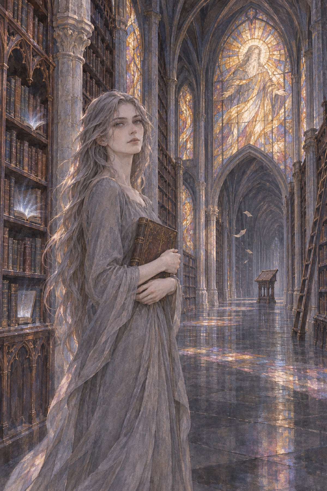
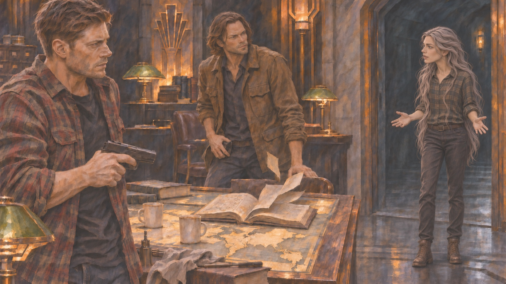
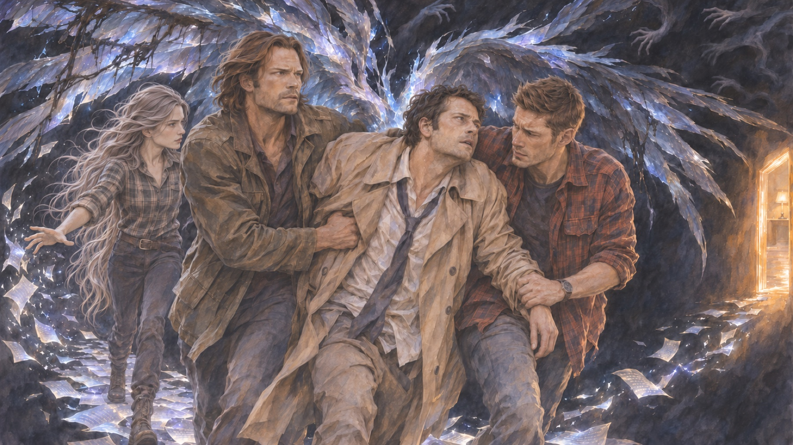
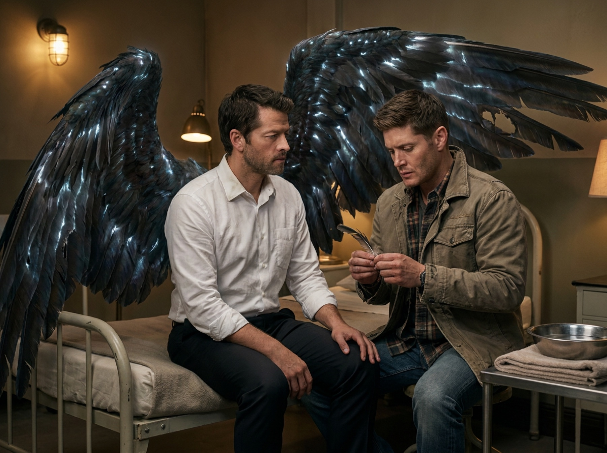
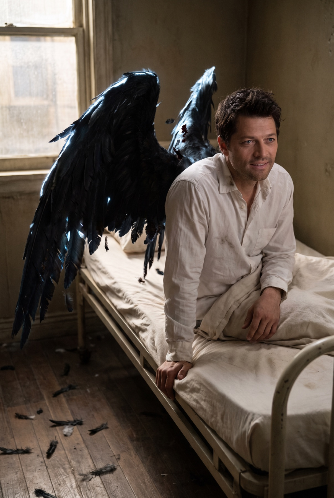
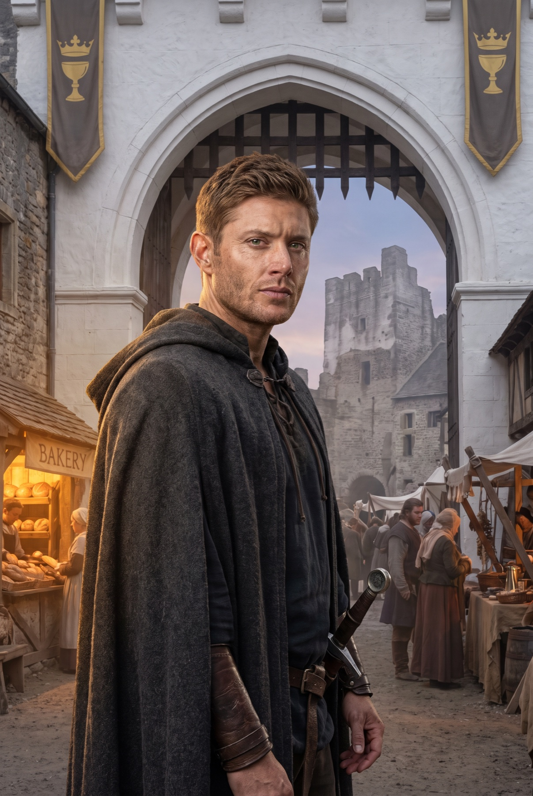
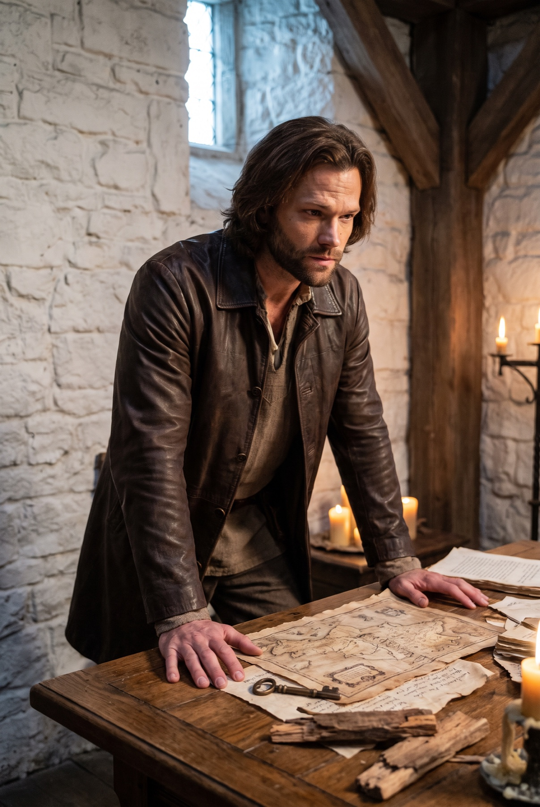

# An Unfinished Hero Story

## Chapter 1 Continuation

------

图书馆里从来没有风。

这里没有一扇通向外界的窗户。石墙之间却嵌满了彩窗。它们从两侧柱廊上方开始，一直延伸到拱顶附近。玻璃后没有天空，也没有太阳。透过颜色较浅的部分向后看，只能看见一层没有深度的黑暗。

中央长廊左侧的第一幅彩窗上，上帝站在尚未分开的光明与黑暗之间。他的一只手托着星辰，另一只手伸向下方的海洋。飞鸟、树木与最初的人类分布在长袍两侧，每一个形象都由细小的玻璃拼接而成。

第二幅描绘天使的诞生。蓝白色火焰从上帝指间落下，在半空展开翅膀。最靠近他的四道身影高大而明亮，后方的天使逐渐缩小，最后变成拱顶下密集的金色光点。

第三幅彩窗里，上帝坐在一张书桌后。桌上摊着一本打开的书。他手里握着羽毛笔，身后排列着尚未获得颜色的世界。细小的人物行走在书页之上：有人加冕，有人相爱，有人举起武器，也有人独自死在雪地里。

上帝的面容无法看清。组成脸部的玻璃过于明亮。从长廊左侧望去，他像一位蓄着胡须的老人；走到另一边，轮廓又变得年轻。靠得更近，五官便会消失，只剩一片被金色光线覆盖的空白。

后面的彩窗描绘着更多故事。上帝站在燃烧的城市上方。上帝俯视一艘穿过洪水的船。上帝把剑交给跪在地上的英雄。上帝将一顶王冠放在某个人头上。上帝合拢一本书，书页下方的人群仍在仰头看他。

彩窗之间，深色书架从灰白色的石质地面升起。书架与石柱交替排列，顶端向内弯曲，在高处交错成拱形的肋骨。中央长廊笔直向前，两侧分布着较为狭窄的通道。更远处还有横向的长廊，将不同区域连接起来。从任何一个方向望去，都看不到尽头。

狭长的阅读桌排列在中央长廊两侧。桌面被磨得光滑，边缘留下深浅不一的刻痕。靠背笔直的木椅整齐收在桌下，部分椅脚已经陷进石砖之间的缝隙。

桌上没有烛台。一本红色封皮的书半开着，金色晨光沿着桌沿流到地面。树叶的影子落在石砖上，随风轻轻摇动。

几排之外，深蓝色月光从另一册书的页缝间溢出。潮湿的海水气味在书架之间停留片刻，又被旧纸、皮革和灰烬的味道覆盖。

更高处，一本横放在书架顶端的书透出苍白光线。光芒缓慢膨胀，照亮拱顶的一角，几秒后骤然熄灭。

相邻的书架上传来刀叉碰触瓷盘的轻响。再远一些，有人在祈祷。听不清那个人使用的是哪一种语言。声音沿着石柱上升，在拱顶下停留片刻，随后融入翻页声中。

图书馆里的书没有统一的形状。有些包裹着皮革，有些覆盖金属。部分书脊上钉着锁扣，链条一直延伸到书架内部。还有些书没有标题，封面只有不断移动的文字。字迹时而浮出表面，时而沉入材质深处。

某些书很薄，只有寥寥数页。某些书厚得无法从书架上取下，书脊从地面一直延伸到高处。它们被放置在独立的壁龛中，四周的石砖已经被纸张透出的光染成不同颜色。

也有一些书完全没有光。它们合拢着，封面蒙尘，铜扣失去光泽。附近的木椅长久没有被移动，石砖上看不见脚印。

长廊尽头立着一张倾斜的读经台。台面空着。后方没有祭坛，也没有神像，只有最后一幅彩窗。那幅画上，上帝背对众生，走向一片尚未染上颜色的玻璃。天使跪在他身后，人类向他伸出手，书籍散落在脚边。上帝没有回头。

彩窗的光落在中央长廊。红色覆盖石砖，蓝色沿书架向远处延伸，金色停在空置的读经台前。光线始终保持着同一个角度。这里没有早晨，也没有黄昏。

只有书页翻动时，彩窗上的颜色会出现细微变化。某处亮起新的星辰。一张面孔从人群中浮现。另一张面孔逐渐褪色，只留下与周围玻璃不同的浅色轮廓。无论其他画面怎样改变，彩窗中央的上帝始终保持明亮。

雨落在汽车旅馆的霓虹灯牌上。马蹄踏过结冰的河面。一个女人在厨房里叫家人回来吃饭。钢铁擦过盔甲。婴儿哭了几声，被人轻轻哄住。声音隔着书架升起，又各自消失。

翻页声不时从侧廊传来。每一声响动都会沿着石柱向上扩散，在拱顶下形成短暂的回声。除此之外，图书馆里没有其他声音。没有脚步。没有呼吸。也没有风。

一页纸忽然裂开。声音穿过整个穹顶。

附近几排书架同时震动起来。高处的灰尘落下，在半空散成细小的黑色字迹。字符彼此碰撞，没有组成完整的句子。

一本厚重的书自行打开。纸页急速翻动，金属撞击声从里面涌出。几排之外，另一本原本合拢的书随之亮起，黑色浓烟从书页间缓慢漫出来。

远处响起号角。号角声穿过中央长廊，在拱顶下反复回荡。

一条夜晚的公路出现在摊开的书页上。汽车急促鸣笛，轮胎碾过积水。水面映出的不是路灯，而是一座正在燃烧的城堡。

祈祷声停了。紧接着，钟声从一本没有光亮的书中传出。第一声。第二声。随后是枪响、雷鸣和数种语言的呼喊。

两侧书架上的书同时颤动。铜制书扣彼此撞击，在长廊中发出连续的轻响。几张木椅被震离原位，椅脚刮过石砖。

彩窗上的人物开始变化。跪在上帝身后的天使抬起头，面孔被另一组五官覆盖。洪水中的船只消失，原本属于它的位置出现一列行驶在沙漠里的汽车。原本接受上帝授剑的国王握住了一把火枪。

第三幅彩窗里，书桌后方的世界互相靠近。不同颜色的圆形被挤压在一起，边缘出现细小裂纹。上帝手中的羽毛笔没有停下。

书架缓慢移动。立柱般的木架向中央倾斜。高处交错的拱形结构随之改变角度，细碎木屑从穹顶落下。

一道裂纹出现在彩窗中央。它从上帝手中的书开始，穿过他的手腕，向下延伸到书页上的人群。

长廊深处传来一声闷响。一本书从高处掉了下来。它砸在中央通道的石砖上。声音沿着柱廊传向远处。

封面弹开，书页连续翻过数十张面孔，最后停在一座掩埋于地下的堡垒。

堡垒里的灯光昏黄稳定。房间中央的长桌上散落着地图、文件和几本翻开的旧书。桌子一端放着一把拆开的柯尔特M1911，零件整齐排列在深色软布上。

一个穿着法兰绒衬衫的男人独自坐在桌边。他的衣领有些皱，袖口一高一低地卷在前臂。下巴覆着几天没有处理的胡茬，绿色眼睛里布满细小的红色血丝。灯光落在鼻梁与颧骨上，照出几粒浅淡的雀斑；低头时，眉间那道折痕仍没有松开。

他一只手握着枪管，另一只手拿着擦枪布。金属表面已经看不见污迹，他仍沿着相同的位置来回擦拭。布料偶尔勾住枪管边缘。他的手会停下来。几秒后，再从头开始。

地堡深处传来管道收缩的轻响。男人立刻抬起眼睛，看向通往走廊的入口。他保持着那个姿势。直到管道声彻底消失，才重新低下头。

面前放着两杯咖啡。靠近他的那杯还剩一点热气。对面的那杯已经冷了，杯面没有留下被碰过的痕迹。

男人偶尔会看向空着的椅子。每一次，他的手都会停在枪管上。随后，他收回目光，将那块早已沾满枪油的布重新折好，继续擦拭已经干净的金属。

银灰色的影子落在书页上。一名灰发少女站在摊开的书前。她看起来二十岁左右，身形纤细。银灰色长发垂过肩膀，浅色眉睫下是一双灰蓝色眼睛。彩窗的光落在她身上。红色停在她脚边，蓝色掠过长发，金色照亮一侧脸颊。

书中的男人停下动作。他伸手去拿自己的咖啡，手指在杯柄前停了一下，随后拿起对面那杯冷掉的咖啡，走向水槽。他扣住杯沿。没有将咖啡倒掉。

少女低头看着他。书页动了一下。

一缕风从纸面吹出来。它越过书页边缘，穿过中央长廊。读经台上的灰尘被吹散，木椅下方积存的纸屑沿石砖滚动。彩窗投下的光轻轻摇晃。风里带着咖啡、火药、旧皮革和雨水的气味。

银灰色的发丝从少女肩头扬起。她抬起眼睛。远处，一本又一本书开始自行翻页。声音沿着倾斜的书架扩散，穿过柱廊，在穹顶下汇聚。

最后一幅彩窗上，上帝仍然背对众生。

少女重新看向脚边。书中的男人已经回到桌前。那杯冷咖啡又被放回空椅子前，杯中的液面没有少。她站了很久。

她没有合上那本书。

------

“你知道那把枪已经干净了，对吧？”Sam的声音从门口传来。

Dean没有抬头。他早就听见了走廊里的脚步。Sam在门外停了几秒，才故意让鞋底擦过门槛。那点时间足够Dean把枪收起来，或者至少装得像个睡过觉的人。他什么也没做。“所以呢？”

“所以你再擦下去，可能得重新买一根枪管。”

“很好。周末有事做了。”

Sam走进作战室，俯身将几本从档案库带来的书放到桌上。垂到颈边的棕发滑落下来，他抬手拨回耳后，才直起高大的身形。他的头发比平时更乱，衬衫袖口卷到手肘，眼下也带着一层熬夜留下的暗色。他看了一眼拆开的手枪，随后看向两杯咖啡。绿褐色眼睛在灯下显得发暗，眉心那道纹路加深了，却没有提起空椅子前的那一杯。

Dean拿起自己的杯子，喝了一口。咖啡已经凉了。这样很好。至少给了他一个皱眉的理由。“找到什么了？”

“Rowena回了消息。她检查了地狱里所有关于Empty的记录。”

“然后？”

“没有门，没有召唤仪式，也没有把活人送进去的咒语。”

Dean拿起弹匣。“那就找不是为活人准备的。”

“我已经在找了。”

“听起来不像。”

话一出口，Dean就知道这不公平。Sam桌边堆着的书已经换过三轮，昨晚地堡熄灯以后，档案室的灯一直亮着。不公平也比无能为力好受。

Sam拉开椅子，没有坐下。“Jack也不知道怎么进去。”

Dean手里的布停了停。“他是上帝。”

“他才刚刚成为上帝。”

“哦，那我可放心了。”

“Dean。”

“什么？”

“Jack说Empty最近不稳定。如果强行打开，我们不知道会放出什么。”

“我们进去，找到Cas，再把门关上。”

“那不是计划。”

Dean抬起头。“这什么时候拦住过我们？”

“以前没有。”Sam说，“也许偶尔应该。”

Dean将弹匣放回桌面。“如果换成是我，你不会坐在这里讨论风险。”

“我当然不会。”

Sam的下颌动了一下，把到了嘴边的话咽了回去。Dean太熟悉那种表情。

“很好。”

“但我也不会假装风险不存在。”

Dean拿起另一块擦枪布。

Sam低头翻开最上面的书。“你说Cas和Empty做了交易。”

Dean继续擦枪。“对。”

“当他获得真正的幸福，Empty就会带走他。”

“对。”

“然后Billie来了。”

“这一部分你听过了。”

“Cas找到办法阻止她。Empty出现，把他们两个都带走。”

“看来你记得很清楚。”

Sam合上书。“你没有告诉我中间发生了什么。”

Dean的拇指沿着弹匣边缘擦过去。金属硌着指腹。记忆却还是越过它，回到地牢里那张离得太近的脸、Cas眼角的泪，以及那句Dean至今没有允许自己完整想完的话。“Billie要杀我。Cas救了我。中间就是这个。”

“救你让他感到幸福？”

Dean抬眼看他。“你有意见？”

“没有。我只是在问发生了什么。”

“我刚才告诉你了。”

“你告诉了我结果。”

Dean将弹匣放下。“结果就是Cas被Empty带走了。我们把他找回来。还要补充什么？”

“Cas说了什么？”

Dean的视线转向桌面。三个词抵在喉咙深处。他拿起咖啡杯，杯沿碰到嘴唇以后才发现里面已经空了。“他说他能阻止Billie。”

“只有这个？”

“你什么时候开始替天堂整理临终遗言了？”

“Dean。”

Dean放下杯子。“他做了一笔交易。Billie把我们逼进死路，Cas找到一个办法，代价是他自己。结束。”

Sam靠在桌边，肩膀微微垮下去，仍看着他。Dean宁愿他继续追问。

Dean重新拿起擦枪布。“别这样看我。”

“我没有怎样看你。”

“你有。你那张‘我的哥哥正在用愤怒回避问题’的脸。”

“你还没有开始喝酒。”

“因为现在是上午。”

“现在是下午三点。”

Dean看了一眼墙上的钟。“那我表现得非常成熟。”

Sam坐下来。“无论Cas对你说了什么，那都是你们之间的事。”

Dean停住了。“他没——”Dean将布折了一次。“没什么值得讨论的。”

Sam看向空椅子前那杯冷掉的咖啡。“也许对你没有。”

Dean抬起眼睛。“别把他拉进来分析我。”

“我是在担心你们两个。”

“Cas现在不需要心理分析。他需要有人把他从Empty里弄出来。”

“如果他认为自己应该留在那里呢？”

Dean笑了一声。“对。Cas最擅长的就是判断自己应不应该牺牲。”

“这一点我们意见一致。”

“那还有什么问题？”

“把他带回来以后呢？”

Dean没有回答。

Sam把手放在桌面上。“如果他回来只是因为我们需要他，他会立刻回来。你知道。”

“世界确实需要他。”

“我知道。”

“我们也需要他。”

“我知道。”

“那就够了。”

世界需要Cas。这句话安全、正确，而且足够大，可以把Dean自己藏在里面。我们需要他，也还能说出口。再往下一句，他没有打算碰。

Sam看着他。“对Cas来说，可能永远都够。”

Dean皱起眉。“什么意思？”

“只要有人需要帮助，他就可以把自己想要什么放到最后。我们甚至不必命令他。”

“Cas不是士兵。”

“那你准备怎么问他？”

“问什么？”

“抛开世界、天堂、Jack和我们，他自己想不想回来。”

Dean将擦枪布扔到桌上。“他被困在Empty里。”

“我知道。”

“他在那里受苦。”

“我知道。”

“那根本不是什么选择。”

“也许不是。”Sam说，“但如果我们不问，这一次替他决定的人就是我们。”

Dean盯着他。“我们连进去的办法都没有。”

远处的档案室里传来纸张翻动的声音。桌面上的几本书同时打开。书页快速翻动。电脑屏幕闪烁数次，同一份档案分裂成几个版本。日期、姓名和照片不断变化。

Dean站起身，几下将桌上的手枪重新组装完毕。弹匣推入枪柄，套筒在掌下撞回原位。

Sam摸向腰后，压低重心，肩膀转向侧门，动作快得几乎和Dean同时完成。冷咖啡的表面荡开一圈波纹。

“这倒是一个可以解决的问题。”

陌生的声音从作战室另一端传来。Dean和Sam同时转身。

灰发少女站在侧门外。她穿着灰绿色法兰绒衬衫，袖口卷到前臂，下身是深色牛仔裤和棕色猎人靴。靴面留有磨痕，鞋底边缘沾着干泥。第一眼看上去，她像个走错地堡的年轻猎人。衣服旧得恰到好处，靴子上的泥也没有多到引人注意。Dean不喜欢这种恰到好处。她将双手举在肩膀以下，掌心朝外。

Dean的枪口从她的脸移向腰间，又落到靴子。没有枪套，也没有刀鞘。“你偷听了多久？”

“只听见你们没有门。”

“你是谁？或者，你是什么？”Sam问。

少女先看Sam，随后转向Dean。目光从桌面掠过，没有在第二杯咖啡上停留。“我可以带你们去见Castiel。”

Dean的拇指压下保险。她挑中了唯一一句足以让他暂时不扣动扳机的话。Dean知道这是诱饵。知道和咬钩是两回事，而他已经没有余地在意其中的差别。

“错误答案。”

“那么先把它当作一个不立刻开枪的理由。”

“你怎么知道Cas的事？”

“我知道他在哪里。”

“这不是我问的。”

“但这是你现在需要的答案。”

Dean的手指停在扳机外侧。

少女继续说道：“我可以打开前往Empty的道路。至于Castiel是否回来，你们可以亲自问他。”

Dean和Sam对视一眼。Sam握在腰后的手松开，指尖却仍贴着刀柄。Dean将枪口压低几寸，朝地图桌偏了偏头。“进来。”

少女唇角轻轻弯了一下，像是在感谢这份有限的许可。她刚跨进作战室，Sam便扬手。圣水迎面泼在她脸上。她闭了一下眼睛。银灰色的头发被水压暗，几缕湿发贴在苍白的脸颊和嘴角。灰绿色的衬衫从领口开始变深。没有白烟。也没有烧伤。

Sam开始念诵拉丁文。驱魔词又快又稳。水沿着少女的浅色睫毛滴落，Dean看着她闭紧的眼睛，握枪的手略微沉了沉。最后一个音节消失后，她才重新睁开眼睛。

“这是必要的吗？”她问。

“很快就知道了。”Dean说。

“恶魔排除。”Sam道。

“暂时。”Dean纠正。

Sam俯身掀开地毯。黑色的恶魔陷阱出现在少女脚下。她低头看了两秒。“留在圆圈里。”Sam说。

“如果我拒绝呢？”

Dean抬了抬枪口。“那我们跳过礼貌的部分。”

少女重新抬起头。“好。”

她留在原地。Dean没有降低枪口。“你认识我们。”

“是。”

“从哪儿知道的？”

“Chuck Shurley。”

那个名字落在作战室里。Dean握枪的手骤然收紧。枪口没有移动，食指仍留在扳机护圈外侧，手臂却已经绷硬了。Chuck已经失去力量，成了会流血、会衰老、也会死的普通人。可那个名字一响起，被撕开的天空、接连消失的世界便涌到眼前。Chuck站在一切之外，看着他们挣扎。

Sam脸上的表情收了起来，拇指抵住腰后武器的柄端。方才垂低的另一只手重新抬起，示意少女留在原地。

“当然。”Dean说。

这个词从牙缝间出来，没有多少意外，只剩厌倦。Sam的视线没有离开少女。“你指的是那些《Supernatural》小说？”

“我读过。”

“出版的部分已经是很多年前的事。”

“所以我知道你们是谁。”少女说。

Dean打量着她。Chuck的书又一次替陌生人打开了他们家的门。Dean几乎能够感觉到那些廉价封面贴在皮肤上，把他以为只属于自己的东西一页页翻给别人看。

“你是书迷？”

“算是吧。”

少女笑了一下，等着Dean继续问。

“太好了，又来了个粉丝。上次碰上这套书，我们发现作者是上帝。”

“这的确很难超越。”

少女的视线落在Dean手中的枪上，多停留了片刻。“那不是The Colt，对吗？”

Dean低头看了一眼。“不是。那把早没了。”

“书里说，它能杀死世上除五种生物以外的一切。”

“书里漏了它被熔掉的结局。”

少女轻轻点头，目光仍停留在枪身上。“可惜。”

Dean眯起眼睛。“你听起来很失望。”

“它是一件很特别的武器。”

“它也是个麻烦制造机。”

少女耸了一下肩。“两者并不冲突。”

Dean转头看向Sam。“棒极了。又一个喜欢危险玩具的。”

Sam站到陷阱边缘。“试着走出来。”

少女低头看向黑色线条。她向前迈了一步。鞋底越过陷阱边缘，没有受到阻碍。她走出圆圈，随即停下。

Dean从腰后抽出银刀，递给Sam。

少女看着刀刃。“银？”

“回答正确。”Dean说。

“有奖品吗？”

“取决于你会不会开始冒烟。”

Sam向她伸出手。

少女停顿片刻，将手掌递给他。她的手指细长，掌心没有枪茧，也没有猎人惯有的伤痕。银刀划开皮肤。鲜血沿着苍白的掌纹漫开。几秒后，伤口自行合拢，只留下没有滴落的血。

Dean的目光停在重新合拢的皮肤上。

Sam也看见了。他擦拭刀刃的动作没有停，唇线却压得更直。恶魔、变形怪和狼人都已经排除；答案越少，留下的通常越麻烦。

Dean将手枪收回枪套，从外套内侧抽出一柄天使之刃。银白色的刃身在灯下闪过冷光。Dean向前半步，将刀尖对准少女的胸口。“普通人不会这样。”

“我没有说自己是普通人。”

“你也没说自己是什么。”

“你们还没有问完。”

Dean看向她湿透的衬衫。“所以这身衣服也是从书里学的？”

少女低头看了一眼法兰绒。“你们在小说里经常穿这个。”

“它们也描述过我的皮夹克。你完全可以选那个。”

“法兰绒是经典款，不是吗？”

Dean从鼻腔里笑了一声。“当然。”

少女嘴角有了一点笑意。

Sam擦净银刀。

Dean朝走廊偏了偏天使之刃。“走。”

“去哪里？”

“一个适合继续认识彼此的房间。”

“听起来不像邀请。”

“现在你开始了解我们了。”

Dean走在前面。

Sam落后半步，将银刀同样换成天使之刃。

接近走廊尽头时，Dean的脚步慢了下来。地牢的门关着。他已经很久没有走到这里。身体比记忆先认出了距离，胸口在看见那扇门以前便开始发紧。他从口袋里取出钥匙。第一把没有插进锁孔。Dean低头换了一把，金属在他手里碰出轻响。钥匙插了进去。他没有立刻转动。

Sam停在他身后。

Dean没有回头，也知道Sam看见了那把拿错的钥匙。Sam没有伸手替他开门，只把原本贴得很近的脚步向后挪了半步。

“我们可以换一间。”

Dean拧开门锁。“这间已经布好了符文。”

“Dean。”

“我没事。”

Dean推开门。封闭太久的空气从门缝里涌出来，带着冷水泥、旧圣油和金属的气味。Dean的胃部猛地收缩了一下。地牢中央放着一把固定在地面的铁椅。墙上画着符文，地面留有圣油燃烧过的黑色痕迹。

靠近墙角的一块水泥颜色比周围浅。黑色残留已经被清理干净，只在砖缝里留下一道很窄的痕迹。那面墙前没有摆放任何东西。

Dean站在门口，目光停在那里。他没有看见黑色黏液，也没有看见Cas。可那一瞬间，记忆替房间补全了它们：阴影沿墙面张开，Cas脸上还留着泪，伸出的手在触碰到Dean以前就被黑暗吞没。Dean握紧刀柄。冰冷的金属压进掌纹，眼前重新只剩那块洗不干净的水泥。

Sam没有催促。

几秒后，Dean走进地牢。他绕开那块颜色较浅的地面，用天使之刃指向铁椅。

少女跟着走进来。她看了一圈，向墙角迈出一步。

“别站那里。”

少女停下。

Dean握着天使之刃的手绷得很紧。命令出口得太快，快过了他来得及掩饰的程度。少女没有追问。Sam也没有。

“从另一边走。”

少女看了他一眼，顺从地退回门边，沿着另一侧走向铁椅。

Sam进入房间，轻轻关上门。

进入房间以后，Dean没有再看那面墙。“坐下。”

少女走到椅子前。“好。”

她坐了下去。Sam将天使之刃收回腰后，扣住她的手腕。锁链合拢时，她移动了一下手臂，让他锁紧另一侧。

Dean把天使之刃放在靠墙的金属台上，刀柄朝向自己，随后沿着外围的符文槽倒下圣油。圣油沿着符文槽绕过椅脚，在少女周围闭合成圆环。

“圣油？”

“你看，我就知道读书有用。”

Dean划燃火柴。“天使？”

“不是。”

“天使一般也这么说。”

“天使通常会先纠正你的定义。”

Dean将火柴丢下。圣油燃烧起来。火焰沿着圆环闭合。少女坐在中央，湿发贴着脸侧，水珠不断从发梢落到衬衫上。

Sam翻开准备好的书，念出以诺语束缚咒。墙上的符文逐一亮起。

少女的身体闪烁了一下。几道轮廓从她身上错开。披甲的战士站在她左侧。一个穿黑色礼服的女人从椅背后抬起头。更远处还有衰老的面孔、沾血的手，以及一个蜷缩着身体的孩子。影像重新叠回她的身体。少女猛地吸气。锁链绷紧。银白色的光从她眼中掠过。她低下头，呼吸了几次。再次抬眼时，目光停在墙上的符文上。

“有效。”Dean说。

“它认出了与Grace相似的部分。”

“相似？”Sam问。

“它知道我与天使有关，但无法完成放逐。”

Dean蹲下身，将手掌按在圣油圆环外的血色符号上。“再试一次。”

符文骤然亮起。冲击波扫过地牢。灯光熄灭，墙上的金属器具落在地面。圣油火焰升高，银灰色光线从中央透出来。应急灯接连亮起。

少女仍坐在椅子上。墙上的天使放逐符文从中间裂开。她的脸色比刚才更白。一道细窄的血迹从鼻下流过唇峰。她低下头，用肩膀擦掉了血。“还要继续吗？”

Sam的视线从她鼻下的血迹移到Dean脸上，手里的书仍停在刚念完的那一页。

Dean从金属台上拿起天使之刃，走到火焰边缘。“那些小说里没有Cas被Empty带走的事。”

“没有。”

“那你怎么知道他在那里？”

“Empty发生了变化。”

Sam问：“你能感觉到？”

“我能察觉偏离正常死亡秩序的存在，也能找到通向不同死后世界的道路。”

“你看见Cas被带走了？”

少女停了一下。“我知道他去了Empty。”

“不是同一个答案。”

“不是。”

“你很喜欢只回答一半。”

“完整的答案通常需要先确定，听见它的人不会立刻动手。”

“那你目前进展不大。”

少女嘴角牵起很小的弧度。一侧肩膀抬了抬，锁链随之发出轻响。

Sam把书合上。“你与天使有关，却不是天使。放逐符文也无法把你送走。”

“是。”

“你到底是什么？”

火焰在少女周围晃动。

“拿非利人。”她说，“至少你们会这么叫。”

Sam皱起眉。“人类和天使的后代？”

“是。”

Dean问：“你母亲是人类？”

“是。”

“父亲呢？”

“一位很古老、也很强大的天使。”

Sam向前一步，“多强？”

少女看了一眼墙上裂开的符文。“足以造成刚才的结果。”

“Archangel？”

“这个称呼足够接近。”

“他叫什么？”

少女搭在扶手上的手指收拢了一点。“我不使用他的名字。”

Dean从鼻腔里发出一声短促的笑，嘴角向一侧扯动。“家庭关系不太好？”

“据我了解，这座地堡对此并不陌生。”

Dean嘴角的弧度消失了。

Sam问：“他派你来的？”

“不是。”

“你的母亲知道他是什么吗？”

“我不知道。她在我出生时死了。”

“抱歉。”

少女转向Sam，“你没有造成她的死亡。”

Sam慢慢呼出一口气，手里的银刀垂低了几寸。Dean几乎要笑，又没能笑出来。

Dean接过话：“所以，你是一位身份保密的超级天使和人类生下的孩子。普通Nephilim已经够麻烦了，这个答案没让我轻松多少。”

“我没指望它让你轻松。”

“可你还是让我们把你锁在这里。”

“是。”

“为什么？”

少女脸上的笑意淡了。她把双手平放在扶手上，不再牵动锁链。“因为你们没有理由信任我。”

Dean没有回应。

Sam看向圣油。“它困不住你，是吗？”

“困不住。”

Dean抬起天使之刃。“那你为什么还坐着？”

“如果我走出来，这场谈话会变得很吵。”

“你很会跟人打交道。”

“这是我的工作之一。”

Dean相信这一点。她每一次笑都恰好出现在他们的敌意稍有松动以后，每一次沉默又恰好让Sam继续追问。Cas刚开始学习怎样与人相处时，从来没有这种本事。眼前的少女熟练得过了头。

Sam问：“什么工作？”

少女抬起灰蓝色的眼睛。“Valkyrie。”

Dean皱起眉，“我以为那是名字。”

“更接近职务。”

“所以你不是北欧神话里骑着飞马、在战场上挑选死者的那种？”

“你们的世界拥有自己的瓦尔基里。我不是其中之一。”

“那为什么用这个词？”

“它最接近我所做的事。”

Dean看了一眼她的头发，“战场、羽毛、挑选死者？”

“基本正确。”

Dean转向Sam，嘴角终于有了一点真正的笑意。“我早说了，看电影也能学到东西。”

“飞马那部分不对。”

Dean翻了个白眼。“现在不是在讨论马的品种。”

“我没有马。”

Dean耸了耸肩，“至少停车位保住了。”

Sam继续问：“你挑选什么样的死者？”

“英雄。”

“然后呢？”

“在他们的故事结束时，把他们带到另一个地方。”

“天堂？”

“不是。”

“地狱？”

“不是。”

Dean握住刀柄的手重新收紧。“他们有选择吗？”

少女搭在扶手上的手指不再移动。“被选中代表他们符合进入那里的条件。”

“我问的是，他们能不能说不。”

她没有回答。火焰另一侧，Sam缓缓站直了身体。

他们都听够了“被选中”。从Azazel到Michael，再到Chuck，这个词每次听起来都像恩赐，最后留下的却总是锁链。

圣油火焰发出轻微的爆裂声。几秒后，少女说道：“我们现在讨论的是Castiel。”

Dean放低天使之刃，刀锋仍然朝向地面。“对。我们之后会回到这个问题。”

“我没有要求你们现在相信我。”

“你只是闯进我们家，知道我们的名字，穿得像猎人，然后提出带我们去宇宙最黑的地下室。”

“这听起来的确很可疑。”

Sam问：“你为什么需要我们？”

“Empty就像字面意思一样，什么都没有，我能打开通道，为你们制造出可以行走的路径，但我无法感知到Castiel的具体位置。你们与他之间的联系可以确定方向。”

Sam若有所思地点点头，“我们是锚点。”

“是。”

“通道失控呢？”

“我会维持它。”

“多久？”

“足够你们进去，找到他，再离开。”

“代价是什么？”Sam问。

“Castiel作出决定以后，我需要你们听听我的请求。”

“只是听？”

“你们可以拒绝。”

Dean笑了一声。“你很清楚，只要把Cas放在交易的一边，我就不会拒绝。”

“是。”

“至少你承认自己在利用他。”

少女没有移开眼睛。“我可以给你一个见到他的机会。我也需要你们的帮助。”

“计划得不错。”

少女看了一眼仍在滴水的衬衫。“目前看来，效果有限。”

Sam走近Dean，压低声音。“我们得先联系Jack。”

“可你之前说Jack不知道怎么进去。”

“但他可以确认她有没有做什么危险操作。”

Dean望着火焰中央。“你能保证把Cas带回来吗？”

“不能。”

Dean的下颌绷紧。“那你能保证什么？”

“把你带到他面前。”

“然后？”

“你可以问他是否愿意回来。”

Dean的呼吸停了一瞬。愿不愿意。仿佛Cas曾经把自己的意愿放在任何人的需要前面，仿佛Dean知道该怎样问，才能确保答案属于Cas，而不是属于那个总会在Dean开口以后留下来的天使。

“如果他拒绝呢？”

“你们回来。”

“没有他？”

“如果那是他的选择。”

Dean盯着她。再开口时，声音压得很低。“我不会把他留在那里。”

“那么你应该先听见他为什么留下。”

火焰在两人之间燃烧。Dean转向Sam。“先联系Jack，给Rowena留消息，准备所有能带的东西。”他说，“然后我们进去。”

Sam抿住嘴，视线先落在Dean身上，又越过火焰审视椅子里的少女。他把书夹到臂下，拿出了手机。

“Dean——”

“我知道。”

Dean指了指仍在椅子上的少女。“但我们没有答应替你工作，也没有答应解决你的问题。”

少女轻轻点头。“很公平。”

“如果你对Cas做任何事——”Dean停了下来。后半句被他咬在牙关里。“你会发现Chuck写的那些书漏掉了很多东西。”

“这一点我已经发现了。”

Dean示意Sam熄灭圣油。他将天使之刃收回外套内侧。“放她出来。”

Sam没有立即行动。“我们还不知道她叫什么。”

少女抬起头。“Valkyrie。”

“你说那是职务。”Sam道。

“是。”

“我问的是名字。”

地牢里只剩圣油燃烧的声音。

“Valkyrie就可以。”

Dean见过人隐瞒名字时的样子。他们会迟疑，会计算，会准备好另一个谎言。少女刚才那一瞬间的空白不像其中任何一种。她似乎真的没有别的答案。

“太长了。”

少女沉默了半拍，随后偏过头。“什么？”

“如果你真打算跟我们去救Cas，我不会每次都喊三个音节。”

“你有什么建议？”

Dean没有回答。

Sam蹲下来，开始熄灭圣油。火焰一寸寸退去。最后只剩地面烧黑的圆环、裂开的符文，以及铁椅上那个穿着湿透的法兰绒衬衫、双手仍被锁住的灰发少女。

“先把Cas带回来。”

他转身走向门口。“如果我们都活着，再讨论名字。”

------

十五分钟后，作战室中央的地图桌被清空了。Sam把最后一摞书搬到旁边，腾出的桌面上已经摆满盐、圣油、天使之刃、装着符文子弹的弹匣，以及三本从不同档案室找出来的以诺语手稿。没有一本提到怎样进入Empty。它们只是放在那里，因为Winchester家的计划通常需要一些书，好让完全没有把握的事看起来稍微像个计划。

灰发少女站在桌子另一侧。湿透的法兰绒衬衫已经不再滴水，颜色仍比原先深了一层。Sam给过她一条毛巾，她用得很仔细，折好以后放回椅背，连边角都对得整齐。

Dean不喜欢这种整齐，也不喜欢她站在他们的作战室里，看起来比许多真正来过这里的猎人更像其中一员。他把最后一只弹匣塞进外套。“Jack还要多久？”

“我不知道。”Sam抬头看了一眼天花板，“他现在不太有时间概念。”

“很好。升职以后第一件事就是学会迟到。”

“我没有迟到。”

声音从Dean身后响起。他转过身。Jack站在通往图书室的台阶下，仍穿着那件浅色外套，头发被不属于地堡的风吹乱了一点。他先看Sam，再看Dean，脸上出现一个短暂的笑容。随后他看见了桌子另一侧的少女。笑容慢慢消失。“你没有说还有别人。”

“电话里不方便。”Dean说，“再说，我想看看你现在还能不能被吓一跳。”

Jack没有回应这句讽刺。他走近几步，视线停在少女身上。作战室里的灯光轻轻闪烁，空气仿佛在短时间内变得更薄。

少女没有后退。她向Jack点了一下头，礼貌得像在某个普通客厅里见到朋友家的孩子。

“Jack，这是Valkyrie。”Dean说，“她声称自己能打开Empty。”他又看向少女。“Valkyrie，这是Jack。”

“很高兴见到你。”

“对了，他现在是上帝。”

少女灰色的眼睛在Jack脸上停留片刻。这一次，惊讶确实出现了，却极淡，像一滴水落进结冰的湖面，很快便被平静覆盖。“那解释了刚才的变化。”

Dean皱起眉。“什么变化？”

“他出现的时候，所有仍在运行的世界同时产生了回应。”

Jack看了她很久。

Dean见过他以这种方式观察天使、灵魂和被魔法改造过的东西。那双眼睛仍然是人类的棕色，目光落下时却会让人想起太阳照进深水——不是强光，而是某种无法躲避的重量。

少女脸上的微笑没有改变。“你能感觉到我的力量。”

“现在能。”

“你有Grace。”Jack说，“但我看不到它从哪里开始。”

Sam的肩膀微微绷紧。“她说自己的父亲是一位大天使。”

“接近大天使。”少女纠正。

Jack仍然看着她。“我认识所有大天使的Grace。”

少女嘴角的微笑停了一瞬，再开口时带了些歉意。“那么，我采用了一个不够准确的分类。”

Dean看向Sam。Sam也正好看过来。又一项没有得到答案的问题。

Jack问：“你能打开Empty？”

“能。”

“它不会允许你带走Castiel。”

“所以我需要他们。”

“他们是人类。”

“他们是Castiel在这个世界里最稳定的因果联系。”

Dean讨厌她谈论Cas的方式，像是在解释某种绳结。但他更讨厌自己听懂了：Cas一次又一次选择他们，也一次又一次被他们选择。若Empty是一片没有方向的黑暗，那些选择就是唯一还留在Cas身上的路标。

Jack把视线转向Dean。“我不能跟你们进去。我的力量进入Empty，会让两个空间彼此挤压。现在的宇宙承受不了。”

“那你能做什么？”

“让门留在这里。只要你们能找到回来的方向，我会保证地堡还在门的另一边。”

Dean点了一下头。“够了。”

“还有一件事。”少女没有立刻开门，而是看向Dean，“进去以后，你们得靠我找到Castiel。如果我出了问题，你们手里的武器未必能拦住我。”

Dean瞥了一眼桌上的天使之刃，又看回她。“你有更好的？”

“有。我想先把它交给你。”

她抬起右手。掌心上方的空气像一张被折起的纸，沿着看不见的折痕向两侧分开。一把刀落进她手中。它没有花纹，也没有能够辨认年代的锻造痕迹。刀刃呈现近乎纸张空白处的银灰色，边缘偶尔从视线里消失。Dean试着记住它的形状，目光移开的一瞬间，脑中只剩下一个模糊的轮廓。

Dean的目光跟着刀锋移动。“这是什么？”

“瓦尔基里之刃。”她将刀横放在掌心，等Dean看向自己，才把刀柄转过去，“一直由我保管。现在，我希望它在你手里。”

Sam立刻开口。“不。”

Dean没有伸手。“先说清楚它能干什么。”

“删除一个具体存在的完整叙事。”

“说人话。”

“被它删除的目标不会进入Heaven、Hell、Purgatory或者Empty。不能被召回，不能被复活，也不能被重新写入任何世界。”

作战室安静下来。Jack向前走了一步。银灰色的刀刃没有反射他的光，也没有对新上帝作出任何反应。

Dean看着少女。“所以它不是杀人。”

“不是。”

“是让一个人连死后的去处都没有。”

“是。”

她答得很平静。Dean左前臂某个早已不存在的伤口开始产生幻觉般的灼痛。

Sam看见他用拇指按住那里。“这和First Blade有什么区别？”

少女的目光在他手臂上停了一瞬。“它不会制造渴望，不会改变持有者，也不需要Mark。”

“刀不是唯一的问题。”Dean说。

“我不明白。”

“当然不明白。”他看着那把轻得仿佛不存在的刀，“上一次有人告诉我，我是最适合拿一把特殊武器的人，最后我变成了恶魔，还差点用锤子砸死Sam。”

Jack垂下眼睛。Sam的表情没有变化，手却离开桌沿，在身侧握紧了一次。

少女没有收回刀。“我选择你，是因为如果我在Empty里失去控制，你需要拥有阻止我的方法。”

“你自己不能用？”Sam问。

“由我持有时，我无法删除作为完整个体的自己。”

Dean抬起眼睛。“由我持有呢？”

“你将拥有它的全部功能。”

“包括删除你。”

“包括我。”

“还有谁？”

“任何仍然是具体个体的存在。人类、恶魔、天使、神祇。”

Dean的声音沉了下去。“Cas？”

“是。”

“Sam？”

“是。”

刀仍然安静地躺在她掌心。它没有First Blade的低语，没有那种能够让所有问题突然变得简单的饥饿。可Dean已经能够感觉到它真正的重量：房间里的每一个人，都在等待他决定是否伸手。

“为什么是他？”Sam问。

少女看着Dean。“因为当所有其他方法失效时，他最有可能执行必要的选择。”

那听起来像称赞。John说过相似的话。Cain说过。Crowley也说过。措辞各不相同，意思却从来没有变过：Dean能够承受，所以最残酷的工作理所当然应该交给他。他伸出手，握住刀柄。

少女松开手。刀刃闪过一道灰白色的光，随后在Dean掌中稳定下来。

“现在你拿不回去了？”

“除非你主动归还。”

“如果别人抢走？”

“他们只能把它当作一把普通的刀。”

“如果我决定用它对付你？”

“那么我会被删除。”

Dean把刀送进她一并递来的刀鞘，固定在外套内侧。那里的重量很轻，轻得令人恼火。“听好。我保管它，不代表我同意替你判断谁应该存在。”

“你拥有最终决定权。”

“不。我负责确保它不会被随便使用。”

少女注视着他。“我会记住这个区别。”

Dean不确定她是否真的理解。“现在开门。”

少女转向地图桌。她没有画法阵，也没有念诵咒语，只从Sam搬来的书中抽出一本。那是一本十九世纪的猎人日志，封皮开裂，纸张散发着霉味。她将书翻到最后一页，把手掌按在空白处。墨迹从前面的纸页间渗出来。

文字一行行脱离纸面，沿她的手腕向上缠绕。地图桌上的其他书随之翻开，数十种语言从书页中升起，在半空拆解成单独的字母。它们没有组成句子，而是彼此交叠，勾勒出一扇门的形状。门内没有光。

黑暗从文字之间漫出来，吞掉桌面的纹路。Dean听见很远的地方传来某种低沉的震动，像一个正在睡眠的庞大存在翻了个身。

Jack站到门的左侧，将手掌按向半空。金色光芒沿着文字轮廓蔓延，却没有进入那片黑暗。“我会守住这里。”

Sam拿起天使之刃。“怎么找到Cas？”

少女看向Dean。“想着他。”

Dean冷笑了一声。“这就是你的专业指示？”

“Empty没有地点。你无法走向一个坐标，只能走向一段联系。”

“那如果我们想错了？”

“你们会找到记忆，而不是Castiel。”

Dean望进门后的黑暗。他最不缺的就是关于Cas的记忆。问题在于，其中太多都以血、告别或者来不及说出口的话结束。

Sam站到他身边。

“我先进去。”Dean说。

“想都别想。”

“Sam——”

“我们是锚点。复数。”

少女先一步跨入门内。她的身影没有坠落，只是在越过文字边缘后失去了颜色，随后被黑暗吞没。

Dean拔出天使之刃。“紧跟着我。”

Sam看了他一眼。“我比你高。”

“今天第一次发现？”

他们一起跨过门槛。

世界消失了。

没有地面，没有天空，也没有风。Dean的靴底踩在某种能够承受重量的黑暗上，每迈出一步，脚下都会荡开一圈比周围稍浅的波纹。他回头。入口仍在身后，只有一条门缝大小的金色光线。Jack站在另一端，面孔被距离压缩得很小。

Sam就在Dean右侧。灰发少女站得更远一些，银灰色长发和衬衫都失去了颜色，仿佛一张尚未完成的黑白照片。

Dean张口呼吸。这里没有空气，身体却仍然记得该怎样运作。心跳声从胸腔传进耳朵，沉重得像另一个人的脚步。“Cas！”

名字没有形成回声。它离开嘴唇以后便被黑暗吸收。远处亮起一扇门。不是出口。那是地牢的门。Billie的镰刀穿过门板，Cas把Dean推到身后。画面没有声音，却精确重演着每一个动作。

Dean停下脚步。

“别看。”Sam说。

太晚了。门后的记忆继续向前。Cas转过身，脸上带着一种Dean当时无法理解、后来又拒绝理解的平静。

Dean强迫自己移开视线。更多画面在黑暗中亮起。Cas披着Leviathan留下的黑色液体走进蓄水池；天使从天空坠落；Jack死在他怀里；一间木屋在爆炸中燃烧。它们不全属于Dean。有些记忆来自Cas，边缘带着灼目的蓝白色光芒。

“它在用他的遗憾挡路。”Sam说。

“我知道。”

“那边。”

灰发少女抬起手，指向一片与其他黑暗没有任何区别的方向。

“你看见什么？”

“一个无法结束的句子。”

Dean没有时间追问。他们向那个方向走。地面有时存在，有时骤然倾斜。记忆不断从周围浮现，试图给这片没有形状的空间制造墙壁和道路。Dean听见Cas的声音时，起初以为那也是幻觉。

“我很抱歉。”声音很轻，从黑暗深处反复传来。“我以为我可以修复它。”

“我很抱歉。”

“我总是让事情变得更糟。”

Dean开始奔跑。脚下的黑暗不断陷落。Sam在身后叫了他的名字，声音被拉得很远。灰发少女说了什么，Dean没有听清。前方出现了一点蓝光。

Cas跪在光芒中央。或者说，那只是Dean的大脑能够接受的部分。熟悉的人类躯体低着头，风衣铺在膝边。更庞大的存在从那道轮廓中向外延伸，穿过黑暗，延伸到Dean无法判断距离的地方。蓝白色的火焰彼此缠绕，组成不断变化的圆环和无法同时看清的面孔。翅膀从不同角度展开，不完全是羽毛，也不完全是光；每一次轻微移动，周围的空间都会随之折叠。它本该灼伤看见它的人。Empty却把那光压得很暗。

翅膀边缘大片焦黑，许多原本相连的光线已经断裂。黑色物质附着在羽翼深处，随着Cas的呼吸缓慢收紧，像无数只抓住他的手。

Dean的眼睛开始刺痛。他没有移开视线。“Cas。”

庞大的真身骤然震动。人类形态的Cas抬起头。几缕深色头发凌乱地贴着额角，下颌覆着一层短短的胡茬。蓝色眼睛先是一片空白，随后慢慢辨认出Dean的脸。向外铺展的光与羽翼开始收拢，层层折回那具熟悉的身体，只留下两道残破的翼影拖在身后。

“Dean？”

“是我。”

Cas撑着膝盖站起来，身后的翼影被黑暗扯住，脚步顿了一下。“你不应该在这里。”

“最近很多人这么跟我说。”

Cas微微歪过头，眼睛眯起一点，像是在判断Dean是否又在用一句玩笑回避真正的答案。那个动作熟悉得让Dean胸口发紧。

Sam从后方赶到。看见Cas时，他脸上的警惕终于裂开。“Cas。”

Cas望向他，眼睛微微睁大。“Sam。”

Sam几步赶过去抱住他。Cas的手停在半空，刚落到Sam背上，脚下就传来一阵震动。Sam立即松开拥抱，扶住他的手臂。那两道残破的翼影在他们身后绷紧了。

Dean站在一步之外。胸口某个从地牢那晚起就一直绷紧的东西没有松开，反而疼得更清楚。

Cas越过Sam的肩膀看着他。“这是Empty制造的。”

“不是。”Dean说。

“它会用希望延长惩罚。”

“听起来很没创意。”

Cas朝Dean伸出手，指尖快要碰到他的袖口时，银灰色的光从旁边划过。

灰发少女走到三人附近。Cas看见她的瞬间，身后的翼影猛地展开。天使之刃滑进他手中，刀尖指向少女胸口。

“你是谁？”

“打开门的人。”

“你的Grace——”Cas的眉头紧紧皱起，“不可能。”

“先把刀放下。”少女侧身避开刀尖，向来路伸出手，“门撑不了多久。”

“她说得对。”Dean挡到刀锋和少女之间，“我们得走。”

Cas看向来路，攥紧了Sam扶着他的那只手。“我不能从那里出去。”

Dean顺着他的目光回头。远处的金光正在变窄，脚下那条银灰色的路断了一截，又被少女指间涌出的文字接上。

“什么？”

“Billie进来以后，这里的边界就开始崩解。”Cas收低刀尖，声音绷得很紧，“有些天使和恶魔也开始醒了。如果我出去，它们可能跟着——”

“Jack守着出口。”Sam扶他转向金光，“他知道有风险。”

“Jack不能进来！”

“他在外面。Cas，看着我。我们得走了。”

Cas的脚跟拖过路面。Dean伸手去扶，黑暗里忽然亮起一张脸：Claire站在谷仓中，愤怒地盯着他们。紧接着是坠落的天使、炼狱中张开的巨口。Jack躺在几步之外，眼里没有光。

Cas猛地转头。Sam险些被他带得失去平衡。

“我试过修复这些。”Cas的声音发哑，“每一次，我都以为能做对——”

“Cas！”Dean挡住他的视线。那张属于Jack的脸仍在他余光里，眼皮突然动了一下。Dean胃里一紧，抓住Cas的风衣，把他往路上带。“别看它。看我。”

“你们会因为我受伤。”

“那就帮我们一起出去。”Sam咬着牙撑住Cas，“别把我们留在这儿争。”

身后的道路塌下去一块。少女猛地抬手，数页银灰色的纸在断口前竖起，撞来的黑暗把纸面压向他们。她退到三人身侧，手指仍朝着那道屏障。

“沿着亮的地方走。”她语速快了，“别停，后面已经没有路了。”

Cas终于跟着迈了一步，却反手抓住Dean的袖子。

“如果是因为那天晚上——”

Dean听见那几个字，脚下差点踩偏。Cas的手抓得更紧了。

“你不欠我。别因为内疚把自己——”

“你觉得我是为了这个来的？”Dean的声音陡然拔高。

“我不知道。”Cas急促地看了一眼他身后，“Dean，你得出去。”

那句“你不欠我”还卡在Dean喉咙里。身后的书页接连撕裂，他几乎听不见自己接下来说了什么。

“那就跟上！我们需要你。”

Cas看着他，嘴唇动了一下。又一股黑暗撞上屏障，他立即抬起刀，目光越过Dean，落在通向出口的路上。他吸了口气，试着从Sam的搀扶中站直；焦黑的翼影收拢时扯得他肩膀一颤，他仍往前迈了出去。

“好。我可以——”

Cas的膝盖忽然一软。Dean托住他的肘部，那只握刀的手还在试图抬起来。该死。他只说了一句需要，Cas就又准备替他们开路了。

“刀收起来。我扶着你。”

“前面还有东西。”

“我看见了。”Dean把他的手臂架到自己肩上，转头喊，“Sam！”

Sam拔出天使之刃，路边探来的黑影却径直穿过刀锋。他撤开脚，刚才站立的那片银光已经熄灭。他沿着尚未断裂的纸页向前抢了两步，回身伸出空着的手。“这边！踩我刚才踩过的地方！”

Dean扶着Cas跨过缺口。风衣从他手下滑了一寸，他立刻攥紧，几乎贴着Cas的耳朵开口：“刚才那句，我说错了。”

Cas转过脸。蓝眼睛近得让Dean忘了预备好的下半句话。纸张在身后炸开，碎片擦过他的颈侧。

“我想带你回家。”他一口气说完，“不是让你回去接着替谁送命。”

Cas的脚步乱了一下。Dean用肩膀撑住他，等他踩稳，继续往前。

“我不知道回去以后——”

“回去再说。”

“如果我又搞砸了呢？”

“那就跟我们一样！”Sam在前面喊。他伸出的手一直没有收回，“快，Cas！”

Cas嘴角牵动了一下，随即被一阵疼痛压住。他回头望向黑暗，翼影深处有东西正在收紧。Dean的肩膀猛地一沉，两个人都被拖得踉跄。

“我害怕，Dean。”

Dean也怕。他的手指已经被风衣的接缝勒得发麻，远处的出口窄得只剩一道金边。他把Cas往自己这边拉，声音压不住地发颤：“我知道。抓紧我。”

少女踉跄着退过最后一页屏障，单膝落地，抬起的手臂被撞得向下一沉。“现在！到门那边去！”

Cas看向金光。他收起刀，空出的手紧紧扣住Dean的手。

“我想回来。”

“那就走。”Dean用力回握，带他冲向Sam。

黑暗尖叫起来。

声音不是从某一个方向传来。它直接穿过骨骼，令Dean的视野短暂发白。无数只手从脚下伸出，抓住Cas残破的翼影。天使真身的蓝白色光芒再次从人类轮廓中爆发，巨大的翅膀在Empty中展开。

这一次，Dean看清了伤口。羽翼深处有许多被强行折断的光，断口被黑暗反复侵蚀。某些部分已经不再燃烧，只剩灰烬般的影子。Cas仍然把翅膀挡在他们和扑来的黑暗之间。Dean握紧他的手。“别又来这一套。”

“我正在争取时间。”

“那就边跑边争取。”

Sam抓住Cas另一只手臂。三个人同时向入口奔去。

灰发少女撤掉屏障。破碎的文字没有消失，而是追到他们身后，在黑暗中组成不断延伸的道路。金色门缝越来越窄。

“Jack！”Sam喊道。

声音第一次在Empty里形成回响。门外的金光骤然增强。地堡作战室的轮廓出现在裂缝另一端，近得仿佛只隔着一层玻璃，又远得无法靠双腿抵达。

少女向前挥手。银灰色的纸页越过他们，在距离金光几步远的地方骤然折断。她立即试了第二次，纸页却从同一处坠进黑暗。

“怎么停了？”Dean吼道。

“接不上。”她盯着那个断口，抬起的手悬了片刻，“刚才还可以。”

Sam扶着Cas向前探了半步。门里的灯晃了一下，连同整张地图桌滑向右侧。他猛地收回脚。“别往前！门在动！”

“Jack！”他转向金光消失的方向，“你听得见吗？”

又一阵冲击从背后袭来。Cas的翅膀向内折叠，护住三人。Dean的手掌穿过一层并不存在于物质世界的羽毛，皮肤立刻传来细密的灼痛。他感觉到的不是温度，而是Cas无法隐藏的疲惫、恐惧和仍然抓着他的决心。

“Sam？”

Jack的声音断断续续地传进来。Dean偏过头，声音来自右前方，比刚才近。他听见Sam再次喊道：“继续说！我们听得见！”

少女也转向那里，双手之间重新浮起银灰色的光。纸页一张接一张铺出去，起先只有模糊的边缘，直到Jack再次叫出他们的名字，最前端才骤然亮起。金光穿过纸面，照出一小块熟悉的地砖。Dean已经能听见地堡通风管道低沉的震动。

“走！”

Sam先跨过门槛，身体被光吞没。

Dean把Cas推向出口。黑暗缠住Cas的一侧翅膀，破损的光被向后拉长。Cas发出一声压抑的喘息，膝盖重重撞在门槛边缘。Dean没有松手。“你已经选了。”他咬紧牙关，将Cas向光里拖去，“别让它替你改答案。”

Cas撑住门框。他的翅膀最后一次在Empty里完全展开。蓝白色光芒照亮了身后的黑暗，也照亮无数仍在沉睡的天使与恶魔轮廓。随后，所有光同时向内收拢。黑暗抓了个空。Cas跌出门外。

膝盖撞上地堡坚硬的地面。他用双手撑住身体，风衣铺在身后，胸口剧烈起伏，像一个刚刚重新学会呼吸的人。门内的Dean看见他抬起头。

Sam抓住Cas的上臂，Jack撑住他的另一侧。Cas还没站稳便转身扑向入口，膝盖擦过地面，朝门内伸出手。“Dean！把手给我！”

Cas伸出的手被收拢的金光隔开。

Dean伸手去够，指尖只擦过一阵灼热的光。金色裂缝缩成一道刺眼的细线，地堡的灯光从门缝里撤走，Empty重新压向四周。

“Dean！”

Sam的声音从另一侧传来，隔着正在愈合的空间，听起来像从很深的水下发出。

Dean冲向出口。脚下的道路突然消失。他向前跌了一步，靴底踩空，膝盖重重撞上一片短暂成形的书页。银灰色文字从纸面溅起，在他手臂上留下冰冷的痕迹。

灰发少女落在几步之外。她抬脚踏向Dean身后的纸页，鞋尖却径直穿了过去。她停住，低头望着那里。掌心还亮着一小片银光，黑暗已经缠上脚踝。

“你还在等什么？”Dean吼道。

她隔了一拍才抬眼看他。“我应该能走过去。”

身后的文字逐行熄灭。她又看向脚下，掌心那点光渐渐暗了。黑暗没过小腿，裤脚的轮廓在其中散开。Dean等不到她迈出下一步，咬紧牙，转身扑回她面前，靴底在残余的纸页上滑了一下。

“手给我！”

少女的目光落到他伸出的手上，自己的手却还停在腰侧。Dean俯下身，一把扣住她的手腕。

触碰发生的一瞬间，周围熄灭的文字同时亮起，沿着Dean的手臂爬向她腕间。少女的手指动了一下，视线追着那些文字移到他的袖口。

Dean向后拽。她被带得向前倾倒，另一只脚仍陷在黑暗里，骤然绷紧的手臂扯得他肩膀生疼。他弯下腰，将她的手臂架过肩头，搂住她的腰。

“抬脚！”

她的膝盖迟了一瞬才弯起来。Dean已经撑着她站直，用力把她拖上纸页。黑暗从鞋底扯落，Empty发出一声低沉的咆哮。无数手臂从下方升起，扫过他刚刚离开的地方。

Dean夹着她冲向金光。她的脚步被他带得踉跄，手臂仍搭在他肩上。门缝在面前缩成一条几乎无法通过的线，他收紧手臂，借着前冲的力道把她推了进去。她的身体在触碰金光时短暂散成无数重叠的人影——披甲的战士、年老的学者、穿礼服的女人、天真的孩童——随后所有形象被拉回同一个灰发少女的轮廓，跌进地堡。

Dean紧随其后。黑暗抓住他的外套后摆。一只手从门外伸进来，准确扣住Dean的手腕。

Cas。

Dean甚至没有时间骂他不该在这种时候继续逞强。Cas用力向后一拉，Dean肩膀撞过门槛。Jack的金色光芒立即合拢，切断仍缠在外套上的黑暗。门消失了。惯性让Dean和Cas一起摔在作战室地板上。

Dean先听见Cas的呼吸，才意识到自己正压在他身上。一只手仍被Cas紧紧握着，另一只手撑在他耳侧。两个人离得太近，Cas眼中的清澈的蓝色把Dean自己的影子照了出来。时间停了一拍。随后Sam抓住Dean的肩膀，把他向旁边拉开。“你们都出来了？”

“除非还有谁打算从里面爬出来。”Dean翻身坐起，“门关了吗？”

“关了。”Jack说。

地堡里所有灯光同时恢复稳定。灰发少女跪在地图桌旁，低头撑着地面，发丝垂落，遮住了大半张脸。Dean刚想问她有没有伤着，Cas便在身边动了。

Cas试图站起来。他的膝盖刚离开地面，身体便向一侧倾斜。Dean和Sam同时伸手。Sam托住他的手臂，Dean则抓住风衣后领，动作谈不上体面，但至少没有让他再次撞上地面。“我可以站立。”Cas说。

“你刚才精彩地证明了相反结论。”

“我的平衡正在恢复。”

“那就坐着恢复。”

Cas张了张嘴，肩背忽然绷紧，扣住了Dean还没收回的手。两道巨大的翼影穿过墙壁，在地堡拱顶下骤然展开。Dean本能地抬起头：黑色裂纹沿羽翼根部向外延伸，几处断羽正在裂纹间颤动。他托住Cas的腋下，让他靠着自己起身，Sam赶紧拖来一把椅子。等他们让他坐下，翼影才暗淡下去。

Jack蹲到Cas面前。“你的Grace还和Empty连在一起。”

“切断它。”Dean说。

Jack没有动。“我能封住连接，但不能把Empty直接从他身体里清除。”

“你是上帝。”

“正因为我是。”Jack抬起一只手，停在Cas胸口前，没有碰下去，“我的力量会把Empty识别成需要从创世中排除的东西。可它已经进入Cas的Grace、翅膀和真身。如果我强行清除，它不会只带走黑暗。Cas与它纠缠在一起的部分也会被撕下来。”

Dean看向Cas身后明灭不定的翼影。“能修好吗？”

“被撕裂以后不能。”Jack说，“我可以重新创造缺失的部分，但那会是我认为Cas应该拥有的形状。不是现在的他。”

Dean望着那些黑色裂纹，按在Cas肩上的手迟迟没有移开。

“Cas？”Jack问。

Cas闭上眼睛，感受了片刻。“封住连接。”Cas说，“其他部分保持原状。”

“这会疼。”

“我知道。”

Dean在Jack抬手以前握住Cas的肩膀。金色光芒进入Cas身体。

Cas猛地向后仰起头。蓝白色的Grace从眼睛和嘴里透出来，身后的翅膀再次显现。金光没有进入那些黑色裂纹，而是沿着Cas真身的边界向内收拢，在Empty与他仍然相连的位置结成一道极细的封印。黑暗立刻向另一端拉扯。

Cas的翅膀被扯得完全展开。羽翼深处传来某种并非骨骼、却像骨骼同时断裂的声响。他没有叫出声，手指却死死扣住Dean前臂，力道大得几乎留下淤青。

Dean没有松手。封印彻底闭合的瞬间，来自Empty的拉力消失了。残留的黑色仍然嵌在羽毛和Grace之间，却不再继续向内蔓延。

Cas全身的力气突然消失。Dean接住他，让他的额头短暂抵在自己肩上。

Jack收回手。“连接被封住了。”

“他为什么还这么虚弱？”

“因为Empty还在他身体里。”Jack说，“我只是阻止它继续侵蚀。剩下的部分必须由他的Grace慢慢排斥出来。”

Dean扶着Cas靠回椅背。Cas的脸色仍然苍白，呼吸却逐渐恢复平稳。Jack修复了他额角和手掌上撞击造成的伤口，没有再把力量伸向那些仍然在Grace深处闪烁的裂痕。

“现在轮到你。”Jack站起身，看向灰发少女。

她已经站了起来。衬衫上的污痕消失了，银灰色长发垂在肩后，衣袖下的手腕也看不出被Dean攥过的痕迹。“我没有受伤。”

“刚才为什么出不来？”Sam问。

“我不知道。”

Dean看着她。“你的答案真让人安心。”

“以前从没发生过。”少女望向入口消失的位置，“我能让你们过去，自己却踩不上去。那条路明明还在那里。”

“我抓住她以后，那些字才重新亮起来。”Dean翻过手掌。几道极淡的银灰色文字仍留在皮肤上，正缓慢消失。

Sam看向她。“是Dean把你拉出来的？”

“是。”她看了一眼Dean的手，“谢谢。”

“先告诉我，这东西会不会有问题。”Dean摊着手，没有收回。

少女伸手停在他掌心上方。最后一道文字在两人之间淡去，她的指尖跟着落下一点。“我还不能确定。”

“我开始讨厌这句话了。”

“抱歉。我得先弄清楚刚才发生了什么。”

Dean用拇指擦过掌心，那里已经什么也没有了。“那先说说你知道的。那些字到底是什么？”

Sam从桌边抽过一张空纸，拿起笔，凭记忆描下其中一个符号。他写到一半停住，划掉末尾，重新补了一笔。“是以诺文？有几处看着像，但我没见过这种写法。”

少女俯身看了一眼。“不是以诺文。最后那一笔应该接在这里。”她指向符号中间，等Sam改好，才继续道，“我用这些文字把入口和出口连起来，也让你们有地方落脚。”

Dean看着纸上的符号。刚才托住他膝盖的东西薄得透光，撞上去却疼得实实在在。他揉了一下仍在发冷的手臂。“你能把这些字变成实物？”

“在那里面，它们能托住你们，也能挡住一些东西。但维持不了太久。”

“我见过天使带人从一个地方去另一个地方。”Dean抬眼看她，“没见过谁得先写这么多东西。”

“我也很羡慕那种方便。”她轻轻弯了弯嘴角，“可你们刚才去的地方，普通的门到不了。”

Sam没接这句玩笑。他将纸转向她。“这是咒语，还是你的力量本来就这样？”

“我用的是自己的力量。文字帮我控制它，让它落在需要的地方。”

“谁教你的？”

她的目光从纸上移回Sam脸上。“和我的工作有关。我可以解释，不过得先从我工作的地方说起。”

Dean正要追问，Cas在椅子上动了一下。他的视线落在少女身上，从她的脸移到双手，又停在她胸口Grace所在的位置，眉间慢慢蹙紧。

少女也察觉到了。她向Cas露出一个温和、毫无防备的笑容。

Cas没有回应。

“你还欠我们一个请求。”Sam说。

“是。”

“现在可以说了。”

“世界正在彼此重叠。”

Dean看向她。“哪个世界？”

“所有世界。”

Dean等着她补上后半句。少女站在桌边，灯光落在她灰色的眼睛里。她说完了。

他下意识看向Cas。风衣下摆还沾着从Empty带出来的灰黑色痕迹，Cas扶在椅边的手慢慢收紧。Dean刚刚才把他带回这间屋子。

“所有仍然存在的平行宇宙？”Sam放下笔，“包括我们去过的那些？”

“包括。”

“它们之间又出现了裂缝？”

“比那个更麻烦。”她看向Sam，声音放轻了一些，“从裂缝里过来的人，至少还记得自己是外来者。现在有些地方连过去都在一起改变。”

“改变到什么程度？”Dean问，“我开车出去，路还通向原来的地方吗？外面的人还在吗？”

“眼下堪萨斯还没有那样的变化。”

“眼下。”Dean重复了一遍，随即看向Jack，“你知道这件事？”

Jack没有立刻回答。他抿紧嘴唇，看向少女，又迎上Dean的目光。

“我能感觉到不同宇宙的力量在变化。”他说，“有的变得稳定，有的却一直在衰弱。我在尽力维持它们，但衰弱没有停止。”

Dean背后泛起一阵冷意。“你也拦不住？”

“我能让它们暂时不至于毁灭。”Jack的声音重了一点，“但她说的这些，我之前看不到。”

Dean盯着他。“可你知道有些世界正在撑不下去。”

Jack点头。

“你刚才就站在这里，看着我们准备进Empty。”Dean的声音一点点绷紧，“你说宇宙承受不了，我以为你是在说开门的风险。你漏掉的就是这个？”

“我还没找到原因。”

“所以就不说？”

Jack迎着他的目光，肩膀僵了一下。“我以为能处理好。你们在找Cas，我不想让你们再——”

“再担心一件事？”Dean打断他，“我们刚从里面出来，就得从她嘴里听说所有世界都出了问题。你觉得这样更好？”

Jack的视线落到桌上。Dean认得那个表情，气反而堵得更厉害。这孩子现在能托住多少个世界，站在他们面前却还是打算等事情解决了，再把坏消息轻轻带过。

“Jack。”Cas扶着椅子坐直了一些，“你一直在维持它们？”

“是。”

“现在也在？”

Jack看向他。“现在也在。”

Cas的眉头皱得更深。他看了一眼自己掌心刚愈合的伤口，声音低了下来。“你刚才还替我封住了Empty。”

“我能做到。”Jack急忙说，“你需要治疗。”

“有谁在帮你查原因吗？”Cas问。

Jack摇头。

椅脚擦过地面。Cas往前挪了一点，向他伸出手。Jack迟疑片刻，走近了。Cas握住他的前臂，拇指压在衣袖上。

“你可以来找我们。没找到答案的时候也可以。”

“你们也许帮不上忙。”Jack说得很轻。

“也许。”Sam接过话，“可我们连试的机会都没有。”

Dean的下颌仍绷着。他想问Jack究竟独自试过多少办法，眼前却又浮起那道随时会闭合的门。“下次发现哪里不对，就告诉我们。别等到你撑不住。”

Jack抬起眼睛。“好。”

Dean还看着Jack。Sam转向桌边的少女。

“你说这些世界正在重叠。你是从哪里发现的？”

“我工作的地方有它们的记录。”

“什么地方？”

“一座图书馆。不属于这里，也不属于其他任何一个宇宙。”她说，“那里保存着每一个世界的历史。我能看到那些原本不同的记录开始变成同一份。问题就出在那里。”

“等等。”Dean说，“谁建的图书馆？”

“Chuck。”

Dean慢慢站直了。她先前提起Chuck时，说的是那些小说。他以为自己已经问清了她从哪里知道他们的事，此刻却觉得那场盘问漏掉了最要紧的部分。

“你替他工作？”

“我替他管理那里的书。”少女迎着他的目光，“他离开以后，我一直留在那里。”

“你之前说，你读过他的小说。”

“我读过。”她轻声说，“但我确实没有告诉你们，我认识他。”

Dean的舌尖抵住后槽牙。刀还贴在肋侧，轻得几乎感觉不到。几个小时前，她把它递过来的时候，完全可以多说这一句。

“现在呢？”Sam问，“你来找我们，也是他的意思？”

“不是。他没有让我来。”她转向Sam，“我发现自己处理不了这些变化，才来找你们。你们可以不相信我的判断，但那些记录，我可以让你们看。”

“我不知道还有这样一个地方。”Jack说。

Dean看过去。Jack的困惑不像装的；他仍站在Cas身旁，手指抵着椅背。

“他留给你的东西里，没有它？”Cas问。

Jack摇了摇头。“我能感觉到那些宇宙。她说的图书馆，我找不到。”

Dean重新看向少女。“所以他留下了一座连Jack都不知道的图书馆，而管着它的人刚好找上了我们。”

少女的神色认真起来。“我知道你在担心什么。你想问的，我会尽量回答。”

“那就别再等我们碰巧问对。”

“好。”

Sam将笔拿了起来。“先说清楚那里究竟放着什么。你说的‘保存’，是把记录放在那里，还是那些宇宙本身就在书里？”

“不是。那些世界并不在书里。它们的物质、时间和灵魂都真实存在，由Jack维持。”

“那书里有什么？”

“已经发生的历史，人物与事件之间的因果，以及一个世界区别于其他世界的选择。”

“所以它们是记录。”Dean说。

“不只是记录，也是坐标。”

“区别在哪儿？”

“记录可以被复制。坐标决定一个人属于哪段历史，也决定两个拥有相同人物的世界为什么仍然不是同一个世界。”

Sam皱着眉，慢慢理清她的意思。“Jack让宇宙继续存在。书籍维持它们各自的叙事身份。”

“是。”

Dean看着少女。“你一开始就可以这么说。”

她露出一点近乎歉意的笑容。“你们通常不喜欢我从完整定义开始。”

“我开始理解原因了。”

“而你是那里的管理员。”

“是。”

“世界为什么会开始融合？”

少女没有立即回答。

Dean注意到了。

“图书馆中用于固定各个世界叙事坐标的结构正在失效。”她最终说道，“原本互不相通的书籍开始共享人物、事件和因果。进入错误历史的个体会形成特异点，改变周围现实，直到其中一个版本覆盖另一个。”

Sam看了Dean一眼。兄弟两人都经历过历史被改写，而且不止一次。Balthazar曾经救下Titanic。只是一艘本该沉没的船平安抵达纽约，百年以后，成千上万原本不存在于那条时间线中的人便获得了完整的人生，命运则开始追杀他们，试图纠正这项错误。有那么几个小时，Ellen和Jo还活着。

不是复活。她们从来没有死去。那段人生同样完整、自洽，拥有足够多的昨日证明自己一直存在。直到Titanic重新沉没，一切恢复“正常”，它才缩成兄弟两人共同做过的一场梦。

Dean至今不喜欢思考，对活在那段人生里的人而言，究竟哪一个版本才算错误。

“我们见过改变一件事会发生什么。”Sam说。

“一艘船。”Dean道。

“然后整整一个世纪都被重写了。”

“这一次，不会只影响一个世纪。”少女说。

“对。”Dean的声音沉下来，“这一部分我们听明白了。”

“为什么需要我们？”Sam问，“你既然能够进入那些历史，为什么不自己修复？”

“因为我不属于其中任何一个宇宙。”少女说，“我可以找到特异点，读取已经发生的历史，也可以在条件满足以后分开两本正在重叠的书。但我不能替一个世界确认哪一段因果属于它自己。”

“你需要这个宇宙里的人作为锚点。”Sam说。

“不只是出生在这里的人。”她说，“必须与这个世界拥有足够深的因果联系。他们作出的选择需要能够让正在被覆盖的历史重新固定下来。”

Dean已经猜到她会怎么回答。“所以你选了我们。”

“我读过你们的故事。”少女看着他，唇边慢慢浮起笑意，“很多遍。”

她的目光移向Sam，又停在Cas身上。说起那些故事时，她微微向前倾身，声音比刚才轻快了一点。

“尤其是那些看起来已经没有办法的地方。所有路都断了，能失去的也几乎都失去了，你们却还是会继续。”她重新看向Dean，“每次读到那里，我都舍不得停。”

Dean没有接话。Cas的袖口还留着血，手掌搭在膝上，连坐直都费力。少女看过他的手，眼里的笑意却仍然明亮。

“你们是这个宇宙最重要的英雄。”

Dean的肩膀绷紧了。Chuck也曾这样兴致勃勃地谈论他们。他忽然很想知道，她舍不得放下的究竟是哪一页。

“别这么叫我们。”

少女敛起笑意，放轻了声音。“我知道这个词从他嘴里说出来时，并不像赞美。”

“可你还是按照他的书选中了我们。”

她没有回避。“是。”

房间安静了片刻。Sam最终把谈话拉回眼前的问题。“具体需要我们做什么？”

“与我一起进入受到影响的历史，找到特异点，削弱它对这个宇宙的覆盖，并重新分离时间线。”

“你刚才说，进入错误历史的个体会形成特异点。”Sam说，“所以我们要找的不是裂缝，是从别的世界过来的人？”

“可能是人，也可能是你们熟悉的某种怪物。”少女说，“但不是每个跨过世界边界的来客都会造成这种变化。有些人会把自己经历过的历史一起带过来，让这里也开始照着那段历史发展。”

Dean皱起眉。“比如？”

“比如一个打赢过战争的人，到了一个他本来战败的世界。先是有人记得他赢了，接着是战场、城镇，还有那些人的一生，都开始变成他熟悉的样子。你们要找的，就是这些变化围绕着发生的那个人。”

“他知道自己在做什么吗？”Cas问。

“不一定。有些人可能和你们一样，正在找原因。”

Sam看了Cas一眼。“找到以后，怎么把他送回去？”

“先让他带来的历史不再继续覆盖这里，再让当地的人重新确认自己原本的人生。”她说，“等两段历史能各自站稳，我就能把它们分开。具体要做什么，得看他带来了什么，又改变了哪些事。”

Dean想到那些醒来后多出一段人生的人。“如果分不开呢？”

少女的目光落在Dean外套内侧。瓦尔基里之刃安静地贴在他肋侧。

“那就需要考虑另一种办法。”少女说，“用刀删除那个让历史不断改变的个体。失去他，围绕他发生的覆盖通常就会停止。”

那个词终于有了面孔。可能是他们认识的某个人，在另一个世界活过一辈子，甚至还不知道自己为什么来到这里。Dean隔着外套感觉到刀鞘抵住肋骨。

Dean发出一声没有笑意的短音。“原来这就是你把刀交给我的原因。”

“这是原因之一。”

“还有多少没说？”

“很多。”少女露出一点近似歉意的笑。

“如果现在全部说完，你大概会在第三句话时把我赶出地堡。”

“你还挺了解我。”

“我读过那些书。”

“那些书漏了不少。”

“所以我没有押注一定是第三句。”

Sam抬手阻止他们继续。“第一个特异点在哪里？”

“不列颠。罗马撤走以后的几个世纪，具体位置还在变。”少女说，“有一份后世抄录的王系手稿，里面的记载已经受到了影响。你们可以先看看它。”

她向Sam借过笔，在画着符号的纸张背面写下馆藏名称和页码。Sam把电脑拉近，找到馆藏目录，又按她给的页码打开扫描件。Dean俯身看过去。褪色的羊皮纸边缘被火燎黑了一角，中央画着一座木墙围起的山丘堡垒。戴窄冠的男人站在城门前，身后只有十几名持矛的士兵。

Sam放大插图旁的拉丁文。人名所在的几处墨迹已经模糊，他沿着还能辨认的句子读下去，在纸上记下国王去世与继位的记载。“这里已经写到下一任了。你发现哪里不对？”

“往下看。”少女指向下一行，“同一个人还在册封领地。那已经是四十多年以后的事了。”

Sam沿着那行字读下去，又回头核对前面的年序。Dean看不懂那些挤在一起的拉丁文，只得等着。就在这时，插图中的木墙上多了一道细白的竖线。

“Sam。别动。”

Sam的手停在触控板旁。白色沿着木墙向上生长，在城门后勾出一座尖塔。年轻统治者头顶的窄冠仍在，身后却浮现出另一顶金冠，下面托着一只杯子。Dean伸手握住电脑屏幕的边缘，将它转向少女。

“这是你做的？”

“不是。”她收回指着文字的手，“我来找你们以前，记录里已经出现了那座塔。”

Sam将扫描件存下来，退出页面，重新打开。白塔仍立在木墙后。他调出馆藏目录的插图说明，逐项比对；那里写着木堡、国王和卫兵，没有塔，也没有杯子。

“原件在哪儿？”Dean问。

“英国。”Sam答得很快，视线仍停在屏幕上。他把目录说明一并保存，笔尖重新落回纸上，却迟迟没写下去。

“刚才那句呢？”

Dean顺着他的目光看去。Sam刚才抄下的继位记载还留在纸上，屏幕里对应的那一段却只剩两行短句。Sam低声译了出来。

“此王未曾离去。此国不设继承者。”

Cas在椅中向前倾身，眉头紧锁。Jack站在他身旁，看了看Sam的笔记，又看向屏幕。Dean忽然很想打个电话，让人去那座图书馆打开原件——可如果连过去都在改变，那个人还会记得自己翻开以前，纸上写的是什么吗？

Sam把插图放大，让那只杯子占据了半个屏幕。“不列颠，一个不会离去的国王，还有这只杯子……”他抬头看向Dean，“你不觉得像亚瑟王吗？”

Dean看回屏幕。金冠、杯子，木堡后升起的白塔。他原本正想着该带什么武器，脑中却忽然冒出了圆桌和石中剑。

“我们要去找亚瑟王？”

“有这个可能。”Sam说，“我会查这份手稿的其他抄本，还有它引用过的记载。”

Cas试图从椅子上站起来。

Dean一只手按住他的肩膀，把他重新压了回去。“不行。”

“如果现实正在被覆盖——”

“现实可以等你能走直线以后再被拯救。”

“Dean，我已经能够——”

Cas站到一半，膝盖再次失去力量。

Dean扶住他。“精彩的论证。”

Sam把笔记留在电脑旁。“我们需要几个小时。你也需要回答更多问题。”

少女先看了一眼屏幕上最后定格的王冠与白色石塔，又转向被Dean扶住的Cas。“第一次覆盖尚未完成。按照目前的速度，它至少还需要六个小时才能稳定下来。”她的语气放缓了一些。“先带Castiel去医务室。我会留在这里整理已经发生的变化。等他得到照顾，我们再继续。”

“听见了？”Dean对Cas说，“世界末日预约在六个小时以后。你先去医务室。”Cas的目光仍停在那份手稿上。

Dean走到他身边，把Cas的一条手臂搭到自己肩上。

Cas低声说：“我可以自己走。”

“你要是再说一次，我就让Sam抱你过去。”

Sam挑起眉毛。“为什么是我？”

“因为你热爱帮助别人。”

Cas似乎认真考虑了一下这个威胁，随后把一部分重量交给Dean。他们走向走廊。

经过灰发少女身边时，Dean停下脚步。“还有一件事。”

她抬起眼睛。

“Valkyrie太长了。”

“你说过。”

“Val。”

少女安静地看着他。

“Val。”

她把尾音放得很轻，目光仍停在Dean脸上。

“暂时的。”Dean说，“等你把剩下的事交代清楚，我们再考虑要不要升级。”

她笑了一下。

“好。”

------

医务室的灯太亮了。Dean关掉头顶其中一排，只留下墙边的照明。Cas坐在窄床边，风衣和西装外套已经脱下来，叠在旁边的椅子上。衬衫背后没有伤口，却有大片潮湿的黑色痕迹，像被什么东西从身体内部浸透。

Sam完成了能够完成的检查。血压、脉搏和体温对一名天使的参考价值有限，他仍然全部记录下来。随后Jack把他叫回作战室，去确认那段历史被覆盖的速度。离开前，Sam在门口停了一下。“你们两个没问题？”

“他又不会突然爆炸。”Dean说。

Cas抬起头。他将头向一侧偏了几度，神情严肃得像是在评估某种确实存在的可能性。“目前不会。”

话音落下时，他嘴角很轻地动了一下。Sam看着他们，显然没有因此放心。“有事就叫我。”

门关上以后，医务室安静下来。Dean背对Cas整理药品。纱布放到左边，消毒剂推到右边，再把完全用不上的听诊器移开。

“告诉我，你们是怎么找到我的。”

Dean把听诊器又向旁边推了一英寸。“Val突然出现在地堡。我们试了恶魔陷阱、天使陷阱、圣水和银，都没用。她说自己能打开Empty，但需要熟悉你的人作为锚点。Jack负责让出口留在地堡，Sam和我跟她进去。”

“你相信了她。”

“我相信她是当时唯一的一条路。”

“她可能把你们全部留在那里。”

“Sam已经把我们可能死在里面的方式列过一遍了。”

“Val说，你持有一把能够删除特异点的刀。”

“她说了不少东西。”

“解释给我听。”

Cas的声音仍然虚弱，最后几个字却咬得很清楚。

Dean转过身，从外套内侧取出瓦尔基里之刃，连同刀鞘一起放在金属台面上。“在我们进去以前，她把这个交给了我。”

Cas的视线落在刀上。“为什么？”

“因为只要我拿着，她就不能使用，也不能召回。别人抢走也只会得到一把特别锋利的刀。”

“而你能够使用它。”

“是。”

“对谁？”

Dean没有回答得足够快。

Cas抬起眼睛。“对谁，Dean？”

“任何具体的个体。”

“Val。”

“是。”

“Sam。”

Dean的下颌绷紧。“是。”

“我。”

“Cas——”

“我。”

“是。”

医务室里的灯发出极轻的电流声。Cas看着那把刀。它安静地躺在金属台面上，没有天使刃的光，也没有First Blade曾经散发的饥饿。它看起来几乎没有重量。“一个身份不明、对你隐瞒了力量来源的人告诉你，她能够进入Empty。”Cas说，“然后把一件可以彻底删除Sam和我的武器交给你。你接受了。”

“换你来讲，什么事都能听起来像坏主意。”

“这件事不需要我的帮助。”

Dean拿起刀，重新塞回外套内侧。“它不会影响判断。没有声音，没有印记，也没有想让我拿它砍人的冲动。她拿不回去，除非我主动归还。”

“你认为没有魔法控制，它就是安全的？”

“我认为留在我这里，比留在她手里安全。”

“然后你跟随她进入了一个连Jack都不敢强行打开的地方。”

“Sam也去了。”

“这并没有让决定变得更好。”

Dean扯了一下嘴角。“欢迎回来。五分钟不到，你已经开始批评我们的计划了。”

Cas盯着他。“你不知道她会不会把你带回来。”

“我知道她是当时唯一能把我带进去的人。”

“你也不知道那把刀最终会要求你做什么。”

“刀不会要求任何事。”

“她会。”

Dean的手仍停在藏刀的位置。

Cas看见了。“她选择你，是因为她知道你会接受那项责任。”

“她选择我，是因为如果她失控，我会阻止她。”

“这两件事没有你希望的那么不同。”

Dean把手放下。“Sam已经讲过这一段了。”

“Sam是对的。”

“千万别告诉他。”

“我不会替你撒谎。”

至少这句听起来像Cas。熟悉得让Dean胸口某个地方短暂松开，又立刻因为接下来的话重新收紧。

“你一直告诉我，我不应该用死亡证明自己的价值。”Cas说，“但为了带我回来，你愿意把自己的生命当成可以接受的代价。”

“不是一回事。”

“你认为哪里不同？”

“我把你带回来了。”

Cas注视着他。“成功没有让风险变得合理。”

“我没死。”

“那也不是理由。”

“通常算我比较有说服力的理由之一。”

Cas仍然没有笑。“Dean。”

他没有提高声音。Dean宁愿他提高。“我不会把你留在那里。”Dean说。

“我知道。”

“那还有什么问题？”

Cas微微偏过头。疲惫让这个动作比平时慢了一些，湛蓝的眼睛却没有移开。“我很感激你来找我。”他说，“我也很生气，因为你认为我会愿意用你的死亡交换自己回来。”

Dean张了张嘴，刚才那个笑话接不下去了。

Cas身后的空间偶尔传来极轻的摩擦声。像羽毛擦过石墙。

Dean循声看去。

Cas的翅膀仍然没有完全收回。它们比在Empty里黯淡许多，也更加接近Dean能够理解的形态。两侧羽翼从Cas背后延伸出去，穿过医务室墙壁，真正的边界存在于某个肉眼无法触及的维度。离身体较近的部分却清晰得惊人：深色羽毛层层覆盖，每一根边缘都流动着微弱的蓝光。伤得最重的地方靠近翼根。

许多羽毛黏连在一起。Cas的Grace已经把一部分Empty残余推到了表面，形成夹在羽毛缝隙间的灰黑色薄层。它们不再与远处的Empty相连，却仍粘附在尚未愈合的光里。几根较长的飞羽从中间折断，断面光芒不稳，随着Cas呼吸时明时暗。

Cas察觉到他的视线，肩膀僵了一下。翼影本能地向后收缩。

“别。”Dean说。

Cas停住。“我无法完全隐藏它们。”

“我不是让你藏起来。”

Dean走近一步。翅膀在他眼中轻微改变角度。某些羽毛同时存在于几个不同位置，盯得太久便会令人眩晕。他伸出手，又在真正触碰以前停下。“我能碰吗？”

Cas盯着他。这个问题似乎比Dean想象中更难回答。

“你在Empty里已经碰过了。”

“那时候我们在逃命。不算。”

Cas低下眼睛。过了几秒，他将左侧翅膀向Dean所在的方向展开了一点。“可以。”

Dean把手掌贴上最靠近自己的羽毛。触感并不完全属于皮肤。指尖先感觉到细密的静电，随后是雨落在挡风玻璃上的震动、阳光穿过闭合眼皮时留下的红色，以及一种低沉得无法被耳朵听见的嗡鸣。羽毛在掌下微微颤动，蓝光沿着他的指缝亮起。

Cas骤然吸了一口气。

Dean立刻收手。“疼？”

“不是。”

“Cas。”

“感觉很清楚。”

Dean看向黏连的羽毛。“这些需要分开。”

“它们会自行恢复。”

“多久？”

Cas没有回答。

“对。就知道会这样。”

Dean搬来一把椅子，坐到Cas侧后方。他从器械柜里找出镊子，又看了一眼那些在维度之间明灭的羽毛，最终把镊子放回原处。“我用手。”

Cas的翼尖轻轻动了一下。“你不需要做这个。”

Dean闭上眼睛，缓慢吸气。“我们能不能暂时别再用‘需要’这个词？”

Cas沉默下来。

Dean重新触碰他的翅膀。这一次动作更慢。他沿羽毛生长的方向将它们逐根分开，只碰那些已经被Grace排斥到表面的灰黑色残余。每清理掉一处黏连，蓝色光线便会重新流过羽轴。仍然嵌在深处的部分，他没有碰。

Cas一开始坐得很直。

几分钟后，他的肩膀逐渐放松。翅膀不再随着每一次触碰向内躲避，而是把更多受伤的部分交到Dean手边。

“你看见了多少？”Cas问。

“在Empty里？”

“我的真身。”

Dean分开两根黏在一起的长羽。“足够知道你一直在虚假宣传。”

Cas回过头，肩后的羽毛跟着轻轻动了一下。“什么？”

“Chrysler Building？你比那麻烦多了。”

Cas安静了片刻。“我的真实尺度无法用人类建筑准确衡量。”

“当然不能。”

Dean听见他极轻地呼出一口气。可能是一声笑，也可能只是疲惫。他继续梳理翅膀。靠近翼根的羽毛表面压着一缕已经松脱的黑色残痕。大部分已经被Grace推出，只剩末端卡在两根新生的光线之间。Dean用指尖捏住它，沿着羽毛的方向缓慢向外拉。Cas全身瞬间绷紧，翅膀不受控制地张开，扫过医务室的灯光。

“抱歉。”Dean立即松手。

“继续。”

“我弄疼你了。”

“停在一半会更疼。”

Dean等到Cas的呼吸恢复，才重新抓住那缕残痕。“准备好了？”

Cas点头。

Dean将它完整抽离。黑色细线落进金属托盘，随即化成一小撮没有温度的灰。

Cas的翅膀垂下来。

Dean用手掌顺过刚刚清理出的羽毛，直到其中紊乱的光重新稳定。

“你不必回答那天的话。”Cas忽然说。

Dean的手停住了。“我们非得现在谈这个？”

“不。”Cas说，“我只是希望你知道，我说那些话并不是为了要求什么。你不欠我回应。”

“你已经说过了。”

“你仍然冒险进入Empty。”

“那是因为你在那里。”

Cas没有转身。“这不能证明——”

“我知道。”Dean打断他，“我知道它不能证明你想让它证明的那个答案。”

翅膀在他掌下静止了。Dean盯着自己仍埋在羽毛间的手指。他可以开个玩笑。可以站起来，声称自己需要查看那个身份不明的中世纪国王有没有把堪萨斯变成主题公园。可以把这场谈话拖到下一次世界末日，而下一次世界末日从来不会让他们等待太久。

“我不知道怎么回答你。”Dean说。

Cas低下头。“我明白。”

“不，你不明白。”Dean的手重新动起来，把一根弯折的羽毛理回正确位置，“我不知道，不是因为你说错了。也不是因为什么都没有。”

Cas缓慢转过头。

Dean没有看他的眼睛。“我需要时间。”

那个词出口以后，两个人同时注意到了。Dean发出一声很轻的、带着自嘲的鼻音。“好吧。这个‘需要’可以保留。”

Cas的翼尖轻轻碰了一下Dean的手腕。他稍稍歪着头看了Dean一会儿，目光里的困惑逐渐被理解取代。嘴角浮起很淡的弧度，几乎在Dean确认以前就消失了。“时间。”Cas重复。

“对。”

“而你希望我在这里。”

Dean终于抬起眼睛。“我刚闯进宇宙最黑的地下室把你拖回来。你觉得呢？”

Cas注视着他，嘴唇动了动，过了一会儿才开口。

“我希望听见你说出来。”

Dean的第一反应仍然是躲开。

他低头看着那些破损、焦黑，却仍然在自己掌下发光的羽毛。

“我想让你留下。”

Cas闭上眼睛，一道极淡的笑意落在嘴角。翅膀缓慢展开，又收拢。左侧较完整的部分从Dean肩后绕过，羽尖停在他另一侧肩头，近得能感觉到温热。

Dean继续梳理剩下的羽毛。谁也没有再说话。医务室外，地堡仍在发出熟悉的声响。Sam和Jack在作战室移动桌椅。远处的水管轻轻震动。

Dean坐在Cas身后，把一根又一根受伤的羽毛慢慢理顺。

------

## Chapter 2 Eternal Camelot

------

两座城开始重叠的那天，国王正在听人报告南边的收成。话说到一半，厅里的钟响了。钟声从不同方向传来，其中一口钟比他的王宫旧得多，余音也短。他走到窗前，看见自己的城墙仍在，墙外却多了一条他从未修过的土路。更近的地方，王宫东翼的白石廊柱间露出一座灰色塔楼。塔楼的下半截与廊柱挤在一起，那口陌生的钟正悬在塔上。

他先叫人去确认城里有没有倒塌的房屋。随后是城门、粮仓和住在东边的几户人家。传令兵带回的消息互相矛盾：他的卫队认得每一条路，路旁的人却说那些道路昨天还不存在；有人在同一处院子里找到了两口井，打上来的水味道不同。

国王循着钟声穿过长廊。走到东翼时，脚下平整的白石突然接上了磨损的灰色台阶，原本通往内庭的门洞也变窄了。他还没走到塔下，宫门便从外面打开。一队披着旧徽记的士兵走进来，靴子上沾着城里的泥。走在最前面的年轻人抬起头，和他长着同一张脸。年轻人握着剑，没有拔出来；国王也示意随行骑士留在身后。他们都说自己从未离开过这座城。

年轻人问，这些白石墙壁为何会出现在他的王宫里。他看着那座嵌进长廊的灰塔，答不出来。他同样想知道，自己的王宫为何接进了一座陌生的塔楼，还从那扇门里走进了另一个自己。

第一天，他们只来得及让人离开正在重叠的房屋，把两边伤者送到没有变形的院子。国王的医师和本地的医师共用一张桌子，争论先给谁用药；两位君主分站桌子两侧，最后各自派人去取剩下的药箱。夜里，白石和旧砖仍在互相穿过。他坐在地图前，第一次发现自己无法指着任何一条边界，说出王国止于何处。

第二天，他的城少了一条街。街上住过的人还记得门牌，送粮的车夫却找不到路。他沿着地图寻到城东，发现那条街正在另一座城里长出来。屋顶和窗仍是他熟悉的样子，门前的石阶却压住了原本属于这里的人家的院墙。他命人先不要拆动两边的房屋。那天傍晚，他和那个年轻人再一次站到街口，听两户人家争论同一扇门属于谁。两人都没有答案。

第三夜，书房里的银杯映出了一张陌生的脸。杯中的水没有波纹，黑得看不见杯底。他把手按在剑柄上，那人却先笑了。

“如果剑能把你送回原来的世界，我就不必来找你了。”

“你是谁？”

“你可以不信我。”杯中人说，“天亮以后，去看城东那条街的尽头。那里会少一户人家。”

他没有松开剑柄。“是你把他们带走的？”

“不是我。两个宇宙正在挤进同一段历史。你的整座王国被推了进来，这里的人暂时还只看见它的一小部分。”

杯中的脸看向他身后的地图。东街仍画在上面，尽头最后一户的墨迹却已经淡了。

“我可以把我的人民带回去。”国王说。

“也许能走回原来的地方。”那人说，“但那里还剩不剩下你记得的那座城，我不会替你保证。”

国王等他继续。银杯里的黑色水面很平，像对方有的是时间。

“这里也有一座王城。”杯中人说，“它的国王封了城门，粮仓撑不过冬天，骑士连誓言都守不稳。你已经让一个王国强盛了数百年。再做一次，有什么难？”

“他是这里的国王。”

“暂时是。让他的人民看见你能给他们什么。等他们愿意听你的命令，两段历史就会知道该留下哪一位国王。”

他把杯子移离地图。对方说得太容易了，仿佛议事厅里的每一个人、街里的每一户人家，都会像棋子一样自己找到位置。他不喜欢有人替他估量臣民的忠诚；他也确实已经开始计算，要把东边那几座旧粮仓修成能度过冬天的样子，需要多少人手。

“你为什么告诉我这些？”

“因为你还以为，只要说服那个年轻人就够了。”杯中人说，“还有别人正在寻找两座城重叠的地方。”

“谁？”

杯中的人影靠近了一些。他看见黑暗深处有一道极细的灰色裂缝，像某扇门刚刚关上。“我见过她从那里经过。”那人说，“灰色头发，灰色眼睛。你们叫她Valkyrie。”

国王只在传说里听过这个名字。战场上的银色羽毛，临死前才会看见的引路人。他看了一眼地图上逐渐淡去的东街。“她会来？”

“会。”

“这里还没有战死的英雄。她来带走谁？”

“挑选英灵，只是你们听说过的那部分。”杯中人说，“她知道不同世界的历史怎样接在一起，也知道怎样把它们分开。她来这里，不是为了带走战死的人。”

“所以她要决定留下哪一座城？”

“她会作出自己的判断。至于这里的人会不会听她的，得等她到了才知道。”

“她会站在哪一边？”

“女武神认得英雄。”杯中人说，“等她来了，你可以亲自问。”

国王看着杯中的人影。“如果她不承认我对这座城的权利呢？”

“那就让她看看你建成的王国，再看看这里。”

国王的拇指抵住冰冷的杯沿。“你说过，分开两段历史需要她。倘若她不愿意帮我呢？”

“她还有别的办法。”杯中人说，“一把能将一个人彻底抹去的刀。两位国王若只剩下一位，争夺便容易结束。”

国王的手按上剑柄。“你要我杀了他？”

“我要你知道这把刀已经来了。”杯中人说，“她把它交给了一个同行的猎人。”

“那我可以从他手里夺过来。”

杯中人的笑意没有变。“拿到它是一回事。让它为你杀人，是另一回事。你最好先弄清楚，那个猎人为什么替她保管它。”

水面恢复了银色。国王没有睡。他把地图摊开，沿着城东那条街一寸寸寻找返回原来道路的地方。烛火烧短了，纸上的东街仍在，通往它的那条路却已经不是昨天的样子。

天亮后，他亲自去了城东。街尽头果然少了一户人家。邻居记得那里昨夜还亮着灯，却找不到通向那扇门的小路。国王在那条消失的小路前站了很久，才让人牵来马。他让人把消失的住户记下来，再去问本地的粮仓还剩多少粮食，去年冬天死了多少人。

午后，管粮官带回数字。他把两座城的存粮列在同一张纸上，听完旧城今年的歉收，又问明城门为什么一直关闭。消失的住户名单就压在那张纸下。他命人从自己的粮仓装车。管粮官问，粮食送进旧城以前，是否先去请那位年轻国王许可。

“告诉他。”国王说。

管粮官正要退下，国王又道：“不用等他答复。”

当天傍晚，他的粮车驶过白石与旧砖相接的城门。

------

Cas从Empty回来六小时后，Dean在医务室的椅子上醒来。他的后颈因为整夜保持同一个角度而僵硬，右手还搭在床沿。指尖下没有羽毛，只有被体温烘暖的床单。Cas已经醒了。他侧身躺在窄床上，蓝色眼睛安静地望着Dean。一侧头发被枕头压得翘起来。距离近得让Dean能够看清其中细小的血丝，也看清眼角几道浅浅的细纹。那张脸他见过无数次，此刻却仍多看了一会儿，才听见自己开口。

“你看了多久？”

“十一分钟。”

Dean闭了一下眼睛。“这问题通常不需要精确答案。”

Cas微微歪头，像是认真考虑了一下这条新规则。“那我应该说什么？”

“说你刚醒。”

“但那不是真的。”

“对。欢迎回来。”

Cas嘴角浮起一点很淡的笑意。那笑容没有维持多久。他撑住床垫，慢慢坐起来。动作进行到一半时，左侧肩膀不自然地停了一瞬。Dean下意识伸手，掌心已经贴上他的背。隔着衬衫，他感觉到一阵极轻的震动。不是肌肉。

一片尚未完全收拢的羽毛从他手背下方掠过，带来静电般的麻意，随即隐入Dean无法看见的维度。

Cas坐稳以后，Dean才收回手。“还疼？”

“比昨晚轻。”

“那不是我问的问题。”

Cas看了他一会儿。“是。”

Dean站起来活动僵硬的肩膀。外套搭在另一张椅子上，瓦尔基里之刃藏在内侧口袋。他伸手拿外套，先碰到了刀鞘。

“那个特异点的情况怎么样？”Cas问。

“早安。睡得好吗？谢谢你昨晚没死在宇宙最黑的地下室里。”

“早安。”Cas配合地说，“我不需要睡眠。你昨晚已经感谢过我。”

“我说的是‘别动，你会把翅膀弄得更糟’。”

“你的语气表达了感谢。”

Dean拿起外套。“你开始变得难以忍受了。”

Cas扶着床沿起身，等Dean穿上外套，才与他一起走出医务室。作战室里的长桌已经彻底变了样。现代枪械被移到最远的一端。桌面铺着四套羊毛与皮革制成的衣服、几只磨损的钱袋、短剑、匕首、水囊和没有任何现代制造痕迹的药品容器。旁边还放着几双沾有旧泥的靴子，鞋底磨损的位置各不相同。

Val站在桌旁，正在把几枚银币分进钱袋。她换掉了灰绿色法兰绒，改穿一条深灰色长裙，外罩着及膝的旅行外衣，腰间系有皮带和数只小袋。银灰色长发被编成便于行动的辫子，发尾用一根不起眼的黑绳束住。整身衣服没有昂贵到引来觊觎，也没有破旧到会被当成乞丐。看见他们进来时，她先对Cas微笑。“早上好。你的脸色比六小时前好了一些。”

“你一直在计算时间？”Dean问。

“是Sam要求我每隔十五分钟更新一次覆盖速度。”

Sam坐在三台电脑之间，面前摊着中世纪手稿的打印件。他抬起头，眼下的阴影证明他没有利用这六小时睡觉。“她本来打算每分钟更新。”

Val把最后一枚硬币放进钱袋，笑意里多了一点无辜。“我调整了沟通频率。”

“奇迹确实存在。”Dean说。

Sam敲了几下键盘。中世纪手稿从中央屏幕上退开，露出一张由他自己建立的图表。两条曲线旁标注着时间，以及一组没有单位的数值。金色线条缓慢升高，另一条银白色线条则不断下降。

“别告诉我地堡现在连宇宙都能测量了。”Dean说。

“不能。”Sam朝站在屏幕旁的Jack示意了一下，“这是Jack过去六小时感知到的变化。我只是把它们整理出来。”

Jack看着那两条无法彼此吻合的曲线。“Chuck创造每个宇宙时，都留下了维持其物质、时间和死后世界运行的力量。”他说，“那些力量与我现在继承的力量来自同一个源头，所以我能感觉到它们正在增强还是衰减。但我无法读取图书馆里的书，也看不见书籍之间的路径。”

他指向逐渐变暗的银白色线条。“和我们的这段历史重叠的另一个宇宙正在衰弱。”他说，“我们所在的宇宙却在变得更加稳固，仿佛现实正在优先承认这一条时间线。但两边的变化并不对等。对方失去的力量，只有一部分出现在了这里。”

Sam靠回椅背，双臂交叠在胸前。“力量不会凭空消失。”

“它没有回到我这里。”Jack说，“创世力量一旦离开原本的宇宙，进入书籍重叠产生的通道，我就无法继续追踪。”

“分离时间线以后，它会停止外流吗？”Sam问。

“会。”

Val把钱袋放到属于Sam的衣物旁，展开了另一张地图。Sam在图表上标出她的回答，留着回来后与Jack的观测核对。

“给我们讲讲中世纪主题乐园。”

Val将一张手绘地图摊开。“目标时间在五世纪末到六世纪初之间，罗马撤出不列颠以后。”

Sam从打印件里抽出一页。“我找到的相关记载里，确实有Arthur。但这些抄本相隔很多年，有的写战争，有的写传奇。那座白塔没有出现在其他插图里，昨晚多出来的两句话也没有。”

Val的指尖落在地图上一片没有标注名称的区域。“现在能找到的是这座城。它还在向外扩展，沿途的地名和道路都受到了影响。你们记得的故事可以作参考，但到了那里，得先看看当地人正在经历什么。”

“我们会从异常中心以外十五英里的森林进入。对外身份是来自北方边境的旅行同伴，以清理异常生物和护送商旅为生。”

Dean拿起属于自己的那套衣服。一件深棕色羊毛束腰外衣，一条皮革护臂，以及一件重量相当可观的暗色斗篷。“所以我们是猎人。”

“用这个时代能够接受的方式，是。”

“我的枪呢？”

“留在这里。”

Dean抬起头。“再说一次。”

“六世纪不列颠没有柯尔特M1911。枪声、弹壳和伤口都可能成为新的历史异常。”

“历史里现在有一个身份不明的中世纪国王正在吃掉现实。我觉得一把手枪不会是最奇怪的东西。”

“你可以带着它。”Val温和地说，“然后用余下时间向每一个目击者解释，为什么你的短剑会发出雷声。”

Dean盯着她。她微笑着，仍托着那套衣服。

“我开始怀念你长篇大论讲宇宙说明书的时候。”

Val从桌下取出一柄带鞘长剑，递给他。“我知道。”

Dean接过剑。重量落进掌心时，比他预想中更顺手。护手简单，皮革缠柄的位置正好适合他的握法。“你从哪儿弄来的？”

“一本已经结束的故事。”

“原主人知道吗？”

“他已经不再需要它。”

这个答案没有让Dean更舒服。Sam拿起自己的衣物。深绿色外袍、厚重披风，还有一个装满草药、针线和书写工具的皮包。“我是什么？”

“记录者、医生，以及这支队伍里能够识字的人。”

Dean抬起眉毛。“只有他？”

“你识字。”Val说，“但你的角色没有必要主动承认。”

Sam低头掩住了嘴角。“我喜欢这个设定。”

“你当然喜欢。”

Cas的衣物放在最后。黑色长袍外配着灰褐色斗篷，没有十字架，也没有任何属于特定教会的标记。

“一位来自东方的朝圣者。”Val说，“你不隶属于当地教会。这样可以解释你的口音、知识，以及你对宗教权威缺乏适当敬意的习惯。”

Cas把长袍从桌上拎起来，布料一直垂到膝边。“我尊重值得尊重的权威。”

“这正是我试图解释的部分。”

Dean笑出声。

“我们有共同来历吗？”Sam问。

“你们在北方一次怪物袭击中结识，此后共同旅行。Dean负责战斗和接受雇佣，Sam记录案件并处理伤病，Castiel辨认超自然力量，我负责语言、交易和谈判。”

“你给自己安排得挺重要。”Dean说。

“如果由你负责谈判，我们抵达王宫以前就会被吊死。”

“这倒像书里写的？”

“这是我见到你以后作出的独立判断。”

Sam咳了一声，掩住笑。

Val把四张写满注意事项的羊皮纸推到他们面前。“当地通用语言正在受到重叠历史的影响。你们进入以后能够理解大部分内容，但语言习惯仍会暴露你们。避免现代俚语，不要讨论汽车、电影、摇滚乐或者美国历史。遇见贵族时由我先开口。Dean不要称呼任何国王为‘buddy’。”

Cas看向Dean。“‘Buddy’是一种骑士头衔吗？”

Dean张了张嘴。

Sam已经低下头，肩膀开始抖动。

Val的神情保持得十分认真，只有眼底出现一点几乎无法察觉的笑意。

Dean指着她。“你故意的。”

“我只负责解释时代差异。”

“Cas，别听她的。”

Cas的视线在Dean和Val之间转了一圈。“所以它不是头衔。”

“不是。”

“你经常这样称呼陌生男性。”

“我们该出发了。”

Sam终于笑出声。

------

Dean和Sam各自抱着衣物离开作战室以后，笑声很快消失在走廊里。

Jack也不在了。几个正在流失创世力量的宇宙已经出现物质与时间上的震荡，他必须同时托住它们，避免那些世界在完成分离以前先行崩塌。留在地堡里的形体原本也只是一道短暂投下的目光。金色光芒从屏幕前褪去，空气重新恢复原本的重量。

Cas没有走。他等到Dean和Sam的脚步声彻底消失，才把视线转向桌子另一侧。

Val低头整理桌上的钱袋。她把银币按照不同地区可能接受的重量重新分组，再将属于Dean的钱袋放到那柄长剑旁边。

“你对他们说谎了。”Cas说。

Val的动作没有停。“哪一句？”Val抬起头，“我想你不会为一件小事特意留下来。”

“你的父亲。”

最后一枚银币落在桌面，发出一声很轻的碰撞。Val抬起头。

“你说他是一位古老而强大的天使。”

“我不该把他称作天使。”Val说，“那是他们当时最容易理解的说法。”

“他不是。”

“不是。”

他向前走了一步。受损的左翼在另一个维度里迟缓地调整平衡，几缕尚未排净的黑色残痕随之牵动。疼痛从翼根传来，尖锐而短暂。

Cas停了半步。Val的目光在他左肩停了一瞬。

“你的Grace不属于任何一位大天使。”Cas说，“我认识Michael、Lucifer、Raphael和Gabriel的力量。我也感知过其他宇宙中大天使的Grace。它们都拥有相同的起源。”

“你拥有与天使相似的结构，但那不是你的起源。”

Val没有否认。

Cas试着再次感知她。第一次见面时，地堡、Empty残留的疼痛以及重获自由带来的混乱遮住了许多细节。现在，那股力量清晰了一些。它不像Jack的金光，也不像Chuck曾经直接降临时令人无法呼吸的重量，却带着某种更古老的相似性——仿佛天使的Grace只是从同一种语言中截取出来的一段句子。当Cas试图继续追溯，那段句子便在意识中断开。不是自然的缺失，更像一扇从另一侧锁住的门。“他是谁？”

“他的名字，我现在不打算说。”

“你利用了Dean想带我回来的愿望。”

“我向他提供了一条能够找到你的路。”

“你知道他不会拒绝。”

“你认识他。”Val说，“他会把每个条件问清楚。他确实问了。”

Cas眯起眼睛。“给一个绝望的人留下可以确认的条件，并不意味着你没有操纵他。”

“他拿走了能阻止我的刀，也知道它能做什么。”Val说，“我没有拦着他问。”

“那不等于你对他诚实。”

“不等于。”

“你应该亲自告诉他们。至少告诉他们，你的父亲不是天使。”

“如果你认为现在就该告诉他们，我不会拦你。”

Cas的翅膀在身后极轻地动了一下。

Val收紧钱袋的束绳。“这不意味着它成了我的秘密。”

“你说得对。”

Cas没有继续追问。走廊里传来Dean抱怨斗篷的声音。Sam说了句什么，随后是一阵压低的笑。

Val把最后一个钱袋推到Cas的衣物旁。

Dean的脚步已经接近作战室。

Cas只需要在门打开时叫住他。Val的父亲不是天使——说出这一句，Dean就会停下来。然后呢？Cas仍不知道那个人是谁。他想再给自己一点时间，可这个念头实在太熟悉了。天堂的战争、Leviathan、Jack；每一次，他都以为再等一等，便能带着解决的办法去见Dean。

门外的脚步越来越近。Cas拿起桌上的黑色长袍。“如果你伤害他们，我会阻止你。”

“即使Dean拥有那把刀？”

“Dean不应该永远负责做其他人不愿做的事。”

Val没有回答。

------

换衣服用了二十分钟。Dean讨厌斗篷。它在转身时总比身体慢半拍，剑鞘又不断撞向膝盖。Val替他重新调整皮带位置，手指熟练地收紧扣环，让剑柄停在不会妨碍行走、又能立刻拔出的高度。

“你以前扮演过军需官？”

“扮演过更擅长给固执战士穿戴装备的人。”

“那个人活得很辛苦。”

“她的故事已经结束了。”

Val收回手，拿起下一条护腕。皮革搭扣在她指间发出很轻的响声。

Cas从走廊另一端出来。长袍掩盖了他身体仍不稳定的部分，却无法完全藏住步伐中的迟滞。Dean看见他在门槛前放慢了一瞬，随即重新调整重心。

“你留在地堡。”Dean说。

Cas停住。“不。”

“你走路还像一边比另一边多了个轮胎。”

“我没有轮胎。”

“比喻，Cas。”

“我知道。”

那点淡淡的笑意只出现了一瞬，很快便被认真取代。“我想和你们一起去。”

Dean准备好的话停在嘴边。

“因为？”他仍然问。

Cas考虑了一会儿。“因为我选择回来，不是选择躲在安全的地方。”他说，“我要自己决定回来以后做什么。”

Dean看着他。

Cas扶着门框站稳，抬眼等着他。眼下的青色在走廊灯光里格外明显。

“走不动就说。”Dean最终道。

“我会。”

“疼也说。”

Cas微微眯起眼睛。“我会尽力。”

“这是作弊答案。”

“但不是谎言。”

Val将Cas的斗篷递给他，等他接稳才松手。“还有一件事。Jack封住了Empty的连接，但残留仍在你的Grace里。到了那边，别随意用天使的力量探查陌生的东西。”

Cas披上斗篷。“我会小心。”

“我相信你。”Val替他理好一处翻起的衣领，笑容自然，“只是如果需要动手，先告诉我一声。我好替大家留条退路。”

Val选择了一本没有标题的厚书作为通道。封面由深色木板制成，边缘包着失去光泽的黄铜。她将书放在地图桌中央，翻到一页绘有密林与白鹿的插图。“进入以后，保持在我能看见的位置。这个时代的历史正在变化，我无法保证书中的道路仍然存在。”

“听起来很专业。”Dean说。

“我可以换一种更安慰人的说法。”

“不用。昨晚的路已经够惊喜了。”

Val把手按在插图边缘。纸上的树枝开始生长。墨线穿过页边，沿桌面铺展开来。潮湿泥土与松脂的气味充满作战室，冷风从逐渐扩大的画面中吹出，卷动四人的斗篷。通道完全展开。Val最先跨过去。

Sam紧随其后。Cas走到书页边缘时停顿了一瞬，蓝色眼睛因迎面而来的光微微眯起。

Dean站到他身边。“改变主意？”

Cas摇头。“只是很久没有去过一个我从未见过的地方。”

Dean看着纸页另一端的森林。“好消息是，要是那里很糟，我们通常会把它弄得更糟。”

Cas望着他，直到Dean又看向书页里的森林。“这是安慰吗？”

“我还在练习。”

他们一起跨进书页。

------

湿泥、动物粪便、腐烂树叶和远处木柴燃烧的气味迎面扑来。冷空气穿过羊毛衣物的缝隙，贴上皮肤。

Dean的靴底陷进泥里。“很好。”

Sam站在一棵覆盖苔藓的橡树旁，头发被风吹到脸上。他的身高配上那件长袍，使他看起来像一个能够徒手搬走教堂门的学者。

“至少我们落在地面上了。”

“标准降得真快。”

Cas从两人身后走出通道。书页的光在他斗篷后方合拢，没有留下任何痕迹。

Val已经蹲在路边，指尖按着泥土。她抬起头时，脸上的表情与在地堡里略有不同。眉眼仍然属于同一个人，姿态却更松弛，声音中多了一种能够让陌生人相信她熟悉长途跋涉的沉稳。

“道路比记录向东偏移了三英里。”

“严重吗？”Sam问。

“可能只是历史误差，也可能是覆盖已经改变地形。”

Val站起来，从腰间取出指南针。指针先指向北方，随后转了一整圈，停在Dean胸口的位置。四个人同时看向他。

Dean低头看了看自己。“什么？”

Val的目光停在他藏着瓦尔基里之刃的位置。“它在识别权限。不是方向。”

她把指南针收回去，脸上的沉稳没有变化。“我们改用太阳。”

“很高兴你准备得这么充分。”

“我准备了十二种导航方式。”

“第几个开始有用？”

“理论上，第七个。”

Dean看向Sam。“她是在开玩笑吧？”

Sam观察着树干上的苔藓。“我现在不敢确定。”

Val唇角弯了一下，已经沿道路向前走去。他们没有走出一英里，便听见了猎犬的叫声。声音从树林深处传来。不是一只，也不是一群，而像数十条猎犬被困在同一个胸腔里，同时撕咬、喘息和嚎叫。

Dean拔出长剑。

Cas身后的空气轻微震动。Sam取下背后的短弓，动作因为陌生武器慢了半拍。

Val侧耳听了几秒。“寻水兽。”

“你给它取名的风格需要改进。”Dean说。

“不是我命名的。传说里，它腹中有三十对猎犬永远追逐猎物。”

“当然有。”

Sam握着短弓的手收紧了一点。“寻水兽……佩利诺尔追的那一只？”

“后来的故事里，佩利诺尔王一直追逐它。”Val说，“更早的记载只说它出没在不列颠。”

Sam望向林外，昨晚那张画着白塔的手稿又浮现在Dean脑中。

“我们离Camelot恐怕不远了。”Sam低声说。

Val轻轻点头。“看来我们找对地方了。”

“太好了。”Dean握紧剑柄，“希望拔剑称王以后还附赠怪物处理服务。”

前方传来男人的惨叫。Val立即转向声音来源。“按照记录，它会把追逐者引向水边。不要从正面——”

Dean已经冲进树林。树枝抽过脸侧。斗篷挂住一根低垂的枝杈，他用力扯开，没有回头。身后传来Sam咒骂他的声音，随后是更加轻快、几乎没有踩断树枝的脚步。Val追了上来。林间空地上，一支六人的骑兵巡逻队已经只剩四人仍能站立。翻倒的马匹旁站着一只长颈鹿。

Dean起初只认出了那身黄褐色斑纹和两只短角。它远比动物园里的照片高，长腿沾满泥，颈侧还挂着一截挣断的缰绳。它正把头压低，鼻翼急促地翕动。被它踢倒的马仍在地上挣扎。

另一具身体不断从它身上错开。斑纹收紧成豹的皮毛，长颈弯成蛇的形状，后半身隆起如狮，鹿蹄在泥里踏出与长颈鹿不同的印迹。犬吠声来自这具身体的腹中；长颈鹿张着嘴，却只发出短促的鼻息。

一名年轻士兵倒在怪物前方，长矛已经断裂。他颈上挂着一只细小的骨哨，伸手够了两次都没够到。那条蛇颈先朝他俯下来。

Dean用肩膀撞开士兵，自己滚向另一侧。鹿蹄踏在刚才的位置，泥土向四周炸开。他翻身挥剑，原本想截住蛇颈，刀锋却划过长颈鹿的前腿。血溅上靴面；再往里又撞到一层不属于那条腿的硬骨，震得虎口发麻。

“那是长颈鹿！”Dean喊道，“另一半又是什么鬼？”

“两个版本正在重叠！”Sam从树后射出一箭。箭头穿过蛇颈旁的斑纹，又被另一副骨骼弹开，“它有两套骨骼！”

“听起来很不方便！”

怪物转向Dean。蛇首张开，下颌裂到不可能的角度。Val从侧面冲来，短剑沿两具身体之间不断开合的缝隙刺入。她选择的位置准确得像已经杀过这只怪物无数次。寻水兽却没有按记录后退。蛇颈从长颈鹿的肩上猛地探出，越过它原本的头，撞向Val胸口。

她在半空改变重心，仍然被扫得向后滑出数英尺。斗篷下摆沾满泥水。她撑住地面，目光从长颈鹿移向那条抬起的蛇颈，却没有立刻起身。

“它刚才还不能从这个方向攻击。”

“现在有了！”Dean喊道，“更新你的说明书！”

Cas抬起手。蓝白色光芒在怪物脚下爆开。两具身体朝不同方向拉扯，蛇颈悬在空中，长颈鹿的四蹄仍死死抵住地面。Cas的脸色骤然变白。

Dean看见他身后的翼影不受控制地闪烁，左侧边缘浮出尚未排净的黑色裂痕。

“Cas，停下！”

“它正在伤害他们。”

“我们来处理。”

Cas没有放手。

Dean骂了一句，转身冲向怪物。他跃上倒下的树干，借着高度扑向两具身体错开的肩部。剑刃无法穿过重叠的骨骼，他索性将武器插进两种轮廓之间不断开合的缝隙。怪物发出三十对猎犬同时受伤般的嚎叫。两具身体短暂分开。

“Sam！”

Sam已经看见了。他蹲到受伤的士兵身旁，扯下那只骨哨。士兵抓住他的手腕，指尖在哨身上敲了三下，又停了一下。Sam照着吹响。长颈鹿的耳朵立刻转向他，蛇首却还盯着倒地的士兵。他再吹一次，长颈鹿试着把头从另一条颈项下面抽出来。

“真的那只认得声音！”Sam喊道，“另一只不认！”

Val朝哨声的方向看去。长颈鹿的缰绳已经断了，前腿还在流血；它仍然一步步转向那个它熟悉的声音。她撑地站起，侧身避开怪物甩来的尾巴，声音清晰地越过犬吠。“Castiel，压住蛇颈。Dean，松剑，给它让出一条路。Sam，继续吹。”

Dean落回倒木旁。“早这么说不就好了。”

他退到倒木另一侧，把卡在长颈鹿腿前的一截断矛踢开。它听见哨声，再次向Sam迈步；蛇首仍试图扑向倒地的士兵，却被Cas的Grace压在原处。

Sam与仍能行动的两名骑兵合力把伤员拖出空地。

Val拔出短剑。她没有再次攻击，而是将剑插进两具轮廓连接的位置，用力向外扭转。

Sam一边吹哨，一边朝林间的空处退；那名受伤的士兵由两个同伴扶在他身后。长颈鹿踉跄着跟过去，肩背上的黄褐色斑纹逐渐从那层豹纹中挣脱。空气里响起布匹被撕开的声音。“现在！”Sam喊道。

Cas撤回力量。

Val同时拔剑。两头怪物向相反方向摔去。蛇颈与鹿蹄撞进林间，那具由传说拼成的身体在接触树木以前化成一阵金色尘埃，被某个尚未关闭的裂隙吸走。长颈鹿前腿一软，跪进泥里，又慢慢撑着站起来。它站稳以后，仍不住地喘息。受伤的前腿还在往外渗血，腹中犬吠却已经消失。那名士兵吹了三声短哨，拿起断掉的缰绳，等它把头低下来。它没有再挣扎。空地上只剩人类的喘息、受伤马匹的嘶鸣，以及Cas压低的咳嗽。

Dean立刻走向他。

Cas已经把翅膀收了回去，脸色却比出发时更白。

“你答应过疼会说。”

“我没有说不疼。”

Dean停在他面前。

Cas抬眼看他，嘴角动了一下，没能完全压住。

“你越来越会作弊了。”

“我一直在学习。”

Dean想生气。那点笑意让事情变得很困难。

“之后再算账。”

他转身查看受伤的士兵。有人已经在替长颈鹿的腿缠布，沾血的缰绳盘在一旁。被Dean撞开的年轻人已经坐起来，一只手捂着流血的额角。Dean看着他手里的骨哨。“你们怎么会带着一只长颈鹿在林子里跑？”

“去年南方的人送给王的。”士兵说，“它今早撞开了兽栏。我们找到它时，它身上已经多出了那些东西。”

Dean回头看了一眼。长颈鹿正低着头，任人处理腿上的伤；先前犬吠的地方，如今只有它随呼吸起伏的腹部。士兵盔甲胸前刻着一条盘绕的金龙，图案边缘却正被另一种银白色王冠缓慢覆盖。他看着四个陌生人，眼神在Cas刚才施展力量的位置停留片刻，最后落到Dean手中的剑上。“你们是谁的人？”

Val向前一步。她的斗篷沾满泥，辫子也在战斗中松开几缕。开口时，语言却自然得仿佛她从出生起便行走在这片土地上。“不属于任何领主。我们从北方来，沿途追踪被异象惊扰的生物。”

士兵看向她。“北方哪一处领地？”

“如果我给出一个名字，你会先判断那位领主是否与你的国王为敌。”Val说，“若我拒绝，你则会把我们当作间谍。我们刚刚救下你的人。不如先从这件双方都能确认的事实开始。”

士兵沉默片刻。“你们追踪的是什么？”

“这里的一只长颈鹿。”Sam说，“传说里的寻水兽正在和它重叠。”

“王的学者会判断。”士兵看了一眼受伤的同伴，又望向Cas施展力量后焦黑的泥地，“你们跟我们回Camelot。国王会决定你们是客人、巫师，还是别人的间谍。”

Dean擦掉剑刃上的泥。“哪个王？”

空地突然安静下来。几名士兵同时看向他。年轻士兵缓慢站起。“Camelot只有一位国王。”

他胸前的金龙已经被银白色王冠覆盖了一半。

“当然。”Dean说，“我们只是想听听你会说哪个名字。”

士兵没有回答。远处传来钟声。林木之间，一座城堡的轮廓从薄雾中浮现。最初只是几座尚未完工的灰色塔楼，城墙低矮，旗帜上仍是巡逻队胸前那条年轻的金龙。第二声钟响起。

更高、更辉煌的城墙覆盖在原有建筑之上。白色石塔直入云层，数百面旗帜同时展开，每一面都绣着王冠与圣杯。两座Camelot占据同一片土地，时而彼此穿透，时而争夺唯一真实的形状。城门上方站着一个人。

距离太远，Dean看不清他的脸，只能看见金色王冠、明亮得近乎刺目的盔甲，以及握在手中的Excalibur。剑光越过森林。Dean胸前的瓦尔基里之刃随之震动了一下。

Val仰头望着城墙上的国王。剑光照进她灰色的眼睛，她向前走了一步。

“Arthur。”她轻声说。

Sam望着彼此穿透的两重城墙。“所以特异点是Camelot？”

Val仍望着城门上方的人。“不是。是他。”

“一座城不会因为一个人换了宇宙，就跟着一起过来。”Dean说。

“普通的城不会。”Val望着城墙上的人影，“可他的Camelot已经和他长在一起了。Excalibur让臣民认他为王，圣杯让土地养着他。至于Avalon——它本来等着他有一天归来。后来，他干脆再也没有离开过。”

第三声钟响起。白色城墙再次向外扩张，森林边缘的几棵树被石块无声地穿过。树干一半仍然生长在泥土中，另一半已经成为城墙上斑驳的浮雕。

“这个世界只要开始认他是Arthur，”Val说，“那些证明他是国王的东西，就都能跟着进来。”

Dean看着城墙上的金色人影。“所以不是Camelot把他带了过来。”

“不是。”

“是他把Camelot穿在了身上。”

Val没有纠正这个说法。“是。”

------

通往城门的路比他们刚才看见的更长。Dean走到第三根里程柱前，停下来擦了擦额角。柱子上刻着一条盘绕的金龙，龙尾下面有一小块缺角。前一根也是。他回头。刚刚经过的那根石柱仍立在路旁，距离却已经远得看不清刻痕。

Sam也停了下来。“城墙在往外移动。”

“我注意到了。”Dean说，“主要因为我的腿还没跟上。”

前方的年轻士兵勒住马，望了望道路，又望向城门。他嘴唇动了一下，最终只是催他们继续走。两名伤员挤在同一匹马上，其中一人的靴底不停碰着另一人的膝盖。Sam上前扶稳他，低声询问腿上的伤。士兵听不懂他提到的某个词，Sam便蹲下来指了指伤处，换了种说法。

Dean放慢脚步，等Cas走到身旁。“还能走吗？”

“能。”

Cas回答时没有看他。风吹动斗篷，布料贴上右肩，他的下颌随之绷紧了一瞬。

Dean伸手，把卡在肩扣下的一小片折角拉平。

Cas终于转过头。

“扣反了。”Dean说。

Cas垂眼看了一下那枚完好无损的扣子，又抬眼看他。嘴角稍稍动了动，眼尾的细纹跟着收拢。

Dean收回手。

“下次别等我问。”

“我会告诉你。”

“最好别又钻字眼。”

“我会尽量清楚。”

Dean看了他一眼。Cas的脸上仍带着那一点笑，步子却比先前慢了。Dean把自己的速度也降下来。

Val从前方折返，递来一只水囊。“巡逻队要在城门登记。我们有时间休息。”

她说完便转向路旁的士兵，询问哪里能找到处理伤口的人。对方先看了看伤员，语气软下来，开始向她解释城内新设的救济所。

Dean接过水囊，先递给Cas。他们终于走进城门阴影时，钟声已经停了。最后一记余音却像留在白石里；Dean从拱顶下经过，靴底都能感到很轻的震动。墙上的王冠浮雕还没有刻完，尖端却已经探入旧城门的黑砖。

Dean原本以为迎接他们的会是泥地、污水和牲畜。门后却铺着平整的石板，两侧有清水沿沟渠流过。水面映出一排高得惊人的白塔；他抬头去找，真正的屋顶还只露出塔尖。一个孩子蹲在沟边，把木制的小船放进水里。母亲提着装满面包的篮子催他回家，他追了几步，仍舍不得那只船。面包的香气盖过了附近马厩的味道。Dean的胃响了一声。

Sam看向他。

“别说话。”

“我还没说。”

“你的表情已经说了。”

城门边有一张长桌。穿灰袍的女人替伤员拆下护腿，旁边摞着干净的布和陶碗。她指了指空着的位置，让Sam把人扶过去。年轻士兵站在桌边，肩膀终于松了下来。“昨天这里还没有这些。”

Val看了他一眼。“救济所？”

“城门。”

他的目光落在白石拱顶上。Dean顺着看去，石缝里嵌着一截焦黑的木头，像有人把旧门的残片直接封进了墙里。士兵揉了一下额角。“不。城门一直在。我在这里值守过。”

“哪一座？”Sam问。

士兵没有回答。他看见灰袍女人拿起剪刀，立刻俯身按住伤员的肩膀。“先处理他的腿。”

Sam没再追问，蹲到桌子的另一边帮忙。

Dean看着那截黑木头。门外曾经有过火。他几乎能看出火焰沿木纹爬过的方向。现在白石把它夹在里面，连拔出来的地方都没有。街上有人欢呼。一辆运粮车从广场经过，车轴被沉重的麻袋压得吱呀作响。驾车的人把一袋粮食卸在台阶前，几名等候的女人上前领取。守卫让她们慢些。一个老人跪了下去。

他身后的年轻人跟着跪下，随后是街道另一边的商贩。欢呼声里，Dean听见同一个名字被反复喊出。

Arthur。一名守卫朝他们走来，目光先扫过Dean的剑，再落到Cas脸上。

“王的恩赐。”他说。

Dean望向台阶前的粮袋。“看到了。不错。”

守卫没有离开。Val把水囊递回Dean手里，转身向守卫微微颔首。“我们的人刚从林中回来，伤员还在流血。请容他们先站稳。”

她的声音足够让旁边几个人听见。灰袍女人抬头看了一眼，手中的剪刀没有停。守卫看向那条浸透血的裤腿，把原本迈出的半步收了回去。“武器交出来。”

“他们留着。”

声音从长桌后传来。一名女人正沿台阶走下来。她披着深蓝色斗篷，衣摆沾着湿泥，腰间挂了一串钥匙。两名随从跟在她身后，一人抱着蜡板，另一人提着药草和布卷。守卫立刻低头。“王后。”

女人走到伤员身旁，用两根手指拨开士兵额前的血发，问他还能不能看清东西，随后把自己的手帕交给灰袍女人。

Sam起身让出位置。她注意到他沾血的手，又看了看地上的断箭。“你们救了巡逻队？”

“他们运气不错。”Dean说，“我们刚好路过。”

“路过的人通常跑向另一边。”

“我们方向感一直不太好。”

王后看着他，眼里掠过一点笑意。“Guinevere。”

Sam的视线短暂移向Dean。Dean没有回应，免得脸上的表情把他们出卖得更彻底。

Val向她行礼，动作比刚才对守卫时更郑重一些。“承蒙接待，陛下。”

Guinevere打量她沾泥的斗篷。“还谈不上接待。你的同伴也受伤了？”

Dean先开了口。“他需要坐一会儿。”

Cas看向他。

Dean没给他补充的机会。“最好有水。”

Guinevere示意随从搬来一条长凳。Cas停了一下，终于坐下。Dean站在凳边，看着他把右手从斗篷里拿出来，掌心已经被自己指甲压出了痕迹。Guinevere也看见了，却没有询问。她转向年轻士兵。“林中发生了什么？”

士兵把怪物的样子描述了一遍。讲到第二颗头时，他抬手指向森林，又放下来，仿佛仍不确定那东西到底从哪里长出来。

Guinevere听完，问了伤亡人数。士兵说出两个名字。她让抱蜡板的人记下。“通知他们的家人。马车去林边，带他们回来。”

她说完，才重新望向四人。“王想见你们。”

“哪个——”Dean刚开口，Sam就碰了一下他的手臂。

Guinevere的目光移到他脸上。

Dean把后半句咽了回去。街道深处又有人开始欢呼。白色旗帜垂在楼窗外，阳光照上王冠和圣杯，金线亮得刺眼。

Guinevere的拇指压住腰间一枚钥匙。“你刚才想问哪个王。”

Dean没再绕开。“是。”

她看了他片刻，朝身后的随从吩咐先去安排车辆。两人离开后，她走到长凳旁，声音低了一些。“今早有人告诉我，这座城已经安宁了三百年。”

Sam抬起头。“你记得多久？”

“去年冬天，我们还在计算粮食能撑到什么时候。”

Guinevere望向广场。领到粮食的女人把袋口系紧，背在肩上，腾出一只手牵住孩子。“我也记得三百年。”

Dean听见身旁衣料轻响。Cas略微倾身，眯起眼睛望着王后的脸。

Guinevere用拇指摩挲那枚钥匙。黄铜磨得很亮，齿部却缺了一角。“我知道这把钥匙属于西塔的粮仓。我在那里和管粮的人吵过，还把锁弄坏了。”

她把钥匙抬起来。“西塔现在是一座礼拜堂。他们说，那里从来没有放过粮食。”

Sam向前半步。“别把它交出去。”

“我没有这个打算。”

她将钥匙放回腰间，抬眼看向Val。“你们是来做什么的？”

Val看了看那枚钥匙，又看向她。“弄清楚这里发生的变化。也许，我们能让你不必再从两份记忆里选择一份。”

“也许？”

“我不想向你保证我们还没做到的事。”

Guinevere点了一下头。“那就从见国王开始。”

她转身向王宫走去，步子很快。Dean伸手扶Cas起身，Cas握住他的前臂，借了一下力便松开。

“她相信我们吗？”Dean低声问。

“她还在判断。”Cas说。

“好。至少有人还在做这个。”

王宫比城墙更难看清。外侧的白色廊柱一根根立在阳光里，柱间却不时露出粗糙的木梁。Dean走过一扇门，门后的火塘烧得正旺；再往前两步，同一个位置只剩挂着金色帷幔的石壁。

Sam把手放在墙边，等一截木梁再次出现时，指尖轻轻碰了上去。

“还在。”他说。

Dean看过去。Sam的手已经按在白石上。

“我知道。”Sam把手收回来，掌心带着一点木屑，“我碰到了。”

他们经过一间侧厅。门缝里传来男人压低的声音。“他们向我宣誓的时候，城里还没有这些白墙。”

Guinevere停了一下。

Dean随她停下，朝门缝里看了一眼。几名骑士围着桌子，挡住了说话的人，只露出他扶在桌沿的一只手。袖口沾着灰，拇指关节上缠着布条。一名骑士发现门外的Guinevere，原本凑到嘴边的话便停住了。

“请等我回来。”她隔着门说道。

那只手慢慢离开桌沿。“他们还会等吗？”

Guinevere在门前站了片刻，才转身继续向前。Dean跟上她，走出几步又回头看了一眼。门正在合拢，最后留在缝隙里的是那名骑士望向走廊的脸。

拐过廊柱，大厅里的交谈声迎面传来。Guinevere径直走了进去，Dean却在入口稍稍停了一下。尽头的王座空着，台阶前也没有卫兵。Arthur站在一张铺着地图的长桌旁。一位白发老人指着南边的河道，解释旧桥承受不了新的水流；Arthur听完，只用指尖按住了桥的位置。

“日落前疏通南渠。桥留下，我会让它撑住。”

老人收起图卷，低头退开。Dean看着地图上那条河。Arthur的手指移走后，原本干涸的河段已经有了一线湿润的蓝色，墨迹似的沿纸纹缓缓向前漫开。

Dean这才看清国王的脸。灰白的头发梳向脑后，眼角留着浅浅的纹路；近距离却很难判断他究竟经历了多少岁月。他穿着深色长衣，袖口卷到腕骨上方，盔甲放在桌旁的木架上。阳光落在他肩头，亮得稳定，仿佛窗外的云影到了那里便停住了。

Arthur抬起头。“我听说，你们救了我的士兵。”

他的目光逐一经过Dean、Sam和Cas，在Cas身上稍停，随后落到Val脸上。

Val行礼。“我们很高兴能帮上忙。”

Arthur没有立即回答。他离开地图，走近两步。Dean的手垂在身侧，拇指碰到剑柄，另一只手却先感觉到了斗篷下面那把刀的轻微震动。

国王停在几步之外。再走一步就是Dean出剑的距离；他显然看见了Dean的手，却像从未考虑过那会成为阻碍。“Valkyrie。”

Dean看向Val。她抬起眼，仍保持着刚才的笑容。“陛下。”

Arthur也笑了。“我还以为，你只在故事结束的时候出现。”

Val没有立即回答。

Dean留意到她握着书带的手。刚才她向Guinevere行礼时，手指一直松松搭在皮革上；现在，带子陷进了她的掌心。

“今天不是为了带走谁。”她说。

Arthur看了看她身后的三个人。“那你找到新的同伴了。”

“暂时的。”

“她还没问过我们。”Dean说。

Arthur转向他。那双眼睛颜色很浅，目光却稳。“我听说你把一名士兵从寻水兽脚下救了出来。”

“他自己也在努力躲。”

“Geraint。”Arthur说，“他的妹妹昨夜退了烧。我让医师去看过她。”

Dean想起那个额头流血的年轻人。Arthur继续看着他，等他开口。Dean本来想问国王背这些名字有什么用。那个年轻人已经活下来，妹妹也得到了医治，话到了嘴边就变了。“她现在怎么样？”Dean问。

“今天已经能下床了。城门的救济所也开始接诊了。”

Sam走到地图旁，没有碰它。“你说粮食够这座城过冬。”Sam问，“从哪儿来的？”

Guinevere看了他一眼。

“从我的Camelot带来的。”Arthur说，“足够让这座城的人度过冬天。”

“你把谷仓和耕地一起带来了？”Sam指向地图上一处墨迹尚未干透的地方。

“我带来的是一个仍能养活人民的王国。”Arthur说，“土地会跟上。它一向如此。”

Dean顺着Sam的手指望去。一条蓝线标着河流，沿岸排列着村庄、田地和道路。蓝线旁边隐约还有另一道刻痕，被新墨盖住了。那条旧河道一直延伸到地图边缘，穿过如今画着谷仓的地方。

Guinevere从腰间取下一枚钥匙，放在桌上。钥匙碰到木面，声音不大。她的拇指却迟了一会儿才松开。“西塔也曾有粮仓。”

Arthur的目光在钥匙上停了一瞬。“你今天又去过那里。”

“里面仍然没有粮食。那里住过的人，现在连门也找不到。”

“我已经让人给他们安排住处。”

“你给他们找了住处。”Guinevere说，“可他们找不到回家的门。”

Arthur抬起头。两人之间隔着那张地图，谁都没有提高声音。

Dean看见Guinevere按着桌沿的手。她似乎还想说什么，最终把钥匙收了回去。门外传来急促的脚步。一名侍卫站在入口，盔甲上的白色王冠在阳光里闪了一下。“陛下，北街的井水快见底了。”

“比我预计的早了一天。”Arthur说，“北街暂时别从那口井取水。南街的水车调过去，救济所的存水先送给他们。”

“取水的人却说，那口井早就是枯井了。”

Arthur的视线掠过地图上尚未画到北街的蓝线，眉心没有动。“让他们照我的吩咐做。”

侍卫领命离开。Arthur重新望向四人。那名侍卫的脚步还没走远，北街的方向已经传来新一轮钟声。

“你的王国正在替换这里。”Sam说。

“是。”Arthur回答。

Val向前一步。“你什么时候知道的？”

“在我的Camelot第一条街消失的时候。”Arthur说，“我在各处都找不到它，直到它出现在这座城的东边。我来接回那条街，却看见了另一座Camelot：城墙尚未修好，粮仓过不了冬，圆桌连自己的命令都守不住。”

“所以你要这里的圆桌向你宣誓？”Sam问。

“是。城门、粮仓和卫队现在听我的号令。”Arthur说，“我给他们粮食、道路和保护。他们已经看见了，这座城可以成为什么样子。我建成过一座Camelot，不会把眼前这一座留给一个还在学习怎样统治它的人。”他用手指抚平地图边缘的褶皱，拿起木尺，压住翘起的一角。

“这里原本的人呢？”Cas问。

Arthur把视线移向他。“他们可以留在我的Camelot，和我的人民一起生活。”

“我问的不是他们住哪里。”Cas说，“他们正在忘记自己从哪里来。”Cas站得笔直。Dean知道他右肩在疼，因为他开口前，手指曾在斗篷里极轻地蜷了一下。

Arthur没有立刻作答。

“他们还活着。”他说，“我会让他们继续活下去。至于他们记得哪一座城，可以以后再谈。”

“有人不记得自己的家了。”Sam说。

“我知道。”Arthur看向Guinevere，“从我来到这里，她就一直在告诉我。”

Guinevere没有移开目光。“那你听见了吗？”

“听见了。”Arthur说，“但不能让一扇旧门决定整座城如何修建。城墙、粮仓和道路，总得有人作主。”

Guinevere的指尖离开桌沿，按住腰间的钥匙。Dean想起城门里那截烧焦的木头，也想起广场上孩子追着粮车跑。要他说那些粮食毫无价值，他说不出口；要他看着那截木头消失，更不行。

桌上的地图轻轻鼓起。新画的河流向外扩了一线，木尺滑落在地。Arthur没有低头。他望着窗外，仿佛已经知道那里接下来会发生什么。

透过他肩后敞开的窗，Dean看见远处一截灰色的矮塔从白色屋顶间露出来。钟声响过，那截塔顶便隐没了，只剩崭新的金色屋脊。Dean走到窗边。塔不见了。街上有人端着篮子走过，谁也没有抬头。

“你们都看见了？”他问。

Sam点头。Cas把视线从窗外收回来。Val走到地图边，指了指那条还在纸上向外扩张的河流。

“两座城不能一直这样重叠。”Val说。

Arthur仍望着窗外。“你要把它们分开。”

“我们还没有作决定。”

“你们？”

Arthur缓缓看过他们四人。轮到Dean时，目光在斗篷下那把刀的位置停了片刻。Dean感觉刀鞘贴着肋骨，没有把手伸过去。

“别看我。”他说，“我连这座城的路都还没认全。”

Arthur淡淡一笑。“你可以走遍这里。”Arthur说，“看看谁愿意舍弃我带来的粮食和城墙，只为保住另一位Arthur的王位。等你找到了，再来告诉我这座城该由谁统治。”

Guinevere向门口走去。“还有一个人，你们该见见。”

Arthur脸上的笑意没有消失。Guinevere经过他身旁时，他也没有让路；她绕过地图的另一端，继续向门口走。

“他今天愿意走出那间屋子了？”

“我没有问他。”Guinevere说，“我要先问这些客人。”

Dean看向她。“侧厅里那位？”

她点了点头。木尺仍躺在地上。Arthur没有再去拾，地图上的新河道已经越过了底下那条旧线。“带他们去吧。”

走出大厅后，Dean才发现自己一直绷着后背。长廊里没有卫兵，只有远处传来的凿石声，一下接着一下。

Sam快走两步，来到Guinevere身旁。“屋里的人是谁？”

她没有放慢脚步。“一位国王。”

Dean回头看了一眼大厅的方向。“你们这儿管这叫只有一位？”

Guinevere握住腰间那枚旧钥匙。“昨天以前，我们确实只有一位。”

她在侧厅门前停下，推开门。靠着桌边的年轻男人抬起头。拇指上的布条已经渗出血迹。他的头发比大厅里的Arthur更深，肩上没有披风，眼睛却与他几乎一模一样。腰间的剑鞘磨得发白，剑柄的缠布松了一圈。桌上摊着城门、粮仓和水井的图，三处旁边都有人名。Dean想起大厅里在另一位Arthur指下改道的河；眼前这位王只能用沾着墨的手指，一处处安排自己的城。门后的骑士立刻起身，有人把手放到剑柄上。年轻男人抬手，让他们退开。

他的目光越过Guinevere，落在四个陌生人身上。“你们见过他了。”

没有人回答。

“告诉我。”他问，“他有没有说，这座城本来就属于他？”

“没有。”Dean说，“他不觉得需要说。”

年轻的Arthur看了他一眼，目光落在他沾着泥的靴子上，又移向Sam背后的短弓。“你们是他带来的？”

“如果是，我们刚才大概不用在门口被搜身。”

“没人搜你们的身。”Guinevere说。

“谢谢提醒。那我现在开始欣赏这个国家的待客之道。”

她关上门。几名骑士仍站在桌旁，没有坐下。Dean看见他们之中有人穿着旧式皮甲，有人却已经换上镶着银白王冠的披肩。一名年轻骑士不断用手指拨弄胸前的扣环，像是不确定那东西什么时候缝上去的。

Arthur把摊在桌上的羊皮纸翻过来。墨水沾到了他拇指的布条上。

“北门的旧卫队不要撤。让他们守住粮车的路，别和披白甲的人争旗。”年轻的Arthur看向另一名骑士，“东街如果又有人忘了门牌，带他们去找Guinevere，不许让他们独自走进新墙里。”

两人领命出去，他才指向桌上的名字。“他们向我宣誓。有的人昨天还记得。”

Sam俯身看去。Dean站在他身旁，辨不清那些名字，却能看见每行字后都有不同深浅的指印。“昨天发生了什么？”Sam问。

“城墙变成白色的时候，他从门外走进来。”

Arthur说得很慢。谈到城墙，他看了一眼窗外，好像现在仍会有第二层石块从那里长出来。“我带人去见他。他问我们的粮仓还剩多少，冬天死了多少人。我没答。他自己说了出来。”

“他说对了？”

“全对。”

Arthur用没受伤的那只手把纸压平。“当天傍晚，东边就有了新的田和粮仓。城门守卫接过他的旗。我命令他们把旗降下，其中一个人看着我，问我是谁。”

靠窗的骑士低下头。

“我当时认识你。”他说。

“我知道。”Arthur回答。

Dean看向Guinevere。她没有靠近年轻的国王，而是站在门边，手始终放在钥匙旁。Dean想起大厅里Arthur那句“他们可以留下”。眼前这些人还站在自己的宫殿里，却已经开始需要向彼此证明，昨天确实发生过。

“冬天到底失去了多少人？”Dean问。

年轻的Arthur抬头看他。“北门的粮车没能进来。我封了门，因为城外有人染病。”

“是我的建议。”Guinevere说。

“是我下的令。”

Arthur说完，拇指压住布条渗血的地方。“他带来的粮食是真的。城里的人接过时，不必先问它来自哪座城。我不能怪他们。”

“你还是想赶他走。”Sam说。

“他让我的人不再认得我。”

年轻的Arthur望向桌旁那几名骑士。没人避开他的视线，但那个佩戴白色王冠披肩的人迟了一瞬，才跟着其他人低头。

“如果我退到一边，”Arthur问，“再过一天，你们还会知道曾经有过第二个国王吗？”

Val走到桌边，俯身看那张羊皮纸。“这些誓言是什么时候立下的？”

“有些在我成为国王以前。”

“地点呢？”

Arthur用缠着布条的拇指按住其中一行名字。纸面上洇开一小点血，他松开手，又看了那行字一眼。

“最早的几次，在西塔。”他回答，“那里原本有一间粮仓。下雨时，屋顶会漏，我们只好挤到粮袋上面谈事情。”

Guinevere把钥匙握进手心。

“不是礼拜堂。”Sam说。

“从来不是。”

Val把纸翻到背面。那里有一小块褪色的印记，形状像一条蜷起的龙。她用指尖沿着边缘摸了一圈，没有用力。“这张纸是从西塔带出来的。它还没有变。”

“那就先去西塔。”Sam说。

“你们要对那里做什么？”年轻的Arthur问。

“先看看它还剩下多少。”Sam把手稿放回原处，“我们在走廊碰到过一面墙，一会儿是木头，一会儿是石头。你们的誓言可能也卡在两段历史中间。”

Arthur听着，眉头一点点收紧，手指按住誓言书的一角。

Dean瞥见Cas倚在靠门的柱子上。长袍把他的身体遮得很严实，只有指尖按在木头上，留下了五道越来越深的痕迹。“你怎么看？”Dean问。

Cas抬眼，先看向桌边的骑士。

“每个人都有自己的记忆。”他说，“我能感觉到。他们现在同样真实。”

佩戴白色王冠披肩的骑士突然抬起头。“我记得国王赐给我这件披肩。”

年轻的Arthur没有说话。骑士看着他，脸上的血色慢慢退去。“我也记得你在西塔把剑交给我，让我守北门。”

他拉开衣领。银白色的王冠下，还有一小截金龙的尾巴露在外面。两枚徽记之间的布料正以极慢的速度重新织合。

Guinevere走过去，握住他发抖的手。“你叫什么？”

“Aled。”

“很好。你现在记得谁？”

骑士张了张嘴，望向年轻的Arthur。Dean以为他会说出国王的名字。Aled却看向门外，那里传来一声沉沉的钟响。“我记得……”

他松开披肩，指尖落到那截金龙的尾巴上。“我记得你把剑交给我。”

年轻的Arthur吸了一口气。Aled的声音很轻，像只要再等一会儿，这句话也会从他嘴里消失。

Val看着骑士领口的两枚徽记，又看向Guinevere手中的钥匙。“我们现在去西塔。”

年轻的Arthur伸手拿起搭在椅背上的斗篷。“我也去。”

Guinevere把桌上的誓言书折好，收进袖中。一名骑士刚要劝阻，他已经绕过桌子，走到门边。Aled也跟了上来。“你的手还在流血。”Guinevere说。

“我知道。”

“那就别再用它碰剑。”

Arthur看了她一眼，紧绷的下颌终于松了一点。他把受伤的手藏进斗篷，跟着他们出了门。西塔离大厅不远。Dean记得来时曾在长廊尽头看见一扇通往塔楼的木门；他们返回那里，门却不见了。白石墙面从地板一直延伸到拱顶，只留一道细得容不下刀尖的接缝。

“走错了？”Dean问。

“没有。”Guinevere拿出钥匙，“我每天都从这里进去。”

年轻的Arthur看向她。“昨天你说，里面什么也没有。”

“我说的是粮食。”

Dean听见Sam在身后轻轻呼出一口气。他们已经走了整整一条长廊，墙的另一面却一点声音也没有。没有祈祷，没有脚步，连风从塔窗穿过的动静都听不到。

Guinevere沿接缝摸索。她的指尖停在一块略微凹陷的石头上，将钥匙插了进去。

“那里没有锁。”Aled说。

Dean侧过头。骑士正盯着Guinevere的手，表情认真得近乎茫然。

“礼拜堂的门一直从另一边开。”

“你帮我修过这把锁。”Guinevere说。

“我记得。”Aled皱起眉，“我也记得从没碰过它。”

钥匙转动半圈，卡住了。石墙深处传来木头受潮后缓慢胀开的声音。一道暗色纹路从钥匙孔向上蔓延，露出粗糙的木门边框；下一瞬，它又被白石压回去。Guinevere的手被猛地拽向墙面。

Dean扑过去，握住她的手腕。钥匙没有松动，他能感觉到接缝正一点点合拢，金属在里面弯曲。“Sam，找个东西塞住！”

Sam抽出短刀，用刀背卡进钥匙旁的空隙。石头压住刀身，发出刺耳的摩擦声。

Cas走到Dean另一侧，把手掌贴在墙上。白石下方浮出一条细细的蓝光，很快消失。他呼吸停了一拍，肩膀也跟着向内缩。

“Cas。”

“我只需要让它停住。”

Cas看向Dean，手掌仍贴在墙上。门里传来钥匙即将折断的脆响。“好。”Dean说，“我数到三，你就松手。”

Cas点了一下头。

Val把肩膀抵在门框露出的木头上。她的辫子蹭过石面，几缕灰发松出来贴在脸侧。

“一。”Dean用力将Guinevere的手往外拉，“二——”

木门突然向里退去。Guinevere和Dean一同失去支撑，几乎撞上对方。Cas在第三声落下前移开手，退了半步。Dean伸手扶住Guinevere，另一只手下意识想去抓Cas，Cas已经靠墙站稳了。Guinevere拔出钥匙。铜齿被压弯了一点，她用拇指摸过那道新痕，把它收回腰间。

Sam的短刀断成了两截。

“你的第三声呢？”Cas问。

Dean看着他发白的嘴唇。“被门偷走了。”

门后是向上的石阶。Dean跨过门槛，脚下踩到的却是散落的谷粒。石阶时隐时现，原来的木梯在下面露出一截又一截。空气里混着蜡烛、尘土和陈粮的气味。墙上悬挂着金色圣杯的织毯，织毯背后却有搬运粮袋时磨出来的深色擦痕。

“我上次进来，它只有礼拜堂。”Guinevere低声说。

“现在两边都在。”Sam扶着栏杆，抬头看向塔顶，“先别分开。”

Aled跟在年轻的Arthur身后。每上一级，他胸前的金龙就清楚一些；白色王冠却仍覆在领口，没被完全抹掉。Dean忍不住回头看了两次，第二次时，Aled也正低头看着自己的衣服。

“我真的修过那把锁。”他说。

Guinevere没有回头。“你把木屑掉进我的面包里。我记得很清楚。”

Aled摸了摸自己衣袖上已经不存在的木屑，脚步稳了一些。塔顶的房间没有门。

Dean刚踏进去，就看见两排木架从墙边伸向中央，每层都压着粮袋；同一位置又立着白石柱，柱间摆放点燃的蜡烛。袋子与石头彼此穿透，谷粒落在地上，有的撞出轻响，有的直接消失。房间尽头是一张长桌。

年轻的Arthur走过去，手掌按在桌面。木头上的刀痕从他指间浮现，又被白色石台覆盖。

“这里。”他说，“我第一次让他们宣誓，就是在这张桌上。”

“那时你还不是国王。”Sam提醒。

“不是。”Arthur抬眼看向他，“我们连能否守住冬天都不知道。”

Guinevere把钥匙放在桌面。金属轻轻一响。她从袖中拿出那张誓言书，摊在木纹与白石交界的地方。纸上褪色的龙印忽然变深。

“它记得。”Sam说。

“纸记得什么？”Dean问。

“谁在这里作过决定。不是王城后来替他们写的那一版。”

房间里传来一声钟响。他们谁也没看见钟在哪里。白石柱上却多出一行刻字，笔画一寸寸向外延伸。Sam凑近时，Val已经低声念出上面的内容。

“日落之前，西塔将见证王国的重新宣誓。”

年轻的Arthur猛地抬头。窗外，太阳离西边的城墙只剩不到一臂的距离。

Dean看向木桌上的誓言书，又看向正在扩大的一行字。旧的选择还在这里，新的誓言却已经挑好了同一个地方。“看样子他也知道这座塔有什么用。”

Val没有接话。楼下传来整齐的脚步声，甲片随着动作轻轻相碰。有人停在他们刚打开的门前，向塔里喊话。“奉王之命，日落前清空西塔。”

年轻的Arthur站在桌旁，没有动。

Dean握住自己的剑柄。剑鞘外面，另一样更轻的东西仍贴着他的肋骨。“他们能不能说清楚是哪一位？”

没人笑。楼下的人开始上楼。脚步有时踏在石阶上，有时踩得埋在里面的木梯咯吱作响。Dean站到入口旁，拔剑半寸，又把它按回鞘里。

“先谈。”Sam说。

“我正准备谈。”

“你刚才拔剑了。”

“只拔了半句。”

Guinevere走到台阶前。最先上来的士兵没有举矛。他约莫三十多岁，眼角有一道旧刀疤；脚下的石阶突然露出木头，他踉跄了一下，才在同伴的搀扶下站稳。

“王后。”他低头，“日落前，请把西塔交出来。”

“我们还在这里。”

“我们可以护送各位出去。”

Dean看了一眼仍在变化的楼梯。“你自己差点摔下去。打算怎么护送？”

士兵没有回答。Sam仍守在长桌旁，翻看誓言书上那些褪色的字。

“这些人最早宣誓的时候，你还不是国王。”他问年轻的Arthur，“他们向谁宣誓？”

“向我。也向彼此。”

“誓言里写了什么？”

年轻的Arthur走过来，用没有受伤的手指着其中一行。“守住城门。让最后一辆粮车进来。”

他读完便停了。Dean想起北门。Arthur后来亲手封过它，粮车进不来，有人饿死。年轻的国王也盯着那行字，没有移开眼睛。

“那年我们做到了。”Guinevere说，“不是每一年都做得到。”

带队的士兵望着他们。“我家的粮车去年被挡在门外。”

“我知道。”年轻的Arthur说。

“我父亲死在路上。”

年轻的Arthur放下手。Dean等着他解释城外那场疫病；那理由是真的，换作Dean也未必敢打开门。但Arthur一句都没有说。

“新王让我的母亲吃上了饭。”士兵说，“我要向他宣誓。”

Guinevere没有阻止。Aled站在她身边，低头看了看自己领口的两枚徽记。

“你可以。”他说。

士兵转向他。“你不走？”

“我答应过守这座塔。今天我还在这里。”

“现在它是礼拜堂。”

“有一半是。”

士兵握紧矛。Dean往前挪了一步，挡在两人之间。

“我不打算跟你动手。”Dean说。

“你挡着路。”

“这两件事可以同时成立。”

楼下又传来脚步声。这一次，没有人被楼梯绊住。地上的谷粒先动了起来，沿着石缝排成笔直的线。誓言书在桌上翻过一页，纸边压着的钥匙滑向白石那一侧。Aled急忙按住书，白石柱上的刻字却已经亮了。

年长的Arthur独自走进塔顶。他仍穿着深色长衣，腰间却多了Excalibur。剑没有出鞘，Dean肋下那把瓦尔基里之刃已经轻轻震了一下。

Arthur看见桌上的誓言书。“它还在。”

“你知道它在。”Guinevere说。

“我知道西塔是什么地方。”他看向年轻的自己，“你们在这里成为同伴。后来才有国王和圆桌。”

他将手放在白石柱上。木架向后退去，露出后面一个抱着空篮的搬运工。他惊慌地贴着墙；头顶的粮袋正从石柱里滑出。

Dean冲过去，Cas已经伸手撑住木架。Dean接住粮袋，把搬运工推向出口。“下楼。看清脚下。”

搬运工往外跑，门口的士兵扶了他一把。Cas松开木架，指节在斗篷下轻微发抖。Dean走回他身旁。Cas摇了摇头，示意自己还能站稳；Dean把原本要说的话咽了回去。

“你知道塔里还有人。”Guinevere对年长的Arthur说。

“知道。”他回答，“木架不会落下。”

Dean回头看了看已经空了的架子，肩头还留着接住粮袋时的酸痛。

年轻的Arthur走到桌前，挡住誓言书。“这里不是你的地方。”

“在我的世界，它也曾是粮仓。”年长的Arthur说，“屋顶同样漏雨。你们写这些誓言时，连墨水都不够。”

“那是你的过去。”

“是你现在最需要的过去。”

两人隔着桌子。年轻的Arthur手上的布条还在渗血；另一位Arthur垂在身侧的手稳得像石头。

“日落时，我的人民会在这里重新宣誓。”年长的Arthur说，“你的人也可以来。没人会被挡在门外。”

“只要他们承认你是唯一的国王。”Sam说。

“只要他们愿意。”

“你准备在一座正在改写他们记忆的塔里问这件事。”

“塔没有替那个士兵作决定。”Arthur朝楼梯看去，“他知道自己为何效忠我。”

Dean无法反驳。士兵的父亲确实死在旧王封闭的城门外。

Guinevere合上誓言书，手压在封面上。

“他可以重新宣誓。”她说，“你不能用他一个人的选择，替所有没开口的人决定。”

Arthur望着她。那目光停得很久，Guinevere却没有拿开手。

“日落以前，你们可以带塔里的人离开。”他说，“日落时，愿意留下的人自己走进来。”

年轻的Arthur抬起头。“他们走进来时，还会记得为什么吗？”

年长的Arthur没有回答。他转向Val。“你见过更伟大的英雄。告诉我，Valkyrie。一个国王已经证明能够救下他们，另一个还在请求他们陪自己承担下一次失败。你会为谁留下羽毛？”

Val望着他。Dean见过她怎样用最恰当的话回应一个人；此刻她的嘴唇微微分开，却没来得及出声。白石上的刻字已经向下延伸，碰到了旧粮仓的木地板。

“现在没人要死。”Dean说。

Arthur侧过脸。“你带着她的刀，还以为自己能保证这一点？”

Dean没有碰刀柄。“别急着替活人办葬礼。”

年长的Arthur又看了他一眼，随后转身下楼。白石楼梯在他脚下完整地出现，带队的士兵跟了上去；另两人等Aled让开通道，也离开了。塔里安静下来。Sam重新打开誓言书，望向石柱上仍在生长的字。“他没有逼那个士兵撒谎。”

“我知道。”Dean说。

“所以我们不能只挡住这道门。已经有人选择跟他走了，这座塔会把他们的誓言也算进去。”

Guinevere拿起钥匙。铜齿上那道刚压出的弯痕还在，她摸了摸，把钥匙收回腰间。“那你们打算怎么办？”

Val扶住桌沿。木面在她指下变成白石，过了一会儿，又退回去。她看向窗外的街道。“先问仍在这里的人。”

Dean顺着她的目光看去。运粮车正从街上经过，有人领到粮食，回头望向即将被白墙遮住的旧街口。太阳还在往下落。

------

Aled留下守着誓言书。Guinevere走在前面，带他们穿过宫门。年轻的Arthur原本跟在最后，快到广场时却放慢脚步，绕到一辆运粮车的阴影里。

Dean看见有人认出了他。一个提着空篮的男人把路让出来，既没有行礼，也没有叫出他的名字。年轻的Arthur点了一下头，对方已经转身去看粮车卸下的麻袋。

“你可以回宫里。”Guinevere说。

“我想听。”

她没再劝。广场上的队伍一直排到水渠旁。守卫按户分粮，一位妇人接过面包，掰开一块递给身旁的小孩。孩子吃得太急，咳了几声；妇人替他拍背，自己的那份还攥在手里。

Val先走过去，问妇人孩子是否需要水。对方道谢，让孩子坐在路沿上，又主动告诉Val：昨夜他还在发烧，今天已经能跑到广场来了。“救济所的医师看过他？”Val问。

“是王派来的。”妇人说，“他什么都知道。他说我儿子会好，早上孩子真的退了烧。”

她看向不远处悬挂的白色旗帜，脸上浮起一点Dean认得的表情。有人把亲人的命从边缘拉回来时，Dean也曾这样看过那个人。

“您愿意向他宣誓吗？”Val问。

“如果宣誓能让他留下，我愿意。”

Sam拿出一张空白的纸，记下她的话。妇人看了一眼他们身后的年轻Arthur。她的笑容收了起来，手臂却仍环着儿子。“请别让他们把面包收回去。”

年轻的Arthur没有走近。

“不会。”他说。

妇人似乎没听见。她抱起孩子，挤回队伍另一侧。Dean等她走远，才看向Val。“这算什么？”

“她知道自己想保住什么。”Val回答。

水渠边坐着一位老人。她面前的篮子已经装满粮食，手里却反复折着一小片蓝布。Guinevere叫了她一声，老人抬头，立刻认出王后。

“您找到西塔的钥匙了吗？”

“一直在我身上。”Guinevere说。

“那请您再看看那条街。我的女儿住在那里。”

Sam蹲到她面前，长发从耳后滑下来。“她叫什么？”

老人报出一个名字，又急忙重复一遍。Sam写下它，给她看。“她每星期来给我送面包。”老人说，“今天大家告诉我，那个地方从来没有房子。可这块布是她上个月替我补衣服剩下的。她总把针脚缝得歪歪扭扭。”

她把蓝布摊开。边上果然有一排不齐的白线。

“您要我们把原来的街道找回来？”Val问。

“要。”

老人看见旁边装满粮食的篮子，手又停了。“我也想把这些带回去。她家的孩子很多，冬天总吃不饱。”

“如果只能留下其中一座城，”Val放轻声音，“您希望是哪一座？”

老人望着她。“我刚才说的是我的女儿。”

Val握笔的手停在纸上。她看了看老人的脸，又低头看向那块蓝布。

Dean看着那块蓝布。他也答不出老人该放弃哪一样。若让她选一个国王，就好像她的女儿和篮子里的粮食只能由其中一个人代表。

Sam又在随身的册子上记了一遍，才把写着名字的纸折好，交给老人。“您先收着。我们会去看那条街。”

“纸也会变。”老人说。

“可能会。”Sam瞥了一眼她手里的布，“但您还记得怎么认出她缝的针脚。”

老人把纸和布一起收进袖里，向他们点了点头。

Cas站在水渠旁，没有靠得太近。傍晚的光落在他的深发上，眼角的细纹比医务室里更清楚。Dean走过去时，看见他正望着排队的人群。

“他们的灵魂呢？”Dean问。

“还在。”Cas说，“我无法从灵魂里替他们挑出哪段记忆该留下。”

Dean看着Cas眼下未散的阴影。把人从Empty带出来，并没把那段经历也留在那里。倘若有人说能让Cas忘掉，Dean恐怕会先松一口气——然后才想起，他还没有问Cas愿不愿意。这个念头让他把视线从Cas脸上移开。“我也没打算让你做。”

Cas微微侧过头，看了他一会儿。“我知道。”

街另一头响起吵闹声。

几名守卫正在换下一面旧旗。旗帜早已被雨洗得褪色，金龙的尾巴还缠在杆上；新旗升起来时，白色王冠的影子投到排队的人脸上。一个孩子指着旧旗问那是什么，父亲想了很久，才说出“龙”这个字。

年轻的Arthur挤过人群，扶住尚未降到底的旗杆。“把它还给我。”

守卫看见他，迟疑了一下。“这是王下的命令。”

“我知道。”年轻的Arthur说，“我只要这面旧旗。”

有人停下排队，围过来看。Dean也跟了过去，担心争执会让那些本来只想领粮的人受伤。守卫解开绳子，把旗递给年轻的Arthur。旧布在他手里垂下来，比原先看着小得多。他没有让守卫把新旗也降下，只将自己的旗折起，交给Guinevere。

Dean曾以为他至少会借这个机会说些什么。年轻的Arthur却走到那位老人面前，低声问起她女儿住在哪条街。

老人又把地名说了一遍。

“我知道那条街。”年轻的Arthur说。

“陛下知道？”

“我去过。”

她看着他许久，终于把蓝布拿了出来。Arthur接过，拇指在歪斜的针脚上轻轻擦过，然后把布还给她。

Sam来到Dean身旁。“外来的Arthur让我们去找愿意回到昨天的人。”

“我听见了。”

“可她刚才说得很清楚。她想要女儿，也想要粮食。”

“你的意思是我们不能替她选。”

“我的意思是，他准备让这座塔替她选。”Sam朝西塔望去，“她甚至不在塔里。”

Dean顺着他的目光看。塔顶的白石比刚才更亮，刻在上面的字已经蔓延到外墙。街上的人还在领粮。

Guinevere抱着旧旗回来。她把它交给年轻的Arthur以后，望向Dean他们。“西塔快准备好了。”

Val站在老人身边，将写满的记录折好，收进衣袖。

又一声钟响。老人突然抓住Sam的手。“刚才我说了她叫什么？”

Sam从册子上找出那个名字，念给她听。她跟着念了一遍，抬起头，声音有些发颤。“不对。我记得的那个字，不是这样写的。”

Sam摊开册子。墨迹还没干，笔画却正在他的眼前改变。

Dean看向西塔。太阳的下缘已经碰到城墙。“我们得把那地方停下来。”

Sam合上册子，墨迹仍透过纸背，晕成一团浅黑。

“先拦下宣誓。”Sam抬手指向广场另一端，“但你看那边。”

两栋相邻的旧屋之间，白石正缓缓挤出一条崭新的走廊。Arthur已经离开西塔，那条走廊却没有停下。

Dean看向那道走廊，又看向Sam手里已经变了字形的名字。

“先让他们有机会开口。”他说。

Guinevere让年轻的Arthur扶着老人跟上，自己先奔向西塔。四人穿过广场时，石缝里的刻字正沿塔身向下延伸。Dean在外墙认出两个名字，Sam刚才才把它们记在册子里。

“他们没有来过。”Sam说。

“Arthur说他们愿意。”Val答道。

“他连名字都不知道。”

塔门敞开着。白色楼梯已经压住木梯，守卫在两侧站成一排。Guinevere径直走进去，没人敢拦她。Dean从他们之间经过时，看见先前那名失去父亲的士兵也在。他没有避开Dean的目光。

“你还是要宣誓？”Dean问。

“是。”

Dean点了一下头，继续往上走。

“不打算劝我？”士兵在身后问。

“你的理由我听过了。”Dean停在台阶上，回头看他，“等会儿也请听完别人的。”

塔顶已经摆好两列长凳。原本的粮袋不见了，白石柱之间垂着王冠与圣杯的旗帜。房间尽头那张桌子却仍是一半木头、一半石头。Aled抱着誓言书守在桌边，见Guinevere进来，才把它放下。

“我没有让他们碰。”

“做得好。”Guinevere说。

她取出西塔的钥匙，放在誓言书旁。弯曲的铜齿碰着木头，发出很轻的一声响。白石从桌沿退开些许，露出了原本被盖住的刀痕。楼下传来人群的声音。他们正沿街走来，有人谈论晚上的粮食，有人只想看一眼传说中不曾离开王位的国王。

Sam摊开誓言书，将第一页转向走上塔顶的士兵。“你们知道这里以前是什么地方吗？”

“粮仓。”一人答道，随即看向头顶的圣杯旗帜，“至少我记得是。”

Sam用手指压住誓言下面的一行字。“他们在这里答应守住城门，让最后一辆粮车进来。那时候，还没有人要他们承认哪位国王是唯一的。”

那人走近看了看。另一名士兵留在楼梯边，手仍扶着剑，没有催他回来。新王出现在楼梯口。身后的阳光映出一圈浅金色的轮廓；等Dean眨过眼，那圈光又只剩普通的夕照。

“我答应让他们自己选择。”他看向Guinevere，“你把旧誓言拿出来，我不会阻止。”

“这不只是旧誓言。”她说。

“对你们而言，当然不是。”

年轻的Arthur带着老人走上最后几级台阶。他的呼吸略急，布条上又渗出血。老人攥着那片蓝布，目光落在誓言书旁空出的一小块桌面上。“我去过她女儿住的街道。”年轻的Arthur说，“那条街现在没有了。”

“我的城里也有消失的街道。”年长的Arthur回答。

“所以她必须为你忘记自己的女儿？”

两位国王隔着几步远。Guinevere将誓言书往自己面前拉近了一点。年长的Arthur看了她一眼，没有阻止。

老人慢慢走到桌边。

“我不想忘。”她说，“我也不想把粮食还回去。”

有人在楼梯上停住，后面的人也静下来。Val退开半步，让老人站在两位Arthur和那张旧桌之间。

年长的Arthur看着她。“你可以留下粮食。”

“那我的女儿呢？”

他沉默了片刻。“我会派人去找。”

“您连她叫什么都不知道。”

Arthur看着老人，终于问：“她叫什么？”

老人张了张嘴。她低下头，用拇指摸过蓝布边缘那排歪歪扭扭的针脚。“我刚才还能说出来。”

Guinevere握住她的手，陪她把蓝布摊在旧誓言旁。老人沿着那排针脚慢慢摸到最后一针，停住，报出了女儿的名字。这一次，楼梯口的人也听见了。

褪色的龙印重新显出来。桌面从木头变成白石，又慢慢退回木头。窗外石墙上，那两个正被刻进去的名字停在了半途。

Sam立刻走到窗边。“字停在这里了。”

塔顶的人都向外看去。白石仍然明亮，石上的字却没有继续往下爬。旧粮仓的木桌也不再被白石吞没。有人松了一口气；那两列为宣誓摆好的长凳仍在，王冠与圣杯的旗帜仍悬在头顶。

Dean也想松一口气，余光却瞥见更远处一排原本起伏的屋顶正在变平。它们一间接着一间，连成城墙上那种整齐的白色。塔上的字不再增长，那片屋顶却没有停。

Cas来到他身边。“你看。”

“是。”Dean说，“西塔稳住了。城里还在变。”

Cas的目光沿屋檐向下，停在仍有水流经过的沟渠上。“那条沟渠刚才还没流向城外。”

Dean顺着他指的方向看去。夕光下，沟渠里的水穿过旧城墙的地基，沿坡地向上流。它经过的地方，干硬的泥土逐渐变深，新田里的麦苗正在长高。

Sam仍站在窗边，视线越过城墙，落在那片田地上。“是圣杯在做这个？”

“是。”Val说，“圣杯维系着Arthur的土地。那片田跟他一起过来，现在正从这座城取水。”

“那就沿着水找。”Dean说，“看看它从哪里接上的。”

Guinevere把侍从送来的新誓词放回桌上。

“先不宣誓。”她说，“这里的人还没把话说完。”

楼梯口那名士兵开了口：“我还是愿意向他宣誓。”

“我听见了。”Guinevere转向他，“告诉他们为什么。”

士兵看了年长的Arthur一眼，没有走向桌前。楼梯上的人也没有散去。年长的Arthur没有催促；城外那些正在变化的屋顶，此刻就在他身后的窗外。

Dean看向年长的Arthur。他也正望着窗外，手掌搭在Excalibur的剑柄上。桌上的蓝布仍压着旧誓言，他没有去碰。太阳的下缘已经没入城墙，最后一线光还挂在窗沿。坡上的麦苗仍在向旧城墙生长。

Guinevere留下来听西塔的人说话。旧誓言书仍放在众人都能看见的桌上，新王准备的长凳也没有撤走。那名愿意向年长Arthur宣誓的士兵坐了下来，手掌撑着膝盖，开始讲起去年那辆被挡在北门外的粮车。

Dean下楼时，听见老人又一次说出女儿的名字。她说得很慢，旁边有人跟着念了一遍。塔外的空气带着雨后泥土的气味，天却没有下过雨。Sam沿沟渠查看水流，年轻的Arthur叫来两名守卫，让他们分别查看北街和城外的井，所见先报给Guinevere；随后他把旧旗交给她，跟上了Sam。

“他们要查的是我的城。”他说，“我至少得知道，明早哪条街会没有水。”

Guinevere看了一眼他手臂上渗血的布条，让人拿来一件斗篷，披在他肩上。

年长的Arthur没有阻止他们。他走在队伍另一侧，身后跟着两名披白甲的骑士。越过广场以后，附近的人纷纷停下来向他行礼。他逐一回应，连一个拎着水桶的孩子也不例外。那孩子向他笑了笑，又把桶放回地上，看水正沿着沟渠往自己来时的方向流。

“北街的井。”Sam说。

Dean想起大厅里那名侍卫的禀报。北街的井水突然见底，Arthur听后立刻调来南街的水车，仿佛早已为这种事备好了办法。

Val提起裙摆，跨过一段被水浸湿的石阶。她借着问路同守井的妇人说了几句话；妇人起初盯着两位国王，不肯靠近，最后还是把手里的陶碗递给了她。碗底沉着一层细沙。

“今天早上打的。”妇人说，“绳子放到底，才勉强打上来这些。”

Sam看了看碗底的细沙，把碗放下。Dean也凑近井口。水面已经降到很深的地方，只映出一小块尚未完全暗下去的天空。井壁上方是粗糙的旧砖，往下却变成整齐的白石。两种石料在水线附近犬牙交错，谁也没能彻底盖住谁。

Cas在他身边蹲下，手指贴近井沿，没有碰到水。他的脸色比离开西塔时更白；Dean刚要叫他起来，Cas先抬头望向街对面的屋檐。

“听见了吗？”

“水声？”Dean问。

“不止一处。”

街后传来木轮碾过石板的声音。一辆水车从巷子里出来，车夫见路被堵住，拉紧缰绳。水桶晃了一下，几滴清水溅到地上。它们没有流向街边的沟渠，而是越过石缝，朝井口缓缓移动。

Dean盯着那几滴水。“这地方连地上的水都要收？”

Sam沿井壁看了一圈，指向水线以下一道几乎看不见的缝。缝里的白石还在向旧砖间生长。

“井水不是凭空消失了。”他说，“白石在井底接出了一条水道，水从这里流走了。”

年长的Arthur走近，白甲骑士为他让开位置。他看了看井，目光转向那辆水车。“城外的田需要水。”

“这里的人也需要。”年轻的Arthur说。

“北街暂时不用那口井。”年长的Arthur回答，“南街的水车今晚会一直往这里送水，城外的田照常灌溉。”

Dean看向那只碗。Arthur的命令下得很快，也确实有人在运水。若不是亲眼看见水往井里爬，他几乎能相信这只是城里一处出了问题的水源。

妇人把碗拿回去，问：“南街要是也变了呢？”

“那就再往南取水。”年长的Arthur转向骑士，“查清所有水井，今夜把能用的标出来。别让他们明早还得挨家找水。”

骑士领命离开。妇人端着碗站在原地，似乎还想问这条街的井究竟什么时候才能再用；Arthur已经沿着水流望向城墙。

Val一直站在妇人身旁。她请车夫把水车往后退，免得马踩上井边松动的白石，又告诉妇人南街的水车今晚会从哪条路来。妇人道了谢，Val抬头给她一个让人安心的微笑。

车夫带着马转进另一条街，井壁上的白石仍在缓缓向外生长。又一线水从缝里渗出，沿石阶流向城墙。

“这样的地方还有多少？”Dean问。

“这里只是其中一个接点。”Val说。她把湿手擦干，朝城墙外望去，“西塔留住了那一小段历史。城里的水却不只经过西塔。”

Sam展开带来的地图。北街旧河道穿过粮仓的那段线，已经被新墨盖住；在井和城外田地之间，图上又多了一条细得几乎看不见的水渠。他翻到背面，羊皮纸上同样洇出浅蓝色的痕迹。“它不是从井开始的。”Sam说，“这条水路往北门去了。”

年轻的Arthur听见“北门”，抬眼看向城墙，按住受伤的手臂。

年长的Arthur也看着同一个方向。

“那就去北门。”他说。

他先迈步，白甲骑士跟上。年轻的Arthur没有跟在他身后，而是绕过井口，走到了Sam的另一侧。Dean落在最后，等Cas站稳才追上去。井边的妇人仍端着那只陶碗。她把碗稍稍倾斜，剩下的水也没能盖过碗底的细沙。她低头看了很久。

北门比Dean想象中低矮。两扇厚木门包着发黑的铁皮，门轴上积着尘土；白石却从门楼另一侧升起，将原本不高的城墙接成了一道明亮的拱廊。站在街上，可以同时看见两种工匠留下的凿痕。城门关着。门缝下，一线水正向外流。

Dean走近时，先看见地上的车辙。两道深槽停在门前三步远的地方，木轮留下的印痕被人来往踩浅了，靠近墙根的那一截却还在。去年那辆没能进城的粮车，或许就在这里停过。

年轻的Arthur也看见了。他在门前站住，Guinevere给他的斗篷从肩头滑落一点，露出手臂上浸血的布条。

“闸门在下面。”他对Sam说，“封城时我叫人把它也堵上了。”

“因为疫病？”Sam问。

“水从城外进来。”年轻的Arthur望向门下，“那时我们不知道它会带进什么。”

年长的Arthur从他们身旁走过，在旧闸前停下。年轻的Arthur转过身。

“这是我的城门。”

“把门守好。”年长的Arthur说，“墙下发生的事，不归这道门管。”

年轻的Arthur没有退开。两名白甲骑士站在年长的Arthur身后，谁也没有去碰那道旧闸。

Dean以为他们又要争下去，Sam却蹲在城墙根，用刀尖挑开一块松动的泥灰。灰下面露出旧闸的木沿；再往深处，白石正沿着木头的裂缝生长，围出一条通向门外的水路。石面光滑，没有凿出的痕迹。

“就算门不开，水也在过去。”Sam说。

年长的Arthur垂眼看了看那条白石水道。

“它在把城里的水带去你的田。”年轻的Arthur说。

“我把荒地变成了田。”

“先让它长起来，再告诉城里的人荒地已经属于你？”Dean问。

年长的Arthur抬眼看他，连眉梢都没动。Dean倒希望他露出一点被冒犯的样子；至少那样还能吵上一架。

“我带来的粮食正在喂饱你们在西塔见过的人。”Arthur说，“明年，他们还要靠那些田活着。北街缺的水，我会派人送去；在那之前，田里的水不会停。”

Dean想起老人抱着篮子，不愿松开那片蓝布。她要的两样东西，不该非得由两位国王分出胜负才能得到。

Cas在水道另一端停下。白石缝里渗出的水沾湿了他的鞋尖，他没有往后退。Dean看见他闭了闭眼，睫毛下的阴影比白天更深。

“别勉强。”Dean走过去，压低声音，“看不清就让Sam来。”

“我没在看。”

他把手贴在旧闸上方的石壁。墙内传来细碎的响声，像有许多小股水正在同一个地方转弯。

“它们原本不流向这里。”Cas说。

Sam从旁边站起来，把地图摊在门板上。北街的井、西塔附近的沟渠，以及城内几口没有画出的水井，正在纸上浮出细线。线条朝北门收拢，再从城墙另一面散开。

“等一下。”Sam用手指追着图上的细线，“那些田不是凭空有了水。它喝的是城里的井。”

Val走到地图前，伸手点了一下其中一道还在移动的线。

“北街那口井就是这样见底的。”Val顺着他的手指看过去，“再往下抽，遭殃的不会只有北街。”

年长的Arthur看着地图，随后对骑士说：“把南街的水车增到三倍。今晚逐户查北街的存水，缺多少就送多少。”

骑士应声，立即派人去办。

“把白石敲掉，水会停吗？”年轻的Arthur问Val。

“不会。”Val答道，“圣杯要从这座城取水，这里断了，它会接向别处。”

年轻的Arthur看了一眼城外，又叫过一名仍戴着旧龙徽的守卫。“去王宫取存水，先送北街。让他们知道这不是井枯了，是水正在被带走。”

守卫领命跑开。年长的Arthur看着他，没有再重复自己的供水安排。

“两座城还没有成为一座，水才会在它们之间争路。”他说，“圣杯照料我的国土。等这里也归入Camelot，井和田就不必再分属于谁。”

Dean看向年轻的Arthur。他的手还按着受伤的胳膊，目光却一直没有离开年长的国王。

“到那时，我的城就不在了。”年轻的Arthur说。

年长的Arthur望着他。“它会比现在活得更好。”

Dean伸手按了按门板。铁皮仍是冰冷的，门下那道水线从他的靴边流过，一刻也没有停。

年长的Arthur离开北门前，向骑士又交代了两处取水点。城墙下很快响起脚步声，有人扛来木桶，有人提灯去查井。Dean看着他们各自散开，连多问一句的人都没有。

Sam把地图卷起来，却没有收进袋里。

“水道我们看见了。”他说，“圣杯呢？”

Val望向王宫的方向。“在他的礼拜堂。”

年长的Arthur已经走出几步，听见这句便停下。他没有回头看Sam，只看着Val。“你知道路。”

“我知道它原本放在哪里。”Val说。

“那就来看看它现在在哪里。”

他说完继续走。两名白甲骑士没有催促，却在四人身后让出一条只通向王宫的路。

Dean和Sam交换了一眼。Dean将手伸进斗篷，碰了碰刀鞘。它还在那里，安静得像一件普通武器。

“观光行程还挺周到。”他低声说。

“他想让我们看见他掌握了什么。”Sam答道。

“我已经看得够多了。”

Cas走到Dean旁边。他没再把手按在墙上听水，经过拐角时却稍稍扶了一下石柱。Dean等他站稳，没有当着骑士的面伸手。

“回来以后，你就一直没停过。”Dean说。

“我们都没有。”Cas说，“我会告诉你什么时候需要停。”

Dean想起路上那句几乎一样的保证。他本来有话堵在喉咙里，最后只说：“好。我会听。”

王宫内院的石板湿润，墙边的草却长得过于整齐。年轻的Arthur走到一排矮窗前，脚步慢下来。

“这里原来是药房。”他说，“冬天有人从窗下排队，一直排到院门口。”

现在窗里点着一列长明灯。门楣上的旧刻痕仍在，新刻出的王冠却压住了它们的一半。年长的Arthur没有停下，径直推开门。礼拜堂不大。四周没有铺金，也没有Dean预想中的祭坛。房间正中立着一块白石，石上放着一只银杯；杯沿磨损，杯脚有一道细裂，怎么看都像一件被使用过很久的东西。墙根的苔藓却沿着灰缝向它生长，几条细根越过石板，停在杯脚一指之外。

Dean原以为它至少会发光。

Arthur走到白石旁，摘下手套，把掌心贴在杯身。杯里没有水，石板下却响起了细小的滴水声。第一声响起时，Dean几乎以为有人在隔壁打井；随后是第二口、第三口，声音从不同方向穿过墙壁，在空杯下汇成一股。脚边那条干涸的缝慢慢变深，湿痕沿着缝隙向门外延伸。

“它在你的世界里也这样取水？”Sam问。

“那里有自己的河流。”Arthur说。他的手仍停在银杯上，“我的城修了水渠，也修了蓄水池。圣杯使土地丰饶；它从来不替国王挖井。”

Val走近白石，没有碰杯。她弯腰看了看石板间新出现的水痕，脸上是那种面对珍贵古物时的专注。

“它在维系您的土地。”她说，“但水要从这座城经过，才到得了您的田。”

“所以我会把城里的供水也管好。”Arthur回答。

年轻的Arthur站在门边，闻言向前迈了一步。“管好，直到这里没有任何事需要我决定？”

年长的Arthur终于把手从杯上移开。湿痕没有退去，反而继续越过Dean的靴尖。

“你去年决定关上北门。”他说，“今晚，城里的人正从我带来的粮袋里取食。你当然可以继续决定——只要他们还愿意承担后果。”

年轻的Arthur看着他，受伤的手臂垂在身侧，没有回答。Dean不喜欢年长国王那种笃定，偏偏也看见了年轻Arthur脸上那一瞬的动摇。

Sam在两人开口以前蹲下，用布角吸起石缝里的水。他展开布，水痕在经纬间分成两道：一道清澈，一道带着北街井底那种细沙。

“北街井底的沙也被带到这里了。”他说。

Arthur低头看了一眼，仍然没有把杯子拿开。“那就先让我的人把水送到北街。”

Dean望着那两道浸开的痕迹。王宫里的一句话，立刻会有人照办。可水仍在石缝里流，哪一边都没有因为命令而停下。

“如果把杯子移走呢？”Sam问。

年长的Arthur的手又落回杯沿。那动作很轻，守在门边的骑士却同时向前一步。

Val看着石缝里的水。“它与Arthur、与他的土地相连了太久。移开杯子会发生什么，我不能保证。”

“那就不必试。”Arthur说。

Dean正想问他是不是从来不允许别人碰，Cas先开了口。“水没有从这里开始。”

他望着杯下的白石，蓝眼睛微微眯起。Dean知道他又在听那种旁人听不见的声音。自北门以来，Cas右肩一直比左肩略低；方才走进礼拜堂时，他连呼吸都放得很轻。

“Cas。”Dean叫他。

“我不用碰圣杯。”

Dean余光里，Val的眼尾短暂地绷紧了一下。等他转头，她仍在看Cas，神情与方才没有分别。他把手放在离杯子几步远的墙上。壁上的烛火同时向一侧倾斜，Dean脚边的水痕短暂停住，又沿着另一条石缝流开。

Arthur转过头。“到此为止。”

Cas没有回答。他的手指按进石壁，指节慢慢失去血色。Dean走过去，还没到他身边，墙上的烛影已经变了形。一片巨大的翼影从Cas背后掠过，越过礼拜堂的屋顶，落在远处两面不相连的墙上。阴影里有数层不同方向的羽翼，折叠时并不服从这个房间的长宽。几根羽轴断在那里，深处还附着着Dean在地堡医务室见过的黑色痕迹。

门边的骑士猛地拔出剑，剑尖却一时不知该对准Cas，还是对准墙上的影子。另一人挡到银杯前。年轻的Arthur退了半步，盯着那道越过头顶的翼影，手摸向腰间又停住。年长的Arthur抬起手，两名骑士才没有靠近。

Cas闭了一下眼。

Dean伸手抓住他的前臂。“停下，Cas。”

“我找到它了。”Cas说。他的声音仍然平稳，握住Dean手腕的力道却轻得不对劲，“圣杯沿着他已经拥有的土地伸展。”

“他在这里没有土地。”Sam说。

“有人开始承认他是国王。土地跟着改变，水才会流过去。”

Dean想起西塔。老人说出女儿的名字后，那里的字停住了，城外的麦田却仍在生长。Sam也朝Val看了一眼，她抬起头，目光越过Cas，停在Arthur手边的银杯上。“松手。”Dean说。

“还有——”

Cas的话断了。他身后的翼影猛地收拢，墙上几支蜡烛熄灭。黑色从那些断开的羽轴间翻涌了一瞬，Dean还没看清，Cas的膝盖已经碰到地面。

Dean跟着蹲下，手臂从他肩后绕过去，托住他。Cas没有失去意识，却把额头抵在Dean的肩上，呼吸终于乱了。

Arthur退开半步，朝骑士抬手。“带他离开礼拜堂。别让他再把那东西引到我的土地上。”

Dean抬头看他，手已经摸到斗篷里的刀鞘。Sam站到了两人之间。

“我们会带他出去。”Sam说。

Val先到门边，请骑士退后，把通道留出来。她的声音温和，措辞优雅。Dean扶Cas站起时，她已经在问年轻的Arthur，附近哪里能让Cas坐下休息。

年轻的Arthur指向院里原本通往药房的走廊。Sam和他走在前面，Val留下同年长的Arthur说话。Dean听不清她说了什么，只听见Arthur答道：“西塔可以继续争论。水渠不会停。”

旧药房的外廊还有一条木凳。Cas坐下后，Dean在他身边弯腰，掀开斗篷看他的肩。衣料完好，下面却有一层细微的颤抖，像肌肉仍在抵抗方才收回的力量。

Sam看了他们一眼，拿着地图和年轻的Arthur走进旧药房，去找还没被礼拜堂覆盖的档案。脚步声远去，廊下只剩他们两个人。

“你说过会告诉我。”Dean说。

Cas抬起头。刚才那点从容的笑意不见了；他眼下有淡淡的青色，深色短发被汗压在额前。他试着坐直，左肩却慢了一拍。

“我以为我能撑到看清它。”

“你每次都这么以为。”

Cas扶着凳沿，把身体撑稳。Dean将检查伤势时掀开的斗篷拢回他肩上。Cas握住前襟，没有松开。“我找到了线索。”Cas说。

“我听见了。”

“如果我停下，我们可能还会一直追着水跑。”

“那就追。”Dean站直身，声音比他预想的重，“Sam会查，Val也会查。我们可以花一整晚找另一条路。”

院里有人提着水桶经过，木桶碰到门框，发出一声闷响。Cas循声望去。“城里的人没有一整晚。”

“你也不知道自己还有多少时间。”

Cas没有再看院子。Dean想起Empty里Cas被拖走的那一刻。他记得自己甚至没能伸出手；现在Cas就在面前，一只手仍攥着斗篷的前襟。

“你在那里听见我说需要你。”Dean低声说，“我是不是一直没说清楚？”

Cas慢慢转过脸，眉头轻轻蹙起。“Dean——”

“我说的是你。”Dean看着他，“不是你能替我们找到什么。不是你还能撑多久。”

Dean忽然不知道该把手放在哪里。他最终坐到木凳另一端，留出一点距离。Cas没有往旁边挪。

“我还是会帮忙。”Cas说。

“我知道。”Dean回答，“下次先告诉我代价。”

Cas的手指在斗篷前襟上慢慢松开。过了很久，他轻轻点了一下头。

Dean把手搁在两人之间的凳面上。他们就这样坐着，直到Sam的脚步声从走廊那头传来。

Sam沿外廊走来，手里多了一本沾灰的薄册。年轻的Arthur跟在他身后，受伤的胳膊夹着几张松散的纸。“怎么样？”Sam问。

Cas抬起头。“很累。”

Sam的脚步停了一下。Dean没有看他，只把放在木凳上的手收回来，给那本册子腾出位置。

“里面还有一间没被白石盖住的储藏室。”Sam坐下，将册子摊开，“这本是药房的记录。这里以前收治过北门外的病人。”

纸上列着日期、草药的用量和名字。有几处墨迹被新画上去的王冠盖住，Sam用指尖压着页边，原本的字才重新显出一点。

年轻的Arthur站在Dean身后。

“封门的命令是我下的。”他说，“后来有几个人还是进了城。我不知道他们在这里待过。”

“现在知道了。”Sam说。

Arthur把那几张纸放到册子旁，露出其中一张画着旧城水井的草图。Dean认出北街的井，旁边还写着几户负责送水的人家。那些名字没有消失，只是随着纸面上的白色纹路时明时暗。

“西塔的老人能记起女儿的名字。”Cas说，“这些人也许还能记起他们照顾过谁。”

Sam抬头看他。Cas没有再碰册子，只用目光跟着那些变化的字迹。走廊另一头传来鞋跟敲击石板的声音。Val走得不快，经过骑士身边时还停下来问了路；那人替她指向外廊，目送她离开。

“Arthur开始送水了。”她说，“每辆水车都插上了他的旗。骑士会在取水处宣读国王的赐令。”

“人都快渴了，他还需要人感谢他？”Dean问。

“他不需要他们说出誓词。”Cas的声音不高，“只要他们认为水来自自己的国王。”

Val看了他一眼，又看向Sam摊开的册子。“第一辆车马上到北街。西塔今晚可以继续听人说话，但北街不会等到明天。”

Dean想起井边端着陶碗的妇人。有人替她送来水，她当然会接。换作Dean站在那里，也会先让家人喝上水，之后再管旗上画了什么。

“不能叫他们别接。”他说。

“也不能拿这本册子逼他们选边。”Sam合上册子，“有些名字，他们自己还没想起来。”

年轻的Arthur伸手接过册子。他翻到自己签过字的那页，指尖停在已经发旧的墨迹上。“我可以去北街。”

Val迎上他的目光，语气温和。“他们也会问起那辆粮车。”

“我知道。”

“你不需要今晚就说服他们支持你。”Dean说。

Arthur把册子合上，夹在没有受伤的手臂下。“那就先告诉他们，去年是谁把门关上的。”

院门外响起钟声。不是召集人宣誓的那种长鸣，只有三下，间隔均匀。Val朝声音传来的方向望去。“水车到了。”

Sam起身，把旧草图卷好交给年轻的Arthur。Cas也要站起来，Dean伸手挡了一下，见Cas看过来，便把手放下。

“我能走到北街。”Cas说，“不用Grace。”

“我没说你不能走。”Dean回答。

Cas的嘴角极轻地动了一下，扶着凳沿站起身。四人随着年轻的Arthur走出院门。路旁的店铺正在收起木板，街上的人却向同一个方向走去。有孩子抱着空陶罐跑在前面，大人叫他慢些；白色王冠的旗帜已经出现在北街屋顶之间。

水车停在井边，车轴沉得微微向一侧倾斜。两只大木桶用绳索绑在车架上，桶口盖着干净的布。车夫解开绳结时，一名骑士站上井沿，将卷起的羊皮纸展开。

“按王命，北街每户今夜可取一桶水。病人与幼童先取，不收钱。”

队伍里有人松了口气。骑士叫两个人搬来量水的木斗。Dean望着车上的王旗，退到井边给领水的人让路。

井边那位妇人也在。她把早上给Val看过的陶碗收在臂弯里，另一只手牵着一个男孩。孩子的脚步一直朝水车挪，眼睛盯着桶沿滴下的水。

Val先过去同负责分水的人说话。她只问了两件事：病人是否仍能优先，领过水的人能否替走不动的邻居再带一份。骑士逐一答应，重新喊了一遍规矩。排在前面的人回头让出一条窄路。

“他要自己过去。”Sam低声说。

Dean顺着他的目光看去。年轻的Arthur站在队伍外侧，没有披斗篷，受伤的胳膊仍缠着布。他手里拿着旧药房的薄册，却没有打开。守车的骑士也看见了他，立即走过来。“王没有请您主持分水。”

“我不主持。”年轻的Arthur说，“这里有人认识我。”

骑士的视线落在那本册子上。Val从水车旁走回来，向他确认刚才的命令是否仍然有效：北街每户都有水，不能因为谁同国王说话就将人赶出队伍。她说得彬彬有礼，骑士找不出反驳的话，只能退到车旁。妇人抬起头，果然认出了年轻的Arthur。

“陛下。”她说。称呼出口后，她自己也停了一下，像是不确定是否该继续这样叫他。

Arthur走近两步。“井的事，我已经知道了。”

“去年北门的事呢？”

他没有看向Dean，也没有翻开册子。“是我下令关的门。那天有人病了，我怕疫病进城。”

“我丈夫没病。”

“我知道了。”

妇人望着他。Dean看见她把陶碗握得很紧，碗沿在手臂上压出一道红印。“我没请您来告诉我您害怕什么。”

“对不起。”年轻的Arthur说。

她没有回答。男孩扯了一下她的袖子，队伍已经轮到他们。妇人牵着他走向水车，Arthur没有再挡在前面。

Sam从Dean身边经过，手里仍拿着药房的草图。他停在妇人几步之外，等她把桶接稳，才说那本册子里有北门那几日的记录；如果她以后想看，他会替她找出相关的页。妇人只点了点头，没有问册子上写了什么。

“愿王长久守护我们。”车旁一名老人说。

另一个人跟着重复。Dean脚边的井壁发出细微的摩擦声，白石沿着旧砖向上爬了一小段。年轻的Arthur听见了，也看见了。他没有叫众人改口。下一刻，水车左侧的石板突然抬起。车轮滑进新出现的缝隙，两只木桶一齐向人群倾斜。那男孩还站在车边，手里抱着刚装满的陶罐。

“离开井边！”年轻的Arthur的声音盖过了车轮的响动。他指着街对面的空地，叫队尾先带孩子过去，又命守卫解开车后的马，别让受惊的牲口拖翻水桶。

Dean冲过去，肩膀抵住车架。Sam抓住男孩的后领，将他拉离车轮；两名旧城守卫按住摇晃的木桶。Cas走到另一侧，帮车夫把卡住的绳索绕回木桩。他没有动用Grace，拉绳的手却因肩上的伤停了一瞬。

“放开。”Dean说，“我撑得住。”

Cas看了他一眼，松开那段绳子，让车夫接手。Val已经把围上来的人引到街对面，又叫骑士搬来木楔。等车轮重新稳住，Dean才慢慢离开车架。碎开的旧砖下面，白石还在生长。骑士望着它，又望了望旗帜，似乎不知道该不该再向国王致谢。

男孩的陶罐没有摔破。他把它抱得很紧，水面在罐口晃了几下，一滴也没洒。妇人走过来替他抹掉脸上的灰，随后回头看了看两位帮忙扶车的人。

“去街另一头分。”她对骑士说，“那里地平，孩子们不用站在井旁。”

骑士看向Val。Val温和地将这句话转成了一条更容易执行的安排：先移水车，再恢复队伍。骑士点头，挥手叫人来帮忙。

Dean退到Cas身边。Cas站得很直，手上留下了一道绳索磨出的红痕。Dean看见了，没有立刻伸手去碰，只问：“肩膀呢？”

“疼。”Cas说，“但我停下了。”

Dean还没来得及答话，水车已经重新动起来。它载着未分完的水驶向街的另一端，王旗在暮色里晃了晃。旧井仍然见底，白石也没有退回去；那些捧着空桶的人跟着车走，继续等自己今晚的水。

------

北街的水车重新开动后，Sam沿着那条还在地图上变长的水路，带他们走向城外。天色已暗，北门城墙上点起火盆，照着白石与旧砖相接的地方。

年轻的Arthur留在北街，看着第二辆水车抵达，又让自己的侍卫去给几个行动不便的家庭送水。Dean他们经过街口时，还能看见他站在队伍旁边。

Sam把药房的册子收进皮包。

“只量城里的井不够。”他说，“我们还不知道城外有多少人在靠这些水活着。”

“那就出去问。”Dean说，“地图可没画谁家今晚没饭吃。”

Cas走到门边便停下来。他看了Dean一眼，自己先在低矮的石阶上坐下，等守卫开启侧门。Dean没说话，只靠在旁边的墙上等他。Val向守卫解释他们要查看城外的水路；那人认得她是Arthur请进宫的客人，犹豫片刻便放行了。

门外的新田一直延伸到黑暗里。麦苗只到Dean的膝盖，叶片却绿得像早已在这片土地上扎根了整个春天。细窄的水流从城墙下穿过，分成几股，钻入田垄。另一侧还是原本的荒地，草很稀，土色发灰。两种泥土在一条车辙里相接，分界线比刀切过的还齐。

不远处有几盏灯，照出一座白石谷仓的一半。它的另一半没有毁坏，也没有倒塌，只是到某块石砖为止，后面便成了空地。几个人把粮袋堆在还存在的墙内，留出了原本应该通向另一扇门的位置。

一名女人正用木勺给两个孩子分粥。她看见四人，先把勺子放下，目光落在Dean的剑上。Val同她打了招呼，报出Arthur允许他们调查水路的事。听见国王的名字，女人重新拿起木勺，让他们在旁边等她把粥分完。

“你们原来住哪儿？”Sam问。

女人朝谷仓缺失的那半边看了一眼。“那后面曾是一条路，通到我家。今天早上还在。”

Dean顺着她的目光看去。谷仓断在最后一排石砖上，后面只有麦田，连一道车辙也找不到。对她来说，回家的路是今天早上才消失的。

“你还记得路的另一头吗？”Val问。

“我家门前有棵梨树。”女人说，“孩子的父亲把矮枝锯掉了，怕他们爬上去摔下来。”

小一点的孩子抬头。“梨子还没熟。”

“是。”女人把碗递给他，“所以你们别想着去摘。”

她说完才看向那片没有谷仓的空地，嘴角还留着刚才告诫孩子时的弧度。Dean见她握木勺的手紧了一下，随后继续把粥分完。

Sam没有追问那条路去了哪里。他打开地图，问水流从什么时候开始经过这里。女人指向最靠近城墙的田垄，说第一股水是今天下午来的；此前他们一直用桶从远处的泉眼挑水，那口泉如今也找不到了。

“Arthur让人把水送过来。”她说，“我们还没派人进城，他就知道这里缺水。”

“路没了，你们还打算留在这里？”Dean问。

女人像是没听懂他为什么这样问。她望了一眼谷仓缺失的那半边，又低头替孩子擦去嘴角的粥。“Arthur还在这里。路没了，他会找回来；找不回来，他会为我们修一条新的。”

Cas站在半座谷仓旁，没有伸手碰墙。他仰头看了看屋顶原本应当接续的位置，转身回来时，脚步比进田地前慢了一些。

“她还记得那棵梨树。”他说，“可现在连回去的路都没了。”

女人把最后一碗粥放到身旁的木箱上，问他们是否也需要吃一点。Dean看了看孩子们手里的碗，说不用。Sam道了谢，收起地图。

回城时，Val走在前面，替他们同守卫说明田里的泉眼已经消失。Dean和Cas走在队尾。

Dean往谷仓回头看了一眼。白石的半面墙在夜色里很亮，另一半仍是黑暗。屋里有人把灯挪得靠近缺口一些，照着那条已经不存在的路。北门的守卫正把一辆空车推到墙边，给第二天的水桶腾地方。Dean从他们身旁经过，听见其中一个人说，城外又有三户人家找不到房子了。另一个人问他们今晚住在哪儿，守卫摇了摇头。

Guinevere还在西塔。宣誓用的长凳被搬到墙边，旧粮仓里的桌子露了出来。她同年轻的Arthur站在桌前，听一名抄写员念北街各口井的水位。Arthur手臂上的绷带换过了，袖口却仍沾着水车旁的泥。

四人进来时，抄写员停了下来。Guinevere让他继续，把最后一口井的数目记完，才抬头看向Sam手里的地图。“城外怎么样？”

“水到了。”Sam说，“房子和路却在消失。有一家人今天早上还住在谷仓后面，现在只剩半座谷仓。”

Guinevere接过地图，找到了那片新田。她拿起笔，在谷仓旁边做了一个记号，又把笔递还给抄写员。“去记下失去住所的人数。孩子、病人，还有今晚没有地方睡的人，分开写。”

“我陪他过去。”Val说，“那里的居民已经见过我。”

Cas在门边停下，往墙上靠了靠。Dean把一张空着的长凳拉出来。Cas看了凳子一眼，坐了下去，双手搁在膝上。

年轻的Arthur指着地图上的新田：“那里的人能回去吗？”

Val看向地图上那片新田，语气仍然温和。“能。等两段历史分开，我会带他们回家。那条路还在原来的地方。”

“你确定？”Sam问。

“确定。”

塔下传来一阵脚步声。一个披着白色短斗篷的骑士走上楼梯，没有带剑，手里拿着一卷盖了王印的羊皮纸。他向Guinevere行礼，也向年轻的Arthur行礼，然后将纸放在两人之间。

“陛下请诸位明早到北门。”

Guinevere没有展开那卷纸。“为了什么？”

“城外有几户人家失去了住所。陛下将让他们搬进北门内的旧军营，水和粮食由他的王宫供应。”

“军营里还有我们的守卫。”年轻的Arthur说，“北街的几户人家也借住在那里。”

骑士垂下眼。“陛下会为所有人提供食物和水。”

Guinevere拆开封蜡。纸上列着床位、粮食和守卫的人数，最下方已经盖好年长Arthur的王印。

“北街的人知道吗？”她问。

“他们明早就会知道。”

“那太晚了。”Guinevere把羊皮纸放回桌上，“旧军营西侧有空屋。今晚没有地方睡的人可以先进去。其余房间怎么用，我要先同住在那里的人谈。”

骑士看向她，张了张口，又看向纸上早已列好的物资。Guinevere等着，他最终没有再说什么。

“请把这件事也告诉您的国王。”她说。

骑士看着她，片刻后重新行礼，下了楼梯。塔内安静下来。抄写员把记录水位的纸收好，留下姓名册和一盏灯。Sam将地图摊得更平，开始标出今晚还能走通的路。Dean走到Cas身旁，见他正望着那张盖了王印的命令。

“你觉得他会等我们问完吗？”Dean低声问。

“他已经派人来通知，而不是征求允许。”

楼下，北门方向又响起车轮声。Dean走到窗边，看见一辆装着木板和毯子的车驶过街口，白色王旗在车头轻轻晃动。Guinevere收起那张命令，带他们下了塔。

旧军营的门开着。两辆马车停在外面，一辆装着毯子和木板，另一辆满载封好的水桶。骑士们正把东西卸在墙边，却没有往屋里搬。本地守卫挡在门槛前，甲胄没有穿齐，显然是听见车轮声才从床上起来的。

Guinevere走过去，先问他营房里还有多少人。守卫报了守夜的士兵、两名修井工匠，以及借住在东侧的四户人家。他说到最后，回头望了一眼门内；一个披着旧披肩的女人正站在走廊尽头，手里提着灯。

“西侧空屋有几间？”Guinevere问。

“三间。床板还在，没有被褥。”

“这些带来的够用吗？”

守卫看向车上的毯子，点了头。Guinevere这才叫他让开门，自己先走进去，同那个提灯的女人说话。

Dean在门外帮忙搬下一捆床板。木头边缘磨得粗糙，他换了个握法，抬头时看见白甲骑士正望着Guinevere的背影。骑士手里握着命令，没往前递。“她没说不让人住。”Dean说。

“国王也没说要把谁赶出去。”

“那你拿着那张纸干什么？”

骑士看了他一眼，把纸卷起，塞回腰带。Sam已经在数车上的水桶。每个桶盖都封着白蜡，送水的车夫告诉他，天亮前还会来一车。Sam问他们要把桶放在哪口井旁，车夫说国王只交代送到营房，没人告诉他这里的井也在变浅。

Cas从车上拿起一床毯子，先去西侧找空床。Dean搬起第二块床板跟进去。里面比街上暖些，空气里有湿衣服和煮过麦子的气味。东侧的门缝下透出光，有孩子在房间里低声问什么时候能睡。Guinevere仍站在走廊里听提灯的女人说话；那女人用手背擦了一下鼻尖，指向通往水井的小院。

“明天再来十几个人，我们的井怎么办？”她问。

“会有水车。”Guinevere说。

“今天北街也有水车。傍晚差点翻在我儿子身上。”

Dean认出了她。白天她在井边牵着男孩，年轻的Arthur向她承认了北门那件事。此刻她手里没有陶碗，声音也不高，只等Guinevere给她一个能用到明天的回答。

“今晚先用送来的水。”Guinevere说，“明天开门前，我会让你们知道还要住进多少人，谁负责把水送到这里。”

女人看着她，终于把灯往旁边挪了一点，照出通向西侧的走廊。“那几间屋子空着。”

侧门外传来车轮停下的声音。Val领着抄写员进来，身后跟着四名大人和几个孩子。Dean认出了谷仓旁的女人。她一只手牵着小儿子，另一只手提着包袱，年长的孩子靠在她身边，困得几乎睁不开眼。

Val向Guinevere报了人数，抄写员则打开册子，指给她看哪些人今晚已经没有屋顶。那个女人听见他们谈起住处，便说了一句：“Arthur派人告诉我们，这里有床。”她说得很自然，仿佛世上没有谁会怀疑国王的安排。

“西边有空屋。”Guinevere说，“今晚你们先住下。”

女人向她道谢，随即俯身让孩子松开自己的裙角。年长的孩子抱着包袱，迈过门槛时停了一下。他的靴子沾着城外那种颜色很深的泥，在旧石板上留下半个脚印。

Dean把床板送进第一间空屋，靠墙放下。Cas已经把毯子铺在另一张床上，低着头压平卷起的边角。孩子从两人之间经过，直奔那张床，坐下以后又抬头望向母亲，像是在等她准许自己躺下。

门外传来一声轻响。Dean回头，看见走廊的旧灰砖旁多出一条白色的石缝。它沿着门框向上攀了几寸，把原本凿在木头上的一道浅浅身高线遮住了一半。东侧那个提灯的女人也看见了。她把灯举高，用袖口擦了擦木框上的刻痕。

“这是我儿子去年量的。”她说。

Guinevere走到她身旁，借着灯光看了看那条线。屋里，城外来的孩子已经脱下靴子，露出磨红的脚跟；他的母亲跪在床边，替他把毯子拉到肩上。白甲骑士站在门口，看了看那道新石缝，命两个手下把剩余的水桶搬进院子。

“先别搬。”Sam说。

骑士转向他。Sam指了指白蜡封住的桶盖，又指向地上的白石。“水能用，但别把整车东西都堆进来。我们还不知道这房子会变成什么样。”

骑士没有回答，目光越过Sam，落在Guinevere身上。

“把今晚要用的留下。”她说，“其他的先放在门外。守卫会和你们一起看着。”

两边的人各搬走一半水桶，木盖碰撞的声音从院里传来。Dean再看向门框，白石仍在缓慢向上爬。木头上的刻痕还没有被全部盖住。

Cas从屋里出来，在Dean身旁停下。他看见Dean正盯着那道身高线，便也望了过去。“孩子已经睡了。”Cas说。

Dean点头。隔着敞开的门，他看见谷仓旁的女人坐在床沿，手里还握着没放下的包袱。她望着熟睡的两个孩子，随后才抬起头，向门外经过的骑士轻声问，国王明天会不会来。骑士告诉她会。

Dean走出屋子，顺手把门掩上。走廊另一头，提灯的女人还站在门框下，灯光照着她儿子去年刻下的线。白石沿着木头往上爬，声音轻得几乎听不见。Sam在院里叫Dean过去看井。他应了一声，从她身边走过。

井边的木桶还吊在原来的位置，桶底却已经碰到了水。Sam把绳子拉起半尺，水面便在下面轻轻晃动。早些时候他量过一次，那时还得把整段绳索放尽，木桶才能沾湿。

“从什么时候开始涨的？”Dean问。

“我刚才听见井里有声音。”Sam把桶重新放下，“送来的水一滴都没倒进去。”

井壁旧砖之间，几道白色纹路正向下延伸。院门外的马车没有动，水却仍在缓缓上涨。Dean靠在井沿闻了闻，闻不出什么异味。

Val跟着走进院子。她看过井壁，又望向西侧亮着灯的三间屋。“圣杯开始照料这里了。”

“它从哪儿弄来的水？”Sam问。

“我不知道。”Val说，“Arthur的Camelot有自己的河流。现在两边连在一起，水可能从几条路过来。”

Dean想起北街井底的细沙，朝Sam手里的样水看了一眼。东侧的女人也来到院里。她把灯放在井沿，探身看了一眼，紧皱的眉头松开些许，随即又抬头看向院墙上正在变白的几块砖。

“明天他来的时候，我能问他这些会长到哪里吗？”

Guinevere站在她身后。“我会让你当面问。”

女人扶着井沿直起身。她的手指被磨得粗糙，指缝里还留着白天搬水桶时沾上的灰。

“等水清了，叫人先给西边的孩子送一桶。”她说。

守卫点头，去找一只没用过的木桶。Cas走到Sam身边，低头看他在绳上做的新记号。井边有人试着打起第一桶水，绳轮发出悠长的吱呀声；Guinevere让人留下样水，暂时别直接入口。

天色开始泛白时，院外传来马蹄声。Dean先看见两名骑士停在门口，接着是年长的Arthur。他没有戴王冠，灰白的头发束在脑后，长衣的下摆沾了夜路上的泥。守卫一见他便站直了，握着井绳的人也停下手。

Arthur没有先看他们。他走到井边，听了听水桶落下去的声音。

“昨夜这里还是一口浅井。”Guinevere说。

“现在可以用了。”Arthur答道。

“还不知道水从哪里来。”Sam把装着样水的陶瓶放到井沿。

Arthur看了瓶子一眼。“你可以继续查。我的人会继续送水。”

提灯的女人从走廊里出来。灯已经熄了，她仍然握着提环。Arthur见她挡在东侧门前，转身等她说话。

“西边的人住进来了。”她说，“我没要他们走。我想问的是，墙会不会继续变？”

“这座营房会得到与我的城相同的庇护。”

女人抬手指向门框。那道身高线又短了一截，剩下的部分被清晨的光照得很清楚。“那一块呢？”

Arthur看了一眼。“可以再刻。”

“那是去年刻的。”

“你的儿子还活着。”Arthur说，“今年也可以再刻。”

Dean看见女人的手慢慢落了下来，指尖在灯的提环上捏紧。西侧的门开了。谷仓旁的女人牵着两个孩子走到走廊口，看见Arthur，脸上立刻有了精神。“您真的来了。”

“他们睡得好吗？”Arthur问。

“睡得很好。”她说，“谢谢您给我们找了地方。”

Arthur轻轻点头，接着看向Guinevere。“空屋还够吗？”

“昨夜够了。”Guinevere说，“今天还要接多少人，我会同这里的住户商量。”

“我的人已经在城外等着。”

“我知道。他们昨晚需要床，所以我开了门。今天如果还要用东侧的房间，你得先听听住在那里的人怎么说。”

Arthur的目光越过她，落在井边那个女人身上，又移向西侧的两个孩子。他没有急着回答。井绳在晨风里轻轻撞着石沿。“让他们来。”Arthur说，“我会听。”

Guinevere点了一下头。她叫守卫去请东侧各户的人出来，也让白甲骑士把城外等待的家庭带到门口。Arthur站在院中，没有离开井边。Dean看向Sam，Sam已经打开地图，把北街几口井的位置一一标了出来。

门外渐渐有人聚拢。有人问东侧的屋子还能住多少人，也有人问城外的孩子吃过早饭没有。Arthur仍站在井边，等他们进来。那个提灯的女人从东侧房门走出，身边牵着白天差点被水车撞到的男孩。她让男孩站到自己身后，走到井边。“我叫Elin。东侧第二间是我和儿子住的。”

Arthur点了点头，示意她继续。

“西侧的人可以留下。”Elin说，“我们昨晚就让他们住进来了。可您的骑士今早还在数东侧的床。他们知道这里有人住吗？”

白甲骑士立刻抬起头。“我没有命人搬走你们的东西。”

“我问的是国王。”

院子里安静了一瞬。Dean看见Elin握住儿子的手，等Arthur回答。

“不会有人因为我的臣民到来而失去住处。”Arthur说，“如果这里不够，我会修更多房子。”

“在哪里修？”Sam问。他把地图展开，指给Arthur看北门外逐渐长出来的田地，“那些地今天还不在这里。北街原来的房子也正在变。你总得先说清楚，准备拿哪块地盖。”

Arthur没有看地图太久。“能容纳他们的地方。”

Elin低头看了看儿子。那男孩正盯着西侧走廊，一个和他年纪相仿的孩子站在门里，手里捧着半碗粥。他想走过去，又没松开母亲的手。

“您给他们找房子，”Elin说，“我愿意帮忙。只是别把我的房子也算进去，再告诉我可以住进一间新的。”

Arthur的目光从她脸上移到那道越来越浅的身高线。“我会让他们把东侧的住户记清楚。”

“昨晚王后就记过了。”Elin回答。

Guinevere在旁边听着，没有替她接话。谷仓旁的女人牵着两个孩子来到院里。她向Arthur行礼，又向Elin点了点头。

“我们不是来赶你们走的。”她说，“要是今晚还有人没有床，我们可以在西边挤一挤。Arthur不会让我们一直这样住着。”

“我也没说你们该回到外面。”Elin说。

那个端着粥的孩子终于走出来，把碗递给Elin的儿子。两个大人都停了停。Elin接过碗，先看了看里面是什么，才让儿子拿稳。

年轻的Arthur从院门那边过来，身后跟着两名仍戴旧龙徽的守卫。他听了几句，便转向Guinevere。“王宫西廊还有空房。以前安置受伤士兵的那些，炉子和床都在。”

“够六户。”Guinevere说。

“先让今天没地方住的人过去。”

年长的Arthur听着他们安排，没有阻止。等年轻的Arthur说完，他才开口：“你们可以借出自己的房间。但我的人不能永远靠借住活下去。”

“没人要他们永远借住。”Guinevere说，“我们谈的是今天谁能搬进来，谁还住在这里。”

“我谈的是一座不必再把我的人称作借住者的Camelot。”Arthur说。

他把目光投向北门外。Dean顺着看去，只见晨光照着新田。更远的地方有几顶帐篷，正在等消息的人挤在路旁，骑士给他们分发热食。

“那就先让他们吃完早饭。”Dean说，“西廊有床，东屋有人。今天用不着把谁的门拆了。”

Arthur看了Dean片刻，转向骑士。“把还没有住处的家庭带去西廊。病人先走。”

骑士应声离开。Guinevere叫一名本地守卫同行，又让抄写员带上昨夜记下的名单。两队人从同一道院门出去，脚步很快混在一起。Elin领着儿子回东屋，经过谷仓旁的女人时停了一下，问她孩子的脚好了没有。女人说早上已经不怎么红了，又问东屋有没有多余的木盆。Elin说自己那间有一个，叫她等着。

Dean看了眼井旁的样水。Sam仍没让任何人喝那一桶，正同车夫确认另一车水从哪里装来。Cas帮守卫把院门撑开，让抬着木板的人先过去。Val站在两位Arthur之间，替送行的抄写员复述西廊的床位和已经收下的病人名单。骑士与守卫听完，各自领了一队人。

Sam等车夫走远，才叫Dean过去。他把装过北街井水的布角摊在井沿，旁边放着今早打上来的水。两块湿布里都粘着细小的黄沙，颜色与颗粒几乎一样。“北街井底有这种沙。”Sam说，“昨晚礼拜堂的石缝里也有。”

Dean看了眼正忙着安置人的Arthur。“这口井涨起来，北街的井还在往下掉？”

“守卫刚去量了。比昨夜又低了一截。”

Val走过来，听Sam说完，俯身看了看两块布。

“圣杯还在改变水的去向。”她说，“营房开始接入他的Camelot，这里的井就得到了水。”

“从北街拿的。”Dean说。

“至少有一部分。”Sam重新卷起布角，“他送来的水是真的，营房的井也真的涨了。但城里别的地方在付账。”

Guinevere从廊下经过，Sam把守卫刚量的水位告诉她。她听完便叫人把北街几口井的数目都重新记一遍，随后带着样水往宫里走。年轻的Arthur跟上去；年长的Arthur仍留在院中，同木匠商量西廊缺少的床板。

Dean和Cas走在后面。出了营房，街上已有人挑着空桶往北街去，另一些人逆着他们走，抱着刚从城外领来的面包。两边在狭窄的街口互相让路。

“他是真的想救他们。”Cas说。

Dean侧过脸。Cas看着路上的人，没有看他。“我知道。”Dean说，“这才是麻烦的地方。”

他们走过一间刚开门的铁匠铺。锤子敲在铁砧上，接连几下，Dean没听清Cas是不是又说了什么。直到声音停了，Cas才开口。

“我曾经也以为，只要我把所有人救下来，你们最后会理解我的做法。”

Dean的脚步慢了一点。那件旧风衣、从炼狱取来的灵魂，还有Cas在门口对他说自己是上帝的样子，许多年过去仍然清楚。

“我那时想把你拉回来。”

“我记得你试过。”

“我没试够。”Dean说。

Cas终于转头看他。那双蓝眼睛被晨光照得很浅，眼角的细纹却让Dean想起他们已经浪费了多少年去猜对方没说出口的话。

“Dean，那不是你的失败。”

“我知道。”Dean停了停，“只是还没习惯这么想。”

前面的Sam在宫门口朝他们招手。Dean应了一声，继续往前走。Cas与他并肩穿过铁匠铺外的阴影。宫门里摆着两张地图。Sam把它们压在长桌两端，叫Dean先看旧的那一张。羊皮纸边缘卷了起来，北街几口井旁都有水位和修缮日期；靠西的一条细河绕过北街，最后流进一片画着芦苇的湖沼。

另一张是今早送到王宫的。纸更新，墨也还没干透。北街的井只剩两个，军营旁却多了几道水渠。那片湖沼的位置变成了狭长的岛，通往岛上的路由白石铺成。

“谁画的？”Dean问。

“王宫里的测绘员。”Guinevere说，“同一个人，昨天下午也给我画过第一张。”

Dean看向旧图。那条河原本经过北街，新图上的白色道路却从河道中间穿了过去。他伸手把两张图靠近，边缘对上时，岛的轮廓刚好压在旧湖沼中央。

“他自己知道画出了两个版本吗？”

“知道。”Sam说，“他带新图来时还说，旧图的渡口一定是抄错了。他在这里工作二十年，昨天却记得自己每年都去那座岛。”

年轻的Arthur站在长桌另一端，脸色比在军营时更差。他用没受伤的手按住旧图的一角。“那儿确实有渡口。上个月我还派人去修过船。”

“船夫呢？”Dean问。

“还在。”Guinevere说，“他说岛上从来没有船能停靠。”

Cas俯身看了看两张地图，没有碰那片新画的白色道路。“他记得自己的船，却不记得它曾载人过去。”

Guinevere点头。她从桌旁抽出一张写满修船费用的旧收据，墨迹有几处正在褪色。最下方仍能辨出船夫的名字，收款处却慢慢浮出了修筑石桥所需的石料数目。

Val接过收据，举向窗边，指尖沿着那条白色道路轻轻划过。“这是通往Avalon的路。”

“你说过他控制了那里。”Sam抬头看她。

“在他的历史里，那座岛是王权的一部分。”Val把收据放回桌面，“现在它也在替自己找位置。”

Dean看向年轻的Arthur。“你们的岛上有什么？”

“一片果园，几间修士住的石屋。”他说，“还有一座墓园。船夫每个月送人过去扫墓。”

长桌边安静了一会儿。Dean想起早上Elin指着那道身高线的手；岛上的人若开始记得一座从未修过的石桥，墓园里又会留下谁的名字？

Sam把两张地图卷起来，先收了旧的。“现在还能从渡口过去吗？”

“路还在。”年轻的Arthur说，“但今天早晨有个守卫去看，走到一半就回来了。他说两边的水面映着不同的天。”

Dean把斗篷拨到剑柄后面。Cas已经到门边，正替Guinevere把那张旧收据折好，塞进不易受潮的皮夹里。Sam背上地图，Val则向年轻的Arthur确认渡口从城门出去该走哪条道。他们离开王宫时，北街的水车仍在往返。Dean跟着Sam、Cas和Val穿过广场，从一个正在井边喝水的孩子身旁经过，朝西门走去。

西门外的路先经过两片牧场，再沿着低洼的草地转向湖沼。城墙在身后渐渐变小，马车留下的车辙也被潮湿的泥地吞没。Dean从高处看见了渡口：一条旧木栈桥伸进芦苇，桥边系着船；几十步外，白石长堤则从草地笔直通往湖心，像有人把王宫外的道路搬到了这里。

“我原以为Avalon至少会藏得更用心一点。”Dean说。

“你看到的是两条路。”Val回答，“未必是同一座岛。”

长堤两侧确实映着不同的天空。靠近栈桥的一边是他们头顶的灰白云层，另一边则亮得近乎盛夏，水里还能看见金色树冠的倒影。几片苹果花从那边的水面飘过来，落到栈桥旁便沾上了秋天的褐色。Dean抬头，真正的天空里没有那片金色，也没有一棵正在开花的树。

一个男人正蹲在船尾，用小刀削平新钉上的木板。他听见脚步，先看了看四人的衣服和武器，最后望向Val。

“去岛上，走桥。”他说，“船不载人过去。”

Val取出Guinevere交给他们的收据。

“我们要去旧墓园。”她说，“王后担心那里的石屋和墓地。”

“桥也到得了。”

“那边的水不一样。”Sam说。

男人把小刀收起来，转头看向湖面。两片天空的分界正从白石长堤下方穿过，桥影落进水里，另一边却没有影子。

“早晨还有士兵来看过。”他说，“他也问我船的事。”

Cas站在栈桥边，低头看了看船尾那块颜色较浅的木板。“上个月换的？”

“对。”男人答得很快，说完却皱起眉，“我自己换的。”

Val把收据递给他。男人认出了修船时留下的记号，拇指沿着纸边反复摸了一下。

“我记得修船。”他说，“可这桥修好以后，我想不出为什么还要载人去岛上。”

“船今天能走吗？”Val问。

男人看了看船，又看向栈桥的缆绳。“能。西边的芦苇太密，别让四个人都站船头。”

Dean先把剑鞘转到不会挂住船沿的位置。Sam替船夫解缆，Cas拿起一支备用的长篙，Val将两张地图收在怀里。船夫撑船离开栈桥，沿着一处几乎看不见的浅水弯了一下，绕开水底的石头。

湖面比岸上安静。Dean能听见长篙插进淤泥时发出的闷响，身后却始终有另一种声音跟着他们：靴底踩过石板，一步、又一步。他回头，白石长堤上空无一人。那些脚步仍与船保持着相同的速度。

“有人跟着我们？”他问。

船夫摇头，把长篙往右拨了半尺。“别看那边的水。”

Val打开旧地图，指向芦苇间一处狭窄的空隙。“从这里——”

“那是去年的水路。”船夫说，“冬天芦苇倒过一次，底下全是尖石。走左边。”

Val把地图合上，替他拉住船尾那根松开的缆绳。船沿擦过一片暗绿色的叶子。水面忽然亮了，另一侧金色树冠的倒影一直延伸到船底。Dean低头时，看见自己靴边有一道白色石阶的影子，仿佛他们已经不是坐在船里，而是站在通往岛上的长堤上。

Cas用长篙抵住湖底，船身猛地偏向芦苇。Sam抓住船边，另一只手扶住船夫；那片石阶影子从Dean脚下滑过去，很快又变回摇晃的水纹。“谢谢。”船夫喘了口气，对Cas说。他重新接过长篙，“再往前就到旧码头了。”

旧码头还在，只剩三根木桩露出水面。船夫将船贴上去，Dean先踏上湿滑的石头，伸手接住Sam递来的地图。往上是一条踩出来的泥路，穿过低矮的果树和墓碑；再往右，几级洁白的台阶通向同一片山坡，台阶尽头的树叶在晨风里纹丝不动。

“它们一直挨得这么近？”Dean问。

“昨天还没有这些台阶。”船夫拴好船，“我也不知道果树下面什么时候多了那么多坟。”

他说完看向泥路，神情有些困惑。那条路边的第一块墓碑已经歪了，石面上残留着他熟悉的一个姓氏；他似乎想过去扶，又没想起自己是否曾在这里见过它。

Sam走到泥路旁，比对旧图上墓园的位置。Val在他身边停下，朝更高处望去。白石台阶后方，一排从未落叶的苹果树围着一座敞开的拱门；拱门另一侧没有房屋，只有更长的一段台阶，消失在金色的光里。

Dean踩上那条泥路。靴底陷进去一点，留下清晰的印子。Cas从码头跟上来，经过两座倾斜的墓碑时，伸手扶正了其中一座。船夫站在他们身后，终于想起了石上的姓氏，低声说出墓主人生前住过的街道。

“她女儿每年夏天都会来。”船夫说，“带一篮没熟透的梨。她母亲嫌酸，活着的时候就嫌。”

他说到最后，自己先笑了一下。泥路再往前，草丛里还露着几块大小不一的石头。Dean绕过一座低矮的坟，发现路上落着一只苹果，果皮沾了泥，边缘已经烂了。几步之外，白石台阶旁的苹果也落了一地。它们红得整齐，连碰在石阶上的地方都没有磕痕。

Sam蹲下捡起泥里的那只，又望向台阶。“那边的树已经结了果。这边才刚过花期。”

“两座果园挤在一起，总得有一边弄错日子。”Dean说。

他把目光移向坡上。旧图标出的石屋应当在墓园后面，屋顶却从一排金色枝叶间露出半截；通往石屋的泥路到了树下，被白色的根须截断。Dean试着用靴尖拨开一根，树根底下还有压实的车辙。它昨天或许还让人通行。

Cas走近，俯身看了看那截车辙。“有人从这里去过石屋。”

“今天早晨。”船夫说，“我送过一位修士上岛。他说要给墓园换围栏。”

Sam展开旧图，指向屋后。“那边应该还有一条下山的路，能绕回码头。”

“有。”船夫说，“推车走得过去。”

Dean抬头看了看挡路的树。金色枝叶间能瞧见石屋的门，距离不过几十步。他向左绕开树干，发现泥路在那里分成了两条。石屋的门露在左边枝叶间，他便走了左边。没走多远，脚下的泥土渐渐变硬，路旁多出一道白石边沿；再往前，竟是拱门下那级最宽的台阶。

Dean停住脚。拱门后那片金色比湖面上的倒影更亮，却不刺眼；树下有一张长桌，桌上放着酒和刚切开的面包。Sam坐在桌边，低头翻着一本书，神情是Dean许久没见过的轻松。Cas站在他身旁，抬头时朝Dean笑了一下。他的眼睛仍然是蓝色的。身后展开的羽翼却没有一处折断，黑色的残痕也不见了。Dean想看得更仔细，往前迈了一步，听见自己的靴跟碰上石阶。这时他才发现，从上岛开始就隐隐作痛的右肩已经不疼了。

有人在他背后叫他的名字。声音隔着树叶，远得像从湖的另一岸传来。Dean回头，看见Sam他们还站在泥路上。那排墓碑退到了很远的地方；Cas也在那里，风衣袖口沾着码头的泥，眉头微微皱着。

“Dean？”Sam又喊了一声，“你走到哪儿去了？”

Dean张了张嘴，竟一时答不上来。他原本是要去石屋的。拱门后，另一个Cas仍看着他，唇边那点笑意丝毫没有变；Sam的书停在同一页，桌上刚切开的面包也没有人拿起。

泥路上的Cas向他走来，在白石边沿前停住。“Dean。看着我。”

Dean看了过去。Cas眼下有淡淡的青色，左边的衣领被斗篷压皱了。他先看了一眼Dean脚下的石阶，目光又回到Dean脸上。Dean想起自己刚才还坐在船上，听着Cas用长篙抵住湖底；那个人此刻就在路的另一头等他。

“我只是想去那间屋子。”Dean说。他的声音比预想中低，“这地方好像有别的主意。”Dean退了一步。石阶没有消失，鞋底却重新踩进湿泥。他又退了两步，墓碑间的小路和那道白石边沿才慢慢分开。他低头，自己的脚印只留在泥上，从来没有踏上过台阶。右肩的酸痛也跟着回来了。

Val走到被树根截断的地方，用鞋尖碰了碰车辙。

“这条路原本通往石屋。”她说，“在Arthur的Avalon里，穿过果园的人最后都会走到那座门下。它认出了Dean。”

Sam抬头看她。“认出他？”

“Arthur把最值得留下的战士带去Avalon。他们的战争可以结束，但不会再离开他的传说。”Val看向Dean，“它给你看见了什么？”

“一个很会推销的地方。”Dean说。

Val没有追问。Dean也没再朝拱门看。他听见Cas的脚步跟上来，才重新看向通往石屋的旧路。

“那条路在他的王国里已经走了几百年。”Val看向白石台阶，“要让这里的路重新出现，得先弄清楚这座岛还和什么相连。”

Sam把图翻到背面。岛的轮廓旁有一行很小的字，标着墓园每年举行祈祷的日期；石屋后面还画了一口钟，旁边注明渡船听见钟声才会靠岸。“石屋里有钟？”Sam问船夫。

“有。船在雾里找不着码头，他们就会敲。”船夫望向山坡，“我今天没听见。”

Dean想起渡船经过白色长堤时，那串始终跟着他们的脚步声。钟楼的屋顶就在果树后面，没被金色的光完全遮住。他把剑鞘往身后挪了挪，顺着墓碑之间那条尚未变成白石的小路走去。

“先去看看钟。”他说。

“这边。”船夫从一座墓后钻过，指了指几块几乎埋进土里的平石，“抬脚。第三块会晃。”

Dean踩过前两块，到了第三块时，听见石屋里传来一下沉闷的撞击。像有人正在拉钟绳，却没能让钟真正响起来。他抬脚避开松动的石板，又听见一声。石屋的门敞着，门前堆了半车还没用上的木料；一个穿灰袍的男人站在屋里，双手握着从楼上垂下来的绳索。他用力一拽，梁上的灰落了下来，钟楼却只回以那一下闷响。

“马修。”船夫叫他。

男人松开绳索，转身看见船夫，紧绷的肩膀终于放低了一些。“我以为你不会来了。”

“你敲了钟？”

“从中午敲到现在。”马修看向门外的白石台阶，“上午它还响。我去墓园量木头，回来就成了这样。”

Sam走到绳索旁，仰头看了一眼。“钟裂了吗？”

“没有。”马修说，“我上去看过。”

Dean让船夫留在门边，自己跟Sam上了狭窄的楼梯。Cas随后进来，Val留在下方问马修上午还发生了什么。楼梯转过一道弯，墙体忽然从粗糙的灰石变成平整的白石。Dean伸手摸了摸，两种石料的接缝就在同一块台阶的中央。

钟悬在低矮的木架上。Sam托起钟舌检查，铜面没有裂纹，也没有东西卡住。钟身刻着铸钟人的名字；刻痕深处正在泛出金色，几笔卷曲的新纹样从字母间伸出来，像要把整个名字围住。

“试一次。”Sam说。

Dean拿住钟舌，往钟壁上轻轻撞了一下。指尖立刻感到铜器震动，钟架也跟着颤了颤。他已经做好了被近处的钟声震得耳朵发疼的准备，听到的却仍是楼下那样沉闷的一声。

Cas站在楼梯口，侧过头。“它在振动。”

“我也感觉到了。”Dean松开手，“声音去哪儿了？”

楼下传来Val的声音：“再敲一下。”

Dean和Sam对视了一眼。他重新推动钟舌。这一次Sam站在窗边，Cas靠着楼梯口。闷响刚落，窗外的果树深处传来一声清亮的钟鸣，隔着整片墓园，尾音却长得像从他们头顶响起。

Sam猛地推开窗。白石拱门附近没有钟楼，长桌倒还在树下。果园里的人影不见了，桌上的杯子和面包纹丝未动。“那不是回声。”Sam说。

Dean又碰了一下钟舌。铜器在他掌中颤动，远处的金色树冠间随即响起第三声。他从窗边望下去：船夫正站在石屋门口，抬头找钟声传来的方向，脚尖已经不自觉地转向了白石台阶。“别往那边走！”Dean喊。

船夫一怔，退回门槛内。马修抓住他的胳膊，指了指他们脚下的楼梯，船夫这才看见Dean正站在本该敲钟的地方。

Dean放开钟舌，下了两级台阶。Val在楼下等着，手里拿着马修早晨画的墓园围栏尺寸。那张纸上的小路还通向渡口，白石长堤却正沿着纸边缓慢地显出一条淡线。“它没把钟弄坏。”Dean说。

“嗯。”Val把图纸递给Sam，“马修说，他第一次敲钟时，桥看起来离石屋近了些。接下来每敲一次，渡口都像离他更远一点。”

马修看向门外，喉结动了动。“我妹妹也在那里。刚才她站在树下，叫我过去歇一会儿。”

Dean的手还残留着钟身震动的麻意。“她已经不在了？”

“十七年了。”马修说，“她生前总嫌我坐着不干活。不会说那种话。”

Dean看了Cas一眼。Cas没有问他拱门里有什么，只走到门边，替船夫挡住了望向白石台阶的视线。Sam铺开两张地图，开始对照钟楼、渡口和拱门的位置；Dean则跟马修拿了根炭笔，在石屋门框上画出自己刚才从钟楼看见的那条白石小路。船夫看了半晌，伸手指向那条路最靠近石屋的一段。

“这儿不是路。”他说，“墓园的围栏一直在这儿。”

Dean走出门，沿着他指的方向望去。几根旧木桩还露在草里，木桩之间却铺出了一条白色窄道，通向果园。刚才他从钟楼窗口往下看时，那儿还是草地。

Sam把两张地图收起。“先别再敲了。”

马修松开仍握在手里的钟绳。他回头看了一眼楼上，像是做惯了这件事，忽然让双手闲下来反倒不自在。

“如果起雾，船靠什么找岸？”他问。

“靠我。”船夫说，“我记得水底哪儿有石头。等真看不见了，再想办法。”

马修看了他一眼，把钟绳系在门旁的铁钩上。他从未用完的围栏木料下面抽出一卷麻绳，一头拴在门环上，另一头递给Dean。

“这段够到墓园尽头。”他说，“别跟着白石走。老路经过一棵树，树干被雷劈开过。”

Dean接过绳卷。Sam和Val走在前面，比对拱门与原先墓园边界的位置；船夫带着马修留在石屋外，把绳子放过门前的围栏。Cas走在Dean身边，顺着他的目光望向金色的果树。

“它让你看见了我？”Cas问。

Dean握紧绳卷，麻纤维擦过掌心。“翅膀完好的你。”

Cas脚步慢了一下。他低头看向自己的袖口，那上面仍留着撑船时沾上的泥。“我不知道它还让你看见了什么。”

“Sam在看书。”Dean说，“我们都坐得住。挺可疑的，对吧？”

Cas轻轻笑了一声，抬眼时却仍看着他。Dean把绳子往前放出一段，跟上Sam的脚步。泥路从被雷劈开的树旁穿过，树干焦黑的裂口还在。两步以外，白色石道平滑得连一道车辙都没有。他们刚绕过树，钟声又响了。

Dean猛地回头。马修还站在石屋门外，双手空着，楼上的钟绳也没有动。那一声直接从拱门下传来，震得墓碑边的长草齐齐伏低。一个人从门里走出。他披着磨旧的银色甲片，肩上有一道修补过的裂纹；长剑挂在腰间，剑鞘的皮革被多年握持磨得发亮。阳光照着他的脸，Dean却无法判断他究竟三十岁，还是已经这样过了很久。那人先看向墓园和正在放绳的船夫，然后向Dean点了点头。

“你听见了召唤。”他说。

Dean没有松开绳子。“你们的钟声借得挺熟练。”

骑士的目光移到绳卷上。“它原本就是为迷路的人指路。”

“那你最好看看它把人带去了哪儿。”Sam说。他指向石屋，“他们在那儿敲钟，声音却从你背后的门出来。”

骑士回头看了一眼拱门，眉间出现一道浅纹。他似乎第一次注意到钟楼与门的距离，却没有因此离开门前的白石。

“如果你们想带走这里的人，”Dean说，“先把钟声还给他们。”

“我没有奉命带走任何人。”骑士的手仍垂在剑柄旁，“我来迎接愿意留下的战士。我自己也是这样进来的。”

Val停在Sam身边。“他没有说谎。”

Dean看着骑士肩甲上的旧裂纹。那道损伤修补得很仔细，新的金属压住了旧的，却没把它磨平。这个人至少仍会记得自己的盔甲怎样坏过。“那我不留下。”Dean说，“把路让开。”

骑士仍站在台阶中央。“路一直在那里。”

Dean顺着他的视线望去。泥路的尽头本该绕到石屋背面，此刻却直通拱门。自己手里的麻绳绷直了，另一头仍系在石屋门上；绳子中段横过草地，正一点点陷进新出现的白石里。“马修，松开绳子！”Dean喊。

马修解开门环上的绳结，与船夫一起向墓园退去。麻绳失去拉力，软软地落在地上；白石仍沿着它刚才的位置向前铺展。骑士看着那条路，手终于离开剑柄。他往前走了两步，靴底踩过新生的石面，在即将碰到第一座墓碑时停住。

“你说你自己选择了留下。”Dean说，“他们呢？”

骑士没有回答。他回望拱门，脸上那道浅纹更深了些。Val从Dean身边经过，走到墓碑与白石之间。她俯身将掌心贴在泥地上，细窄的银灰色痕迹顺着原本的小路向两侧展开，像雨水短暂地填满了旧车辙。白石在墓碑前停下，树后的石屋重新露出完整的屋顶。

“我只能替这条路争取一点时间。”她说。起身时，她先在膝上擦去泥土，才看向船夫，“请你现在回城，把钟声的事告诉王后，还有本地的Arthur。”

Sam在马修那张围栏草图上标出两条道路，指出旧码头仍在的方位，再把图纸交给船夫。船夫点了点头，沿墓碑后方往旧码头走去；马修则回到石屋，守着那根系好的钟绳。

Dean拾起留在地上的麻绳，试着扯了扯。被石头压住的那段纹丝不动，剩下的长度还够四个人各握住一截。他将绳卷递给Sam，转身面对拱门。骑士仍站在原处，没有再说那条路一直存在。

他等船夫走过被雷劈开的树，才转向Dean。“那口钟，原来属于他们？”

“你刚才亲眼看见了。”Dean说。

骑士低头看向离他最近的墓碑。碑边留着Cas扶正时沾上的湿泥，白石路停在离它不到一掌的地方。他迈出一步，靴尖刚碰到泥土，一小块白色便从鞋底下浮出来。骑士把脚收回，泥地上的白色却留着。

Sam也看见了。“你从门里出来，这条路就跟着你？”

“我以前来过湖边。”骑士说。他蹲下身，用指腹摸了摸新生石面的边缘，“那时这里只有我的王国。”

Dean低头看了看骑士留在泥里的那块白石。

“你说自己不会带走不愿留下的人。”Val走近两步，“我相信你。请带我们进去，看看是谁让这口钟替你迎客。”

骑士望着她，片刻后让开拱门正中的台阶。“我会带你们见守园人。他知道钟声从哪里来。”

“还有守园人？”Dean问。

“当然。”骑士看了他一眼，“王不会亲自照料每一条路。”

Sam把麻绳分给众人，各人只握住一段，没有系在手上。另一头仍压在门外的石路下；Dean用力一拉，麻绳绷紧，没被扯出来。“这东西未必能带我们回去。”Sam说。

“至少进去以后别走散。”Dean把绳子绕过掌心，又看向Cas，“有什么不对，就直接说。”

Cas点了一下头。他的目光掠过拱门里那些纹丝不动的树叶，落在Dean手上。“你也是。”

他们跟着骑士跨过门槛。Dean脚下先是光滑的白石，接着是一层薄薄的落叶；叶片在他踩上去时发出细碎的响声。门外的湖风刮过他的后颈，等他回头，墓园已经缩成树干之间一条狭窄的灰影。马修的钟楼还在那道灰影里，屋顶与拱门看起来相距不到几步。

“刚才从外面看，没有这么深。”Sam说。

骑士没有回头。“有些人走了很久，才找到出去的路。”

Dean脚步一顿。骑士回头看他，补了一句：“也有人不想走。”

果园深处，数张长桌并排摆在树下。有人正在磨剑，有人把一盘热面包递给同伴；Dean看见一位年长的女人弯腰替年轻骑士修好靴扣，对方低声道谢，然后抱着头盔继续往前走。Dean刚才看见的那张桌子仍摆在最靠近门的位置，杯中的酒一滴未少。

Cas在他身旁停了停，视线也落到那张桌上。Dean没有问他看见了什么，只把手里的绳子放松半寸，等Cas跟上。一声钟鸣从右侧传来。他们循声绕过两排果树，终于看见一口钟挂在粗壮的枝杈下。它和石屋里的钟一样大，连钟身上的铸造者姓名都刻在相同的位置；只是刻痕里泛出的金色已经连成了完整的王冠。钟下空无一人，钟舌却缓缓摆动，又敲出一声。

Sam走近，伸手按住钟身。远处的墓园灰影随之抖了一下，像有人从另一端碰了碰它。

“别再敲。”Dean说。

“不是我。”Sam收回手。钟舌在他面前第三次摆起，又在即将触到钟壁时停住。

骑士跨前一步，握住那根停在半空的钟舌。他的手甲与铜面轻轻相碰，发出真实而短促的一声。“守园人就在前面。”

他把钟舌压住，等Sam从旁边的树枝上解下一条绑包袱的皮带，绕着钟舌和支架缠了两圈。钟终于安静下来。门外灰色的墓园没有立刻变清晰，石屋的屋顶却也没有继续往后退。

骑士领他们穿过果树。越往里，路越不像从外面看到的那样笔直：一条小径通向堆满旧盔甲的棚屋，另一条通向水边的石阶。Dean还看见有人坐在树下缝一件孩子的外衣，一名断了两根手指的战士替他穿针。

再往前，树丛间出现一间低矮的石屋。屋前没有旗帜，只有几只装着泥土的木盆。一个灰发男人站在矮梯上，剪去苹果树上长得过密的枝条。他的长袍袖子卷到手肘，手背上有几道浅浅的划痕。枝条断开的刹那，石屋后那条白色小径在Dean眼前短了一截，露出一片湿草。男人把枝条放进篮子，那片草仍在。他听见脚步，没有马上回头。

“梅林。”骑士说，“渡口的钟声被带进来了。”

男人转过身，目光从他们四人身上经过，最后落在骑士手甲残留的铜锈上。“你动过那口钟？”

“我让它停了。”

“很好。”梅林从梯子上下来，取过一块布擦去剪刀上的汁液，“昨天我剪掉了通向渡口的枝。今天它又长出来了。”

Dean看了Sam一眼。Sam已经拿出地图，似乎有十几个问题正排着队。Dean先问了最容易确认的一个：“你是梅林？Arthur的梅林？”

“那要看你认识的是哪位Arthur。”梅林说。他看见Dean的表情，又补了一句，“是的。他曾经听过我的建议。”

“曾经？”Cas问。

梅林把剪刀收进木盒，盒边压着一卷薄薄的羊皮纸。“国王如今有足够多的答案。我留在这里，照看他不再亲自经过的地方。”

Sam将两张地图铺在木盆之间。“岛上原本有渡口、石屋和墓园。现在你们的路正在盖过去。你能把它剪断吗？”

梅林没有立刻答话。他展开那卷羊皮纸，纸上画着一棵树，每条枝杈末端都有地名；不少字已经被擦过，重新写在旁边。最靠边的一根细枝末端，写着马修那座石屋的名字。金色的墨迹还没干，Dean能看见它一点点渗进纸纤维。

“我可以剪掉这根枝。”梅林说，“明天它还会从同一处长出来。刚才你们看到的钟也是这样。”

“是谁让它长的？”Dean问。

梅林抬起眼。“Arthur。或者说，他允许阿瓦隆把他所守护的土地都算进王国。”

“他知道这次算进来的是别人的墓园吗？”Sam问。

“我还没有告诉他。”梅林说。他说这话时，手指仍压着那根新长出来的枝；等Sam的目光落在他的手上，他才把纸卷松开，“从前有路长错地方，我去王宫，他会听。后来王国越来越大，我也越来越少离开这里。”

Dean又看向屋外的果树。那个穿针的战士正举着针，让孩子的外衣不至于被线扯皱。阿瓦隆若不在了，那个人还能不能找到回家的路？他没有问出口，梅林却顺着他的目光望了一眼。

“别以为我只照看Arthur的路。”梅林说，“有些人在这里住了几百年。我不能为了让另一座岛恢复原样，今晚就把他们脚下的土地剪掉。”

“也没人叫你这么做。”Dean说，“我们先把那口钟还回去。”

梅林点了点头。他卷好羊皮纸，从桌下取出一只小木匣，里面装着几枚不同颜色的石子。他挑出两枚相同的灰石，一枚放在地图上的旧渡口，另一枚放在那根新长出的枝旁。

“这两个地方以前从不相连。”他说，“现在，每当一边的钟响，另一边都会回答。要让声音各归其位，我得去看一眼你们那口钟。”

Sam抬头看向拱门的方向。那道灰色的墓园影子从这里已经看不见了。骑士扣紧腰间的剑鞘，朝来路退开一步，让出位置。Dean握住自己那段绳子，先去确认Cas和Val都还握着各自的一段。

梅林没有带上那卷画满道路的羊皮纸，只将剪刀插进腰间的皮套。他走在骑士身旁，不时停下来看看那些新从路边冒出的白石。靠近拱门时，绑住钟舌的皮带仍在，钟却隔着皮革微微发颤。

“它又想响。”Sam说。

“我知道。”梅林抬手碰了一下钟身，树下的落叶随之抖动，“不能让它再替那边的船指路。”

骑士留在树旁守钟。其余人穿过拱门，灰色的墓园重新占满Dean的视野。Val留在泥路上的银灰痕迹已经很淡，几处白石沿着墓碑底部露了头。梅林踩下石阶，靴底落在泥里；Dean看着他的脚印，等了一会儿，周围仍只是湿土。

“他走过的地方都在变。”Dean朝门里的骑士偏了偏头。

“他宣誓守护国王的道路。”梅林说，“我没有。”

马修的石屋还在。梅林上楼看钟时，Sam跟了上去。Dean留在门口，看着门外那条渐渐变白的路。屋里不断传来铜器被轻敲的闷响，梅林叫马修报出铸钟人的名字，又让他翻出修缮簿，核对钟是在何年挂上去的。

“名字没错。”Sam在楼上说，“王冠却正在盖住它。”

梅林要来马修那根炭笔，把钟身上的金色纹样拓在纸上，下楼与Sam的两张地图并排摊开。果园的路、白石长堤和石屋的钟楼恰好连成一道弧线。Val指向弧线的两端，梅林便在中间那段尚未写上名字的地方画了一个小圈。

“这里原本什么都没有。”他说，“现在两口钟每响一次，这段空地就被当作同一条路。”

“把那个圈擦了？”Dean问。

“纸上可以。”梅林将炭笔递还给马修，“土地上不行。我能先让钟声回到它该去的水面，直到新的路再次长到钟楼下。”

他取出剪刀，回到楼上。Dean听见金属刮过铜面的细响，接着是很轻的一声断裂。钟没有立刻响；梅林下来时，剪刀尖夹着一根细若发丝的金线。那东西一接触屋外的空气便卷成了王冠的形状，又慢慢失去光泽。

“现在试。”梅林说。

马修拉动钟绳。声音从楼上落下来，震得Dean耳边嗡了一下。他看向拱门，树下没有另一声回答；湖面远处却有一群水鸟突然飞起。马修握着绳索，怔了片刻，才笑出声。他又要拉，梅林轻轻按住他的手。“一声够了。它还会长回来。”

他们等了很久。天色从果树顶端一点点暗下来，渡口那边终于传来船夫的呼喊。Dean走到旧码头时，一条船正绕过白色长堤，船头站着两名戴旧龙徽的士兵。年轻的Arthur在他们身后扶着船舷，另一只手仍用布条缠着。他上岸时没有去看那些金色的苹果，先看了看脚边的三根旧木桩。

“王后还在城里。”他说，“北街的水车今晚不能停，她要守着那边。”

Dean点头。Arthur带来的人抬着一卷旧墓园名册和几块新木板。马修从石屋赶来，看见名册，立刻接过放到干燥的台阶上。“你们听见钟了？”Dean问。

“在湖中央听见的。”Arthur说，“船夫说他一整天都在找这声音。”

他跟着Dean往上走，看见被白石围住的第一座墓，脚步慢了下来。Cas扶正的那块碑还在，碑上熟悉的姓氏却只剩一半。Arthur没有碰它，转身叫来自己的士兵。

“把名册抄两份。一份留给马修，一份带回城里。先记下还看得清的字，再问来扫墓的人。”

士兵应声去找墨水。Arthur望向拱门，手里那卷名册的绳结勒进了指节。

“能把桥拆掉吗？”他问。

Dean看向梅林。梅林站在几步外，正替马修收好拓下来的金色纹样。

“桥后面有人住。”梅林说，“也有人每天从那里走过。如果现在拆，它会先断在他们脚下。”

年轻的Arthur没有马上回答。湖边的风把他肩上的斗篷吹开，露出重新渗血的布条。他低头看了一眼，从手里松开了名册的绳结。

“那就别拆。”他对两名士兵说，“带来的木板先修旧码头，今晚留人在这里。有人要去岛上扫墓，仍坐这条船；从桥上来的人也别拦，让他们知道脚下不是他们原来的岛。”

“如果他们不信呢？”其中一名士兵问。

Arthur望向白石尽头。那里站着那位银甲骑士，隔着一段泥路看着他们，没有再往墓园迈步。

“带他们来见我。”年轻的Arthur说，“我会告诉他们。”

银甲骑士听见了，隔着白石路向年轻的Arthur行了一礼。Arthur回了礼，转头让士兵去搬木板。

梅林从钟楼带回的拓纸还放在马修手里。年轻的Arthur向他要来看，纸上那道金色王冠已经淡了一些，钟身原有的铸造者姓名却仍被盖住了最后两个字母。

“这口钟还能响多久？”Arthur问。

“我不知道。”梅林没有看向果园，“明早以前，也许会再借一次声音。”

Arthur把拓纸还给马修。“今晚你不用一个人守在这里。我的士兵会轮流来听钟，也看着墓园。”

马修说了声谢谢，捧着拓纸进屋。Arthur沿着墓碑往上走。最靠近白石路的一块已经被压住底座，他让士兵停在路旁，自己蹲下来清理碑面的泥。那只受伤的手不好用，动作慢了些，但还是把一行浅刻的字露出来。

Dean站在不远处。Cas走到他身边，顺着他看的方向望了一眼，没有说话。年轻的Arthur身后，银甲骑士仍守在另一段白石上；两个人之间只隔着一排歪斜的墓碑。

“梅林。”Val走到石屋前，“钟声现在一半指向渡口，一半指向白桥。如果阿瓦隆在这里扎下根，只剩下一条路，还会有人被带错吗？”

梅林捻着剪刀柄，目光落在墓碑与白石相接的地方。

“不会。”他说，“渡口会成为白桥，钟也会留在果园里。”

“城外的田呢？”

“会继续生长。”

Val转向年轻的Arthur。他还蹲在墓碑前，泥土沾着指节。

“城里不必再为水和粮食发愁，城外的人也有地方住。”她说，“今晚我们已经看见了。只要不再让两段历史相互拉扯，这些都能留下。”

她没有提高声音，离石屋最近的士兵却停下了笔。年轻的Arthur抬头看她，又看向自己身旁那座名字已经缺了一半的墓碑。

“墓碑呢？”Sam问梅林。

“会变成另一座墓园。”梅林说，“埋在这里的人，也会有别的名字。”

Val没有打断他。“我会尽可能保住这份名册。”

Sam合上手里的册子。“你问阿瓦隆留下来会怎样，却一句没提怎么把它送回去。”

“西塔留住了旧誓言，圣杯的水还是到了城外。”Val说，“我们守住一处，别的地方就在变。”

“因为我们还没找到切断圣杯的办法。”

“也许找得到。”Val的目光掠过士兵手里的名册，“可在那之前，这座城还会失去多少东西？我想让他们知道，另一条路能留下什么。”

Sam没有接话。他看向年轻的Arthur，目光在那块尚未抄完名字的墓碑上停了一瞬。

年轻的Arthur用布条较干净的一端擦去手上的泥，站了起来。

“你是说，让他的Camelot留在这里？”他问。

Val没有避开他的目光。“我想让这里的人活下来。”

Dean听着，目光越过Val，落在年轻Arthur沾着泥的指节上。那些孩子今晚能住进屋里，他刚才也只顾着想这个。

Arthur低头看着手里的布条，拇指反复擦过上面的泥。他又朝白石路看了一眼。“他能给他们的，比我现在能给的多。”Arthur说，“如果让他留下，城里的孩子至少不用再担心这个冬天。”

他看向身旁的墓碑，刚清出来的名字已经有一笔淡得辨不清了。“也许我不该拦着。”

Arthur把布条折好，收进袖口。

“先把名字记完。”Arthur对士兵说。

他将刚擦出的名字念给士兵听，士兵俯身记下；马修从石屋里出来，纠正了其中一个姓氏的拼法。等那一页写满，他们才移到下一座墓前。士兵翻开新的一页，码头方向传来木板落地的声音。Dean循声望去，先前被派去修渡口的两个人停了工，正看着白石路上的银甲骑士。那骑士走到墓园边缘便停下，向年轻的Arthur行礼。

“桥今晚就能通到城门。”他说，“我的人可以替您守着这里。湖上的船不必再冒险。”

年轻的Arthur看向码头。刚钉好的几块木板在岸边排成一截歪斜的栈道，船夫提着灯，仍在等士兵把下一块送过去。

“那明天来扫墓的人呢？”Arthur问。

“他们可以走桥。”

“桥后面是另一座岛。”

骑士的目光从他肩上的旧龙徽移到墓碑上。“路接通以后，就不会再是了。”

Dean沿泥路走向码头。银甲骑士说得客气，连声音都没有抬高；岸边的两个士兵却已经把锤子搁在了一旁，等他们的国王决定还有没有必要继续。

Arthur迟疑了一会儿。“今晚先修好渡口。”

士兵重新拿起锤子。骑士向他低头致意，退回白石路上。那条路在暮色里清楚得多，连尽头的灯火都看得见；旧码头的灯却晃个不停，照着船舷上的裂纹。

Dean俯身抬起一块木板，Cas走到他身边，扶住另一端。两人把它搭上栈道，Dean蹲下找准钉孔，Cas才低声开口。

“他已经在想，明天是否还需要这条路。”

Dean把第一枚钉子敲进去。“今天还有人要坐船。”

Cas的手仍稳稳压着木板。他轻轻点了一下头。

Dean抬头看了他一眼。Cas正望着年轻的Arthur；国王仍在墓园里，听马修纠正另一个被抄错的名字。Dean收回目光，把剩下的钉子逐个敲牢。

返城的船准备离岸时，墓园的名册只抄完一半。Arthur把留守的士兵分成两班，让他们继续记名，也留意白石是否又长到墓碑下面。梅林回了果园；那名银甲骑士仍守在桥头，目送他们上船。

Val坐在船尾，同船夫说起夜里风向变化时该怎样靠岸。她说得很耐心，还替他把快被水打湿的缆绳提到了船板上。Dean从她身边经过时，她抬头问他木板是否钉牢了。Dean说牢了，继续走向船头。

年轻的Arthur站在前面，手扶着船舷。白桥与旧渡口在他身后渐渐并到一处，直到船划过湖心，才又分开。

船抵达城岸时，Dean远远听见北街水车的响声。他们沿街走回去，轮轴还在转，守夜的人把灯挂在木架上，一袋袋谷物正从白石路那头运进城。搬粮的人里既有白甲骑士，也有Dean早晨见过的本地守卫。

Guinevere站在水车旁，手里拿着一张被水浸湿了边角的清单。她抬头看见年轻的Arthur，先问墓园的钟。他告诉她渡口已经修好，岛上还留了人继续抄名册；说到梅林只能暂时分开两口钟时，Guinevere将那张清单折了起来。

“西门的人等你的命令。”她说。

一名披旧龙徽的骑士走上前。他的手套沾满谷壳，显然刚帮着卸过车。

“另一位国王送来了粮食和守夜的人。”他说，“粮车可以进，今晚守门的换不换，我们没答应。”

年轻的Arthur望向正在搬运的队伍。一个城里的女人接过面包，掰下一块给怀里的孩子。白甲骑士替她挪开挡路的车轮，等母子俩过去才继续推车。

“他们守着门，”Arthur说，“我们的兵就能去北街修井。”

Guinevere没有反驳。她把清单交给他，上面记着今夜还缺水的街道，以及已经派去修井的人。

“能去。”她说，“但守西门的人得知道谁住在门后。今晚从那里走的，不只有粮车。”

骑士低声报出两个还没回家的孩子的名字。Arthur听见第二个时抬了抬头，问他们是不是又去了湖边；骑士说，孩子的母亲已经派人去找，打算从西门带他们回来。

Val走近一些，替年轻的Arthur扶住被风掀起的清单。“白桥那边的骑士熟悉新路。”她说，“如果两队人一起守，城里也不必少一批修井的人。”

Dean想起墓园里那名骑士的话：等两条路接通，岛便不会再是另一座岛。今晚若连守门的人也分不清来自哪边，明早又会怎样？

Sam走到粮车旁，看了眼车板上的烙印。“先记清这些粮从哪里来，送到哪一家。”他说，“人手可以互相帮忙，账不能混在一起。”

Arthur低头看完清单，递回Guinevere手中。他向那名旧龙徽骑士说：“粮车放进来。门上的岗哨照旧；他们的人要帮忙，就请他们护送车队到粮仓。北街的井，我再派两个人去。”

骑士应了，转身跑回城门。Val朝Arthur点点头，接过Sam从车板上抄下的第一处烙印，替他核对运粮的数目。她很快与那名白甲骑士说上了话，连对方运粮时绕过哪条积水的街都问得清楚。

Dean看见Guinevere把清单重新展开，在“西门守卫”那一栏写下年轻Arthur的命令。墨迹沿着纸纤维洇开，她吹干那一行字，把清单交给等在一旁的守卫；年轻的Arthur已经走向水车，问木匠今晚还缺多少人手。

木匠刚报出数目，街口的人便往两侧退开。年长的Arthur沿着运粮车经过的路走来，身后只跟着一名白甲骑士。他仍穿那件深色长衣，Excalibur挂在腰间；马车驶过留下的泥水溅上靴面，他没有低头。

“听说西门还由你的卫队守着。”他对年轻的Arthur说。

“粮车没有被挡在外面。”

“我没有问粮车。”年长的Arthur停在水车前，“同一座城门，不能有两道命令。半夜起火，守卫该听谁的？”

Guinevere从木架旁走回来。“今晚的命令写在这里。”她举起清单，“你的人把粮送到仓里，西门的守卫负责开门和巡夜。他们知道遇到火该去哪儿取水。”

年长的Arthur看了清单一眼。“那明天呢？”

年轻的Arthur没有立即回答。Dean看见先前报信的骑士站在他身后，手按着旧龙徽，指腹把绣线压得发白。

“你的人留下。”年长的Arthur转向那名骑士，“你们熟悉这座门，我的卫队会和你们一起守。从明早起，门上只挂一面旗。”

骑士的手滑离胸前的龙徽。他看着年长的Arthur，像是听见了一道熟悉的命令，膝盖微微一弯。Dean上前半步，Cas却先转过头，盯住骑士的脸。

“贝迪维尔。”年轻的Arthur叫了他一声。

骑士猛地站直。Dean先前没有听过这个名字；骑士却像终于听清了自己的名字，低头看向胸前的旧徽。金线沿着龙翼的一侧伸出，长成了半圈陌生的王冠。

Sam快步走近，指着那枚徽章。“刚才还是龙。”

Val也看见了。她把清单交回Guinevere，走到贝迪维尔面前。“你脸色不太好。”她轻声说，“先坐下，其他事过会儿再说。”

贝迪维尔没有坐。他看看胸前的徽章，又望向两个Arthur，嘴唇动了动，却没叫出任何一个人的名字。街边有人轻轻吸了口气。

年长的Arthur对年轻的Arthur说：“你看见了。士兵不能每天醒来，再猜一次自己的国王是谁。”

“那就别让他今晚换誓言。”Guinevere说。

年长的Arthur看向她。“这座城会得到我的粮食、道路和保护，也会由我来守。你不能一边收下这些，一边要求城门仍只听从旧日的命令。”

年轻的Arthur握住贝迪维尔的肩，等他呼吸平稳一些，才松开手。“今晚不换。”

“明天，你仍得回答我。”

“明天再谈。”年轻的Arthur说。

年长的Arthur看着他，过了片刻，向那名白甲骑士示意。两人继续往粮仓走去。路旁的人为他们让开；几个捧着面包的孩子仍向年长的Arthur挥手，他停下来回应，随后才走进拱门。

Dean等他走远，才重新看向贝迪维尔。骑士胸前那枚徽章仍是一半龙、一半王冠。Guinevere叫人把他带到水车旁坐下，让他喝口水；年轻的Arthur留在他身边，听他一点点说起自己第一次进宫宣誓的那一天。

贝迪维尔把水喝了大半，才说：“那天您念错了我的名字。”

年轻的Arthur看着他。“我记得。”

“您叫了我父亲的名字。我纠正您，满殿的人都在看。”贝迪维尔低头转动陶杯，杯沿碰到护腕，发出很轻的一声，“我以为您会叫我闭嘴。您却让我重新说了一遍。”

Arthur的嘴角动了一下。“我第二次也差点念错。”

“第二次对了。”

Dean站在几步外。贝迪维尔说话已经顺畅了些，胸前的金线却仍在。Arthur问他今晚还能不能继续当值。贝迪维尔说想再坐一会儿，Arthur便叫同伴替他守完这一班。

Guinevere让侍从拿来一张干净的纸，把西塔、北街和墓园里的变化记下。Sam摊开两份地图，还没指出错位的街道，就有人挤过来认自己的屋顶。另一个人说白石路出现以后，去田里少走了半个时辰。Dean压住图角，听他们隔着桌子争起来。

Val听完一位赶车人说话，替他把那条新路画在图边。她连他夜里运车容易错过的弯道也标了出来，问得周到；等他走开，她便把笔搁回Sam手边。

“明早他要我回答。”年轻的Arthur说。

Guinevere抬头。“那就让他们先看见你要回答的是什么。”

“如果他们真想要另一座Camelot呢？”

“会有人想要。”Guinevere将纸压在地图上，“你的城里人吃过他送的粮。他的人也已经住进来了。你得让他们说话。”

Arthur望着纸上两条彼此重叠的街，没有再说话。

“明早把两张图都挂出来。”Sam说，“让他们看看，新路经过了谁的家。”

Cas在水车旁站着，听见自己的名字才走近。他看了一眼贝迪维尔的徽章，对Arthur说：“我想再看看守卫。不一定只有他听见了两道命令。”

“在他们向谁重新宣誓以前。”Dean补了一句。

年轻的Arthur看向他，点了一下头。Guinevere叫侍从去通知各处守卫和愿意来的住户，说明天开门时可以到王宫前的广场看地图。侍从复述一遍，沿街跑开。

贝迪维尔放下空杯，试着站起来，站稳后向年轻的Arthur行了礼；那枚分成两半的徽章仍留在胸前。贝迪维尔由同伴送回营房以后，Sam把两张地图卷在一起，叫Dean跟他去西门。Cas也跟上来。Val刚向赶车人问完最后一个路口的位置，听见他们要去哪里，便将笔还给Guinevere，走在队伍末尾。

城门下还有两辆粮车没卸完。白甲骑士和本地守卫挽起袖子，一起将沉重的麻袋传进门内；一名老人提着灯，从他们之间穿过。Sam等她走远，才把地图摊在城墙内侧的石台上。

“早上这里还只有一条路。”他说。

Dean朝外看去。白石已经铺到门洞前，最后几尺却仍是旧路的泥地。那两辆车经过时，车轮一半沾着白灰，一半带着泥。后面的粮车陷进一道深辙。白甲骑士跳下来，让附近的守卫帮忙推；四个人合力把车轮抬出去，门上的旧龙徽纹丝未动。Dean走过去，把挡在车辕下的一块石头踢开，刚要退到旁边，白甲骑士便喊守卫打开另一扇门，好让车身转过去。守卫下意识伸手去拉门闩。石门楣上，龙翼旁的一道刻痕忽然变得平直，边缘浮出一点金色。

“等一下。”Sam说。

那名守卫停住，手仍抓着门闩。本地的值夜队长从城墙下跑来，先看了眼车轮，才对自己的士兵说：“把左门打开，车过了再关。”

守卫照做。白甲骑士也帮着推车。等车尾驶进城里，Sam再去看门楣，那点金色留在那里，没有继续往外长。

Cas站在门洞里，视线沿着石上的两道刻痕移动。“他们刚才一起推车时，什么也没发生。”

“有人替这里的守卫下命令，才开始变。”Sam把这句话记在地图边上。

白甲骑士擦掉手上的泥，听见后看了他们一眼。“车挡着路。我只是让他开门。”

“我知道。”Dean说。他看了看那道尚未褪去的金线，“这才麻烦。”

Val上前问骑士粮车要送到哪座仓里，同他确认了剩下的路。骑士向她点头，回去帮忙。等他走远，Val才望向城门上的旧徽。

“人可以一起做事。”她说，“但这座门还分得清是谁在发号施令。”

Sam没有立刻收起地图。他蹲下来，摸了摸门洞底下那条排水槽。槽里只有一线水，正沿着地面的缓坡往城外流；流过白石与泥地的接缝时，却折向了另一边，逆着坡度钻进新路下面。“守卫听的还是自己的队长，水却不管。”Sam说。

Dean抬眼望向北街。那边的水车仍在转，声音隔着城墙断断续续传来。Sam用炭笔在两张地图上各画了一条短线，起点都在城内，终点却落在不同的田地里。

“明天先去看这里。”他把其中一张递给Cas，“如果是圣杯带走的水，我们得知道它在哪儿开始不认原来的河道。”

Cas将地图折好，放进风衣内侧。Dean最后看了一眼门楣：金线停在那儿，守卫也仍站在自己的岗位上。城外的白路停在门前，水却从他脚边继续流了过去。

天刚泛白，他们循着Sam画的线来到北街外的旧磨坊。水声比Dean预想的还响，磨坊的大轮却停着。一个袖子湿透的男人站在轮轴旁，正用长杆清理卡在木齿间的树枝。Cas过去帮他抬住杆子的另一端，Dean则踩进浅水，把那团枝叶拖了出来。

轮轴只晃了一下。水越过原本应该冲向木轮的石槽，在尽头忽然偏开，沿一道新出现的浅沟往田里流。

“昨天还没有这条沟。”男人说。他把长杆靠到墙边，“磨坊再停一上午，城里的面包店午前就拿不到新磨的粉。”

浅沟另一头，一位穿着白色外袍的女人扶着两只空桶，听见他的话，走了过来。

“我的麦子昨夜才有水。”她说，“再断一次，根就要死了。”

她指给Dean看，田地从低处一路延伸到白石路旁。麦子已经长到膝头，田边压着几只昨夜搬来的空麻袋。Dean看了看停住的磨轮，又看了看田里的麦子，没有说话。

Sam将两张地图摊在石槽边。旧图上，这里只有通往磨坊的水道，田地原是一片常年积水的低地；新图上，磨坊的位置被一条灌田沟穿过，沟外是连到外来Camelot的麦田。

“两张图在这里用的是同一股水。”Sam把手指压在石槽末端，“可它们把这块地画成了两个地方。”

Val蹲在他旁边，替他按住被水汽卷起的图角。“在他的Camelot，这条沟已经用了几百年。”她向女人确认旧年的洪水曾在哪里留下水痕，又转头问磨坊主上次修石槽是什么时候。两人答完，她都记了下来。

“把沟堵上？”Dean问。

“水会去找下一处相连的土地。”Val说，“北街的井也在供这片田，不只靠眼前这道沟。”

“我没说要堵。”Dean指向石槽旁一块松动的旧闸板，“这里能不能先分一点给轮子？”

磨坊主和那女人都蹲了下来。他们争了一会儿闸板该抬多高，最后由女人拿一根麦秆探水深，磨坊主往板下垫了两块石头。Dean帮他扶住闸板，Cas把卡在槽底的细枝捞净。一部分水重新撞上木轮，轮轴终于发出沉闷的响声；另一部分仍从浅沟流向麦田。

Sam在地图边写下水开始转向的位置。那儿的旧石槽还在，边上却长出一块平整的白石，两种石头之间没有缝，Dean用指节敲了敲，声音却不同。“不是整条河都改了道。”Sam说，“只从这里开始。”

Cas把湿透的袖口挽上去，看向磨坊主和那女人。他们还守在闸板两侧，听着木轮重新转动，谁也没把手从石头上拿开。

“这块木板撑不了多久。”磨坊主说。

“我回去找结实的。”女人答道，“在那之前，先这样。”

Dean从水里退出来，把靴底的泥蹭在岸边。木轮转得慢，至少已能带动磨石；Sam将两张地图卷起，夹在臂弯里。他们赶到王宫前的广场时，晨光才越过城墙。Guinevere叫人把两块木板立在台阶下，Sam将地图分别铺上去。纸角用小石子压着，留出的空白处摆了炭笔，供认得路的人补上昨夜发生的变化。

来的人不算多。Elin牵着儿子站在旧图前，指给他看营房东侧那间屋子；一名披白甲的士兵替两位外来老人找新图上的街道，见他们听不清，便蹲下来重复了一遍。Dean看见贝迪维尔靠在广场边的柱旁，胸前的徽章被斗篷遮住了一半。他没有当值，却还是穿着那身盔甲。

磨坊旁的女人也来了，肩上扛着一块比旧闸板厚得多的木料。她原本只想从城里借锯子，经过地图时停下脚步，伸手指向新图上的麦田。

“我的家在这里。”她说。

她指着的位置在旧图上是一片湖沼。Elin的儿子先看了那块蓝色，又去看新图里的麦穗，问两张图是不是有一张画错了。没人立刻回答。

“都没画错。”Sam说。他用炭笔在两张图的同一处各画了一个小圈，“磨坊和麦田今天早上还在，一股水却不够它们照原来的样子用。”

Guinevere让侍从记下那女人的名字，又问旧图上那片湖沼以前由谁看管。人群后面有人答了，侍从便把两个名字分别写在两张纸边上。

Val帮那女人卸下木料，替她找了个不会绊住行人的地方放好。她问麦子还能撑多久，又把磨坊主已经垫好的两块石头解释给旁边的人听，语气平和；听的人慢慢围过来，连Elin也跟着看向那条被圈出的水道。

“那是暂时的。”Val说，“旧闸板最多撑到下一次涨水。”

“我知道。”那女人说，“所以我来找新的。”

年轻的Arthur从王宫台阶下来时，正听见这句话。他的手臂仍缠着布。等磨坊主托人带来的尺寸报完，他问木匠能不能照那个尺寸做一块，又问麦田那边是否也愿意派人去安。

“我去。”那女人说。她向Arthur行了一礼，又说自己仍效忠另一位国王。

Arthur点了点头，叫木匠照两边商量好的高度做闸板。

Sam把西门门楣上新生的金线标在旧图边缘，又在北街几口井旁画了不同长度的水位线。广场上的人开始轮流上前：有人指出一条新路使送粮快了许多，也有人发现自己的铺子在新图上已换了门牌。他们还在争论哪条路更安全，一名侍从便问，等年长的Arthur到来时该把哪张图挂在王宫门前。

年轻的Arthur望向两块木板。两张纸都被人碰得起了皱，边上却已写满刚才问到的名字。

“都挂着。”他说，“谁来都能看。”

侍从应声去找钉子。Dean帮他把木板抬上台阶，Cas扶着另一端，让两张地图并排靠在宫门旁。风一吹，纸页分别鼓起，又各自落回木板上；Sam重新压好石子，继续听下一位居民说话。

年长的Arthur来到广场时，围在宫门前的人自动让出一条路。他停在两张地图中间，逐一看过新增的记号，最后将手指点在Sam圈出的磨坊旁。

“这里仍在争水？”

“闸板暂时把水分开了。”Sam说，“我们还不知道它能撑多久。”

Arthur身后的白甲骑士展开一张图。上面画着一道更深的石渠，从西侧绕过旧磨坊，接向新出现的田地；另有一座新磨坊，建在下游一处尚未有房屋的空地上。Arthur指给那位来自麦田的女人看，告诉她，石匠下午就能开工。

“两边都不必等一块木板。”他说。

女人把手掌按在图上，仔细看水渠通向哪里。“麦田能用？”

“能。新磨坊也会比旧的转得更快。”

Dean听见身后有人称赞。那张图确实画得周到，连每段石渠该有多深都写了；磨坊主此刻却还在城外，守着他们刚让它重新转动的木轮。

“你还没问过磨坊主。”年轻的Arthur说。

年长的Arthur转头看他。“你今早问了。你的人也量过水。他需要的是一座能工作的磨坊；我给他一座更好的。”

“他需要磨粉。”Dean说，“那地方是不是他想交出去的，你得让他自己说。”

Arthur的目光落在Dean脸上，停了片刻。“等他见到新磨坊，再请他来谈。”

Val站在两张图旁，将外来石渠的位置与Sam标出的水位一一比对。她说这条渠能让麦田稳定取水，也能减少北街的损耗，随后提醒骑士，新磨坊的地基在旧图上离一排住家太近，开工以前应先核对住户。

骑士应了，拿起炭笔修改。笔尖刚划过旧磨坊的位置，旧图上的木轮便淡了一层。Sam伸手按住纸边。“等等。你们还没在那儿动工。”

“用不着等石头砌起来。”Cas说。他望向广场外的街道，“国王的命令已经开始改变这片土地。”

年长的Arthur看见褪去的线条，没有叫骑士停笔。“既然迟早要修，就不该让整座城等磨坊主一个人想好。”

“今天的磨坊也在磨粉。”年轻的Arthur说，“那条石渠先不要画过去。”

骑士把炭笔抬离纸面，看向年长的Arthur。两位国王隔着并排挂起的地图对望。广场上的人没有散开；有人还拿着早晨分到的面包，也有人正等着在旧图上找到自己家的名字。

“这座城不能靠一块木板过冬。”年长的Arthur说。

“我知道。”年轻的Arthur的手碰了碰缠在臂上的布条，又放下，“但今天先让它继续转。磨坊主回来，我们再谈你的渠。”

年长的Arthur看向那位麦田里的女人。她望着两张图，最后说自己的麦子还要水，却没有催骑士继续落笔。Arthur收回目光，向骑士示意将图卷起来。

“到日落。”他说，“那时我会再来听你的答复。”

他带人离开后，Sam才松开压在旧图边缘的手。木轮的线条仍比刚才浅，没有自己变回来。年轻的Arthur叫侍从去磨坊请人，并让木匠先把那块新闸板送过去；Dean看见他等侍从复述清楚两件事，才让人出发。

磨坊主到广场时已过了午后。他带来一小袋刚磨好的面粉，裤腿上沾着河泥。侍从想替他接过袋子，他说不重，自己拎到了地图前。

“闸板装好了？”年轻的Arthur问。

“装好了。木匠比我量的多留了一指，水大时还能往下放。”磨坊主拍了拍袋口上的面粉，“午前答应的那些面，我已经送出去了。”

年轻的Arthur让人把另一张图拿来。磨坊主听完石渠的走向，用沾着白粉的食指顺着线划了一遍，在新磨坊的位置停住。

“这里原先是什么？”

“旧地图上有几户人家。”Sam说，“我们还在核对。”

磨坊主点点头，又看向旧磨坊。纸上的木轮比早晨淡了许多，他把袋子放在脚边，凑近了一点。“要是水走了，它就转不起来。”

“新磨坊能磨更多的粮。”Val说。她从骑士留下的图上找出石匠标注的尺寸，递到他面前，“粮仓到那里也近些。你如果愿意，我可以替你把工钱、搬迁和停工的日子逐项问清楚。”

她说得周到，磨坊主也认真听了。他想了片刻，问她：“那旧磨坊停下来的那天，北街的面包店去哪儿取粉？”

Val低头看图。“新磨坊建好以前，石渠不该截断旧槽。”

“图上没写。”

她将图翻过来查看背面。Dean看见她的指尖在空白处停住，随即把图重新铺平。“你说得对。我会补上。”

磨坊主却摇了摇头。“这不只是我一个人的磨坊。有人在那里等活，有人欠着我两袋麦子，还有人明早就要来取面。你把这些都算进去，我可以谈新磨坊。”

“你愿意搬？”Dean问。

“我愿意先看看。”磨坊主看了他一眼，“旧的迟早要修，河水也不会永远照我的意思走。可不能在我还干活的时候，图上就先把它擦了。”

磨坊主的手从旧图上移开，留下了一道面粉的白印。

年轻的Arthur向侍从要来一张干净羊皮纸，请磨坊主把面包店、帮工和欠粮人的名字说给他听。写到第三个时，磨坊主纠正了一个拼法。Arthur划掉那个字，照他说的重写。

Val拿起炭笔，在石渠图上标出旧槽必须继续供水的位置，又留出下游几户住家的范围。她把图推给Sam：“这样至少能保证动工时不会立刻断水。接下来的水量，你能算吗？”

Sam看了看两张图。“能估。前提是圣杯不再把别处的水也改道。”

他们一同俯身核对刻度。Val讲得清楚，遇到Sam指出旧图上遗漏的井，也立即把它添了进去。磨坊主站在旁边听，时不时插话，问的都是哪一天停工、哪一条路还能通车。

有那么一会儿，Dean几乎能把眼前的争执当作一场普通的修渠会议。直到王宫门旁的旧图轻轻响了一声。压在上面的石子没有动，木轮那圈褪色的墨迹却又少了一截。

Cas先抬头，看向广场另一侧。白甲骑士正对照国王留下的图纸量地，每走一步，便把一根细木桩插进石缝。

“不是图纸的问题。”Sam说。

年轻的Arthur走下台阶，叫那几名骑士暂时停手。领头的人答应了，却说自己接到的命令是日落前把路线量完；他抬头看了看天色，等年轻的Arthur给出新的命令。年轻的Arthur的目光从木桩移到面粉袋上。他没有让骑士把桩拔掉。

“我会亲自去见他。”他说，“在我们回来以前，谁也别再往前量。”

骑士行礼退开。磨坊主抱起面粉袋，年轻的Arthur让自己的侍从带上存粮册，同他一道往王宫外走。Dean跟上时回头看了一眼：广场上的两张地图还并排挂着，几根新插的木桩却已从台阶下排向北街。

年长的Arthur正在北街尽头查看地基。石匠们用绳子量出渠壁的宽度，几名士兵将堆在路边的石块搬开，留出运料的地方。他站在一座小屋前，听属下报告要从哪一侧拆墙。屋里传出碗碟相碰的声音。

年轻的Arthur叫住他。年长的Arthur转过身，看见磨坊主手里的面粉袋，示意石匠先停下。

“你们来得比日落早。”

“他想看你的计划。”年轻的Arthur说。

磨坊主把袋子放到一块干净的石头上，听骑士重新解释石渠与新磨坊的位置。他问了磨石的尺寸、工期和运粮的路，骑士逐项回答，连新磨坊建成后的产量都算给他看。

“要是你们真能按这个数做出来，”磨坊主说，“城里会有更多面粉。”

年长的Arthur点头。“你原来的帮工也可以过去。停工时的粮食从我的仓里出。”

磨坊主望向身后的小屋。“那住在这里的人呢？”

“会有新住处。”

那句话落下时，屋里有人推开门。一个中年女人站在门槛上，手里还拿着没擦干的木碗。她认得年轻的Arthur，先向他行礼，才看见地上的测量绳已经越过门前两块旧石砖。

“新住处在哪儿？”她问。

骑士翻开名册。Dean注意到他翻得很快，显然这问题已经有人替他考虑过。“西门以南。屋子会比这里宽敞，搬运由我们负责。”

女人听完，问：“我母亲呢？”

“名单上有两个人。”骑士说。

“她在后面的院子里。”女人把碗搁到窗台上，“你们说要拆哪一侧的墙？”

Dean顺着她指的方向望去。院墙外的地面隆起一小块，摆着一只陶罐，里面种了矮小的迷迭香。新石渠的测量绳从墙根笔直穿过。

骑士合上名册。“可以另找地方安葬。”

女人没回答。她走下台阶，把绳子从那块地上提起来，挪到旁边。士兵正要上前，年长的Arthur抬手止住了他。“我可以让石匠改道。”他对女人说，“多费一些工，却仍能在入冬前完工。”

她看着他。“改到哪里？”

年长的Arthur回头看向石匠。路边还有两座房屋，再远处便是北街的旧井。无论绳子怎样绕，最终都得从某一扇门前经过。

Sam也看见了。他展开两张地图，在Dean身旁压住被风掀起的纸角。“新图上这里是空地。你们的渠不是绕开了房子——它是照着没有房子的地方画出来的。”

“图可以重画。”年长的Arthur说。

“房子也还在。”年轻的Arthur接过话，“住在里面的人就在这里。”

年长的Arthur看向他，神情里第一次露出一点不耐，却仍压着声音。“所以我在同她说话。我愿意改渠，愿意给她新屋，甚至愿意让这一段石渠晚几日动工。告诉我，你还能替她要什么？”

年轻的Arthur张了张口，没有立刻答上来。

女人站在两人之间，手中还攥着那截绳子。“我不想让她再搬一次。”

年长的Arthur的视线落向院墙。他沉默片刻，向石匠下令先绕过这座院子，去量北街另一侧。石匠答应，带着绳子离开；女人把地上的陶罐扶正，回身进了屋。

Dean看见年轻的Arthur一直等到门关上，才转向另一位国王。

“你已经给了她能给的一切，”他说，“可那件事她自己还是不愿意。”

“那就找肯搬的人。”年长的Arthur望着石匠远去的方向，“一条渠，总得经过某个人的土地。你不能向全城逐户讨一份满意的回答，同时还保证他们冬天有粮吃。”

年轻的Arthur低头看着手中的羊皮纸。上面写着磨坊主报出的名字，墨水在纠正过的那个字旁洇开了一点。

“我不能保证。”他说。

年长的Arthur等着下文。年轻的Arthur却先问磨坊主，倘若在旧槽下游加一道分水口，旧磨坊能否继续开工，直到新磨坊真的转起来。磨坊主说得回去量水，又看了一眼Sam手中的两张图。

“那就一起量。”年轻的Arthur说。

年长的Arthur没有拦。他示意自己的骑士同行，却在众人转身时叫住了年轻的Arthur。“日落以后，城外的麦田也要喝水。”

“我知道。”

“知道还不够。”

年轻的Arthur握紧羊皮纸，又慢慢松开。“所以我现在就去。”

Dean随他们往旧磨坊走。Val走在前面，正向骑士说明石槽的坡度；她回头问Sam是否带着早上的水位记录，听见答复便放慢脚步等他。她说话时仍是那种令人愿意信赖的口吻。Dean看了一眼她手中的石渠图：新添的住户、旧槽和墓地都标得很清楚。他不知道这张图交到年长的Arthur手里以后，那些名字会不会变成另一份搬迁清单。

到了磨坊，木轮比早上转得快些。新闸板卡在石槽里，木匠正往两侧添泥，防止水从板边漏出去。磨坊主把面粉交给帮工，卷起袖子，带Sam沿着石槽往上游走。

年轻的Arthur留在水边，听那位来自麦田的女人讲夜里还要浇哪几块地。她认得石渠旁的白甲骑士，向他们点头时神情放松；回头看旧磨坊，却总要先确认木轮有没有停。

Sam借来一只木桶，对照早晨留下的水位刻痕。木匠把闸板往下压了一点，木轮随之放慢；白石下面那股流向麦田的水却连声音都没变。Sam放下一片树叶，看着它经过旧槽，忽然被一条肉眼看不见的支流带走，贴着白石逆坡而上。

“闸板管不住它。”Sam说。

Val蹲在他身旁，指给年轻的Arthur看那片越漂越远的叶子。“圣杯沿着它承认的土地取水。今天从这里走，明天就可能去更上游找。”

“如果把去田里的水全断了呢？”年轻的Arthur问。

“城里的井会暂时回升。”Val看了一眼麦田，“那边的人会失去收成。”

年轻的Arthur走向田埂。那位来自麦田的女人正用指尖拨开湿土，给骑士看新长出来的麦根；她抬头时，Arthur告诉她刚才看见的水流。两人一起望向磨坊，木轮已经慢得能看清每根辐条。

女人听完，把手上的泥擦到裙边。“我的父亲不会让我把麦子拿来和一座磨坊赌。他会去找国王。”

“你现在也可以去。”年轻的Arthur说。

“我已经告诉你了。”她站起身，“这些田必须有水。你打算怎么办？”

年轻的Arthur看了看那只量水的桶，又看向磨坊主。

“今晚先照早上的高度放闸。”他说，“磨坊把剩下的粮磨完，田那边也不能断。明天再量一次上游的水。要是水位变了，我们在这里重新商量。”

白甲骑士皱眉。“那渠呢？陛下已经让石匠备了料。”

“料可以放着。”年轻的Arthur说，“房子还没有答应搬。”

骑士看向Val。她将Sam记下的水位交给他，提醒他把数字原样带回去，又替他把弄湿的一角折好，免得墨迹被掌心抹开。

Cas站在旧石槽旁，忽然俯身触了触轮轴。Dean走近时，Cas指给他看木轮内侧一处浅浅的凹痕。“早上这里还有一个刻痕。”Cas说。

“你记得？”

“我扶过这根轴。”Cas的手停在木纹上，“那人用刀刻了三个字母。现在只剩两个。”

木轮仍在转，磨坊里传来磨石的响声。Dean想起宫门前那张逐渐褪色的图；眼前的木头比墨迹更难让人怀疑。他伸手摸了摸凹痕，第三个字母所在的位置平滑得像从未刻过。

Sam听见他们说话，停下记录。“所以只要另一位Arthur还在把这片土地划进他的Camelot，修好闸板也留不住磨坊。”

“能留住今天。”磨坊主在后面说。他已走回木轮旁，正招呼帮工把下一袋麦子倒进去，“今天的面还得磨。”

Dean让开地方。年轻的Arthur也退到石槽外，把路留给搬粮的人。Sam没有收起水位记录，他在页边添上那道消失的刻痕；Cas则用指甲在轮轴另一侧重新划了一下，木屑落进水里，很快被带走。

太阳擦着西边的城墙落下时，麦田里的女人又来了。她没有进磨坊，先蹲在沟边看了一阵，然后沿着田埂往上跑。Dean跟出去，见她把一株麦子连根拔起，细根上只挂着一层薄泥。

“下面还是干的。”她说。

田里的水能沾湿表面，却没有浸到根部。Sam将水位记录摊开，同午后第一次量的数字比了比。上游的水少了一道刻痕，木轮仍在转，速度却慢了下来。

白甲骑士回报说，年长的Arthur正在赶来。女人没有朝他行礼，先问国王看过水位没有。骑士说看过，国王让她等。

“我等了一天。”她说，声音不高，“麦子没有。”

年轻的Arthur听见了，从磨坊里出来。他刚同磨坊主核完存粮，手里拿着明早各面包店应得的数目。他走到田边，把水位记录看了一遍，问Sam，若今晚将闸板改到麦田那侧，明早北街的井还会剩多少水。

“我不能保证。”Sam说，“圣杯取水的地方也在变。我们连它现在从哪口井拿走了多少，都还没量完。”

年轻的Arthur合起记录，望了一眼田，又看向旧磨坊后面那排低矮的屋顶。

年长的Arthur带着六名骑士沿白石路走来。他看过女人手中的麦根，又去看仍在转动的木轮，问年轻的Arthur：“你决定了？”

“今晚按午后的闸位。”

“麦田得不到足够的水。”

“我知道。”

年长的Arthur接过骑士递来的水位记录，目光停在下降的那一道刻痕上。“明天这个时候，地会更干。你准备每天都回来问他们一次，然后看着麦子一点点死掉？”

“我要弄清楚水从哪里走。明天一早，城里的井和外面的田一起量。”年轻的Arthur说。

“今晚呢？”

“闸板不动。”

年长的Arthur将记录还给Sam。他向身后的骑士说：“把闸口交给我的人。水先送到田里，磨坊明早再开。”

磨坊主从门内冲出来。“明早面包店就要来取粉。”

“你今天磨过的，够他们用到中午。”年长的Arthur说。他已经问过产量，连磨坊主都没法立刻反驳。

两名骑士走向闸板。Dean正要跟过去，一道身影先从石桥下上来，挡在他们与水槽之间。贝迪维尔胸前的旧龙徽还留着半圈金线。他看了年轻的Arthur一眼，手按在剑柄上，没有拔。

“陛下？”他问。

年轻的Arthur走到他身边。“守住闸板。”

贝迪维尔向那两名骑士道了歉，脚却没有挪开。Dean听见城里赶来的守卫在身后停住；白甲骑士也停了。水还在他们之间流，冲得木板轻轻发颤。

年长的Arthur看着贝迪维尔。“你知道另一边的孩子要靠那些麦子活过冬。”

“知道，陛下。”贝迪维尔说。金线沿着胸前的龙爪亮了一下，他的手指在剑柄上收紧，“磨坊这边也有人等面粉。”

“所以由我来决定。”

年长的Arthur向闸口迈了一步。水声忽然变重，白石下的沟里涌起一股急流。旧木轮慢了半圈，磨坊里的磨石发出尖锐的摩擦声。没人碰过闸板。

Cas抬头看向年长的Arthur，眉心轻轻一紧。Sam已拿起桶往上游跑，Val按了按被水冲得晃动的木板，随即退到石岸，催磨坊主先把磨石提起来，免得卡死轮轴。她的指令清楚，磨坊主立刻照做。

Dean站到了贝迪维尔旁边。他把手伸进斗篷下，碰到刀鞘冰凉的边缘，却没有拔刀。年长的Arthur看见了他的动作。

“你替他守一座磨坊，”他说，“能守多久？”

Dean望着正费力抬磨石的磨坊主，又看见田边那女人仍攥着麦根，鞋尖在干裂的泥土里划开一道沟。“不知道。”Dean说，“先守到他们把话说完。”

年长的Arthur的目光越过他，落在年轻的Arthur身上。年轻的Arthur从贝迪维尔身后绕过去，踩上水槽旁只容一人站立的石沿。他没有拔剑，双手压住闸板上缘。木板在他掌下发出一声脆响。裂口就在他这一侧，水横着打上肩膀；年轻的Arthur脚下一滑，朝水槽里跌去。贝迪维尔抓住他的后襟，也被带得向前倾。Dean松开刀鞘，扯住贝迪维尔的肩甲，把两人拖回石岸。

“都退开！”Dean喊。

Cas抓住磨坊主的后领，把他从轮轴旁拖出来。闸板又裂了一寸，水越过板顶，一半冲向麦田，一半漫进磨坊的门槛。木匠冲上前，想把一块石头塞进裂口。年轻的Arthur拦住了他。

“再堵，整块板都会碎。”Sam从上游跑回来，裤腿湿到膝盖，“水已经在旧槽后面涨起来了。”

年轻的Arthur看向磨坊。磨石提起来了，帮工正在把没磨完的麦袋往高处搬。麦田里的女人也赶到沟边，隔着水流看他。他把沾湿的手在衣服上擦了一下。

“把闸板打开。”他说。

磨坊主猛地转头。“国王——”

“今晚先让水过去。磨坊里的粮搬出来。”年轻的Arthur的声音有些哑，“明早面包店来人，我亲自跟他们说。不够的面粉，从宫里的存粮里调。”

磨坊主看着门内的人。帮工已经把最后一袋麦子扛出来，脚边都是水。他咬了一下牙，去帮木匠抬闸板。水一股脑涌进白石下的沟，旧木轮停了。那女人跑回田里，蹲下来将溢出的水引到最干的一畦。Dean看见年轻的Arthur仍站在岸边，听着磨坊里忽然安静下来的声音，直到磨坊主叫人搬开门口的袋子，他才过去搭手。

年长的Arthur走到闸口，看了一眼被抬到岸上的裂板。“若早一个时辰这样做，就不必有人冒险。”

“明早我会派人来量水。”年轻的Arthur说，“今夜的闸口，仍由贝迪维尔看守。”

年长的Arthur的目光停在他身上。“我的人在这里修渠。”

“他们可以来量、来谈。今晚不能接管水闸。”

“你刚刚按我的办法放了水。”

“我看见闸板要断，自己叫人打开的。”年轻的Arthur说，“那不是把城交给你。”

几名白甲骑士同时转向年长的Arthur。贝迪维尔站在抬起的闸板旁，水沾湿了他的盔甲下摆。旧龙徽上的金线顺着翅膀向外延伸，像有人正从里面把另一枚徽章描上去。

年长的Arthur向前走去。贝迪维尔没有拔剑，却又一次挡住了路。

“让开。”

“陛下，水已经过去了。”贝迪维尔说，“今晚不必再动它。”

“我不是来动闸板。”

外来骑士伸手去接贝迪维尔腰间的闸门钥匙。贝迪维尔握住对方手腕。几乎同时，两侧的剑都出了鞘。

Dean拔出自己惯用的短刀，挡开从贝迪维尔肩后刺来的剑。他听见金属撞在一起，石岸上有人跌倒；一名本地守卫被划开手臂，血落进沟里，很快淡得看不见了。那几个呼吸里，谁也没再顾得上被送去田里的水。

“退开！”年轻的Arthur喝道。

年长的Arthur也开口命自己的骑士停手。剑锋停下来时，两名骑士仍紧紧抓着同一把钥匙。贝迪维尔胸前那半圈金线比刚才更亮了，他的目光却始终落在年轻的Arthur身上。

Val已经来到受伤的守卫旁，按住伤口替他止血。Dean收起短刀，蹲到另一侧，替守卫托住发抖的手臂。

Cas撕开一截干净的衬布，交给Val压住伤口。守卫还能自己坐起来，只是手臂发抖。年轻的Arthur走到他面前，问他的名字，又叫人送他回城里包扎。守卫答话时一直看着贝迪维尔腰间的钥匙。两名骑士终于松开手。贝迪维尔将钥匙收进斗篷内侧，年长的Arthur没有阻止。

“你可以留到天亮。”他说。

年轻的Arthur看着他。“然后呢？”

“把城门、水渠和守卫交给我。我会留下你的位置，让你管你熟悉的街道。今天你看见了，我能让这座城少走多少弯路。”

磨坊里没人说话。水轮停后，Dean第一次听清有人在远处卸石料，一块接着一块，落地的声音从白石路那边传来。

“你想要我宣誓？”年轻的Arthur问。

“我想要这座城不必为了两道命令再流血。”

年长的Arthur瞥了一眼守卫手臂上的布条，语气并没有变。他转向自己的骑士，令他们退到桥外，今夜不得再接近闸口。骑士照办。贝迪维尔却一直没松开剑柄，直到最后一副白甲消失在弯道后。

年轻的Arthur派贝迪维尔送守卫回城，让磨坊主先按今夜剩下的水量磨粮，明早的缺口由王宫补上。年长的Arthur走远时，麦田里的女人向他行礼，又回田里挖开一小块泥土，看水到底浸到了多深。

Sam弯腰捡起被人踩进泥里的水位记录。纸上的数字还清楚，页边那道记录木轮刻字的线却湿成了一团。

“他为什么要等到天亮？”Dean问。

“这里的人还听从另一位国王。”Sam把纸摊在手掌上，“抢到钥匙能管住闸口，不能让这座城承认他一直是国王。”

Val从伤者身边起身。她把沾血的布交给负责照看的士兵，走过来时先看了眼Dean的手。Dean已经从刀鞘上移开了手指。

“你刚才也看见了。”Val的目光掠过守卫手臂上浸红的布，“明天两边的兵还会站到一起。”

“我们还在找把他们分开的办法。”Sam说。

“我知道你们没停。”Val看向他，声音放缓，“塔里的字稳住了，渡口的钟也回去了。可刚才谁也没碰那块闸板，水还是冲过来了。”

“你想说什么？”Sam问。

“还有个办法，今晚就能让他们停手。”

“什么办法？”

“本地的Arthur。”

磨坊里有人正在搬粮，木门被撞得响了一下。Dean一时没能把她说的名字同刚才那个浑身湿透、替磨坊主扛袋子的人放在一起。

“他不是特异点。”Sam说。

“不是。”Val回答，“但他是这段历史尚未被覆盖的中心。只要他存在，两位国王的命令就会继续争夺同一座城。”

“你到底想让他怎么样？”Dean问。

“先听我说完，好吗？”她没有靠得更近，“另一位已经有粮、有兵，也能养活城外的人。如果只剩他一个人发号施令，明天就不用再为一把钥匙拔剑。旧磨坊、那些房子，我会请他留下。”

Dean朝年轻的Arthur那边看了一眼。“你刚才列了所有人。怎么没有他？”

“我读过他统治的几百年。”Val说，“这里的Arthur是个好人，我知道。可刚才他差点掉进水槽，士兵也伤了；另一位还没拔剑。这不是问谁更善良，是问明早谁能守住这座城。”

“他们有不同的记忆，可都是Arthur。”她停了一下，“如果一定要留下一个，为什么不留下已经证明自己能做到的人？”

“他们不是同一个人。”Dean说，“另一位用了圣杯，还派人抢他的钥匙。你把这些也算成他的错？”

“不是他的错。”Val没有迟疑，“但那些人明天仍要在这里生活。危险不会因为他无辜，就等他学会怎样当国王。”她停了一下，望向Dean。“我想让你在黎明前用刀删除他。”

“本地的Arthur被删除以后，谁能保证另一位还会保护这里的人？”Cas问。

Val转向他。“他会保护他们。他让自己的Camelot繁荣了几百年，一次次挡住战争和饥荒。那是他已经做过的事。”她看着Cas，“他是英雄。面临选择时，他会做正确的事。”

Cas的目光越过她，落在年轻的Arthur身上。他正在听磨坊主抱怨明早的运粮车太少，没有发现这边的人正讨论怎样让他消失。“他保护过自己的人民。”Cas说，“这里的人还没有选择他。本地的Arthur也没有答应把自己的命交给你。”

Val望向Dean，眉心轻轻蹙起。“我知道这听起来很残忍。但如果明天开战，死的人不会因为我们没有动刀，就重新活过来。”

他能理解她为什么找上自己。守卫手臂上的伤口是真的，麦田里那株根部干透的麦子也是真的；天亮后，两边都可能死人。Dean并不确信，到那时自己还能作出同样的回答。当年拿起初刃，事情也是从“总得有人做”开始的。如今这把刀安静地贴在腰侧，他却又听见了那个熟悉的念头：如果自己不动手，后来死的人是不是就该算在自己头上？

“刀在我这儿。”他说，“他也还活着。今晚这两件事都不会变。”

Val看了他片刻，轻轻点头。“好。那我们继续找。”

她转身去帮磨坊主搬粮，动作利落，碰见受伤守卫的同伴还停下来问了两句伤势。Dean望着她的背影，听见Sam在身边低声说：“她没说她改变主意了。”

“我听见了。”

Sam找了间没进水的储物室，把两张地图铺在面粉袋上。门敞着，外面的灯光照进来，磨坊主和帮工搬粮的脚步声一阵近、一阵远。Dean守在门边，能看见年轻的Arthur正同两名城里守卫清点明早能动用的人手。

“年长的Arthur今晚已经把水引走了。”Sam说，“却没继续抢钥匙，还给了我们到天亮的时间。”

“他要另一位Arthur亲口把城交给他。”Cas说。

Sam用炭笔在西塔、北街和旧城门上各点了一下。“塔里的人记起原来的誓言，白石就停了。贝迪维尔今天拒绝交钥匙，徽章也没完全变过去。他没拿到这座城的全部承认。”

“水可不这么客气。”Dean说。

“圣杯能从这里取水，因为他的土地已经和这里接上。”Sam将两张地图错开一些，露出边缘没有重合的地方，“如果那条联系还在，光守住城门没用。我们得把他的王权和土地一起从这边移开。”

Dean顺着图上的白线看过去。外来Arthur的军队、田地、粮仓，都是实实在在的人与东西。把他们从这座城移开，听起来比关一道闸还难。

“阿瓦隆。”Cas说。

Sam抬头。

“他让那座岛承认自己永远不会离开。”Cas看向两张地图重叠的边缘，“如果他肯回到属于自己的Camelot，阿瓦隆也许能带着他的历史一起退回去。”

“关键是‘肯’。”Dean说。

Val从门外进来，把一盏灯放到地图旁。她听见了后半段，俯身看Sam画出的三处记号。

“梅林可以打开阿瓦隆的旧路。”她说，“但我只能在两段历史不再互相覆盖时打开图书馆的门。现在的Arthur还握着两把剑都想承认的王权。你们在城里留下一个名字，圣杯就从另一条街把水带走。”

“那就先别想着整座城。”Sam说，“我们找一处他还没有完全接管的地方，看看能不能让人、土地和两把剑各自认回原来的历史。”

Val看了看西塔的记号。“那里撑过一次，但第二次未必够。”

“够不够，去了才知道。”Dean说。

Cas站在他身侧，目光落在Dean斗篷下的刀鞘上。“她把刀交给你，”Cas低声说，“不是把每个最坏的决定也交给了你。”

“听起来全世界还没收到通知。”Dean说。

“我收到了。”Cas说。

Dean转过脸。Cas仍看着他。Dean想说点什么，把这句话推回玩笑里；Sam已经卷起地图，从两人身边经过，问磨坊主能不能借一辆车。

“去西塔？”Val问。

“先去见年轻的Arthur。”Sam说，“这件事没有他，谁都办不成。”

年轻的Arthur就在门外，手里还拿着那张写有磨坊主与面包店名字的纸。“你们找到办法了？”

“找到一处可以试的地方。”Sam说，“还没找到能保证成功的办法。”

年轻的Arthur点头，将纸折好，目光越过Sam，停在Val身上。Dean跟着看了过去。

“还有一条路，”Dean说，“她刚才也提了。你该知道。”

Val将灯往旁边挪了一点，Arthur的影子从地图上退开。

“如果你不再是这段历史里的国王，”她说，“两道王命就不会继续争夺这座城。年长的Arthur能够接管水渠、粮仓和守卫，不必等到天亮再开战。”

“不再是国王？”年轻的Arthur问，“他要我宣誓，我已经听过了。”

Dean看着Val。“说清楚。”

她望向年轻的Arthur。“我向Dean提出，使用瓦尔基里之刃删除你。”

屋外有人在搬木板，拖过石地时发出很长的一声响。年轻的Arthur朝Dean腰间看去，那里只有斗篷压出的模糊轮廓。

“那把刀会杀了我？”

“比死更彻底。”Sam说，“你不会去阿瓦隆，也不会在别的地方醒来。人们做过的选择不会凭空消失，但关于你的名字和面容，他们会慢慢记不清。”

Arthur低头看了看手里的名单。他方才才把一个帮工的名字改对；划掉的那个拼法还留在纸上，旁边的墨迹没有完全干。

“我的人呢？”

“他们会活下来。”Val说。

“你确定？”

“我读过另一位Arthur统治他的Camelot。他有能力保护他们。”

“那和确定不是一回事。”Sam说。

Val没有反驳。年轻的Arthur将纸折得更小，收进袖口。他望向门外，磨坊主正同两个帮工争论该借几辆车，谁也没有留意这里。

“我做不到他做过的那些事。”Arthur说，“他的城墙、粮仓、那些跟随他的骑士……我连明早的面粉都没安排妥当。”

Dean等着。Arthur望向门外，把手里的纸又折了一道。“如果只要少我一个，他们就不会再打起来——”

“我们还没有试过分开两段历史。”Cas说。

Arthur看向他。“如果到天亮还做不到呢？”

Cas没有回答得太快。“那时你仍有权知道每一种选择会带来什么。不是由我们先决定，你的生命比别人的更容易放弃。”

磨坊主从门外探进头，问Arthur能不能派人把南边的路清出来，让粮车夜里先走。Arthur应了一声，拿起桌上的炭笔，在地图边画出另一条街。他问磨坊主那边的桥能承多重，听完才把路线接上。

“西塔的人今晚还在那里？”他问Sam。

“有人守着旧誓言书。”

Arthur把炭笔放下。“我去。路上的事先安排完，跟你们一起去。”

他走出储物室，叫住两名正准备出发的守卫。Dean看着他把粮车的路线交代清楚，才回头看向Val。她正将两张地图重新卷好，纸边沾了些面粉。她把它抹去，动作与刚才替骑士整理水位记录时一样仔细。他们借到的车跟在运粮队后面，出了北街才转向西塔。夜里，城墙上的白石比旁边的旧砖更容易辨认；几条新路在灯下延伸，路口的守卫每次都得先确认脚下踩的是哪一段。

西塔的楼梯仍是一半木、一半石。Aled在塔顶点着两盏灯，把誓言书摊在旧桌上，桌角垫了布，免得从窗缝渗进来的水弄湿书页。几名城里的士兵还在，其中一人是下午说愿意向年长Arthur宣誓的那个。他看见年轻的Arthur进来，站直了，手却仍扶在桌沿上。

Arthur走到桌边，先问Aled，书上的字有没有再变。

“最后一页多了这些。”Aled说。

原本空着的羊皮纸上显出淡金色字迹，列着这座塔将向年长Arthur交出的钥匙、粮仓和守军。墨迹还未写满，Dean却认出了北街水闸的名字。

“那不是我们商量过的事。”Arthur说。

“是他的骑士今天下午拟的。”那名士兵回答，“我见过草稿。他答应我，城门会有人修，冬天也会有粮。”

“你仍想向他宣誓？”Arthur问。

“想。”士兵扶着桌沿，“但我去年在这座塔守过粮车。我不想明天醒来，发现自己从没来过。”

Sam把两张地图并排放到书旁。“这就是我们来这里的原因。”他看着士兵扶在桌沿的手，“你可以跟他走。可你去年守过的那趟粮车，不能因为今晚的誓言就变成没发生过。”

Val看向誓言书末页，伸手指了指那些淡金色的字。“现在只是空白处多出一份命令。等塔完全承认它，前面的守门誓言就会被改写。”

Aled拿起笔，问那名士兵是否愿意把自己的话记下来。士兵想了想，自己写在另一张纸上：他打算追随年长的Arthur，但去年他确实守过旧城门。写完以后，他把纸递给年轻的Arthur看。

Arthur读过，将纸放回旧誓言书旁。

“如果明天你仍要跟他走，我不会把你关起来。”他说，“但我也不能为了让你得到那座粮仓，就命令其他人忘记这里原来是什么样。”

士兵看了看那张纸。“那您明早会交出城门吗？”

Arthur的手指还停在书页上。Dean看见他袖口里露出磨坊那份名单的一角，纸张被反复折过，边缘已经软了。

“不会。”他说，“我要守住这座城今天以前的事。你们以后愿意跟随谁，该由你们自己说。”

那名士兵把自己的记录往灯下推了推，确认墨迹已经干了。Aled请另外两人也说说是否记得旧城门；他们一个记得冬天的粮车，一个只记得父亲在那里站过岗。

窗外传来石头轻轻摩擦的声音。Dean抬头时，塔身上原本向下延伸的金字仍在那里，却没有越过旧龙印。Sam将这一处记在图上，又看向Val。

“人可以把自己的历史留在这里。”他说，“哪怕他想选另一位国王。”

“这一处暂时可以。”Val说。她望向窗外另一条白石路，“圣杯还在取水，阿瓦隆也还连着他。只靠这座塔，天亮以后不够。”

年轻的Arthur从桌旁退开，给正在说话的士兵让出位置。Dean看见他站到了旧桌与白石墙的接缝处，那儿两边的地面还没有长成同一种颜色。

Sam请Aled把那名士兵的话誊清，再抄一份西塔旧誓言的开头。Aled写到一半，年轻的Arthur拿起士兵亲手写的那张纸，问他愿不愿意把它送给年长的Arthur。

士兵抬起头。“让我去？”

“这是你自己的话。”Arthur说，“不用替我说什么，也不用替他改。”

贝迪维尔送伤者回城后赶到了塔下，听见这句，立刻让两名守卫备马，问是否要派人跟着。年轻的Arthur说，若士兵愿意，守卫可以送他到白石路口；再往前，由他自己走。

那名士兵将纸折进衣服里。“我会回来告诉你，他怎么答。”

“你不必回来向我交差。”Arthur说。

士兵顿了顿，朝楼梯走去。贝迪维尔侧身让开，胸前的金线在灯下闪了一下。

Val把刚送来的水位记录放在Aled誊清的那张纸旁。“塔里的名字留住了。北街的井却比下午又浅了一截。”

“那就让他看看，”Cas说，“他的追随者正在失去什么。”

Val点了点头，替Aled压住旧誓言书卷起的页角。夜更深时，塔外陆续有人来送消息。北街几口井都比午后浅，磨坊的粮车却已从南路绕过去；城外的麦田喝到了水，一段原本通往旧墓园的路又多了几级白石台阶。Arthur听完，让守卫把井口盖好，免得有人摸黑打水跌进去。他也叫人到墓园提醒留守的抄写员，不要让白石压住还没记下的墓碑。

Dean靠着塔门听这些回报。年轻的Arthur把送来的纸条叠在一起，最上面是磨坊主改过的那份名单。接近天亮时，马蹄声停在西塔外。那名士兵先上楼，身后跟着年长的Arthur和四名白甲骑士。年长的Arthur握着那张纸，折痕仍沿着士兵留下的那一处。

年长的Arthur在桌前摊开纸，看了一眼旧誓言书。

“你让他把这些送来，是要我承认两份誓言都有效？”他问年轻的Arthur。

“他选择追随你。”年轻的Arthur说，“也记得自己曾替这座城守门。我不会让他为了前一个选择失去后一个。”

年长的Arthur将纸递还给士兵。“我不禁止他记住。”

士兵接过，却没有收起来。“塔上的字正在变，陛下。我差点忘记自己的父亲也在这里守过岗。”

年长的Arthur看向石墙。金字停在旧龙印上方，没有继续往下。他走近些，手搭上Excalibur的剑柄。灯火明明没有变，墙上的金色却亮了一层。

“你们保住了一座塔的旧名字。”他说，“天亮以后，城外的人要吃粮，井要有人管，边境要有人守。一本书做不到这些。”

“我也没说它能。”年轻的Arthur走到他身旁，“我们来谈的是怎样让两座Camelot不再抢同一口井。你的人不必放弃他们的田，我的人也不必忘记自己的家。”

“你给我一份尚未做成的办法，要我先停止供水？”

“我没有要你断水。”年轻的Arthur说，“我请你先别把这里的人算进你的国土。”

年长的Arthur望着他，随后看向塔里那些听见这句话的人。那名士兵仍站在两位国王之间，纸攥在手里。“到第一声晨钟，”年长的Arthur说，“你仍可以亲口告诉我，是否交出城门。”

他转身下楼，白甲骑士跟在后面。Dean走到窗边，看见他们穿过白石路，往王宫方向去了；远处的天刚开始泛白，西塔墙上的金字仍停在原处。第一声晨钟响起时，他们正沿着旧城墙往北门走。钟声撞上潮湿的石壁，接着传来车轮碾过碎石的响动。Dean走快几步，绕过墙角，看见一辆运面粉的车横在门洞里。右侧车轮陷进新冒出的白石，拉车的马拼命向前挣，缰绳已经绷得笔直。

两个帮工在车旁卸粮。门楼上的弓手朝城外喊着什么，下面的人听不清，只顾着把麻袋往肩上扛。年轻的Arthur拨开人群走过去，先让一名守卫牵住马。

“别拉它了。”他对车夫说，“卸完货，把车轴锯断。”

车夫抬起满是面粉的脸。“这是磨坊最后一辆车。”

“我会赔你车。”

Dean跟着Sam来到车轮边。白石贴着辐条往上爬，Sam刚把手按到轮毂上，就被Dean拽开。一道细缝在他们眼前裂开，露出下面原本的黑色石板。“连车也算进去了？”Dean问。

Val蹲下，仔细看过那道缝。“它运的粮已经登记进年长Arthur的供粮簿。再往前走，这辆车会从旧磨坊的账上消失。”

“那就快点卸。”Sam站起身，去帮车夫搬最上面的袋子。

白石路的另一头传来马蹄声。年长的Arthur带着骑士停在门外，披风垂在马侧，晨光照上他的剑鞘。贝迪维尔从门楼下来，带着守卫在车旁列队。那名在西塔写下记录的士兵也在年长Arthur身后，手里仍攥着那张折过的纸。

“钟已经响了。”年长的Arthur说。

年轻的Arthur把第二袋面粉交给守卫，转过身。“我听见了。”

“城门呢？”

“留在这里。”

年长的Arthur看了一眼卡住的粮车。“把路让开。我带来的人会把粮送进去。”

车夫还在车底摸索固定车轴的铁钉。两名白甲骑士驱马向前，贝迪维尔抬手拦住他们。马蹄踏上新石，门洞上方原本缺了半边的旧龙纹忽然亮了一下，石屑从龙角旁落到Dean肩上。

Dean拔出短刀，挡在车夫和马之间。年长的Arthur的视线掠过他腰侧，停在那把藏于斗篷下的刀鞘上。

“你有更快的办法。”年长的Arthur说。

Dean握紧短刀。“今天先试试慢的。”

他听见Cas在身后短促地吸了口气。转头时，Cas正扶住一名险些被受惊的马撞倒的帮工，将人送到Sam身边。他的脸色比昨夜更白，手却稳稳按在那人的肩上。Dean直到Cas松开手，才把目光转回门外。

年轻的Arthur叫贝迪维尔先把门楼上的人撤下来，另派两名守卫帮车夫脱开车轴。车夫终于撬开铁钉，Sam和两个帮工一齐将车身抬高。断裂的车轴滚到地上，白石沿着裂口爬上车辕；守卫稳住车身，车夫趁机牵马冲出了门洞。门楼上的旧龙纹又露出一截。那名带着纸来的士兵仰起头，忽然叫了身旁骑士一声。“我父亲说过，那只角是他补的。”

骑士没有答话。他所站的白石上，金色字迹仍在往城门里延伸。年长的Arthur翻身下马，向门洞走来。贝迪维尔的剑出鞘半寸，年轻的Arthur抬手按住他的腕。

“让他说。”

年长的Arthur停在两步之外。“我已经给了你一夜。”

年轻的Arthur袖口沾着面粉，掌心被车辕磨破了一块。他把手放下来，站在门洞中央。

“城门我会守住。”他说，“你想把粮送进城，我们会收；谁愿意跟你走，我也不会拦。但你得先让那些白石停在门外。”

年长的Arthur望着他，又看了一眼仍在搬粮的守卫。门洞里，两块不同颜色的石头贴在一起，细碎的响声从Dean脚下传出来。“你愿意收下我的粮。”年长的Arthur说，“却要运粮的人停在外面？”

“车夫可以进来。”年轻的Arthur说，“骑士留在门外。”

年长的Arthur的目光从贝迪维尔的剑上移到门楼。“那谁来守住他们送进来的粮？”

“这里有人守。”

年长的Arthur拔出Excalibur。剑刃在晨光里亮得刺眼，剑尖抵上门槛的白石。Dean脚下传来一阵颤动。门外的白色旗帜一面接一面扬起，风却仍从相反的方向吹。旧城门上的铁钉接连松开，嵌进墙里的门轴往外挤了半寸。

门楼上一名弓手喊了起来。他身旁的石阶正在变宽，原本只容两人并肩的地方出现了第三道台阶。弓手后退，踩空了半级，抓住墙上的铁环才没有摔下去。

“贝迪维尔，带人下楼。”年轻的Arthur说。

贝迪维尔回头看了一眼门楼。“可绞盘——”

“先带他们下来。”

Dean把短刀插回腰间，踩上楼梯去接那名弓手。石阶在脚下变动，他一手抓着墙缝，一手把对方拉下来。那人年纪很轻，落地以后还盯着自己刚站过的位置。

Sam已经把粮袋往门内搬。Cas帮他托住袋底，放下时掌心在石墙上停了一瞬。Dean从楼梯上下来，看见他收回手，没再去碰那面墙。白甲骑士趁守卫撤离门楼，穿过门洞。贝迪维尔横剑挡住第一个人；两把剑撞在一起，声音把拉车的马惊得往侧门退去。车夫扯紧缰绳，喊人帮忙把最后一袋面粉挪开。

年长的Arthur抬了抬手，他的骑士立刻停步。

“不必伤他们。”他说，“把门楼接过来。”

“那上面的人还没下来。”年轻的Arthur说。

一名弓手正扶着同伴往下走。新台阶从他们脚前伸出来，墙上的旧扶手却停在原处。Dean奔过去，接住跌下来的那个人。对方手肘撞上他的胸口，疼得他吸了口气。

门外的那名士兵忽然跑到白甲骑士前面，把手里的纸塞进胸甲下。他登上第一阶，转身向他们张开双臂。“等他们下来。”

“让开。”骑士说。

“我说了会跟随你们的国王。”士兵站在台阶上，“我也知道这楼梯原来有几级。”

年长的Arthur朝他看去。士兵咬紧牙关，仍没有退下。

Dean扶着弓手走过那道还在变化的门槛。年轻的Arthur接过伤者，让贝迪维尔带人往城内走。门楼上的旧龙纹已经被一条金线分开，龙角旁那块补过的石头却还露在外面。

Sam来到Dean身边，指了指龙角下方。“那块石头没变。”

Dean望向挡在楼梯上的士兵，又望向年长的Arthur。他的剑仍抵着门槛，白石已经爬到贝迪维尔刚才站过的地方。

“Val，”Sam说，“西塔的誓言还在这里起作用吗？”

她走近那块补过的石头，用指腹拂掉上面的灰。石头底下露出一道歪斜的凿痕，和城门其他地方的纹路都不一样。

“有一部分。”她说，“Aled记下的是守门人的名字。这里还有他们亲手留下的东西。”

年轻的Arthur抬头看向那块补过的石头。

“把人都带离门楼。”年轻的Arthur对贝迪维尔说。他回头看向那名士兵，“你也下来。”

“我在替他们挡路。”

“我看见了。”Arthur说，“下来再说。”

士兵看了一眼年长的Arthur。等最后一名弓手经过，他才扶着墙走下石阶。白甲骑士从他身旁登楼，金色的字迹随着他们的脚步爬向龙纹。

年轻的Arthur叫人扶好伤者，退到门内，与年长的Arthur隔着那截被白石覆住的门槛。

“你拿到了门楼。”年轻的Arthur说。

年长的Arthur看着他。“你终于明白，有些地方必须有人接管。”

“我明白站在上面的人会掉下来。”

Sam从怀里取出西塔那张誊清的纸，递给年轻的Arthur。几名撤下来的守卫围过来，在晨光下辨认那些旧名字。Dean听见贝迪维尔叫人去取城门原来的修缮册；他刚扶下来的弓手说，自己知道它锁在哪间屋里。

弓手带他们穿过门内一条窄巷。库房的门闩卡得很紧，贝迪维尔用肩膀撞了两次才推开。屋里堆着旧矛杆、麻绳和几筐生锈的铁钉。修缮册压在木箱底下，封皮上的皮带已经断了。

Sam把书放在箱盖上翻阅。门楼每次补石、更换绞盘，旁边都记着工匠的名字和领用的材料。Dean找到刚才那块龙角：去年的一场暴雨冲坏了它，一名守门人拿旧城墙拆下来的石头补上，没领新的石料。

“就是他的父亲？”Dean问。

“名字对得上。”Sam用指腹压住那一行。窗外传来搬粮的吆喝声，他把书又往前翻了几页，“这上面还有桥、井栏和南边那段城墙。修过它们的人，有些今天还在城里。”

Val看向门口。几名白甲骑士正把自己的旗帜挂上门楼，贝迪维尔留下的守卫守在楼梯下面，双方隔着三四级石阶。

“旗子挂上去以后，账册也会开始变。”她说。

Sam合上书，把它塞进外衣。“那就先带走。”

年轻的Arthur从门外进来。他看见库房里的人，走到箱旁拿起一卷麻绳，递给那名弓手，让他去帮车夫重新捆好粮袋。

“城外还有多少车？”Arthur问。

“三辆。”Dean说，“年长的Arthur的人正在查他们。”

“让车夫把粮卸在门内。”Arthur看向贝迪维尔，“你带人接。骑士若拦，就来叫我。”

“陛下，门楼已经——”

“我看见了。”Arthur说，“先把粮送进来。”

贝迪维尔把剑推回鞘里，带着弓手出了门。Dean跟出去看了一眼。年长的Arthur立在门楼下，正指挥骑士将装粮的马车排成两列；运粮的人跟着他的话动，城里的守卫却仍向年轻的Arthur请示。

Sam带着修缮册走到Dean身旁。“我们可以把城里还没变的地方找出来，交给这里的人守住。但阿瓦隆和圣杯仍会从外面接过来。”

“梅林呢？”Dean问。

“得让他把通往原来Camelot的路打开。”Cas说。他从库房的暗处走出来，手里拿着一张卷起的旧图，“这条去渡口的路，昨天还在。”Cas把旧图递给Sam。地图的边缘卷得厉害，Sam按住一角，又将随身带着的新图铺在旁边。旧路从南边绕过墓园，正好通向他们先前到过的阿瓦隆；白石路切穿同一片林地，两条路线只在渡口短暂相接。

“我们去找他。”Sam说。

Dean看向年轻的Arthur。那人正站在巷口，听一位妇人说她家井里的水只够今天煮饭。他问清街名，叫守卫把两桶水从粮车上卸下来送过去。年长的Arthur就在不远处，Excalibur的剑尖仍抵着门槛。

“我留下。”Dean说。

Val接过旧图，对照上面的两条路。“渡口那边会变。现在走，或许还能坐原来的船过去。”

Cas抬头看了看门楼。金线已经爬过旧龙纹的一只眼睛。他走到Dean身边。

“他们一旦往城里走，别在门口等我们。”他说。

Dean看了他一眼。“我知道怎么撤。”

“我知道。”Cas说。

Sam已经把修缮册交给年轻的Arthur，请他找人抄下城里其他修补过的地方。Arthur让那位守门人的儿子来帮忙；士兵从门楼下来时，胸甲下仍藏着自己写的那张纸。

Dean走回巷口。马车开始往门内挪，城里的守卫接过粮袋，外来的骑士守着门楼。Sam、Cas和Val沿旧城墙向南走去，很快被送水和搬粮的人群遮住了身影。

一名白甲骑士从门楼下来，向年长的Arthur报告北街仍有三口井打不出水。年长的Arthur听完，让人把车上的粮留给贝迪维尔，又叫随行的工匠去看城墙下的旧水沟。

年轻的Arthur跟了过去。Dean走在他旁边，脚下是昨夜被两种石头挤裂的路面。工匠掀开沟盖，水沿着墙根往城外的麦田流；他们撬动一块白色闸石，水面立刻抬高，分出一股向北街去了。“那边有人住。”年轻的Arthur说。

“他们缺水。”年长的Arthur答。

年轻的Arthur看向工匠。“这条沟一旦接过去，房子也会跟着变吗？”

工匠的手还扶着闸石。他看了年长的Arthur一眼，才答：“水会认新的渠。渠边的土地也会慢慢认。”

Dean想起营房接上圣杯之后，井里重新有水的那个早晨。北街的人等不到Sam他们从阿瓦隆回来，沟里的水已经越过第一处岔口。

“先告诉那条街的人。”年轻的Arthur说，“让他们知道水从哪里来。”

年长的Arthur微微转头。“你想让他们继续守着空井？”

“我说让他们知道。”

他叫贝迪维尔派人沿北街敲门，通知住户水会经过哪几处地基，又让工匠等人撤出后再开闸。Dean跟着第一队守卫走向离水沟最近的房子。门开着，女人正把两个空桶放到路边；听说水要来，她立刻想去取第三个。Dean告诉她先带屋里的人出来。她看了看他，又看向沟渠，最后朝屋里喊了一声。

年轻的Arthur带着工匠赶到这排房子时，街尾先传来石头崩裂的声音。水流经过一间低矮的烘炉房，墙角的旧砖正在往外鼓，几块新白石从炉底顶出来。炉里还烧着火，一个满脸煤灰的少年抱着面团冲到门边，门框已经被挤窄了。

“走后门！”年轻的Arthur喊。

“后门堵着柴！”少年说。

Dean撞开旁边的木窗，热气迎面扑来。他把短刀插进窗闩下面，撬起一截发烫的木框。年轻的Arthur攀上窗台，半个身子探进去，将面团从少年怀里接过来扔到Dean手上。

“现在过来。”

少年踩着炉边的矮凳翻出窗。Arthur刚把他推到Dean身边，里面的炉台便沉下去一角。Dean扔开面团，抓住Arthur手臂，将他从窗上拖下来。热灰落在两人的衣袖上，Arthur用手背抹过眼睛，留下了一道黑印。

年长的Arthur的骑士赶到，带着水桶和湿布。有人要进屋查看炉火，年轻的Arthur拦住了他。梁木已经歪向新生的白墙。骑士将水泼进窗内，火光暗了下去。

“人在外面。”年长的Arthur走到他们身后。他看过少年的手臂，叫一名骑士带他去医师那里。少年却先弯腰捡起掉在石地上的面团，灰已经沾满了表面。

“炉子没了。”他说。

年长的Arthur望向正在变宽的水沟。“会有更好的。粮仓旁边有地方建。”

少年抱着面团，迟迟没有跟骑士走。年轻的Arthur从他手里接过那团脏东西，搁到一旁的桶盖上。

“你师父在哪儿？”他问。

“去南边领麦子了。”

“去找他。告诉他，烘炉先用西街那家的。今晚之前，我会让人把你们剩下的面粉搬出来。”

少年点头，跟着骑士离开。Dean看着他不断回头，直到两人拐过街角。水已经流进第一口井。方才摆出空桶的女人打上来半桶，放到鼻子底下闻了闻。她抬头看年轻的Arthur，又看了看年长的Arthur，双手仍紧紧抓着桶柄。

“能喝吗？”她问。

年长的Arthur答：“能。”

年轻的Arthur走过去，自己用掌心接了一点水。他闻过，又喝了一口，才向她点头。女人把桶提回门前，叫屋里的孩子拿杯子来。

Dean回头时，烘炉房的屋顶还在慢慢升高。原先烟囱的位置出现一道白色拱门，墙上烤焦的木招牌被挤到了拱门边缘。年轻的Arthur走过去，让贝迪维尔先把周围几户的人带出来；Dean跟在后面，敲响了下一家的门。

------

去渡口的路比Cas记得的窄了许多。新长出的白石占了半边泥路，雨后留下的车辙在石头边缘戛然而止。Sam走在前面，隔一段便停下来看地图；Val找到昨夜载过他们的船夫，跟着他绕过一丛柳树，走向旧码头。

码头的木板湿滑，缝隙间透出下面的湖水。Cas跟在Val身后，看见她踏向第三块板时，板缝里忽然显出一道浅金色的线。她脚下停住，转身提醒Sam靠左走，语气自然得像早已发现那里松动。

Cas看了她一眼。金线在她转身后继续往前爬，到了码头尽头，已经连上白石长堤。

“你看见它什么时候出现的吗？”他问。

“刚才。”Val说，“这座码头比我预计的变得快。”

Sam从地图上抬头。“船还能靠岸？”

Val看向对岸。“现在能。”

Cas走到码头边，扶住松动的护栏。木头在他掌下微微发颤，湖面却平静。他等Sam和Val先上船，自己踏上最后几块木板。那道金线从板缝移到了鞋尖前；他抬脚绕开，胸口深处忽然传来一阵钝痛。Cas抓住护栏。Sam回头看见他停下，从船上跨回码头。他的视线落在Cas按住胸口的手上。

“又疼了？”

“等一下。”Cas说。

“好。”Sam留在他身边，用肩膀抵住那截不牢固的护栏。

Val收紧缆绳，对船夫说：“先别开船。”她将小船拉近码头较稳的那几块木板，抬头看向Cas，“你不用踩那道金线。我把船挪过去。”

Cas缓过那阵痛，松开手时，木栏上留下了几道被指甲压出的浅痕。他试着走了两步，Sam跟着他，直到他踩进船里才松开护栏。“可以走了。”Cas说。

Val把摊开的地图收起来，给他留出船中间的位置。船夫撑篙离岸，绕过白石长堤，才向阿瓦隆的旧码头划去。Sam坐在Cas对面，地图留在膝上，却一直没有打开。上岸后，Cas脚下的泥土踩起来仍然发软；白石长堤却已延伸到果园外，银甲骑士正站在两条路相接的地方。

“国王已经入城。”骑士对Val说，“梅林知道。”

“我们要见他。”Sam道。

“跟我来。”骑士说。

梅林站在石屋外，正用细绳将两根枝杈分开。一根指向白桥，一根伸向湖面。他看见三人，没有松手。

“渡口还在？”他问。

“还在。”Sam把地图展开给他看，“北门的白石已经进了城。你现在能把这条路重新接回你们的Camelot吗？”

梅林的手指沿地图上的旧渡口走到果园，又停在城墙旁。“路可以开。但Arthur仍把城门当作自己的地方。让他带着这份王权走过去，路另一端也会跟着长出一座城门。”

Sam把另一张地图铺到旁边。“西塔的誓言还在，渡口也还在。”他指着城墙上交叠的两道线，“只要能拖住覆盖，城里的人就还有时间决定自己要守什么。”

“那我先把渡口准备好。”梅林松开细绳，找来一根木桩，交给银甲骑士，“带人把它打在旧码头。白桥的石头长过来，就往湖里移，别让它碰到船。”

骑士接过木桩，叫上两个战士往外走。梅林剪断指向白桥的那根细绳，枝条弹回去，叶子上的露水洒在地图边缘。

“有多少人要从这里走？”他问。

“还不能确定。”Sam说。

“那就别只给国王留路。”梅林打开石屋的门，里面堆着修渡口留下的木板，“来，搭一段让所有人都能上下船的。”

船夫指出春天涨水时船会撞到的位置。梅林让人把木桩打在旧码头外侧，给小船留出退路；Sam和Cas帮着把第一块木板铺稳，Val则沿着岸边观察白石生长的方向。银甲骑士从果园回来，手里还拿着一截被白石压断的树枝。

“国王让白桥通到城门。”他说，“您现在把人送回船上。”

梅林接过树枝，折开断口，看了一会儿里面尚未干透的木纹。“白桥仍会通到他要去的地方。这座码头是给不走白桥的人留的。”

“您要我把这话告诉他？”

“照原话说。”

骑士走后，船夫刚把缆绳系好，白石长堤便向旧码头逼近了一截。木桩倾斜，刚留出的退路也窄了。

“你会把国王叫回来吗？”Sam问梅林。

“我会请他来看。”梅林说，“他若不来，我也得先把这条路修好。”

Sam看了他一眼。“这条路会让他的Camelot退回去。”

梅林将那截断枝放进岸边的篮子。

“我见过另一位Arthur在这里修渡口。”他说，“有人向他提议，让阿瓦隆替他们架一座不会坏的桥。他问船夫，旧码头还缺几块板。”

Cas记得年轻的Arthur也曾听船夫抱怨旧码头。他那时有一群人等着发令，却真的等船夫把话说完。

“我的王年轻时也会问。”梅林说，“我还想让他听见别人回答。”

远处传来木头断裂的脆响。白石长堤的边缘顶住旧码头，一块刚钉好的木板翘了起来。船夫来不及收手，衣袖被钉头挂住。Cas和Sam一同拉住木板，Val抽出船夫的袖子，拿刀割断勾住他的线头。

梅林跪在长堤与码头相接的地方，用剪刀尖挑出石缝里一根细金线。线绷得很紧，剪断时，靠近岸边的水面忽然退了一寸。船底轻轻撞上木桩，钉好的板又落回原位。

“它还会长回来。”Sam说。

“会。”梅林站起身，把剪刀收入鞘中，“所以下一次它来的时候，船夫得有地方把船移开。”

他指向码头另一侧尚未铺板的空地，让船夫带人继续修。Cas刚松开木板，掌心已有一道红痕。Sam拿起地图，提醒梅林他们还没确认旧路如今通向哪里。梅林带他们回到果园。

树下那卷画满道路的羊皮纸仍压着石子。梅林把指向城门的一枚金石移开，换上从旧渡口带来的灰石。Cas听见叶间传来轻微的水声，抬起头时，两棵苹果树之间露出另一片果园。那里的树更高，远处有一条通向城堡的石路。

Sam往前一步。“那边是你们的Camelot？”

“是。”梅林按着灰石，“先别过去。”

远处的城堡被一层晨雾遮住。雾里另有一座门楼慢慢显形，缺了半边的龙纹正刻上白色石柱。Sam从外衣里取出北门的旧图，和树间的轮廓对照。

“北门也过来了。”

梅林将灰石从羊皮纸上拿开。树间的路退回阴影，刚出现的门楼只剩下一线白光，随后也消失了。

Val走到那两棵树前，伸手摸过树皮。指尖离开时，一小片金色苔痕仍留在那里。她用指甲刮掉它，又看向梅林。“如果Arthur继续守着北门，你每次打开路，它都会跟来。”

“我看见了。”梅林把灰石放进木匣，“至少旧路还记得自己通往哪里。”

白石长堤那边传来马蹄声。刚才送信的银甲骑士回来了，斗篷下摆溅着泥。他在石屋前下马，向梅林行礼。

“国王说，岛上的事由您照看。”骑士道，“请您留在这里，不要把路接到城里。”

梅林接过他带回的树枝。断口处多了一道整齐的剑痕，像是年长的Arthur看完以后，亲手将它削平了。“他看见码头了？”梅林问。

“从门楼上看见了。”

梅林把树枝放回篮中，取下挂在门旁的斗篷。

“你要去见他？”Sam问。

“是。”

“他会听吗？”

梅林将剪刀插进腰间的皮套。“不知道。”

Sam看了看刚刚消失的那条路，又看向渡口。船夫正让两个战士站上新铺的木板，试它能承多少重量。“我们跟你回去。”Sam说。

梅林叫住银甲骑士，让他留下照看果园和渡口，又吩咐船夫暂时别让人踏上树间那条路。Val收起两张地图，交还Sam的那一份。Cas走在最后，经过那两棵苹果树时，望了一眼刚才门楼出现的位置。树影已经合拢，岸边的锤声却仍一下一下传过来。

------

Dean敲开北街最后一户人家的门时，袖口还沾着烘炉房的灰。开门的老人问外面的水能不能喝，他告诉她，井边已经有人试过；至于墙会不会变，他指给她看隔壁屋檐下刚冒出的白石。老人转身去拿外衣，Dean等她锁好门，才陪她走到街上。

年轻的Arthur正让守卫把人带到未接入水沟的南边。旧烘炉房只剩半截烟囱，一队工匠站在白色拱门下量尺寸；另一边，西街的面包师推来一辆空车，帮那个少年搬走还没被压住的面粉。

年长的Arthur来到井旁，接过工匠递来的水位尺。井里已有大半桶水，沿街的人端着容器排起了队。他问过还有哪几口井干着，叫人把沟渠再向东开一段。

“东边也有人住。”年轻的Arthur说。

“我知道。”年长的Arthur将水位尺交还工匠，“会先让他们出来。”

“房子不是他们唯一会失去的东西。”

年长的Arthur看向那条正在变白的街。“他们今天需要水，明天还需要粮仓和守卫。你准备什么时候把这些给他们？”

年轻的Arthur看着队伍末尾一个抱着空陶罐的孩子，没立刻回答。Dean站在他旁边，想起烘炉里那个少年捡起面团的样子。要他开口叫这些人把水倒回井里，他也做不到。

一阵马蹄声穿过南街。Sam先从人群里挤过来，身后是Cas、Val和一个披灰色斗篷的男人。Dean认出梅林，立刻向他身后看了一眼。Cas隔着几个挑水的人望见了他，微微抬了下手。

“路打开了吗？”Dean问。

“打开过。”Sam说，“北门跟着长到了另一头。”

年长的Arthur放下手中的水位记录，转向梅林。“我请你留在岛上。”

“我知道。”梅林走到井边，朝水面看了一眼，“那边的路仍在。我只打开了一小段，北门就出现在我的果园里。”

“北门已经由我的人守着。”年长的Arthur说。

“所以它跟着你。”

年长的Arthur的目光落在梅林腰间的剪刀上。“你打算把它剪掉？”

“剪不掉。”梅林说，“等你回去，它还会在那里。”

Dean看向Sam。Sam摊开从阿瓦隆带回的图，两道原本分开的路在北门重合。Val俯身按住纸角，替排队取水的人让出一条窄道，才开口告诉年长的Arthur：“只要你仍然把这里算作自己的城，两个Camelot就分不开。”

年长的Arthur望向井边的人群。“你们说得像我只是来夺一条街。”他转向Sam，“我看过这里的城墙、粮仓和圆桌。它们本可以让Camelot更强盛。我已经建成过一座这样的王国，凭什么要我看着另一座止步于此？”

“这里已经有国王。”Sam说。

“所以我就该站在城门外，看着它继续如此？”

队伍里有人听见这句，抬起头。年轻的Arthur叫负责分水的守卫先照顾带孩子的人，再让东街的工匠暂缓开渠，等住户知道可能失去什么。

年长的Arthur看着他。“你准备靠逐户询问治理整座Camelot？”

“贝迪维尔守着城门，磨坊主在送粮，西街的面包师收留了失去烘炉的人。”年轻的Arthur看向井边的人，“他们知道这座城哪里撑得住，哪里撑不住。我会下令，也会听他们说话。”

“你直到昨夜才学会依靠他们。”

“是。”

梅林走近一步。“你年轻时也不是一开始就会。”

年长的Arthur侧过脸，眼里终于有了一点不耐。“我记得自己的过去。”

梅林没有争辩。他从路边拾起烘炉房的旧木招牌，翻过来让烘炉师傅的名字朝上。漆面已经烤黑，仍能辨出几个字母。“那就问问他，新炉子要建在哪里。”

年长的Arthur看了一眼招牌。烘炉房的少年正在西街面包师的车边，听见自己的师傅被提起，也向这边望来。Dean看见年长的Arthur的手指在剑柄上停了一瞬，随后缓缓松开。

远处城门的钟又响了。井沿上，一道金色细纹沿着水渍往外延伸，在年轻的Arthur脚边遇到旧路的石缝，沿着缝隙拐了弯。Val最先看见，直起身时，Dean已经走到他身旁。

金线贴着靴边分成两股，一股钻进路面的缝隙，另一股折向那块烧黑的招牌。少年把招牌从梅林手里接过去，抱在怀里。他的手上还粘着没洗净的面粉。

“你师父什么时候回来？”年轻的Arthur问。

“领到麦子就回来。”少年看了一眼年长的Arthur，“他昨天说，炉子要是塌了，就先借西街的。他不知道这条街会变成这样。”

“那就等他回来。”年轻的Arthur说。

年长的Arthur看着街尽头。东边的井仍然空着，取水的人已经排到了转角；烘炉房外，工匠们却因两位国王都在这里，迟迟没敢收起尺和绳。“他回来以后，井不会自己修好。”年长的Arthur说。

“可以先送水过去。”年轻的Arthur回答，“那边的住户要出来，工匠也得知道炉子该建在哪儿。”

“你可以派人问。”年长的Arthur说，“我派人施工。”

那口气平静得像两件事原本可以同时进行。Dean低头看了一眼旧路石缝里的金线。它还在那里，细得几乎被路上的水光盖住。顺着石缝再往前，就是东街第一户人家的门槛。

“师傅回来之前，谁也别动这里。”年轻的Arthur说。

年长的Arthur转向他。“你要让整条街停工，等一个人回来告诉你炉子该朝哪边开？”

少年把招牌抱紧了些。“他会知道。”

“我相信。”年长的Arthur说。他向少年点了下头，再看向年轻的Arthur，“可东街不只有一座炉子。你还要等多少人，才肯下令？”

Dean不喜欢这个问题。北街的人刚喝上水，东街的空桶还摆在门口。假如自己住在那里，听见有人说要继续等，大概也会发火。可工匠脚边已有一摞新石料，石上刻着年长Arthur的王冠；一旦砌进墙里，少年怀里的招牌还能挂在哪里，他也说不准。

Sam蹲在年轻的Arthur身侧，打开从阿瓦隆带回的地图。刚才井沿出现的金线已经沿街分出细枝，每一枝都通向一处门槛。图上那些旧街名还在，字迹却被水浸得发浅。“他不必亲自挨家挨户问。”Sam说，“Guinevere记过住在这里的人。名单带过来，先查哪几家正被改掉。”

“名单不是水渠。”年长的Arthur说。

“它能告诉我们水渠底下是谁的家。”Cas开口时声音有些哑。他站到少年身旁，将那块招牌从金线经过的地方轻轻挪开。线没有跟着招牌走，仍朝烘炉房原来的门延伸。

年长的Arthur看了他一眼，随后对身边的骑士说：“去告诉东街的人，水车现在就来。工匠留在原地，等我的命令。”

骑士领命离开。几名工匠松开了手里的绳，街上有人长出一口气。年长的Arthur看着他们，手又落回剑柄上。

梅林也看见了。“他们会回答你。”他说。

“会。”年长的Arthur说，“等每一户都开过口，最后仍得有人决定城墙修在哪里。”

“这里的人已经有国王。”年轻的Arthur说。

年长的Arthur望着他，目光从他被泥水浸透的靴子移到身后的街道。那里有人搬水，有人带孩子离开即将变白的房屋；他们经过年轻的Arthur时，会叫他的名字，也会直接叫他帮忙。“既然你是他们的国王，就当着他们的面下令。”年长的Arthur说，“让我的水渠停在这里，还是让它继续往东。”

年轻的Arthur看向井边。抱空陶罐的孩子已经接到了水；失去烘炉的少年仍站在他们身旁，等师父回来。“我要他们有水。”年轻的Arthur说，“也要他们明天还认得回家的路。”

“你给不出两样。”年长的Arthur说。

他终于松开剑柄，转身朝东街走去。金线从年轻的Arthur靴边绕开，追着他的脚步爬过湿石。它尚未碰到第一扇门，Sam已叫出门上那户人家的名字。屋里有人应声，推开窗，问他们还需不需要把孩子带走。

年轻的Arthur抬头回答：“先出来。等人齐了，我会听你们说这条街该怎么修。”

年长的Arthur停了一步，却没有回头。Dean听见身后的马蹄声由远而近；贝迪维尔带着几名旧卫队的士兵赶到了井边，Guinevere也在其中。她下马后接过Sam递来的地图，先向那扇窗里的人问起屋后还住着谁。

街道另一头，年长的Arthur叫工匠把绳重新拉直。年轻的Arthur留在街口，叫贝迪维尔按Guinevere的名单逐户确认：有人愿意搬，也有人要留，士兵不能替他们答。Dean听见屋里有人叫帮手，便跟进去，同一个本地侍从抬起那张卡在门口的桌子。

桌腿卡在门框上，Dean不得不把它斜过来。桌面的旧漆被磨掉一块，下面刻着几道身高记号，最近一道还没有Dean的拇指长。跟在他们后面的女人端着一篮碗，见他低头看，便说最上面那道是去年量的。

“桌子可以搬。”她说，“要是屋子没了，这些该刻在哪儿？”

Dean腾不开手回答。侍从把自己那端抬高，等桌腿越过门槛，两人一起将它搬到街对面尚未变色的屋檐下。女人把碗放上去，一个一个扶稳，才回头去叫孩子。

Guinevere已让侍从把东街住户的名字写在另一张纸上。Val在旁边替一个说不清门牌的老人找到了她女儿登记的住处，又请几个抱着空桶的人先把桶放到路边，水车来了便不必挤在门口。有人说自己愿意换一间屋，只要新井真的有水。一个拄杖的男人要Guinevere记下，白石下面还埋着他和邻居共用的排烟道；若从那里砌墙，两家的炉子都会冒烟。

Dean听着他们七嘴八舌，忽然想起年长的Arthur方才问的那句：要等多少人才肯下令。这些人连想保住的东西都不一样。年轻的Arthur仍站在纸旁，等拄杖的男人说完，才请他带工匠去看排烟道的位置。

一辆装麦子的车从南边驶来。烘炉师傅跳下车，还没站稳，少年便抱着那块招牌跑过去。他接过招牌，拇指擦了一下自己的名字，随后抬头看向只剩半截的烟囱。

“你要新炉建在哪里？”年轻的Arthur问。

师傅没有立即回答。他走到白石拱门旁，蹲下摸了摸仍然温热的旧砖，又去看工匠沿街绷好的绳。“他们要把水从这里引过去？”

“是。”

“把沟挪到墙外，给我留下南边那一丈地。”师傅用鞋尖划了一道线，“新炉可以靠着旧炉起。烟道不用重新穿过别人家的屋顶。西街肯借炉子，我还能先做面包。”

工匠跟着他量了一遍，说沟可以改道，只是得拆掉早晨才砌的那段白石，水要晚两三天才能到东井。

“水车先送。”年轻的Arthur说。他看向队伍里几个仍抱着空桶的人，“我会让人每日在这里登记，缺多少就送多少。”

有人问水车要是坏了怎么办。另一个女人说她可以去西井帮忙抬水，但不能每天都去。年轻的Arthur把这些也交给Guinevere记下。

年长的Arthur从街另一头走回来。工匠向他报告了改道的办法和所需的工期。他听完，先问师傅：“这两三天，你能做出多少面包？”

“借西街的炉子，够这附近的人吃。”

“东街的井呢？”

“水车——”

“我问井。”

师傅放下招牌。“晚两三天。”

年长的Arthur看着他，点了点头。“你的炉子可以照你说的建。先在新街留出地方。水渠今天照原路走，旧炉拆下来的砖和那块招牌，我让人送过去。”

师傅脸上的神情变了。他指着脚下：“我说的是在这里建。”

“那里离新粮仓更近。”年长的Arthur说，“你的麦子也不必再穿过半座城。”

“穿过来买面包的人住在这里。”

年长的Arthur看向Guinevere手中的名单，又望向街边那些尚未搬完东西的人。“新街会给他们住处。”

Dean看见师傅握住招牌的指节慢慢发白。招牌上的面粉被汗抹开，他仍站在旧烘炉的门前。

“你说会听他们。”年轻的Arthur道。

“我听了。”年长的Arthur回答，“他们要井水，要面包，要能住人的房子。我会给他们。”

“他们还说了在哪里。”

“一座城不能为每个人原来的门槛重新画路。”

他向工匠伸出手。工匠迟疑片刻，把绳的一端交给他。年长的Arthur沿着井水流出的方向走了几步，将绳拉紧，另一端的人便把木桩重新打在旧烘炉房旁。第一下锤声响起时，白石下那道金线越过了拄杖男人画出的排烟道。

“停下。”年轻的Arthur说。

工匠抬头看了两位国王一眼，没有再落锤。街口几名白甲骑士却已牵马过来，守在水沟两侧。贝迪维尔也带着旧卫队的人走近，他把剑留在鞘里，问年轻的Arthur是否要先将居民带出绳线以内。

“带他们出去。”年轻的Arthur说，“屋里的东西能搬多少搬多少。别碰工匠。”

Dean听见最后一句，往前走了两步。年长的Arthur仍握着绳，离少年不过一臂远；那块木招牌横在他们中间，烧黑的漆面在阳光下泛着一点光。

“你的人会护送他们。”年长的Arthur说，“我的人会把这里修好。”

年轻的Arthur接过工匠手里的另一端绳头，却没有再把它绷直。他转向Guinevere：“名单上的人，一个都不能漏。烘炉师傅说的那条路，也画上去。”

Guinevere用炭笔在纸边添了一道弯线。年长的Arthur松开绳，白石仍在木桩下面缓慢生长，发出石块互相挤压的细响。

Sam走到Dean身旁，低声说：“工匠停了，它没停。”

Dean看向年长的Arthur。国王已经走到东井边，正让骑士将第一车水先分给等候最久的人。队伍末尾还有人举着空桶，他又叫骑士把下一车引过来。

水车旁的老妇人接满陶壶，刚走出两步，便停在自家门前。白石顶起了门槛，她试着推门，门板卡在石缝里，只开了一道。屋里还晾着她孙子的衣服。

Guinevere从名单上找到她的名字，请贝迪维尔先带祖孙俩离开。男孩抱着水壶，走过门前时朝里面看了一眼。Dean跟他们走了几步，确保那条新裂开的石缝没把路截断。

Sam顺着金线走到那扇门前，蹲下按住地图。图上的东街已经比早晨宽了一截，白石铺出的新街却没有通向老妇人熟悉的门，而是直接穿过屋子。“他们停工也没用。”Sam说，“只要这条新街还被当作他的城，石头就会继续长。”

Val来到他身边，替他按住被风掀起的纸角。“是。”

Dean看向年长的Arthur。“那就请他收回命令。”

“他没有下过让石头生长的命令。”梅林说。他的声音不高，附近几名工匠却都抬起了头，“他只说了，这里也归他治理。”

年长的Arthur分完最后一桶水，沿着众人让出的空隙走回来。

“我若撤走水车，东街今晚就会有人渴着睡下。”他说。

“没人叫你撤水车。”Dean指了指老妇人离开的方向，“他们要水，也要自己的房子。刚才已经有人找到了改道的办法。”

“晚三天。”

“那三天我们送水。”年轻的Arthur说。他从Guinevere手里接过名单，走到年长的Arthur面前。“每户需要多少，我们会记下来。那座炉子按师傅画的位置建，水渠绕开住人的房屋。”

年长的Arthur看着纸上密密麻麻的名字，眉峰微微抬起。“若有一户不肯搬，你便绕过一户。十户不肯，就让水渠绕完整座城。等到冬天，他们会记得是谁让井干着。”

“他们也会记得是谁拆了他们的家。”年轻的Arthur声音低了些，视线仍停在年长的Arthur脸上。

年长的Arthur看向Guinevere。她把纸上的弯线指给工匠，请他再算一遍改道所需的石料。街口，一名白甲骑士走到旧烘炉旁，示意工匠继续搬石。贝迪维尔带着旧卫队挡住去路。一块待砌的白石在他们脚边慢慢顶起，挤裂了原来的砖缝。Dean上前把一个还在收拾工具的学徒拉开。石块擦过学徒的靴尖，他踉跄着撞到Dean身上。

Cas赶过来，扶住学徒的后背，等他站稳才松手。Dean抬头时，年长的Arthur已经走进两队士兵之间。

“日落以前，东街必须腾出来。”他对自己的骑士说，“把人送到安全的地方。有人不愿走，也不要伤他们。”

他没有提高声音，骑士们却立刻转身。Dean看见年轻的Arthur握紧手里的名单。那上面写着谁住在哪间屋里；若白石仍这样生长，日落之前，那些门牌恐怕都要换一遍。

“贝迪维尔。”年轻的Arthur说，“先护送需要离开的人。其余住户由他们自己决定。谁也不许进屋拖人。”

两支队伍在街口分开，分别走向同一排房子。Dean跟着贝迪维尔走向最近的一扇门，听见背后第一辆空水车沿着石板路驶来。门里传来挪动家具的响声。Dean敲了两下，一个男人从里面探出头，额前的头发被汗粘住。他已经把妻子扶到了桌边，桌上堆着衣物和几只装粮食的小袋，门槛内侧却还躺着一条腿粗的木梁。

“屋后有道裂缝。”男人说，“我们能走，隔壁那家不行。他们家老太太的床搬不过那条巷子。”

贝迪维尔叫两名士兵去找可以抬床的门板。街道另一头，一名白甲骑士也听见了，取下头盔走过来，问老妇人能否坐起来。男人看了看他的王徽，迟疑着点头。Dean让他们先把床移到屋前，不要走那条已经被白石截断的巷子。

巷口传来一声闷响。原本贴墙的木梯被忽然鼓起的石面顶倒，横在两户人家的后门之间。Dean刚把梯子拖开，墙里的灰砖便松了，整片墙面向外倾斜。白甲骑士扔下头盔，和贝迪维尔一人抓住门板一端，把老妇人连同被褥抬过门槛。Cas扶着她的肩，让她的头避开落下的碎砖；Dean在后面撑住门框，等最后一人出来才松手。

墙倒下时，扬起的灰盖住了他们半截小腿。Dean咳了两声，伸手摸过Cas的后背，确认那身斗篷底下没有新的伤口。Cas转头看他，刚要开口，Dean便把手收了回去，指向贝迪维尔他们抬走的门板。

“先把人送出去。”

Cas轻轻点头，转身跟上。Dean多等了一瞬，才发现自己握着门框的手还在发抖。街口的水车已经卸空，车夫正往南边赶。年轻的Arthur让守卫把另一辆车从西井引来，停在Guinevere画出的旧路上。烘炉师傅领着工匠拆下第一块白石，露出下面还没被盖住的旧砖。几户愿意留下的住户沿着门前的沟商量怎样让车轮通过；要搬去新街的人则请Guinevere把他们的新住处也记下来。

Dean把老妇人送到没有裂缝的院子，回来时，Sam正蹲在旧烘炉旁。他将阿瓦隆的地图压在膝上，指给Val看：原本穿过屋子的那条金线停在了旧路边，仍很亮，却没有继续伸向下一户的门。

“水还没进东井。”Sam说，“他们也没把沟挖完。”

“但这条街已经有了别的办法。”Val说。她抬头看向正在分水的年轻Arthur，“他们肯按那个办法做。”

年长的Arthur从水车另一侧走来。他看了一眼被拆开的白石，又看向停住的金线。刚才替老妇人抬床的骑士向他行礼，盔甲上还沾着灰。

“那户人家已经安全了？”他问。

“是，陛下。”

“很好。带她去新街，那里有房子。”

骑士朝老妇人坐着的院子看了一眼。“她说想等自己的儿子回来，再决定去哪儿。”

“她可以等。”年长的Arthur说，“东街不能。”年长的Arthur走到刚拆开的沟口，拔出了Excalibur。

Dean听见街上的谈话一声接一声停下。剑身映着东街，却把那些尚未修完的屋顶照成了一整排白色尖塔；他眨眼再看，剑里仍是那座已经完工的城。年长的Arthur把剑竖在两段街道相接的地方，剑尖轻轻触地。

旧烘炉旁的金线骤然亮起。Sam抓着地图后退，原本停在砖缝里的光从他刚才按住的位置穿过去。工匠们脚下的白石重新合拢，拆开的沟口被顶起的石块压住。西井来的水车还停在旧路上，车轮却陷进一道刚刚形成的白色车辙。

“把车拉出来！”年轻的Arthur喊道。

Dean与车夫同时攀上车辕。木轮卡得死紧，Cas从另一侧推住车身，Sam用撬棍撬开轮下的碎石。车终于往后退了半尺，桶里的水晃出一大片，沿白石缝隙流走。几名排队等水的人跟着往后退，谁也顾不上继续争论那条沟该从哪里过。

年长的Arthur收起剑。白色车辙没有消失。

“你刚才看见他们有办法了。”Dean对他说。

“我看见他们让一条街停了下来。”年长的Arthur的目光掠过被困的水车，落在年轻的Arthur脸上，“我的人民还在城外等候。你的城墙挡着他们；你的井供不起这里的人。我要修的从来不止这一条水渠。”

年轻的Arthur走到水车前。“你可以把粮食和水送进来。你不能借此接管我的城。”

“我已经让他们吃上了饭。”年长的Arthur说，“你还在许诺三天之后的井。”

“那三天是我说的。”年轻的Arthur握紧名单，“少送一桶水，就叫他们来找我。东街的人要不要搬，由他们自己说。”

年长的Arthur看了他一会儿，随后转向白甲骑士。“封住东门。粮车和水车继续通行，其余人暂时不得出入。让城外的工匠进来，接手东街与粮仓之间的路。”

贝迪维尔立即抬头。“东门由我们守卫。”

“现在由能够守住它的人守。”

白甲骑士领命往城门去了。年长的Arthur将Excalibur收入鞘中；贝迪维尔的几名士兵也朝东门赶去，隔着半条街跟在骑士后面。

年轻的Arthur叫住贝迪维尔。“别在城门口动手。先把还在外面运水的人接回来。”

Sam已经将地图卷好。“东门一旦换了守卫，水和粮都要经过他的人。下一条需要搬迁的街，也会由他的人先开门进去。”

梅林从井边走来，望向城外那条正慢慢变白的路。“北门已经长到我的果园。再让他的兵把东门接过去，即使你们守住这条街，也没法把他的王国从城里分出去。”

Guinevere把住户名单交给侍从，吩咐他们分头通知还留在屋里的人。城门的警钟响了三下。Dean转身往那边走，Sam跟上来；Cas从水车旁追到他们身侧，伸手拂去Dean肩头沾的白灰。Dean回头时，Cas正看着自己指腹上的灰，像没料到斗篷上积了这么多。Dean想替他也拍一下，瞥见自己满是泥的掌心，只好作罢。他放慢半步，让Cas跟到身侧。Val已经越过他们，指向街边一条还没被白石截断的小巷。

“从这里去东门，比骑士的马快。”她说。

Dean看了她一眼。“这次你最好是对的。”

“我刚从那里过来。”Val说，“再等一会儿，它往哪边通可不好说。”

Dean没再问。四人穿过小巷时，身后东街的第二声警钟也响了起来。巷子比Val说的还窄。Dean得侧过身，才能从两堵墙之间挤出去。出口就在东门内侧，一名守卫正费力将门轴上的铁销推回原位。门外还有两辆送水的车，赶车人听见钟声，不敢再靠近。

“先让他们进来。”Dean说。

守卫认得他是跟在年轻国王身边的外来人，却还是望向门楼上的队长。队长点头，叫人把小门打开。Sam跑出门洞，挥手让两辆水车依次驶入；Cas留在门边，替最后一个牵马的人拉住缰绳。Val和队长说了几句，指给他看东街那几户还等着水的人。队长叫人放下弓，先去帮忙卸车。

第一辆车刚进城，骑兵便到了。领头的正是刚才在东街帮忙抬床的白甲骑士。他勒住马，等第二辆水车过门，才朝守卫伸手。

“奉国王之命，东门由我们接管。粮车和水车照常通行。”

“我们也有国王。”队长说。

白甲骑士看了他一眼。“我听见了。他命你们先接回送水的人。现在人都回来了。”

Dean站到门洞中央。骑士下马，隔着半开的城门看向他。两人在倒塌的墙边合力救过人，Dean不愿意因为一枚门钥匙就跟他动手；骑士也没有让身后的士兵靠近。“你们打算把谁关在外面？”Dean问。

“今夜不放新的队伍进城。运水和运粮的仍可以过。”

“明天呢？”

骑士没有回答。门楼底下传来熟悉的石头挤压声。旧门轴旁的灰砖向外鼓起，白石从缝里露出来，慢慢顶住了队长扶着的铁销。守卫试着把销钉重新按进去，才发现整只手都伸不进原来的位置。

Sam上前帮他托住门板。木门尚能开合，连接它的墙却已经换了形状。Val从另一侧拨开铁销边的碎屑，下面的白石已经顶住金属。门楼上的弓手开始张弓，白甲骑士也听见了弓弦拉紧的声音。

“把弓放下！”Dean喊道，“这门楼快塌了，你们想让谁先死在底下？”

队长咬了咬牙，叫弓手放下弓。白甲骑士让自己的兵退到门外，告诉队长，今夜换防的命令不会撤销。

Cas看了看逐渐失去支撑的旧门轴，又望向城里。“先把水车挪开。”

Dean顺着他的目光看过去。两辆车还停在离门不到二十步的地方，车夫正给马卸缰。Dean走过去，跟Sam一起把车推到街道另一头。Cas留在队长身边，帮他叫来木匠和撑门用的长木梁。

等Dean回来，东门的两侧各站了一队士兵。谁也没有交出钥匙，谁也不敢说自己仍能关上这道门。白石已经长进门楼，水车仍在城内，旧城的旗还挂在塔上。Sam把地图摊在墙边；上面东门的位置，比他们赶来时又偏移了半寸。

Val请两位队长到门洞外说话，给木匠让出地方。她提议两边各留两个人照看车道，其余人先退开；年长的Arthur不许伤害居民，年轻的Arthur还等着水车送水。旧城队长叫下门楼上的弓手，白甲骑士也让身后的人退到路边。

Sam将东门的新位置圈在图上。“我带这个回去给Arthur看。”

“Val跟你一起。”Dean说，“他得知道这座门楼正在变成什么。”

Sam看了看两边的骑士。“你和Cas留在这里？”

“先看着门。”Dean说，“放心，比我们平时的人手多。”

Sam卷起地图，用绳结扎好。Cas仍和木匠扶着门梁，听见外面有车轮声靠近，便往门外看去。

“门再动，派人来叫我。”他说。

Dean点头。Sam和Val沿小巷返回东街。Dean走到门边，替木匠扶住撑门的梁。Cas叫守卫留出一条足够马匹通过的路。来的是一辆篷车。它从新铺的白石路上驶来，右侧车轮歪得厉害，每转一圈便刮过车身。赶车的男人在城门外勒住马，两名白甲骑士上前查看。篷布下面传出小孩的咳嗽声。

“粮车？”旧城队长问。

男人摇头。他身上的披风沾着细白的灰，衣角绣着与骑士胸前相同的纹章。

“桥那头的房子没了。”他说，“先是院墙，然后连着院墙的路也没了。我们沿白石往这边走，走到一半，后头的石头又开始往下掉。”

一名妇人掀开篷布。车里除了两个孩子，还有一个腿上绑着木板的老人。

白甲骑士走到车旁，认出了赶车的人。“你们的村子在北边。为什么从东路来？”

“北边现在是湖。”

Dean放开木梁，走到门外。车轮后面有一道新鲜的裂口，木头被石块砸得翻起毛边；男人说的路大概没比这辆车多撑多久。远处的白石仍笔直地伸向城外，夕阳照在路上，路旁的草地却一块块地失去颜色。

“他们得先进来。”Dean说。

旧城队长还没开口，白甲骑士便道：“国王不准新的队伍入城。”

“我听到了。”Dean看向车里，“你也听到小孩咳嗽了吧？”

骑士下颌绷了一下。“我会派人去请示。”

他叫一名随从上马。赶车人望着那匹马跑远，攥紧了缰绳。篷车后的白路又传来一声碎裂的轻响，两个孩子同时转过头。

Cas走到车旁，问妇人老人能否移动。妇人说他还清醒，只是腿不能碰。车轮在石缝里一歪，老人抓紧了身下的毯子，绑在腿上的木板也跟着晃了一下。Cas扶住车沿，俯身看了看木板下面渗血的布条。

“你能治好他吗？”妇人问。

Cas抬头看着她。

“我现在还不知道他的腿伤得有多重。”他说，“先把车稳住，别让他的腿再受颠簸。进城后还需要医生。”

妇人点点头，放下篷布去安抚孩子。Cas向旧城的木匠借了两根短木条，让他垫住歪斜的车轮。Dean递给Cas一截干净绳子；Cas绕过车轴，和木匠一起把轮子固定住。

门楼里传来一声闷响。撑门的梁向Dean刚才站过的地方滑了半寸，旧城队长喊人扶住。灰砖正在梁后裂开，白石从缝里压出来。木匠丢下绳子奔回门洞，Cas把最后一个结打紧，也跟了进去。

Dean看着车上的老人和孩子，又看向卡在两种石头之间的城门。等请示的骑士回来，这扇门也许只剩下一半。

“让车先过。”他说。

旧城队长摇头。“我的命令也不是随便放人。”

“那就去问你们的国王。”Dean说，“现在。”

队长让一名守卫跑进城。白甲骑士已经叫同伴牵住篷车的马，替它离开正在开裂的路面。他们把车推到门前，仍停在门槛外。赶车人想扶老人下来，妇人却说他受不住折腾；几个人只得围在车旁等。

Dean站回梁下。Cas扶着另一端，木头在两人之间微微发颤。Dean把肩膀抵上去，梁头仍稳在门框上。小巷里响起急促的脚步。Sam先跑出来，年轻的Arthur跟在他身后，Guinevere、Val、梅林和两名守卫随后赶到。梅林留在门楼内侧，察看白石挤进旧砖缝的地方；Arthur穿过门洞，看见篷车时，先问车上有多少人、是否还有别的车留在路上。

“只有我们。”赶车人说。

“你确定？”

男人望向来路，摇了摇头。“我没看见别人。”

Arthur叫人拿出水和一条毯子，随后走到门边。旧城队长向他报告双方都没交钥匙，也没人受伤；说到这辆车时，他把白甲骑士的命令一并复述了。“让他们进来。”Arthur说。

“陛下，他们来自另一座城。”队长压低了声音。

“我看见了。”

白甲骑士向前一步。“我的国王正在派人安置他们。”

“城门眼下由我的人守着。”年轻的Arthur看向他，“你的国王可以来这里接人；老人和孩子不用在裂开的路上等他。”

骑士望了望车轮。他没有再拦，转身同赶车人一起把马牵进门洞。门内的人挪开长木梁，让出刚好够车身通过的地方。妇人在车上扶稳老人，两个孩子紧紧挨着她。

篷车走到一半时，门楼上方忽然落下一阵灰。Dean抬头，看见原来托住铁销的那块旧石已经脱离墙面，正沿着梁头往下滑。

“快点！”他喊。

赶车人拍了马背，马却被车轮绊住。Cas从侧面顶住车厢，Dean钻到另一边抬起歪轮。旧城队长和白甲骑士同时抓住车辕，将它往里拖。车刚越过门槛，铁销便从墙里崩出，砸在白石上，发出一声刺耳的响。

木梁倾斜。Dean的手还在车轮下，被Cas一把拽开。两人退进城时，白甲骑士已把篷车推到安全的地方。老人被震得叫了一声，妇人掀开篷布，确认他仍清醒，才重新把它放下。

门没倒。梁头被一层刚长出的白石托住，横在半空；旧城的木门却离开了门轴，只剩下边缘一枚铰链还咬着灰砖。守卫试着推它，整扇门向外晃，谁都不敢再碰。

“这扇门还能撑住下一辆车吗？”年轻的Arthur问木匠。

木匠爬上矮梯，沿着门框摸了一圈。“拆掉旧门，门洞还能通。可外面的兵也都能进来。”

Sam顺着白石摸到门楼内侧。那道金线已经越过门轴，贴着墙根向城里延伸。“他仍把这座门当作自己王国的一部分。门拆了，我们连挡住他骑士的东西都没有；白石也不会因为他的人进了城就停下来。”

年轻的Arthur看向城外的骑兵，又看了看车里仍捂着伤腿的老人。他问队长，能不能先把人从侧门抬进去，等木匠加固门楼再拆。

“侧门的门槛太窄，担架过不去。”队长说，“要让这辆车退回去绕西门，得先把它抬过那段裂开的路。”

Arthur握着门环的手慢慢松开。他又抬头看了一眼斜挂在门框上的木门。

“拆。”他说。

旧城队长抬头看他。“陛下？”

“留着它，下一辆车就可能被压在下面。”Arthur说，“把铰链卸了。”

守卫搬来梯子。Cas按住门板，等木匠敲松上方的铰链；Dean和两名士兵用绳套住门沿，防止它往人群里倒。最后一枚铁钉落地时，沉重的旧门向外倾去。他们一齐拉紧绳，让它慢慢躺在地上。门洞豁然敞开。城里看得见白路尽头的田，城外也看得见东街还在忙着搬家的住户。

Sam蹲在方才的门轴旁，将地图压在膝上。白石已经占了门楼的一半，旧路却没有随木门一起消失。刚才由两边士兵和木匠合力拆出的通道，正落在图上两种颜色相接的地方。

“停了。”Sam抬头看向门洞，“至少这里停了。”

Dean看向门洞外。白甲骑士和两名旧城守卫正把老人抬往街对面的医师家，妇人牵着孩子跟在后面。篷车留在门洞旁，赶车人蹲下检查那只歪斜的车轮。马蹄声从城内传来。年长的Arthur穿过东街，身后跟着十余名披甲骑士。他看见地上的木门、拆下的铰链和停在门洞旁的篷车，眉间浮起一道浅纹。等他望向敞开的门洞，脸上又恢复了先前的平静。

“你把城门卸了。”

“它要砸死人。”年轻的Arthur说。

年长的Arthur走到地上的门板旁，靴跟踩过那道被白石顶裂的旧龙纹。“所以现在谁都可以进来。”

“受伤的人已经进来了。”年轻的Arthur说，“你的骑士护送他们，其余的人还在外面。”

“他们不是来请求你收留的。”年长的Arthur朝篷车看去，“他们是我的人民。”

“他们现在也在我的城里。”

Dean听见身旁的队长吸了口气。年长的Arthur转向从医师家走回来的骑士。“伤者怎么样？”

“医师正在看。路断了，他们今晚回不去。”

年长的Arthur叫他去为那一家人安排住处，随后走到年轻的Arthur面前。两个人站得很近。年轻人的眼下有一片沾了灰的擦伤；另一位国王的王冠在夕光里泛白。“我原本打算等到日落。”年长的Arthur说。

年轻的Arthur听见“日落”时，眉头皱了一下。他开口时嗓音有些哑，目光却没有避开另一位国王：“你的人民要进城避难，我不会拦。你的骑士也可以护送他们。但这座城门仍由我的人守。”

年长的Arthur望向门外。白路两侧还有人在往这边赶，远处的房屋也在变化：一处露出新修的墙，旁边那处却退回了被草盖住的地基。他握住Excalibur的剑柄，门楼里的白石便传来一阵低沉的回声。

“他们会来找我。”他说，“每一个失去道路、粮仓和屋子的人。你能为他们打开多少扇门？”

“眼前这扇先开。”年轻的Arthur说。

“然后呢？”

“再开下一扇。”年轻的Arthur朝仍在碎裂的白路看了一眼，“今晚先安置进来的人。天一亮，我就沿路去找。能找到多少，就带回来多少。”

年长的Arthur的下颌慢慢绷紧。他抽出了剑。门楼内外响起一阵接一阵的出鞘声。年轻的Arthur也拔出自己的剑，剑尖压得很低，让车夫先从身边退进街里。旧城卫兵随他聚拢，白甲骑士则向另一位国王靠近。Dean站到两人之间，却没拔腰间的刀。他看见Excalibur的剑尖越过年轻Arthur的肩头，指向空荡荡的门洞。

一缕金光从剑上掠过白石。门洞两侧开始向内生长，仿佛要为这把剑重新造一扇不会坏的门。木匠慌忙从梯子上跳下，旧城队长叫人后撤。

Cas和旧城队长抬起先前撑门的长梁，把梁头抵进石缝。石块沿梁边向上挤，门洞下方暂时留出一条能走人的空隙。

“撑不了多久。”木匠说。

“先把人撤出去。”Cas答。

年轻的Arthur让车夫和工匠先退到东街，命旧卫队清出门洞，自己收剑入鞘。年长的Arthur起初只看着，直到白石沿着木梁转向，他的眼睛才眯了起来。剑尖离开白石时，它的生长慢了一些，却没有立即停止。

Sam猛地展开地图。“Dean！北门的金线也进城了！”他赶到Dean身边，把地图举给他看。东门的线已经越过外墙；两条线都在向城中心延伸。

梅林顺着门楼内侧的白石抬头望向城中。钟楼的背后，一段他们没有见过的白色塔尖正从屋顶之间显露出来。

“王宫。”年轻的Arthur说。

年长的Arthur把剑收入鞘里。“今夜把我的人民安置好。天亮之前，我的人会进城。”

“没有我的允许，骑士不能去王宫。”年轻的Arthur说。

“你可以试着守住每一条路。”

年长的Arthur转身离开，白甲骑士们跟着他穿过门洞，踏上城外的白路。

Dean目送他们踏上白路。地图上，那道向王宫伸去的金线还在变长。Sam把图收起来，年轻的Arthur已经叫贝迪维尔去召集城里各处的守卫，也请Guinevere把今晚能够腾出的房间和床铺再查一遍。

“等一下。”Dean叫住他，“你知道他的剑刚才在做什么吗？”

年轻的Arthur回头看了看那段白石。“让这座城认得他。”

“那你的办法呢？”

Arthur看向门外那条还在碎裂的路。

“先把进城的每个人记下来，找地方让他们过夜。”他说，“然后召集城里的人。我们得在他到王宫之前，自己决定那里由谁守。”

他带着Guinevere和守卫沿东街离开。Dean站在门洞下，听见木匠又把锤子捡了起来。白石还在缓慢挤压梁头；Cas和队长一起扶着木梁，等木匠往缝里打进新的楔子。Dean过去接住另一端，三个人把它抬高了一点。

木梁终于卡稳。木匠又往楔子上敲了两下，Cas和Dean松开手，等了一会儿，确认它没有再滑动。城里，第一口钟响完，第二口钟紧跟着响了。东门外的路还通着，入夜前会有更多人从那边来。

Dean从门洞下出来时，街上的人正提着灯往王宫的方向跑。他拦住一个穿旧龙徽的士兵，问清那边有没有打起来。士兵说还没有，只是圆桌厅的门从里面打不开了，Guinevere已经派人去找木匠。

“不是年长那位的骑士？”Sam问。

“没有骑士进去。”士兵说，“我听见里面有人叫门。”

他转身去接下一批从城外来的车。Dean和Sam沿着东街往回走，Cas从门楼追上他们，袖口还沾着扶梁时蹭到的湿木屑。

“东门暂时撑住了。”Cas说。他抬头望向王宫，第二口钟的余音还在屋顶间回荡，“这里却开始响了。”

Dean脚下绕过一截从路面冒出的白石。“希望他们敲钟只是叫人帮忙。”

王宫前的广场挤满了人。刚从东门进来的那辆篷车停在台阶旁，妇人抱着一个孩子，另一个睡在车厢里；本地守卫正在替他们找过夜的地方。广场另一头，几名白甲骑士卸下粮袋，和旧城的侍从一起往救济所搬。每经过一根廊柱，柱上的龙纹便淡一点，白色王冠逐渐从石里浮出。

年轻的Arthur站在圆桌厅门前。门框正在向内挤压，木匠试着撬开铰链，却只撑出一指宽的缝。里面传来桌椅拖动的巨响。Arthur立刻叫贝迪维尔带人撤出门后的长廊，自己留下数清还有谁没出来；他刚报出最后一个名字，整扇门便向内猛地一扯，木匠险些连撬棍一起被带进去。

“里面有多少人？”Dean问。

“七个。”Guinevere从廊下走来，“三个圆桌骑士，两个侍从，还有一位抄写员和他的女儿。”

“门后有人吗？”Sam俯身看那道缝。

“刚才还在喊。”木匠说，“现在听不见了。”

一道银白的光从缝里掠过。Dean以为是有人点了灯，凑近才发现那里面已经不是他来时见过的房间。粗木桌边多出一圈白石座椅，座椅的影子却落在另一处；原本靠墙的火塘被推到了大厅中央，火焰正从两张桌面之间往上窜。

一个男人从门内扑到缝边，肩膀卡在门框里。他的披肩一半绣着旧龙，一半泛起银色的线，脸被烟熏得发黑。

“后面还有人！”他喊，“地在动！”

Dean抓住他伸出的手。Arthur与贝迪维尔一同拉开门环，Sam把撬棍塞进铰链底下。门终于松动，男人跌进Dean怀里；他的后脚还没跨出来，一块白石便从地面升起，将门缝重新挤窄。

“走侧廊。”Val的声音从Dean身后传来。她和梅林刚从另一端赶到，灰发被晚风吹得贴在颊边，“那道门在两座宫殿里都通向外面。至少现在还通。”

Guinevere已经叫人去开侧廊。Dean扶那名骑士坐下，问他里面的人在哪里。骑士咳了两声，说抄写员和孩子在火塘旁，其余人正在把桌子推开。

“别再推。”梅林说。他走到门前，听了一阵里面传出的石声，“另一张桌子正从下面升上来。推得越远，出口越窄。”

Arthur转身就往侧廊走。Dean跟上他，过门时看见墙上的旧猎犬浮雕正被白石盖住，石缝里露出一枚陌生的圆桌纹章。越往里，空气越烫。大厅里的火没有烧到房梁，热气却被两层墙困住，连呼吸都带着石灰味。

侧门仍然开着。Cas先进去，避开一道伸进过道的白石椅背，沿着声音找到火塘旁的父女。女孩蹲在地上，双手捂着耳朵；抄写员正试着搬动压在她裙角上的木凳。Cas抽出小刀割断布料，把女孩抱起来交给门边的Sam。

“她没受伤。”Cas说，“带她出去。”

“你呢？”Sam问。

“她父亲还在里面。”

Dean跨过一截桌脚，扶住抄写员。那人半边手臂被撞伤，起身时咬紧了牙。圆桌厅深处，另外两名骑士和一名侍从正拖着另一位晕过去的侍从往这边来；木桌的边缘被白石挤得裂开，碎片在他们脚边不断落下。

“到门口去！”Dean喊。

其中一名骑士回头望向厅中央。“誓言书还在桌上！”

Dean顺着他的目光看去。一本厚书躺在两张桌子交错的地方，书页翻得很快；写着人名的旧纸不时从白石下露出来，又被下一页银色的文字盖住。

“先走。”年轻的Arthur说。

“陛下，那是圆桌——”

“我知道那是什么。”Arthur接过侍从的一只手臂，让骑士腾出身来，“带他出去。”

他们赶在侧门被白石压住以前退回走廊。最后出来的是Arthur。他受伤的手臂撞上门框，脸色一白，脚步仍没停。Dean从后面拉住门，让Guinevere把走廊上的人往外带。门板在他掌下逐渐变沉，木纹里一根根生出细白的线。

到了广场，女孩才松开Sam的衣领，问父亲在哪里。抄写员蹲到她面前，用没伤的手把她揽进怀里。Dean看了片刻，抬头望向圆桌厅。那扇侧门已经合拢，门楣上一半龙纹、一半王冠；里面的桌椅声还在继续。

“厅空了。”贝迪维尔说，“另一位王的人若进来，我们就很难再进去。”

Sam望向廊柱上渐渐露出的王冠。“他的人一旦在王宫安顿下来，他就更有理由说这里也是他的。圆桌厅已经变成这样；我们还不知道能不能把两座宫殿重新分开。”

“也不能让他借送粮和水，替这里的人决定要不要效忠。”Guinevere说。她仍拿着安置伤者的纸，纸上的空位已经不多。

“可以让他们留在城外。”贝迪维尔说，“我的人送些帐篷过去。”

年轻的Arthur从他身边望向广场。篷车上的妇人正抱着孩子在台阶下等医师；他们来时经过的白路，刚才已经塌掉一段。他又望向闭合的圆桌厅。那里面的誓言书还在，人却已经退出来了。

“帐篷搭在什么地方？”Arthur问，“他们来的那条路今晚还在塌。”

贝迪维尔看向那辆篷车。歪斜的车轮里还嵌着崩裂的白石。Arthur转向Guinevere，问外廊和厨房还能容下多少人。Guinevere报了数，又告诉他医师的屋子已经满了。Arthur听完，没有再看厅门。

“把广场留出来。王宫的门先别关。”他说，“城外来的人也能进来，找家人、要水、问路。圆桌厅封着，外廊先安置伤者；守卫仍由我们的人来当。”

“白石还会往里长。”Sam说。

“我知道。”年轻的Arthur望了一眼圆桌厅旁逐渐变白的廊柱，“外廊留条路。白石要是越过柱子，先把伤者抬出来。”

贝迪维尔抬头望向圆桌厅。“那张桌子呢？”

“现在拿不出来。”Arthur的声音有些哑。他看向刚从侧廊逃出的骑士，“等石头停了，我和你们一起回去。先把广场腾出来。”

Val站在Guinevere身旁，向一名侍从问起医师的位置，又替受伤的抄写员找来干净的布。她同女孩说了几句话，女孩终于松开父亲受伤的袖口，让Val把布递过去。

王宫的钟在他们身后响起。先是一声，随后城外的白塔也答了一声。梅林抬头望向圆桌厅紧闭的门；廊柱上，白色王冠的边缘仍在往下生长。

Guinevere让侍从将外廊的长凳搬开，沿墙铺上干草和毯子，中央留下两人并肩抬担架的宽度。Dean帮着挪动最后一张凳子，木脚刚离开地面，原先压着它的石砖便泛了白。他把凳子扛到广场，回来时，那块白色已经爬到廊柱底座。

床还没铺完，东门又送来三户人家。走在最后的一位老妇人穿着白城的衣服，怀里却抱着一只刻有旧龙纹的木匣。她说匣子是从路边捡的，想找到失主；一个本地士兵认出上面是他父亲的刻字，接过去时手抖得连匣盖都险些扣不住。

Dean看着士兵把老妇人领到火盆旁坐下。她问有没有人见过自己的丈夫，他的回答却是先替她倒了水。两个人谁也不知道该去哪里找，仍挨着火盆继续说了下去。

一辆满载粮食的车停在台阶下。白甲骑士随车带来一卷封着王印的文书，说年长的Arthur已命令粮仓按人数供给王宫，城外的药草和干净布料也会跟着送来。Guinevere看完，把文书交给年轻的Arthur。

“粮会来。”她说，“照这张纸，领粮的人得从明早起到他们的仓房登记。”

年轻的Arthur翻到末页。那里已经列好了负责登记的白甲骑士姓名，王宫里原本掌管粮食的几个人却不在名单上。

“今夜先卸车。”他说，“明早在哪儿领，等两边的人把存粮和缺口一起算清楚。”

骑士看着文书。“这是国王的命令。”

“我没叫你把粮拉回去。”年轻的Arthur把文书还给他，“城外的人也饿了。先送进厨房；你的人可以一起守着，明早再谈仓房。”

骑士还想说什么，车后一个负责卸粮的年轻人已弯腰扛起第一袋。他来自白城，胳膊上缠着那边的白色布条；本地侍从接过袋子的另一端，两人合力把粮搬上台阶。骑士收起文书，跟着他们进了门。

“他会把这算成你接受了他的安排。”Sam低声对Arthur说。

“那明早请他来问我。”Arthur看着搬粮的人，“今晚不让他们空着肚子等。”

Sam没有再劝。他转身去帮Guinevere核对已经送到的粮袋，发现车板上的王印与文书上的相同，便叫侍从把它们和旧城存粮分开放好。Dean看见Val走到骑士身边，几句话就问清了下一车药草从哪条路来、什么时候能到。骑士方才紧绷的神情缓下来，还主动把可以同行的医师名字告诉了她。

她语气轻快地把消息带给Guinevere，随后与Dean一起将药箱送往外廊。沿途遇见伤者的家人，她便停下来问候几句，告诉他们医师将从哪里过来。

外廊深处忽然传来木头裂开的声音。Cas先朝那里走，Dean跟在后面。铺好的几张床沿墙往外滑了一点，石壁上原本只到腰高的白色正越过他们方才选作界线的廊柱。几个躺下不久的人被扶了起来，一位伤腿的老人咬着牙，把木板固定的那条腿从垫草上挪开。

“往广场走。”Cas对抬担架的守卫说。

Dean来到老人另一侧，一起把担架抬过门槛。Cas走在前头，先把堆在路上的两袋粮移开。等老人到了火盆旁，Dean回头看去：外廊并没有塌，只是白墙在旧墙前面长出一层更平整的石面，连火把的位置都替他们留好了。刚才铺床的地方，转眼成了另一座宫殿本该有的样子。

Sam跑来时，靴上带着厨房的面粉。他望了望那片新墙，又看向仍在卸粮的车。“才一车粮。”

“不只是粮。”Val说。她从白甲骑士那里拿来一盏灯，照向刚变出来的墙，“他的命令已经把王宫算进供给的范围。这里为他的仓房、他的医师和他的守卫留出了位置。”

Dean摸到墙上刚浮出的铁环。它高低恰好适合拴马，冷得像早在那里待过许多年。“人还没同意，房子就先同意了？”

“石头听不见人的回答。”梅林说。他从廊柱旁走过，鞋底碰到一截被新石挤出的旧砖，“国王的剑能替它回答。但人可以不照着石头安排的路走。”

广场上有人喊起年长Arthur的名字。Dean走出外廊，看见送粮的白甲骑士向宫门方向让开。年长的Arthur从他们之间经过，没有穿盔甲，只披着一件深色斗篷；Excalibur在鞘中。Dean先看见廊柱上的旧龙纹褪色，随后才发觉国王已经走到柱下。白石王冠从龙纹里显出来，柱旁原本低着头的两名侍从下意识让开了路；其中一人直起身时，自己也怔了一下。

他先看了伤者与粮车。那个腿上绑木板的老人已经安稳躺下，外来的医师正弯腰检查，国王问过伤势，才走向年轻的Arthur。

“药草到了。”年长的Arthur说，“粮食够这里用三天。明天，我会把其余的人带进来。”

“你的人今晚已经进来了。”年轻的Arthur说，“他们有床，也有水。”

“所以我把需要的东西送给了他们。”年长的Arthur望向宫门上的旧龙纹，“他们不该每过一扇门，就重新求一次庇护。”

“不用求。”年轻的Arthur说，“城门还开着。”

年长的Arthur看了他一会儿。“仓房的安排呢？”

“你的人已经在厨房帮忙。明早由两边的人一起点粮。”

“我有足够的粮，不需要他们逐袋核对。”

“我需要知道城里还有多少人没领到。”年轻的Arthur说，“你有粮，那是好事。怎么送到他们手里，让这里的人也说得上话。”

年长的Arthur的目光越过他，投向圆桌厅。那扇侧门的门框已完全变白，门上却还留着旧城木匠打进去的两枚钉子。“你的人把它空出来了。”

“里面不能待人。”

“我的厅能。”年长的Arthur沿台阶走上去。贝迪维尔往前一步，年轻的Arthur伸手拦住了他。年长的Arthur走到门前，门没有打开；门旁的白墙却向内退去，露出一条Dean先前没有见过的宽阔走廊。银白色的光沿走廊一直照到圆桌厅深处。

Dean听见厅里有人说话，嗓音低而整齐，像一群骑士刚刚结束会议。刚才被夹在两张桌子之间的誓言书仍翻着页，远远看去，它已被放在年长Arthur那张白石圆桌的正中。

“他没有碰那扇门。”Sam说。

“因为那是他的宫殿。”梅林的声音比刚才低了些，“只要他仍把这里当成自己的城，阿瓦隆也会把回家的路认成通往这里。”

Dean回头看他。“所以你打开路，他会把这座王宫一起带回去？”

“或者把他原来的王宫继续带过来。”梅林说，“刚才在果园，我已经看见另一扇门长进了树里。”

Val来到他们身边。她望着走廊里的白光，脸上仍是刚才安抚伤者时的平静。“要让两座城分开，他得先停止把这里的王宫算进自己的王国。否则我打开通道时，带走的不会只有他那一段历史。”

“他不会自己停。”Dean说。

“是。”梅林看向圆桌厅里的国王，“我刚才劝过他。”

大厅里，年长的Arthur站在白石桌旁，正听随行骑士汇报城外还有多少人未找到住处。他将新的住处一处处定下来，语速不快，连其中一户有病人的事也没有漏掉。厅中的人随他记下每一个名字。

年轻的Arthur也望着那里。Dean离他不远，看见他受伤的手攥着那张未签的粮仓文书，纸边已经被汗浸软。他把文书交给Guinevere：“粮可以收，仓房的钥匙不能交。让我们的管事留下，所有送来的东西都当着两边的人点清。”随后他转向Sam，“你们找到的那条归路，能不能把王宫也分开？”

Sam还没答，先前那个送粮的白城青年从厨房出来。他手上全是面粉，听见两位国王都在，脚步顿了一下。他向年长的Arthur低头，又把空了的粮袋交给Guinevere身边的侍从。

“我家在他那边。”青年说，“可我母亲今晚睡在这里。明天领粮，我该去哪座仓房？她走不动那么远。”

“不用让她去。”年轻的Arthur说，“明早我叫人送过去。”

Guinevere接过空袋，问清他们住在外廊哪一处，又叫人带青年去取热水洗手。年长的Arthur从圆桌厅里听见了这番话，转头望来。年轻的Arthur让守卫留出通往厨房的路。

Dean看着青年从两种石头相接的门槛跨过去。走廊里，白色的光仍旧耀眼；广场的火盆照着他的背影，一直照到厨房门口。

年长的Arthur从圆桌厅走出，叫住那个青年。对方转身时还没来得及擦净手上的面粉。

“你家在哪一条街？”国王问。

“北边，过白桥以后第二条。”

“我已经派人找那里的住户。明天，你可以去新街看为他们建的房子。”

青年看向身后的厨房。“我母亲还在那里。如果旧路能回来，她会想先去找我们的井。”

“那口井已经不在原处。”年长的Arthur说得很平静，“新的井有水。”

“我知道。”青年把手在衣服上擦了擦，“她还是会找。”

年长的Arthur望了他一会儿，便让骑士去问清母亲的名字。他会给那家人留下住处，也会派人带他们看新的井。青年向他道谢，却没有立刻跟骑士走；他先把那只空粮袋送回厨房。

梅林穿过广场，来到年长的Arthur面前。“阿瓦隆的旧渡口还在。你原来的Camelot也还在路的另一端。”

“在。”年长的Arthur说，“我的人告诉我，他们经过的路正在消失。你要我把他们带回去，让他们再失去一次房屋？”

“我没说那里安全。”梅林答，“我说你不能把他们来过的地方当成从未存在。”

Sam转向Val。“那边的Camelot现在怎么样？”

“城还在。”Val说，“城外有几条路断了，河流和农田也都还在。”

“如果把人送回去，他们还能在那里生活吗？”年轻的Arthur问。

Val看向他，声音放得很轻。“等两段历史分开，流失的力量就会停下来。原来的Camelot会慢慢恢复。”

年长的Arthur望着她。“你要我放弃这里，把他们带回一座正在消失的城？”

“我会先让他们看见回家的路。”Val说，“至于是否回去，应该由他们自己决定。”

年长的Arthur转头望向方才那个白城青年。青年正在厨房门边跟一位妇人说话，手指比划着白桥和已经看不见的旧路。他们没有听到广场这边的问话。“他们已经告诉过我想要什么。”年长的Arthur说，“粮食、道路、不会倒塌的房子。我给了他们。”

“如果有人想留在这里呢？”年轻的Arthur问。

“等两座城分开，想来这里生活的人还可以再来。”Val说，“但现在他的Camelot正沿着城门和水道压进你的城里。我得先把这两段历史分开。”

Sam看向她。“你确定分开以后，那边就能恢复？”

“它还有自己的书。”Val说，“我能让它接回原来的时间。”

Sam把两张卷起来的地图夹在臂弯里，终于没再拿它们出来。他转向梅林：“先把渡口通往另一边的路准备好。让人能亲眼看见那里是什么样子，再决定去留。你开路时，别让北门又跟过去。”

“我需要有人守住果园和旧码头。”梅林说，“那里的白石随时会把船岸接成一座桥。”

“我跟你去。”Sam答。

Val原本正看着年长的Arthur，听见后向Sam靠过来。“我也去。等王宫这边松开，我能从渡口打开图书馆的门，把两段路各自接回原来的历史。”

Dean看了她一眼。她在西塔向年轻的Arthur保证过，回家的路还在原来的地方。Sam当时问她是否确定，她回答得毫不犹豫；现在他正和梅林商量，究竟还有哪一段路能让船靠岸。

Sam已经在问梅林渡口需要几个人手。年轻的Arthur叫来贝迪维尔，让他派两名熟悉湖路的守卫同行，另外的人继续照看宫门。

“你留这里？”Sam问Dean。

“有人得看着这座王宫。”Dean说。他望向圆桌厅里那张白石桌，“万一它再长出一扇门，别让我们成为最后知道的人。”

Cas站在他身侧，接过一名侍从递来的灯。“我和你一起。”

Sam看了他们一眼，把地图交给同行的守卫。梅林已经往旧码头的方向走了；Val跟在他身旁，向守卫解释路边哪些白石不能踩。Sam最后才穿过宫门，回头望了一眼广场。Dean朝他抬了抬手，直到三人的背影消失在通往渡口的街上，才转向仍站在圆桌厅前的两位国王。

年长的Arthur叫来一名白甲骑士。“去渡口看着。路可以开，白桥不能拆；谁也不许把我的人留在两座城之间。”

骑士领命，转身便走。年轻的Arthur看着他的背影：“贝迪维尔的人已经去了。我会叫他们帮忙。”

“你的士兵不认识阿瓦隆的路。”

“你的人也没走过今晚这条。”年轻的Arthur说，“让他们一起守着。有人从路上过来，总得有人接。”

两人的声音都不高。Dean却留意到宫门边的守卫已经停止搬运粮袋，等着听清下一句命令。王宫地面刚长出的白石从年长Arthur脚边延伸到门口，那里还铺着旧城的灰砖。两个士兵站在接缝上，一个穿白甲，另一个胸前是褪色的龙徽，都没有挪动。

“你的人会把他们送回去。”年长的Arthur说。

“如果他们愿意回去。”

“他们的家在那里。”

“家还在不在，让他们亲眼看看。”年轻的Arthur说，“你自己刚才也问过那个青年。他母亲还记得自己的井。”

年长的Arthur望向外廊。那里的伤者已经被移到广场，白城医师仍在替他们换药。

年轻的Arthur转身叫Guinevere。她带人从原先的圆桌厅里搬出一只窄长的木匣，匣子的一角被白石刮掉了漆。她将它放在旧地砖上，打开搭扣，里面躺着一柄样式朴素的长剑。

Dean认出了那把剑。几天前在水闸边，年轻的Arthur把它交给士兵，自己跳进水里压住闸板；后来他又在东门拔过剑，给挤在门洞里的车夫让路。剑鞘上有一道旧裂纹，被浅色皮革补过。

“石中剑。”Cas在他身边说。

“我还以为它会更……亮一点。”Dean说。

“它不会发光。”年轻的Arthur听见了，抽出剑让他们看。剑身有磨过的痕迹，刃口也并不平整，“那天他们亲眼看见我把它拔出来。剑没有替我守过城。”

“它让人知道该跟着谁。”年长的Arthur说。

“起初是。”年轻的Arthur把剑放回匣中，“如今他们认识我，总不能每次出事，都请他们回去看那块石头。”

Guinevere看着年轻的Arthur，神情缓了一瞬。

年长的Arthur拔出Excalibur。白石上的王冠随之亮起来，紧接着，木匣下那几块旧地砖也浮出细小的金线。站在接缝上的旧城守卫退了半步；年轻的Arthur按住木匣，没有拔剑。“他们认识你。”年长的Arthur说，“但等城墙倒下来，认识不能替他们挡住石头。”

“你可以让它停。”

“我可以让它变成不会倒的墙。”

一道金线从木匣底下钻出来，沿着裂开的剑鞘往上爬。Dean把匣子从地上搬起，金光便留在原处，没有再往剑上生长。Cas走到旧城守卫旁，示意他后退，自己俯身观察那几块砖。

“先把它带到西塔。”Cas说，“那里留着你们原来的誓言。”

年轻的Arthur接过木匣，递给Guinevere。“请人把西塔打开。贝迪维尔的士兵也该在那里集合。”

“你打算再让他们宣一次誓？”年长的Arthur问。

“我打算告诉他们出了什么事。”年轻的Arthur说，“他们愿意守，就自己来。若是有人觉得你更能护住这里，我也得听见。”

年轻的Arthur命贝迪维尔清出西塔前的通道，让Guinevere将刚送到的药草分出一半，随伤者一起带过去。他调王宫的水车去东街，命自己的卫队先为那里的居民让路。

西塔门前已经排起了人。Guinevere把剑匣放在旧粮仓的木桌上，叫Aled取来誓言书；上回被白石挤到墙角的长凳尚未搬走，来的人便坐在那里等。有人问外来的国王是否也会到场，有人只想知道今晚还能不能从北街取水。年轻的Arthur先回答了井的事，叫守卫把王宫留下的水桶推过去，才站到众人能看见他的地方。

Dean留在塔门边，听年轻的Arthur讲从东门到王宫发生的事：城门接进了另一条路，圣杯仍从他们的井里取水；开了渡口，两个世界也未必会自己分开。一个木匠问，若他们明天还认他作国王，今晚死在门口的士兵会不会因此活过来。

“不会。”Arthur说。他握着剑匣，手背上的伤被木头磨得发红，“我只能先把活着的人护住。钟楼下还有三户人家没领到水，谁知道他们在哪儿，告诉我。”

木匠没再问。坐在另一边的女人报了一个街名，随即有人补上门牌。Aled把那几户写在誓言书旁的空页上。Dean看见原先顺着桌角生长的金色纹路慢了下来；木桌仍旧裂着，白石也没有退去，但那页纸上的字不再被覆盖。

Cas弯腰靠近桌边，看了一会儿。“他的剑没有阻止Excalibur。”

“可是这里的人还认得自己的事。”Sam不在，Dean只能顺着眼前的变化猜。他看向那把安静躺在匣里的旧剑，“先守住西塔，至少能让另一位没法直接借它说话。”

Cas抬头，向他轻轻点了一下头。北边的湖钟忽然连响三声。塔里的人全停下来，等着第四声，钟却不响了。一名随梅林去渡口的守卫骑马赶到，肩上披的斗篷湿了半边。他说阿瓦隆的旧岸已经露出来，船越过湖心，便能看见白城原来的果园；与此同时，白桥也沿着湖底往那边生长。梅林让船夫停在两条岸都能望见的地方，没敢载居民过去。

“Sam呢？”Dean问。

“他和灰头发的姑娘在量水。桥下面有一股水，流得比船还快。”

Dean和Cas赶到西塔窗边。天色已彻底暗了，北面却有一线白光穿过林梢。那不像月光，倒像水面从两座不同的天空里各接了一半颜色。站在下面的人看不见水往哪里去，Dean却想起磨坊里那条往高处爬的沟渠。

“圣杯一直在取水。”Cas说，“连去阿瓦隆的路也接上了。”

“带桥过去不行，断了水他们又活不了。”Dean回头望了一眼塔里的伤者，“总得有条河是他们自己的。”

守卫说，那边确实有一条。Sam让他带回两只小瓶，瓶口用不同颜色的线系着：一只装着本地河水，另一只来自白城旧岸。Dean拿起它们时，两边的水都在轻轻晃；靠近剑匣，装着本地河水的瓶子便沿玻璃内壁结出一圈细密的金色光点，另一只却没有。

Val和Sam回来时，Guinevere正叫人给守卫换湿斗篷。Sam走进塔里，先看见Dean手上的瓶子。

“那边有河，有田。”他说，“离城不远。圣杯不是非得从这里取水。”

Val接过两只瓶，放在桌边。她的手指沾着泥，向众人解释时声音仍然从容：“梅林已经把旧渡口找回来了。等年长的Arthur把圣杯带到那条河边，它就能重新照料原来的土地。王权也必须在这里断开；不然阿瓦隆开出的归路，还是会把两座Camelot当成一座。”

年轻的Arthur看向剑匣。“这一步由谁来做？”

“不是拔一次石中剑就够了。”Sam说，“西塔能留住你们自己的誓言，可年长的Arthur仍然在王宫发号施令。只要这里的人还得去他的仓房领粮、让他的骑士守门，Excalibur就有地方落脚。”

Guinevere放下手里的名册。“那就把领粮的名单带回来。粮可以收，仓房与守卫由这里的人一起管。”

“他未必肯。”Dean说。

“我会去和他谈。”年轻的Arthur合上剑匣，“若他不肯，明天也不能再让街上的人被迫向两边报名字。”

从塔外传来一阵马蹄声。年长的Arthur到了，没有随从替他通报。披着白色斗篷的骑士停在门口，他独自走进塔里；Excalibur仍挂在腰间，经过那张木桌时，桌边的金线重新亮了些。

他看见两只水瓶，又看见摊开的誓言书。“你们已经找到了我的河。”

“也找到了回去的路。”年轻的Arthur说。

“路可以由我带人走。”年长的Arthur望向挤在长凳上的伤者，“在那之前，我要知道这里有没有足够的粮，让走不了的人活过这几天。”

“有。”Guinevere答道，“我们已经分了药草，厨房还在煮下一锅粥。你的医师可以留下帮忙。”

年长的Arthur看了她一眼，目光转向年轻的Arthur。

“你会接纳我的人民，”他说，“却不允许我保护他们。”

“你可以保护他们。”年轻的Arthur说，“不能借此替这里所有人决定住在哪座城。”

年长的Arthur的手落在剑柄上。塔外，白石长街的钟声越过湖面传来，压住了西塔尚未响起的旧钟。Dean把水瓶放回桌上，往两位国王之间走了一步；Cas已从另一侧靠近，准备把长凳上的人先带出去。

“圣杯会回到我的河边，阿瓦隆也会为我的人打开。”年长的Arthur说，“但在那之前，王宫和渡口由我的骑士守。你的人可以留下帮忙。”

年轻的Arthur没有去碰自己的剑。他看着国王，声音在两阵钟声之间清楚地传了出去：“明天守门的是谁，今晚就让城里的人知道。他们会亲自告诉你，愿不愿意换。”

年长的Arthur拔出了Excalibur。塔里的烛火朝门口倒伏，木桌上的两只瓶子同时震颤。Dean看见装着本地河水的那只，瓶底已经出现一道细小的裂纹。

裂纹继续向上爬。Sam抓起瓶子，倒出里面的水；水还没碰到地砖，便在半空分成两股，一股落向桌脚，另一股沿塔门外的白石台阶流了出去。年长的Arthur看着它，抬起剑尖指向塔内那张誓言书。

“把书拿来。”

Aled抱住书，往后退了一步。年轻的Arthur抽出石中剑，站到木桌前。他的剑刃暗淡，映不出年长Arthur身后那些正从墙里浮现的白色盔甲。

“那是这里的人写下的。”年轻的Arthur说。

“你让他们今晚重新选择。”年长的Arthur向前走来，“至少让他们听见另一种回答。”

塔门外的石阶一层层变白，原本只能容两人并肩通过的门洞向两边打开。白甲骑士顺着新出现的宽阶赶上来，贝迪维尔的人在门外迎住他们。第一声兵刃相撞时，Dean已经把长凳掀向墙边，为抱着孩子的女人腾出了通往后梯的空隙。

“后面有门！”他朝还坐着的人喊，“别往正门跑！”

Cas扶起一名伤腿的士兵，交给两名侍从。Sam把小瓶塞进包里，拔刀割断挡在后梯口的帘绳；厚布落下来，露出被木架遮住的窄门。Guinevere认得那里，带着几个孩子先走，下到一半又回来接那名伤者。Aled抱着誓言书留在Sam身旁。

白石从门槛漫进来，托着年长Arthur的靴底向上生长；他每向前一步，塔里便多出一截属于另一座城的石阶。旧城的卫兵刚退过桌角，脚下便失去了平稳的地面。年轻的Arthur叫他们沿木桌撤向后梯，自己挡住逼近的Excalibur。两柄剑只碰了一下，塔窗上的旧龙纹便裂成数块。

Dean冲上去挡住第二击，手里的剑差点脱手。来自Excalibur的力道没有随着交锋结束而消失；他脚下的灰砖仍在微微发颤。他退开半步，看见年轻的Arthur已经把那个卫兵推向后梯，便抢在国王再向前时横过剑身。

“你这么喜欢这座塔，先让里面的人走完。”Dean说。

年长的Arthur看了一眼后梯。Guinevere正扶着最后一名伤者往下走。他垂下剑尖，门边的白甲骑士也停住了。塔外却传来更多兵器撞击的声音：贝迪维尔的人守着从钟楼通往湖边的街，白甲骑士正试图从两侧绕过去。

“你把他们护得很好。”年长的Arthur说。

“这不是面试吧？”

“我的圆桌需要这样的人。你知道何时该挡在别人前面，也知道一座城不能靠善意守住。”

Dean仍握着剑，掌心被震得发麻。他几乎要笑出来。这种时候，还有人给他留着一个圆桌席位。

“我能给你骑士、城墙，还有足够的粮。”国王的目光掠过后梯，“你在乎的人也不必再逃。”

Dean看向狭窄的楼梯口。Cas正扶着伤者往下走，身形被门框遮去了一半。Dean握剑的手紧了紧。“你得先问问他们想不想住进你的城。”他说。

年长的Arthur的眉间终于有了一点倦意。“等他们不再需要逃，会明白的。”

“那你找错人了。”Dean用剑柄撞开一名从侧门挤进来的骑士，“我不擅长替别人说‘他们会明白’。”

骑士退到门外，门廊里有人摔倒。年长的Arthur让自己的兵后撤，给倒地的人留出位置。他用Excalibur的剑尖碰了一下白石门槛，金线沿桌腿爬上去；桌上那页写着新街名的纸开始变薄，墨迹从边缘向内褪去。

“守住西塔和通往湖边的路。人可以走，书留下。”他对骑士说完，又望了一眼Dean，“如果你改变主意，圆桌厅的门会为你开着。”

门外的白石向两旁退开，露出一段直通王宫的长廊。年长的Arthur收剑入鞘，带着几名近卫走了进去。剩下的骑士重新占住塔门；Dean看着白色廊墙在国王身后合拢，知道下一道命令会从王宫传来。

Sam从Aled怀里接过誓言书，催他先下楼。金线越过那张薄得透光的纸，沿Sam握书的手腕向上爬。Cas从后梯折返，抓住Sam的手臂，掌心里的天使力量只亮起一瞬，便把金线从皮肤上逼回桌面。Sam踉跄了一下，书还抱在怀里。

“下楼。”Cas对他说。

“Arthur还在里面。”

“Dean也在。”Cas看见Sam手腕上的红痕，声音沉下来，“你带着书离开，我接他们。”

年轻的Arthur与贝迪维尔已退到塔门边。另一侧白甲骑士仍守着路；他们既不让本地士兵返回钟楼，也不让他们去湖边接应梅林。年轻的Arthur听见街上的喊声，扭头看去。王宫方向传来一声钟响，塔门上刚留下的金线骤然亮起。整段白石长街从塔下隆起，将旧卫队切成了两半。

Val从外面进来，沿着还没长成的窄缝穿过两队骑士。她伸手替一个倒下的人按住肩上的伤，叫白甲骑士让出担架的位置；声音稳得能让周围的人继续听她指挥。Dean刚替年轻的Arthur挡开一截坠落的窗框，她已经走到他身旁。

“现在看到了吗？”她问。

Dean看着她。塔里的人都在往后门撤，她说话却近得只有他听得见。

“Excalibur还在扩张。”Val说，“再过一会儿，渡口也会接进他的王国。给我刀，我们可以在更多人死之前结束争夺。”

“你要删的是他。”Dean说，望向正试图把贝迪维尔从断开的街面拉回来的年轻Arthur。

“他活着，两个王就会继续争同一座城。”Val的手停在Dean斗篷外，没有碰刀鞘，“Dean，你已经看见另一位能护住这些人。”

Dean脑子里闪过塔下倒地的士兵，随后是那位在水闸旁报出自己名字的伤者。第一把刀教过他怎样把这些痛苦加起来，再告诉他只有一件事能让总数停止增加。他把剑交到左手，右手按住斗篷下的刀柄。

“你还在等我替你做那个决定。”

“我在等你阻止下一次进攻。”

“方法不止一个。”

Val看向那条已经把守卫分开的白石长街。年轻的Arthur脚下又有砖块松动，她过去把他拉离裂缝，扶稳以后，替他拍掉肩上的碎屑。Dean的手仍按在刀柄上。

贝迪维尔从裂缝另一端攀上石沿，袖子被剑划开，血顺着手臂滴到白石上。年轻的Arthur将他拉过来，问他街上的人撤到哪里了。贝迪维尔喘着气，说通往湖边的路已经被切断，西塔后方还有一条旧巷，马过不去，人可以走。

“带他们走旧巷。”年轻的Arthur说，“白城来避难的也一起带走。不要让你的兵问谁是哪边的人。”

贝迪维尔领命跑下台阶。Guinevere已从后梯绕回塔门，把担架和水桶沿旧巷送出去；几个本地士兵跟着她，抬起一位穿白城衣服的老人。守在白石台阶上的骑士认出老人的衣服，侧身让他们经过。此时，王宫高处传来第二次钟响。

远处的白塔一座接着一座亮起。Dean起初以为是火光，直到街道尽头浮出整排高耸的拱门，每道门下都有骑士列队。王宫通往湖边的路原本弯曲狭窄，现在一段白石大道穿过屋顶间，直指阿瓦隆。它所经过的屋子没有倒塌，而是被完整地移到了两边；有人从自家的窗里望出去，发现窗下已不是昨天的街。

“他把白桥接到了王宫。”Sam说。

湖边传来号角。另一声号角从近处回应，几名白甲骑士沿新路冲向西塔；贝迪维尔的人本想守街口，背后却同时出现一段白色台阶。Dean抓住一名旧卫队士兵的肩甲，把他从骑兵的路线里拽开。马蹄砸在两人刚站过的石上，溅起一串苍白碎屑。

“这就是你们护送居民的路？”Dean朝领队的白甲骑士喊。

“国王已经把路开到渡口。”骑士说，“让开西塔，他们就能走。”

年轻的Arthur越过Dean，迎住从拱门下来的骑士。两剑撞在一起，他被逼得退了三步，却给身后的老人争到了穿过巷口的时间。他没有神力，手臂上的伤又裂开了；Dean看见他换手握剑，随即听见钟楼方向传来年轻国王自己的卫队号角。旧城的人也来了。

年轻的Arthur叫守卫守住旧巷；门房和铁匠抬来备用的木梁，横在巷口，让马进不去。白城居民帮着把孩子送到后方，几名白甲骑士也离开队伍去扶自己的家人。两边的军队仍在厮杀，逃难的人从他们之间挤出一条狭窄的路。

Cas走到Dean身边，望向正不断延伸的拱门。“那不是普通道路。Excalibur把王宫、渡口和军队连在一起了。”

“Sam，去找梅林。”Dean说，“让他别把阿瓦隆的门开到这条路上。”

Sam看向Val。她已经抬起头，沿白石道路辨认各处王冠的位置。

“我带他去。”她说。

Dean看着她，话到嘴边停了一下。Sam先开口：“到了渡口，你只管路。这里的Arthur还活着。”

Val点头，和他穿过旧巷，消失在搬运担架的人群后。王宫最高的白塔接连挂出两面旗，一面指向西塔，一面指向湖边。旗帜才展开，城里的骑兵便分作两路。

年轻的Arthur将石中剑收回木匣，叫人送进旧巷深处，交给Guinevere保管。他从守卫手里接过一柄备用的短剑，仍留在Dean身边，望着那道几乎横过整座城的白路。门房带来坏消息：城东的两座井已经开始流向白城，粮仓的门上也出现了新的王印。

“王宫、西塔、渡口。”年轻的Arthur说，“他要一次拿走。”

“那就别跟着他守三处。”Dean看向旧巷里仍在通过的人，“先保住这条路。等Sam把渡口分开，我们再找他谈谁的城是谁的。”

“他现在不想谈。”

“看出来了。”Dean重新握紧手里的剑，“所以谈之前，可能还得让他先输一场。”

一支箭从西塔的窗里射出，钉在他们身后的木梁上。Dean回头时，塔顶已经升起白色旗帜。Sam带走了誓言书，Guinevere护着石中剑沿旧巷撤离；塔本身却只用了不到一刻钟便换了主人。

占住西塔的骑士没有追赶撤走的人。新的命令从王宫传来，弓箭手沿塔窗排开，向下封住旧巷入口。第一轮箭钉在旧卫队的盾牌前，逼他们离开塔门；第二轮越过盾沿，一名守卫倒下。Dean推着年轻的Arthur退到墙后，听见贝迪维尔喊他们绕过水渠。那边有一间还没被白石覆盖的烘炉房，门后能通往钟楼。

年轻的Arthur却先看向仍在巷中的最后一副担架。抬担架的是一名白甲骑士和本地侍从，两人一时被箭逼在同一截矮墙后。Arthur把自己的盾交给Dean，冲过去替他们挡住塔上的视线。Dean几乎骂出声，身体已经跟了上去。他把盾斜举过两人头顶，箭头连着撞上木面；Cas从另一侧接过担架，四人踉跄着退进烘炉房。

门房把铁门闩上。屋里有人正用湿布压住一名士兵肩上的箭伤，炉火仍烧着，面团放在桌角还没来得及烤。年轻的Arthur喘了几口气，去问伤者能否走路。Dean看着他，一时分不清是想揍他，还是想确认他真的没有中箭。

“你不可能每次都冲出去。”Dean说。

“刚才不是我一个人。”Arthur接过守卫递来的水，只喝了一口便还回去，“他们两个也没丢下彼此。”

Dean想反驳，却听见外面传来一阵沉重的轰响。白石大道越过西塔，已经压到通向钟楼的桥上。烘炉的火猛地向外一扑，面团旁的旧砖渐渐泛白。连他们刚救下的人，也快没有地方继续躲了。

烘炉旁的帮工抓起铁钩，想把炉里的面包拖出来。钩尖刚碰到炉底，白石便从砖缝间顶起，铁钩一滑，撞在他的手背上。他骂了一句，仍不肯松手。

“出去。”Dean说。

“师傅明天拿什么开炉？”

Dean看见木案上还摆着没来得及烤的面团。那帮工的手正在发抖，目光却没从炉里移开。Dean伸手抓住铁钩另一端，把它从炉口抽了出来；炉膛深处传来一声闷响，里面那排面包随白石一起往后退。

“明天再找炉子。”年轻的Arthur说。他叫两名守卫把后门打开，“现在让这间屋子里的人出去。能走的扶伤者，走不了的用门板抬。炉火留着，不许再进去。”

帮工转头看他，脸上的灰和汗混在一起。“这已经是我们借来的炉子。”

Arthur的目光停在那只被撞红的手上。他认出了对方——Dean也记得，这人前些天还在东街废墟里找面粉。“我知道。”Arthur说，“另一间烘炉是我答应替你们找的。这间若也没了，明早你和师傅到王宫找我。”

“王宫现在还是您的吗？”帮工问。

屋里的人都听见了。

“今夜你能在那儿找到我。”他说，“明早若找不到，就去问Guinevere。她会知道我在哪儿。”

帮工握着铁钩，终于让开炉口。伤者已被抬到后门，他最后看了一眼面包，过去帮他们托住门板。

钟楼那边没有声音。Dean听得见桥上的马蹄、屋顶落下的碎石，还有伤者在门板上压抑的喘息，唯独听不见那口本该在这个时辰响起的钟。

Cas也在听。他站在后门旁，手扶着门框，不知是为了给抬担架的人让路，还是借它稳住自己。Dean走过去时，他已经把手放下了。“桥压住了钟楼的路。”Cas说，“钟还没被带走。”

“你现在连钟也能诊断？”

Cas偏过头看他，蓝眼睛里那点疲惫没有被这个玩笑遮住。“我听得见钟架在震。钟没响，但它还在。”

Dean望向那条挤在白墙与旧房之间的窄巷。Guinevere带着石中剑从这里撤离；如果她和其他人已经到了钟楼，为什么钟没有响？他不喜欢脑子里先冒出来的那些答案。

Arthur正在给贝迪维尔分派守卫：一队护送伤者，另一队守住窄巷入口；不许追进西塔，也不许把白城来的居民赶回白石路上。Dean等他说完，才指了指钟楼。

“我们得知道王后到了没有。”

“我去。”Arthur说。

贝迪维尔立刻抬头。“您留在这里。若钟楼也失守，我需要知道该把人送到哪里。”

这话说得硬，声音却发哑。Arthur看了他一眼，把刚才准备拿回的盾牌留在他手里。

“那你来定后面的路。”他说，“我带他们穿过这条巷子。若一刻钟内没有钟声，别再等我们，从南街撤。”

贝迪维尔张了张嘴，最后只点头，叫守卫把给伤者铺的门板抬高一些。Arthur走出后门前，回头确认帮工也跟上了。他手上的伤已经把新缠的布浸出一片深色。

窄巷里有股热灰味。烘炉的烟从屋顶冒出来，烟里夹着细碎的白灰，落在Dean肩上，像尚未烧透的纸屑。身后忽然有人喊他的名字。他回头，看见那名抬担架的白甲骑士停在门边。

“我奉命守西塔。”骑士说，“现在若送他们去钟楼，回去该怎么交代？”

他仍托着门板的一角。门板上的伤者穿着本地卫队的外衣，正睁眼看他。

Dean原本想替他编一句好听的。骑士脸上的神情却让他想起自己过去拿着刀，等别人替他证明那一刀确实非下不可的时候。

“照实说。”Dean道，“你看见一个人快死了，先把他送去了医师那儿。”

骑士朝王宫的方向望了一眼，随后继续往前。Cas走到那人另一侧，撑住倾斜的门板，替伤者挡住巷口落下的碎瓦。他们走出巷子时，钟楼的门还开着。几名旧城守卫站在门前，正把麻绳往楼上送；绳子的另一端散成了数股，像被什么东西从中间扯断。Guinevere站在台阶上，剑匣放在脚边。她看见Arthur，先越过他数了数后面的担架。

“西塔呢？”她问。

“失了。”Arthur说，“誓言书在Sam手里。他和Val去了渡口。”

Guinevere闭了闭眼，听见“书在Sam手里”才重新看向钟楼。她的脸上有一道新擦伤，眼神却很清醒。

“钟绳断了。”她说，“塔顶还有人。我们把人带进去，他们守得住一阵。”

“一阵是多久？”Dean问。

她指向街对面。一面白旗正沿石阶往上升，旗还没有展开，钟楼外墙的旧石缝已经开始泛光。“够你们把钟重新敲响。”

Arthur走上台阶，看了一眼剑匣，又看向那根断绳。

“先敲三下。”他说，“东街的人听见，就去南街。别让他们往钟楼来。”

Guinevere抬眼望他。过去每次城里遇到火或围困，这口钟都在召集守卫；这一次，他却要它叫人离开。

“贝迪维尔的人会接应。”Arthur说，“我已经把南街交给他。”

她点头，叫两名守卫带铁槌上楼。Dean跟着他们穿过狭窄的楼梯。Cas走在最后；楼内光线很暗，Dean听见他的鞋底有一次踩空了半级，却也听见他随后扶住墙，继续往上。Dean放慢了些，没有回头。

钟室开着两道窄窗，一道朝湖面，一道朝旧城。断掉的绳索垂在梁下，切口没有毛边，像它伸进白石里的那一段从来不存在。两个守卫合力拉住钟身旁的木架，Dean接过铁槌，试着敲了一下钟沿。

钟声并不洪亮。第一下过后，他听见的只是耳朵里一阵发麻的嗡鸣，下面的街仍乱着；第二下，城东有一个人停住，仰头看向这里。Dean握紧槌柄，敲出了第三下。

Guinevere在塔下叫守卫放开南街的路。几户人从白石拱门下出来，最前面的男人背着一个睡着的孩子，走了几步又想回头。年轻的Arthur站在路口，指给他看贝迪维尔留下的旧龙徽；那男人认出徽记，才转身带着家人往南去。

“有人听见了。”Dean说。

Cas来到窗边。他望的却是湖的方向。“不止他们。”

隔了几个呼吸，远处有一声钟响从水面传来。Dean分不清那是阿瓦隆的旧钟，还是方才的声音绕了一大圈才回到耳边；Cas已侧过头，仔细听完最后一点余音。

“是梅林那边。”他说。

Dean想让他再听听Sam是否安全，话没出口。Cas看见他欲言又止，眼角浮起一点很淡的笑意。

“我没有听见Sam喊救命。”

“好消息，标准真低。”

“是你教我的。”

Dean刚要回一句，王宫的钟响了。那声音比他们的更沉，像从脚下的石头里传来；塔内的灰尘被震落，白石沿着钟室的窗框向上长了一寸。外面的几名居民停在路中央，不确定刚才与现在究竟哪一声才是撤离信号。

年轻的Arthur在下面喊他们继续走。Dean抬起铁槌，还要再敲，Cas却碰了碰他的手腕。

“等一下。”Cas说，“它在学这口钟。”

Dean沿他的视线看去。断绳旁那道原本细得像头发的金线，已经搭上了钟架。随着王宫的钟声，钟身轻轻摆动；他们谁也没有碰它。

“敲了三下，够了吗？”Dean朝楼下问。

Arthur站在台阶上，回头数了数最后几户还在跑的人。Guinevere仰头望向正随王宫钟声轻轻晃动的钟身。“够了。”Arthur说。他的声音越过楼下的喧闹，清楚地传到Dean耳边，“把钟舌卸下来。”

两名守卫都看向他。一个人轻声问：“陛下，这口钟是您加冕那年挂上的。”

“我记得。”Arthur答，“钟留着。今晚先别让别人拿它叫我们的人回来。”

Dean放下铁槌，帮守卫拆开固定钟舌的铁扣。螺钉因震动卡得很死，他用刀背敲松一边，另一个守卫才把沉重的铁舌托出来。钟身又晃了一次，空空地擦过木架，再没有响。

王宫的钟还在继续。可南街的撤离队伍已经过了桥，那里的人没有再回头。年轻的Arthur等最后一个孩子跑过路口，才让守卫关上钟楼临街的大门。

Dean把钟舌交给楼下的Guinevere。她接过时没有看Arthur，只用袖口擦去铁面上的灰，叫侍从把它同剑匣放到一起。随后她带人从侧门赶往南街，要在那里接应撤下来的守卫。

Cas最后下楼。王宫那边传来马蹄声，白甲骑士已经登上钟楼对面的石桥；楼里的守卫正问要不要从侧门撤。Arthur让他们先带孩子和伤者走，自己走到Dean身旁，望着不断接近的白色旗帜。

“你帮我保住了这里的人。”他说。

“还没保住。”Dean看着那座被王宫钟声催得越来越亮的桥，“只是把他们送出这一条街。”

Arthur把随手拿来的短剑重新系紧，叫守卫将钟楼侧门留给最后一批撤离的人。那名刚才质问Dean的白甲骑士也在门边，门板上受伤的士兵已经被医师接走。他问哪里还能找到自己那位同伴，Arthur给他指了路。

等骑士离开，Dean才发现钟楼下已经没剩多少人。Guinevere带着剑匣去了南街，贝迪维尔的队伍正在那边重新列队；Sam与Val还在湖边。白石桥却越过空下来的街口，直通他们身后的钟楼。

“王宫里的人会知道钟为什么停了。”Cas说。

“让他知道。”Arthur望着桥上越来越近的骑士，声音里仍带着刚才救人时的沙哑，“他想要我的城，总该亲眼看看，城里的人去了哪里。”

桥上的骑士没有立刻冲过来。他们在钟楼前勒住马，队长看见敞开的侧门，又看见Dean身后只剩几名守卫，先叫弓手把弓放低。

“奉王命接管钟楼。”他说，“陛下，人已经撤了。您也可以走。”

他叫了“陛下”，却没有下马，视线已经越过Arthur，望向钟楼的大门。

Arthur往前走了一步。Dean习惯性地跟上，他抬手示意Dean留在原处。“钟楼归你们。”Arthur说，“先让侧门的伤者过去。桥上骑兵别动。”

队长看向Arthur身后的门。门板已经被抬进巷口，最后一位伤者的脚还露在外面。他向后举起手，白甲骑士沿桥退了几步，给担架留出宽度。Dean看着担架经过那些马匹，马上的人仍握着缰绳，朝钟楼张望。

担架过去后，Arthur叫守卫撤出钟楼。两名留下帮忙的白城士兵也跟着出来，其中一个把一串钥匙交给队长，才返回他们原先的队伍。钟楼的旧龙纹在他们脚下慢慢变浅。

那名队长望了一眼空荡荡的钟室。“钟坏了？”

“今晚不响了。”Arthur说。

对方没有追问。王宫第三次敲钟，他便带人登上台阶。Dean和Cas随Arthur走进侧巷，身后传来门闩重新落下的声音。这一次，钟楼是从里面被别人关上的。

侧巷通向南街，路却比刚才窄了。白石桥的桥墩长进两面旧墙之间，将原来供粮车经过的路挤成一人宽。Arthur让守卫先把担架从外侧绕过去，自己停在桥墩旁，摸了摸一块还带着石匠记号的灰砖。

“这条街去年才拓宽。”他说。

Dean侧身挤过桥墩，斗篷擦着那块灰砖。“还没完全堵死。”他说。

“会的。”Arthur收回手，“所以得让南街的人在它堵死以前动起来。”

Guinevere已经在街口摆了两张桌子。一边登记伤者与失散的人，另一边记城里还能供水的井。钟舌放在她脚边的木箱里，石中剑的剑匣则横在桌后。她听见脚步，抬头看Arthur。

“东街的人到了。”她说，“少了三户，我已经让人去找。西井还可用，但一辆水车只能到这里；白石把后面的路封了。”

Arthur站到桌边看了眼名单。“粮仓里还剩多少？”

“够这里的人吃两天。年长那位的粮车今夜也到了，仓房的钥匙还在我们手里。”

Arthur点头，叫贝迪维尔把刚从钟楼撤来的守卫分成三队：一队护送那三户人，一队守粮仓与西井，剩下的人轮换去照顾伤者。贝迪维尔在“护送”后面添了一个问号。

“若他们已经进了白城的房子？”他问。

“敲门。”Arthur说，“告诉他们我们在找人。别把人从屋里拖出来。”

Guinevere将这句话记在名单旁，笔尖被一个快步跑来的孩子撞偏，划出一小道黑线。孩子说她的祖母仍在东街，白甲骑士已经把人带进了新的医馆；她自己不敢进那扇门。Guinevere蹲下来问清医馆在哪条路上，又让一名认识那位祖母的本地侍从跟着贝迪维尔去找。

Dean把目光从孩子身上移开时，发现Cas一直站在桌子的另一侧。他正听那名侍从复述医馆的位置，偶尔纠正一句方向。侍从离开后，Cas靠在墙边停了片刻，才走回来。

“你刚才听见了什么？”Dean问。

“王宫的钟。还有两座城里不同的人在喊同一个名字。”Cas说，“声音开始重在一起了。”

Dean看向Guinevere桌上的两张名单。“能分清哪个人在回答吗？”

“有时候。”Cas看了看Guinevere桌上的两张名单，“问他们，会比我听得更准。”

Dean的嘴角动了动。“瞧你，开始相信正常调查流程了。”

“我一直相信Sam的。”Cas说，“对你的，仍持保留意见。”

Dean终于笑了一下，很短。Guinevere叫他去看南街的路，他收住笑，把她递来的地图展开。纸上的白石桥已越过钟楼，下一段金线正朝王宫与南街之间的粮仓延伸。老人、孩子和粮食都在这里；老国王不需要亲自来，钟声已经替他找到了下一处。

------

Sam在渡口听见那三声钟响时，正蹲在一块半湿的木板上，用石子压住两张地图。旧岸在纸上离他只有一指宽，抬头看去，却隔着一片生满白色台阶的湖水。

“城里在撤人。”他说。

梅林拿起剪刀，越过他望向对岸。“不是召集守军？”

“三声之间隔得太久。”Sam说，“他们让人有时间走。”

第二种钟声随即从王宫方向传来。白石长堤在湖里轻轻一震，最靠岸的一级台阶裂开，裂口却没有塌陷，而是向外生出一条新的窄路。它沿着梅林上午钉好的木桩伸去，像要把旧渡口也接进白桥。

船夫跳到岸上，急着解开缆绳。他的船还系在木桩旁，船头已经被新石托起；再晚一点，整条船就会搁在桥上。

Val先替他拉住船尾，让船顺着水面转过一个角度。Sam把地图卷起来，从桩边搬开工具箱，梅林则用剪刀挑住那根贴着木头往上爬的金线。金线断开时，湖水猛地撞了一下船底。船夫趁势撑篙，终于把船带离石阶。

“它会再来。”梅林说。

“我知道。”船夫把缆绳抛回旧岸，“可我的船现在还在水上。”

Sam望向果园。两棵树之间，那条通往另一座Camelot的旧路仍有轮廓；路旁的围墙时隐时现，一次能看见青苔和旧门，一次只剩半截白石。一个披白城斗篷的女人站在树下，手里攥着一把门钥匙。她是跟着运粮车来的，刚才一直请求船夫送她过去。

“我妹妹没有出城。”她对Val说，“如果那边还有房子，我想知道她是不是还住在里面。”

Val问清那间房在什么位置，又蹲下来，让女人从树影间看见旧路尽头的灰屋顶。她说话时几乎不用寻找词句；女人握着钥匙的手慢慢松了一些，终于能告诉她，屋顶左边原本还有一座钟楼。

Sam想起自己和Dean第一次在地堡见到Val时，她也是这样把声音放轻，让人愿意继续说下去。眼前的女人已经松开了钥匙，正努力回忆妹妹家钟楼的位置。Sam等她说完，才开口。

“等分开以后，她能回去找人吗？”他问。

“能。”Val抬头看他，回答得很自然，“我会把这条路接回她原来的时间。”

女人握紧钥匙，似乎终于有了一个今晚能等下去的理由。Sam把她妹妹家的位置记在图边，请船夫认一认那条路。船夫说自己从未去过她的城，但如果路能留住，他可以带她到岸上。

白桥上有马蹄声。一名奉命看守渡口的银甲骑士带着两个人走下来，见梅林手里还拿着剪刀，先看了一眼断掉的金线。

“王说旧渡口可以修。”他道，“没说可以切断白桥。”

“船若被桥托到岸上，等他们要走时，你怎么把人送过去？”Sam问。

骑士看向那位白城女人。她手里的钥匙晃了一下。

Val来到两人之间，先替银甲骑士把命令说完整：“国王不准任何人留在两座城之间。船被卡住，反而会让人过不了湖。梅林只是把船留在水上。”

骑士没有立即答应。他的目光越过Val，落到梅林脸上，像在等这位曾经替国王指路的人承认自己正做什么。

“白桥还在。”梅林说，“我没有把它拆掉。只是这座岛从前也有一条路。”

“那条路现在会把北门带回我们的果园。”骑士说。

“所以我还没让人走。”

骑士走到树下，亲眼看了一会儿两座不同的城。他最终叫随行的人守住白桥，不许追赶船夫，也不许把等在岸边的人推进果园。那女人想向他道谢，话到了嘴边又停住；骑士已经转身去看桥上是否有新的裂缝。

Sam收起地图和誓言书。西塔的书页在他包里摩擦，发出轻微的响声。他隔着皮革按了一下封面：书还在，里面那些名字也还在。但路上每多一段白石，他就更难想象Dean他们如何把这本书送到城里的人手中。

对岸的钟忽然安静了。只有王宫那种深沉的响声仍从湖面传来。梅林将两枚灰石分别留在旧码头与果园，吩咐船夫在他们回来之前别移动木桩；有人若想看原来的城，可以站在树下看，却不能擅自踏上去。

“他们把钟楼交出去了。”Sam说。

“至少他们敲到了这里。”梅林把剪刀收回鞘里，“带上你的书。现在该让城里的人看见，西塔没有把它一同交出去。”

------

南街的粮仓原本只有一扇门。Dean从Guinevere的地图上抬头时，门旁已经出现第二道拱口，白得像刚从石头里切出来。两边的门都通向同一排粮袋；一名旧城管事站在灰色门槛上，另一名披白甲的骑士站在新拱口，彼此隔着不到六步，都声称自己是来保护粮食的。

“再让它长一会儿，”Dean说，“这仓房就要有两个地址了。”

Guinevere把钥匙从腰间解下来，交给原本的管事。“先开我们的门。能分出去的粮，今晚都按先前记好的数送出去。白城送来的也照数记，不能让哪家因为住在旧街还是新街就少领。”

白甲骑士往前走了半步。“王命令所有粮食由圆桌厅统一发放。”

“那位王的粮，我们会在账上写明。”Guinevere看着他，“这里还有去年收进来的麦子，不是从他的城里搬来的。”

骑士看向Arthur。Arthur接过账册，翻到最后一页。

“西街借出的烘炉若还在，就把第一批面粉送去那里。”Arthur说，“医馆那边留够两顿。余下的分到南街和旧码头，别堆在一座屋子里等他来接管。”

“您是在把粮仓搬空。”白甲骑士说。

“我在把粮送去该吃它的人手里。”Arthur答。声音不高，旧城管事已经叫人推来小车，开始点数。

Dean帮忙把最上面那袋抬下来。袋口的线还没有拆，底部却浮出一枚淡金王冠；他将袋子放上车，旁边那袋去年收进仓的旧麦子也有了同样的痕迹。白甲骑士看见，神色并不意外。Dean把粮袋翻过去，王冠仍从麻布里透出来。

“等一下。”他叫住管事，“你们发粮时，报的是谁的名字？”

“仓房有名册。”管事说，“上面是家户，不是国王。”

“那就照名册叫。”Guinevere接过话，“别替任何人加一句感谢谁赐粮。有人要谢，等他们吃过以后自己说。”

她拿起炭笔，在账册边做了记号。Dean把第二袋放上车时，袋角的金色还在，却没像第一袋那样爬满缝线。门旁那道新拱口仍在向上生长。

王宫派来的传令兵抵达时，第一辆小车刚出门。他让马往旁边退了退，等小车过去，将一卷封着白蜡的文书递给Arthur。

Arthur拆开读了两行，脸上那点因疲惫而显出的年轻感便退了下去。他把纸交给Guinevere。Dean站得近，看见文书最上面仍称他为国王，下面却列好了明日起城门、粮仓、医馆与渡口的共同管事。名字几乎全出自白色Camelot。

“他给你留了什么？”Dean问。

“我的宫殿。”Arthur把纸翻过来，指给他看最后一行，“还有挑选自己侍从的权力。”

传令兵抬着头，等Arthur读完。

“午夜前给答复。”他说，“圆桌厅会等您。”

Arthur把文书重新卷好，没有立刻答应。Dean看见他拇指下那块旧布已经染红；他握住纸时仍很稳。“告诉他，我会来。”Arthur说，“不是来领宫殿。我有几件事要当面问他。”

“哪些事？”传令兵问。

“他的骑士为何要接管我们的人名册。那些想看一眼原来的家的人，能不能走自己的路。还有——”Arthur看了眼仓门外排队的人，“他肯不肯当着这两座城的人，回答他们。”

传令兵的目光随他望向队伍。那里面既有认得Arthur的人，也有穿着白城衣服、今天才找见住处的人。他把文书留给Arthur，说自己会照原话转达。

他走后，Dean低声问：“你真要去？”

“我已经告诉他了。”Arthur说。

“我的意思是，你准备拿什么跟一个能让墙替他说话的人谈？”

Arthur看向Guinevere。她刚把粮仓钥匙还给管事，正在让车夫先送走面粉。城里的人会照她的安排吃饭、找医师，直到两位国王谈完；如果谈不完，他们也仍要过这一夜。“我不知道他会答应什么。”Arthur说，“但他现在给我写条件，至少说明他还需要我回答。”

Dean没法否认。王宫若已经握有整座城，便不必派人来问。可他也听过太多让人走进陷阱的邀请；瓦尔基里之刃贴在斗篷下，轻得像它从未给过任何人一个糟糕的答案。

Sam回来时，第一辆车已经进了南街。他和Val各抱着一卷地图，梅林走在后面，斗篷下摆还沾着湖岸的泥。Dean先看见Sam的胳膊和腿都在，再去看他怀里的誓言书。

“渡口？”他问。

“旧路还在。白桥也在往那里长。”Sam把书放在Guinevere的桌上，“梅林留了人看着船。现在谁都不能把整座白城送过去，除非年长的Arthur先收回他对这里的王命。”

Val将地图摊开，指给Guinevere看被白石挤窄的岸线。Guinevere借着灯光核对还剩哪处船阶，梅林补上果园里仍能看见的旧路；Sam则把他们在渡口遇见的女人与那把钥匙记在图旁。

“她妹妹还在那里？”Dean问。

“不知道。”Sam答，“路没有完全断。她想亲眼确认。”

Dean望向城外。白石王国的屋顶在暮色里仍然明亮，亮得很难让人相信其中也有正一点点消失的房子。Val走近时，他注意到她的手上沾了灰色树皮的碎屑；她刚替那女人指过路，现在又已能熟练地向Guinevere解释每一个岔口。

“圆桌厅要他在午夜前答复。”Dean对Sam说。

Sam看了一眼Arthur手里的文书。“那我们得先把那本书带进去。”

“书上的人，很多就在街上。”Guinevere说，“我可以叫他们来，不必让一本书替他们回答。”

“对。”Sam说，“但年长的Arthur会说，这些人已经吃过他的粮、走过他的路、接受过他的守卫。书至少能证明，他们在这些东西出现以前，也做过选择。”

梅林把目光从两张地图移到Arthur脸上。“他会把你迎进他的圆桌厅。那张桌子、那里的骑士，都认识他。他希望你一进去，就觉得自己只是坐在客人的位置。”

“我知道。”Arthur说。

Guinevere看了他一眼，把誓言书用布包好，仍留在桌上。Dean注意到Sam已经把随身的刀放在自己最容易取到的位置；他也将短刀的刀柄转向手边。

Val对那份文书只看了一遍。她把蜡封的痕迹指给Sam看，告诉他封蜡上除了王冠，还有圆桌十二个席位的印记。这不是一名国王私下邀请另一个国王喝杯酒；年长的Arthur要让整座白城见证对方如何作答。

“那就让他们见证。”年轻的Arthur说。

他说完，回头吩咐贝迪维尔守好南街、Guinevere继续发粮。贝迪维尔不满自己又被留下，Arthur让他看看身后排队的人；骑士嘴角绷了片刻，最后把剑推回鞘里，去叫守卫换岗。

Cas一直站在Dean旁边，听他们把能带进圆桌厅的人数算了又算。等旁人散开，他才低声问：“你打算接受他的邀请吗？”

Dean看向王宫那条宽阔得不像真实道路的白石长街。他知道Cas问的不只是能否从大门走进去。西塔里，老国王给过他骑士、城墙，还有再也不用看着所爱之人逃跑的许诺。“进去，不等于入伙。”Dean说。

“我知道。”Cas顿了一下，“只是想听你亲口说。”

Dean把卷好的地图塞回Cas手里。他们的手指碰了一下，Cas没有立刻松开，等Dean调整好斗篷才握住纸边。“那就跟紧点，”Dean说，“万一那老家伙又给我安排座位，你替我挑个靠门的。”

Cas看着他，眉间终于松了些。“你通常不会坐在给你安排好的位置。”

“这次也不会。”

王宫的钟声又响了。南街的车轮还在一辆接一辆地滚过，Guinevere仍在念名单上的名字；Dean听见她把一位白城老妇人与旧城的两兄弟安排在同一辆车上。Arthur在前方等他们，手里只有那卷被捏出血迹的文书。通往圆桌厅的路已经伸到南街口，像整座白城都确信他们会沿它走过去。

白路比Dean记忆中的宫道宽了一倍。两侧的房屋没有倒下，门槛却一间间退到拱廊后面。有个男人从自家门里出来，转身想替妻子撑住门，手掌按到的已是一面平滑的白墙。他站了几秒，叫出妻子的名字；廊下另一扇门开了，女人抱着一卷被褥，满脸茫然地应他。

Arthur停下来，让随行的两名旧卫队士兵送他们去南街。男人抱着被褥从他身边经过，忍不住又回头望那面墙。

“把他们的住处记下来。”Arthur对士兵说，“明早不管墙还在不在，都得有人找到他们。”

Sam把街名添到地图背面。Val接过男人给出的门牌，替他在白墙上找到一处仍露出旧灰砖的刻痕，叫他今晚别独自回来找路。她说得体贴，甚至记得问被褥里有没有给孩子备药；Dean却想起她在渡口回答那位拿钥匙的女人时也这样笃定。他希望她真能兑现那些话。

王宫正门开着。门内不再分得清哪一段台阶属于哪座宫殿：旧石阶从左边升起，走到一半接上白色大理石，再在拐角处变回磨损的灰砖。银甲骑士站在两种石头相接的地方，见年轻的Arthur走来，行礼之后先去看他身后的人数。

“国王请诸位进圆桌厅。”骑士说，“武器请留在门外。”

Dean抬了抬眉毛。“你们那位也留？”

骑士看向Arthur手中的文书。邀请上写明了同行者的名字；Arthur把那一行指给他看。骑士让出路，却没有退开。

Dean掀开斗篷，露出普通的佩剑。“这是我最后一次问。你们那位国王留着Excalibur，我们凭什么空着手进去？”

“他准许诸位带剑，”骑士说，“这件请留在外面。”他的视线停在Dean另一侧的刀鞘上。

Dean的手在斗篷下收紧了一瞬。“谁告诉你我还带着这个？”

“国王吩咐过。”

那把刀一直藏在斗篷下。Dean看了一眼Sam，后者也正盯着骑士。Arthur站到他身侧：“这不是你们能接管的武器。若国王不许它进门，我们就在这里等他。”

骑士看了看已经延伸到门外的白色台阶，最终让开。Dean经过时，听见Sam的包扣轻轻碰到誓言书封皮；骑士没有再伸手。

Cas经过门槛，脚下的白石响了一声。并非钟声，更像一根绷得太紧的弦被拨动。他垂眼看了片刻，顺着Dean的脚步继续走。Val走在最后，向骑士轻声道谢。

圆桌厅的门比白天高了许多。Dean记得自己先前从侧廊救出抄写员时，这里只有一张被白石挤裂的旧木桌；现在木桌仍在，却被嵌进一圈完好的白石中。十二张椅子排得整齐，靠近门口另添了一张，椅背没有徽记。它空得太显眼。

年长的Arthur坐在最远处，没有穿甲。他身后的高窗映着两座城的夜色，一边是仍在冒烟的灰色屋顶，一边是白塔与井然的街道。圆桌骑士沿墙站着，没人交谈。Dean踏进厅里时，年长的Arthur才合上面前的账本。

“你来了。”他对年轻的自己说。

“我说过会来。”

年轻的Arthur把文书放在桌上，没有坐。年长的Arthur的目光越过他，看向Dean。“我给你留了位置。”

Dean看了一眼门边的空椅。“靠门。倒挺会听人讲话。”

“有需要时，你可以先出去。”年长的Arthur说，“也可以留下，指挥那些愿意跟随你的人。”

Dean的手指搭在斗篷边缘，没碰里面的刀。“我习惯自己找出口。”

年长的Arthur没有再劝。他示意骑士把一幅地图摊开：桥梁已接通钟楼，水渠灌溉着城外的田，医馆和粮仓都标了新的管事。那张图画得细，连Guinevere今晚在南街设的两张桌子也在上面。

年轻的Arthur看了很久。“你把我的王后记成粮仓的一个职务。”

“她办得很好。”

“她不是在替你办事。”

“我没有要求她停下。”年长的Arthur的语气很平稳，“她要给谁发粮，就给谁发。明早城门与水渠交接之后，只需让管事能找到她。”

年轻的Arthur把文书压在桌上，指节顶得纸边起了皱。地图上的粮仓、医馆、城门一个不漏，连Guinevere的桌子都还会保留；只是明早换岗的人，全得先向另一位国王报到。

Sam从包里取出西塔的誓言书。护在外面的布已经湿过又干，边缘发硬。他翻到Aled记下的新街名，把那页推到年长的Arthur面前。“你地图上的一条路昨天还没有名字。”Sam说，“今天有人给它起了名。你准备把这些人登记在哪本册子里？”

年长的Arthur低头看了一眼。“在这里。他们都将被登记。”

“按他们选的名字？”

“只要不会让医师找错门。”

“那城门呢？”年轻的Arthur问，“你的骑士为何要接管我们的人名册？”

“因为北门有两份名单。两名孩子被各登记了一次，另有一个人直到天黑都没有被找到。我合并了它们。”

Sam翻到自己记录的北门失踪名单，果然有两处重号。他把书页压在桌上，没有急着反驳。

“你可以把名单交给Guinevere核对。”他说，“不必连她的城门一起拿走。”

年长的Arthur抬起眼。“如果明天两份记录仍互相改写，你打算让谁负责？”

“我。”年轻的Arthur说。

“你今夜没找到那个人。”

“那我还会继续找。”

一名圆桌骑士把找到的第三份名单放在桌边，上面有新的住处，还有已经送进白城医馆的名字。年轻的Arthur认出了那位孩子的祖母，在自己的名单旁补上医馆的位置，随后才抬头。

“你可以留在这里，”他对年长的自己说，“让你的医师和我们的一起找人。粮车也可以进城。但守门的人、住在这里的人，得能对你说不。”

年长的Arthur望着他，窗后白塔的光落在脸上，反而让那张脸显得更像一尊雕像。

“他们可以向我提出任何困难。”他说，“我会解决。”

“如果他们说，不想由你来解决呢？”

“我会问为什么。”

“问完之后？”

年长的Arthur没有立即回答。他似乎真在考虑这个问题；随后他说：“我不会让他们因为错误的判断，失去明天的粮食和城墙。”

Dean听见身后有木门合上的声响。回头时，门仍然开着，只是原本通向外院的侧廊换了方向。Cas站在那边，蓝眼睛盯着廊柱上的金线。它在年长的Arthur最后一句话落下时，才向旧灰砖爬了半寸。

Val的目光从廊柱上的金线移到那份尚未签字的文件上。年长的Arthur仍在等年轻的自己回答。

“这就是你的回答。”年轻的Arthur把誓言书合上，递回Sam。

“我还没听见你的。”年长的Arthur说。

“我不交城门，也不会签你的文书。”Arthur把那卷纸从桌上拿起来，没有还给对方。

他话音刚落，王宫的钟响了。白石桌面发出轻微的碎裂声；一条金线从年长的Arthur座位下穿过去，沿着旧木桌伸向厅外。Dean赶到门口，亲眼看见走廊尽头那截灰色地面沉下去，露出往南街去的白色台阶。

“你早就派人去了。”Dean说。

“我让他们准备交接。”年长的Arthur起身，“你们现在出去，仍有时间告诉街上的人，粮不会断，医师不会走。”

年轻的Arthur抽出身侧的短剑。“不许碰他们。”

年长的Arthur的视线落在剑上，平静得几乎像惋惜。他没有拔Excalibur，只向门边的骑士点头。两人从Dean身后走过，去关通往南街的廊门。Dean用肩膀撞开其中一个，Cas已经抓住另一扇门的把手。门沉得不像木头，Cas使了力，额边便渗出汗。

“这边。”Sam叫道。

誓言书被他举到一盏旧灯下。Aled写下的名字在灯光里还很清楚，灯座旁那截灰砖也仍保持着旧城的形状。梅林把剪刀插进灰砖与白石的接缝，用力一扳，露出一道仅容一人通过的旧侧门。Dean先让年轻的Arthur与Sam过去，自己回头看了一眼。

年长的Arthur已将手搭在Excalibur上。厅里的骑士没有冲上来。他们只等着国王下一句命令，像整座白城都等在他的唇边。

“别让他们带着书离开。”他说。

Dean往后退，顺手从门边拖来一条长凳。第一名骑士的剑砍进凳面，旧木裂开，正好替Cas争到了穿门的时间。Val侧身让他先过，用手背挡开飞来的碎片，自己也退进门内。

侧门在Dean身后合拢。厅里的剑击声顿时变远，王宫的钟却从墙内继续传来，一下一下，催着南街的白石向前长。他们从旧药房后面的窄廊出来。白天这里还有人排队领药，夜里只剩空架子；架上的陶罐随着钟声互相碰撞，发出细碎的响。Dean跑到院口，先看见宫墙外的白色大道。它没有朝空街延伸，而是越过两排民居，直抵南街粮仓。大道下方仍有人在推车，车轮卡在正在抬升的石缝里。

年轻的Arthur吹响腰间的短号。南街那边很快有旧卫队回应，号声短促，随后被王宫的钟压住。他又吹了一次，这次没有停，直到街上几个正要追着白旗走的人转头望来。

“贝迪维尔听见了。”他说。

Sam将誓言书重新包进布里，向院口跑了几步。白路边的旧砖正在一块块下沉；再等片刻，他们也许只能顺着年长国王为他们留的台阶回去。

“你们去南街。”梅林说，“我得回渡口。白桥一旦接上果园，整座岛都会按他的命令开门。”

“我会到渡口，”Val说，“但得先看一眼圣杯。”

Sam举起包着布的书。“我先把这个交给Guinevere，随后去渡口。你查过圣杯就来。”

Val自然地接过梅林手里的地图，替他标出王宫白路可能抵达湖岸的位置。她交还时，语气跟刚才在圆桌厅对国王说话一样平和：“别让船离旧岸太远。真正需要开门的时候，我得找得到你们。”

Dean等梅林离开，才问她：“你要怎么进礼拜堂？”

“从药房过去。”Val说，“他的骑士已经在走水渠那条路。圣杯若继续借这里的井供养他的土地，渡口就算打开，也只会带走两座缠在一起的城。”

“礼拜堂在王宫里。”Cas说。

“药房的旧侧廊还在。我们刚从那里出来。”

Dean想起白天年长的Arthur带他们看杯子的情景。那只杯子裂了脚，放在一块不大的石台上，怎么看都不像值得让两支军队争夺的东西；现在城里几口井正替它取水。“我和Cas跟你去。”Dean说，“Sam陪Arthur。别让他又被请回那张桌子。”

年轻的Arthur正让两名宫门守卫把受困的粮车从路中拖开，并叫人去南街告诉Guinevere：圆桌厅的条件没变，白甲骑士已经在接管粮仓。话说完，他才转向Dean。

“你们需要多久？”

“比你守住整条街的时间短一点。”

“那就快些。”Arthur说。

Dean跟着Val与Cas折回药房。身后的短号再次响起，他听见Sam高声叫几个守卫去移粮车，声音很快混进石头断裂的声响里。走了半条廊，Val忽然停在一个通往礼拜堂的门洞前。门上原本挂着药草，眼下那些干叶被湿气浸软，滴下一股带着铁锈味的水。

“他的剑还在他身上。”她说。

“看得出来。”Dean绕过她，试着推门。门纹丝不动。

“圆桌厅里，事情本来可以很快结束。”

Dean的手仍抵着门板。他回头时，Val先看了一眼他被碎木刮伤的指节，随即把目光重新放回他的脸上。

“你还想让我删掉年轻的Arthur。”

“我想让那些人活下来。”Val答，“今晚每多等一刻，通向他的王宫的路就多一段。”

“我知道代价。”Dean说。

她目光落在他脸上。“你知道。”

Dean松开门板。她答得太快了，像早已在心里替他做完了那道题。Cas正检查门框上的金线，离他们只有几步，没有插话。“我也知道你会怎么解释。”Dean说，“刀一下去，剩下那个更好的版本就赢了。我们连明天会怎样都不用看。”

Val看了他片刻，放轻声音：“如果你找到能在今晚救他们的办法，我会帮你。”

“那先开门。”

Cas走回来，将掌心贴在门框未变白的一侧。木头深处传来细微的摩擦，药房原来的搭扣慢慢露出轮廓。Dean伸手，将那枚锈钉拨出来。门一开，一股潮湿的风从礼拜堂里灌出，吹得走廊上的干叶沙沙作响。

银杯仍在石台上。杯里空着，杯脚裂纹却比白天更深；每当王宫的钟敲响，地板下便有几股水向它汇聚，随后沿另一面墙流走。墙上的旧药房门正在变浅，新凿出的白石水槽一直延伸到外院。槽边有守卫，正把装水的皮袋递给前来求水的人。

“杯子不装水，”Dean说，“倒挺会让别人替它跑腿。”

Cas俯身听了一会儿。“这些水还没进他的田。先绕过王宫，再向北。”

Val走到石台旁，没有伸手碰杯。她指出墙根两道水痕：一道来自本地井渠，一道从白石拱廊通向阿瓦隆。它们在杯下交织，接着一同流向年长Arthur带来的土地。

“原来的河在渡口另一边。”她说，“杯子一旦靠近那条河，这里井水的联系可以断开。但现在他不会带它走。”

Dean看了一眼守门的白甲骑士。那人正在给一个本地孩子装水，装满后顺手用掌心试了试水袋是否漏。后面还有一整排等着取水的居民。

“能先让它少抽一点？”他问。

Cas望向杯下的裂纹。“我能把水从这里暂时分开。它会从别处寻找新的入口。”

“多暂时？”

“不知道。”

Dean看着他。

“够让人撤出这条廊就行。”Dean说。

Val已走向守卫，指给他看杯脚不断扩大的裂缝，告诉他水槽若裂开会怎样冲垮门槛，必须先把取水的人带离石台。守卫听完，立即叫人把水袋搬到外院；等Dean把最后一个孩子送过门，礼拜堂里才剩下他们三人。

Cas将两根手指按在本地水痕前。石缝里亮了一瞬，Dean听见脚下的水突然停顿，像有人在地底深处屏住呼吸。另一道白色水痕随即变宽，槽中的水往上涌，冲到石台边沿。

“够了。”Cas说。

他收回手，地板下的声音又开始流动，只是本地井渠那一侧暂时安静了。Dean帮他跨过湿滑的门槛，手臂搭到他的背上，摸到风衣里紧绷的肌肉。Cas在门边停了一下，闭上眼睛。外院里，刚得到水的孩子正把皮袋抱在怀中。

“刚才你说不知道。”Dean低声说。

Cas抬眼看他。“因为我确实不知道。”

“好。”Dean扶稳他，松开手，“总比‘我能撑住’强。”

白色水槽深处传来一声裂响。水从另一端倒灌，沿着年长国王留下的金线直冲王宫。Val抓住门边的绳索，把原先供药房晒药的木架拉倒，挡在水槽前。

“回南街。”她说，“他会知道有人碰过杯子。”

他们到南街时，粮仓前的白色拱口已经长成一扇真正的城门。白甲骑士列在门外，没有阻止居民领粮，却要求他们先到一旁的新桌登记。旧城管事还坐在灰色门槛里，手里的家户名册被一名骑士拿去核对；每查过一页，麻布粮袋上的王冠便亮一些。

年轻的Arthur站在两张桌子之间。Guinevere已将石中剑交给他，自己拿着一叠刚抄好的名单，正与白甲骑士的队长争一位老人的住处。老人明明在旧城住了四十年，新册却把他和从白城来的同名人并在了一户。两人都站在旁边，谁也不肯认对方是自己的另一半。

“找到了。”Sam从人群里走出来，手里拿着两张纸，“同名，出生年份差了十七年。把他们分开。”

队长接过纸，查了一眼便叫书记重写。那位老人用粗糙的手指把自己的名字从白册上抹过去，墨迹沾了一指；身后的城墙随之发出一声细小的摩擦。队长也听见了。他抬头望向王宫，像在等一个新的命令解释这件事。那名队长握着刚重写的名单，拇指压在两个相同的名字之间。他再抬头时，先确认两位老人都还站在原处，才叫书记把纸送回去。

“宫里怎么样？”Sam问。

“他知道Arthur不会签。我们动了圣杯的水路。”Dean抹去袖口上的湿痕，“现在他八成也知道了。”

Arthur将石中剑拔出半寸，又推回鞘里。“你们没有拿到杯子？”

“还在礼拜堂。”Cas答，“本地井暂时不再供给它。他会让骑士重新接上。”

Arthur把剑匣交给身旁的侍从，让他拿到Guinevere桌边。白色大道压在他们头顶。

“让东街的水车过来。”他对Guinevere说，“剩下的井水先给医馆与住在旧墙外的人。今夜若守不住粮仓，也别把车和人一同关在这里。”

“我安排好了。”Guinevere把名单递给他，“但北门又来了一队人。他们说白城那边的旧路正在往湖里退，想从这里过夜。”

Dean看见Arthur手指停在纸边。

“让他们来。”Arthur说，“医馆旁那间空仓先给带孩子的。我们的守卫同他们的人一起带路。想回去找家的，名字也记下来，别替他们划掉。”

白甲骑士队长朝他转过脸。“王会派车来安置他们。”

“可以。”Arthur说，“车让人坐，去哪里由车上的人说。明早他们还要找得到自己的亲人。”

一个抱着婴儿的白城妇人走上前，问车能否先去北门接她父亲。Arthur让管事把北门的路标画在她手背上，又叫一名白甲骑士认给车夫看。王宫的钟突然敲了第四下。

原先只响三声的钟，如今有了不属于旧城节律的第四声。粮仓前的白石门槛升高，登记用的新桌沿地面滑到正中央，几辆满载粮食的车被迫向两边分开。白甲骑士队长朝王宫行礼，随后宣读命令：午夜前，所有城门由圆桌接管；反抗者缴械；伤者与居民仍可通行。

旧卫队一时没有动。

Arthur看向贝迪维尔。“守北街到这里的巷口。允许担架和粮车通过。披白甲的也一样。谁来拿城门钥匙，你让他先找我。”

贝迪维尔领命，带着人退到巷口。白甲骑士列阵向前时，孩子们才被Guinevere带进仓房；Dean听见一名旧城士兵在身后叫妻子的名字，随后把头盔戴正，重新握住盾牌。

第一个撞上盾牌的并不是骑士，而是一块从地面顶起的白石。旧卫队的队形被抬开一道缝，白甲骑士趁势进入。两边的人几乎同时拔剑。Dean冲到缝口，把一个正试图避开孩子的骑士撞向空出的门洞；对方反手划破他的袖子，却没有追击。贝迪维尔带人封住缺口，脚下的旧砖又裂了一片。

Cas伸手接住从高处坠下的木梁。梁上还挂着仓房的旧牌匾，两个士兵正从下面往外跑。微光从Cas掌下闪过，木梁被推向空地；落地时木屑四散，Dean闻到陈年的谷尘。

“左边！”Dean喊。

Cas偏身躲开一支箭。箭从他的肩旁穿过，钉在白石上；Dean这才发现王宫高窗已排开弓手。那位年长的Arthur仍坐在厅里，却像把手伸进了这条街。

Arthur叫贝迪维尔撤出被高窗瞄准的正路，从粮仓后面的旧巷绕到西侧。旧城的人只能在两次钟响之间跑；等白路上的骑兵掉头，Guinevere已用南街的车把伤者送了出去。

Dean追到巷口，忽听一阵比钟更尖锐的声音自王宫传来。Excalibur出鞘了。白石大道上的旗一面接一面张开，原本守粮仓的骑士立刻分成两队：一队继续逼近Arthur，一队沿北路奔向阿瓦隆。

“他要把渡口接上。”Sam说。

Val已从怀里拿出她画过的地图，指给Sam看两处正在靠近的岸线。“梅林守不住整座桥。如果Arthur仍认为这里是他的城，他的骑士到了果园，旧路会跟着白桥变成一条。”

“先让他在这里站不住。”年轻的Arthur说。

他看了一眼面前仍在互相覆盖的两本名册，叫Guinevere把旧城的那一本带上。白城那本同样留在桌上，由骑士队长的书记继续核对。

“我要去王宫。”他说。

“他等着你回去。”Sam道。

“我知道。”Arthur让贝迪维尔继续守巷，转向Guinevere，“召集刚才在西塔发言的人。别只叫支持我的。那两个同名的老人也请来，若他们愿意。”

Guinevere看着他：“你要在他那张桌子前问他们？”

“桌子能坐十二个人。”Arthur说，“厅外的广场容得下更多。”

Dean本能地想说这像自投罗网。但白路已经把王宫和城门连在一起，年长的Arthur不来街上，他们迟早得去他那里。一个选择是在桌前被请入席，另一个是带着城里的人一起进广场。

Sam把誓言书递给Guinevere，让她和名单放在一起。“我去渡口。梅林需要知道宫里要做什么。”

“我们也去。”Val说。

Dean转头看她。Val迎着他的目光，解释得很快：“你们若能让他收回对城门的命令，我就能开两段历史之间的门。在那之前，我必须站在旧渡口。”

Val把渡口的位置在地图上圈出来，等Dean答复。他把斗篷拢紧。

“刀还在我这儿。”他说。

“我知道。”Val答，“如果你需要我，叫我的名字。”

Sam从Dean手里接过剩下的地图，朝北街跑去。Dean望着他越过两块尚未变白的路石，才跟随年轻的Arthur往宫门走。Cas走在他身侧，手指悄悄碰了一下他被箭擦破的袖口。

“只是衣服。”Dean说。

“我没有问。”

Dean低头看那道裂口，伸手把线头扯掉。“那我也没回答。”

Cas的呼吸因刚才托住木梁而有些沉。他把那截线头从Dean手里接过去，打了个笨拙的结，两人才继续往王宫走。

------

Sam赶到阿瓦隆时，桥上的骑士已比他离开时多了一倍。没有人向果园冲锋；他们把灯挂在桥栏上，仔细检查每一级新生的石阶。白桥伸过水面的那一截，末端已碰到旧码头的木桩。每当王宫传来钟声，木桩便往岸里陷一点。

梅林站在船上，让船夫把篙横过桥下。船身卡在旧岸与白石之间，像一枚迟早会被压碎的楔子。Sam刚踏上码头，梅林便朝他伸手。

“书带来了吗？”

“留给Guinevere了。Arthur要带人去王宫广场。”

梅林望向白桥。“那得比这座桥先到。”

拿钥匙的白城女人还在果树下，身旁多了一位与她面孔相似的老妇人。两人的鞋都湿透了。船夫告诉Sam，王宫的钟停下那会儿，女人趁旧路露出一截跑了过去；她找到姐姐，又在路被水漫过以前拖着人回来。梅林正在训她，见Sam走近才停下。女人低着头，手里那把钥匙握得发白。

“路还在。”年轻的女人说，“我们走过来了。”

Sam看见钥匙齿上沾着另一座城的灰泥。姐姐说，她找到自己的房子时，一半房间还在，另一半已换了墙；她起初以为妹妹隔着门叫自己的声音也是历史重叠造成的。

“你们要回去吗？”他问。

姐妹俩互相看了一眼。老妇人先说：“我丈夫还在那里。”

“那就别再冒险过去。”Sam指向仍在水中的船，“王宫那边一松开，旧路才会稳。现在跟着骑兵走白桥，会把他们的北门一并带过来。”

年长国王的骑士队长听见了，走到桥头。“我们不是来夺船。国王要我们确保他的人能回家。”

“那就帮忙守住这条木桩。”Sam说，“它倒了，你们也没地方把人送回去。”

队长看向梅林。梅林指着旧岸伸出的木板，让他派两名骑士守在另一侧，别让马踩上去。队长迟疑片刻，照办了。银甲与船夫的粗布袖子挤在狭小的岸上，木桩总算不再独自承受白桥的重量。

Val到时，水面正从两种颜色变成三种。来自本地河道的暗水渐渐退去，白城那边的河却仍离这里很远，中间出现一层像翻开纸页时露出的银灰光泽。她跪在旧码头边，将手伸进那道光里。水没有浸湿她的袖口，一行极细的字却沿手腕向上浮现，随即又沉进皮肤。

“门能打开吗？”Sam问。

“现在开，会把白桥也算进去。”Val收回手，“我需要王宫先放开这边的城门。”

桥上忽然传来马的嘶叫。一个银甲骑士跳下马，靴子踩过岸边果树的树根；那根原本扎在湿土里的根，瞬间被白石裹住。树叶上的露水变得浑浊，远岸一整排白城屋顶同时向湖里倾斜。

梅林厉声叫他退回桥上。骑士照做，果树却没恢复。Sam扶住其中一棵，看见树皮下有金光在跳动，像另一座城已经开始借它长出新的路。“没法一直等。”梅林说。

Val望着那名骑士留下的足印，脸上的平静短暂地退了一点。她很快用刀尖似的指甲在自己掌心划出一道浅口，将血按在树根与白石之间。银灰色的细字从土里升起，刚好圈住那棵树；光停住了，没再爬向第二棵。

“多久？”Sam问。

“等不到天亮。”

Sam想追问，远处王宫的第四声钟又传过来。水面上，那层银灰色的光被震出一道裂缝。

“让Arthur知道。”他对随行守卫说，“渡口不是一条可以留到明早的路。”

守卫上马往城里赶。Sam留在码头，帮梅林把果树下的旧木板一块块搬到船上。Val的手还按在树根旁，那道浅口已经不见了，袖口却沾着土。白城姐妹坐在不远处，一人攥着钥匙，一人替她挑出头发里的落叶。她们争论起家里那扇总关不严的厨房门，老妇人坚持说不是门坏了，是妹妹从来不肯把门闩推到底。说到这里，两人都笑了，随即又朝水的另一边望去。

------

王宫广场被白色的廊柱围起时，Dean才发现钟声已停。十二面圆桌旗挂在柱间，通往南街与北门的白路都在它们下面汇合。两条街上的人陆续被带到这里，有的来找亲人，有的只想知道明早去哪座粮仓。白甲骑士让他们通行，却要求所有人留在旗帜内。

Guinevere比Dean他们先到。她同两名书记坐在台阶上，翻开誓言书，念出其中几户仍未找回的名字。每听到一个，广场上便有人回答住处或最后见到他的地方。那两名同名老人也来了，彼此隔着一段距离，像怕再走近就会被世界误认成同一个人。

Arthur上台阶时，Guinevere抬头看他。他想说什么，她先将那份未签的文书从他手里拿走，夹进自己的名册。

“你还没丢。”她说。

“等他亲眼看着我撕。”

“别撕。”她望了眼陆续进广场的人，“明天还得有人记得，他曾给我们什么条件。”

Arthur低声应了一句。Guinevere把石中剑的剑匣递过去，目光在他伤过的手上停了一瞬。

“我来握。”Arthur说。

“我知道。”

Cas站在Dean右侧，仰头看圆桌厅高窗。一扇窗后有人影移动，随即白色光线在窗框间停住。Dean认出年长的Arthur下了台阶。近神的国王走进广场，身后跟着六名骑士；Excalibur在鞘中，剑柄上的金色却已顺着柱身流向两条街。

人群让出一条路。许多人是真心敬畏他，也有白城居民喊了他的名字。一位老妇人带着受伤的孙子上前致谢，说他的医师保住了孩子的腿。年长的Arthur停下来问了伤处和明日换药的时辰，叫随行骑士确认医师不会漏掉他们。

“你把两城的人都叫来了。”年长的Arthur对年轻的自己说。

“你要他们见证我作答。”

“我会让他们听见。”

Guinevere把文书展开。有人替听不清字的人逐条念出王宫、城门、粮仓和渡口将由谁管理。年长的Arthur让骑士把火把移近，好让她看得更清楚。每念到一项，白路上的旗便被风吹动一下。

“这些人有医师，粮食也会继续发。”年长的Arthur说，“我的骑士今晚已经替两座城守了门。你若担心他们的身份，我可以让原来的管事留任。”

“留在谁的命令下面？”Arthur问。

“国王的。”

“哪一位？”

年长的Arthur没有回避。“我。”

广场一时安静了。Dean听见旧城的管事把一只粮袋放在地上，麻布刮过石头。

“有人愿意你这样治理。”年轻的Arthur说，“他们可以当面告诉你。但这里还有人不愿意。”

“他们害怕失去熟悉的东西。”年长的Arthur说，“我不会因为害怕，就让他们失去必要的东西。”

“让他们自己说。”

Guinevere请那个在白册上险些被合并的老人过来。他说他感激新医馆，因为自己的妻子在那里取过药；但他不能接受被告知他今年刚从另一个村庄迁来，不能接受自己儿子的墓变成别人的空地。他说到墓时喉咙发紧，指向广场外那排几乎被白墙挡住的墓碑。

年长的Arthur看向老人指的方向。那排墓碑中，属于他儿子的只露出刻着姓氏的一角。“我可以给你儿子另立一块碑。”

老人抬起头。“他已经有一块了，陛下。”

国王没有再说话。一个白城青年走出来，说父亲还守着河对岸的家，他想回去接人。旁边一位妇人却不同意：原城的屋顶正在塌，她的孩子已经在新医馆治病，为什么非要他们回去？争论从两三个人蔓延到整片广场。白甲骑士不断望向自己的国王，等着下一道命令。

年长的Arthur终于拔出Excalibur。剑光并不刺眼，只让广场的白色变得更纯净；杂乱的声音像被厚厚的雪盖住，一下子低了。高窗下的旗齐齐转向他，广场边缘那些旧砖也沿着石缝发出细响。

“回家的路在，”他说，“但它通往一座无法保护你们的城。我能在这里给你们更好的。今晚过后，这两座城不必再彼此争夺。”

Arthur拔出石中剑。他的剑在那片光里显得陈旧，剑身上甚至有一道当年修补过的浅痕。

“你不必把他们送走，”他对年长的自己说，“也不必把我的城变成你的。他们可以留下，我们能慢慢处理粮和住处。”

“慢慢？”年长的Arthur看向仍被白路压着的屋顶，“那条街撑不到明早。”

“所以我今天晚上就在这里。”

两位国王的剑终于在广场中央相遇。Dean听见的是一声近乎刺耳的金属震响。年轻的Arthur被逼退，靴跟撞上旧城地砖的边缘；Excalibur的光从两柄剑相交处漫出去，广场边的一列白柱随之向前移动。站在那里的人仓皇退开，台阶下的一辆水车却来不及拉走，车轴被石头夹断，桶里仅剩的水洒了一地。

“把车后面的人带走！”Arthur喊。

贝迪维尔与两名白甲骑士同时跑过去。两名骑士原本奉命守柱，却都认得被困在车后的老妇人；他们抬开断轴时，圆桌旗下有一瞬间无人看守。年长的Arthur对身后的人说：“护送她到医馆。”

下一剑来得更快。年轻的Arthur用剑脊接住，手臂猛地一沉，膝盖几乎碰地。Dean往前冲了一步，被Cas拉住斗篷。

“看地面。”Cas说。

Excalibur还压在石中剑上，金线却在距离年轻Arthur脚尖半寸的灰砖处停住。Guinevere那边有人回答了旧册上的姓名，一块被白石覆盖的门槛露出原来的磨损；紧接着，城门方向有人喊回另一条街的旧名字。变化很小，却让年轻的Arthur脚下那片地保住了形状。他抓住这一点空隙侧身，将剑从Excalibur下抽出。

“他不能在这块地方替他们回答。”Cas说。

Dean回头看向Guinevere。她已不再逐条念誓言，改叫人把自己从前住过的街、希望明天从哪扇门出去，直接告诉负责记下的人。有人选择旧城的名字，也有人说白城的屋子更暖，想暂时住下。书记听见后一度抬头看年轻的Arthur，他只是让他们照实写。金色王冠仍悬在广场上方，下面新写的住处却一行行留住了自己的字迹。

“你的人在改变名册。”年长的Arthur说。

“他们在改自己的那一行。”年轻的Arthur答。

年长的Arthur踏上那块灰砖。白石不能替他把它改写，他本人却仍比眼前的年轻人更强。第三次交锋，石中剑从年轻Arthur手里滑了出去，划过地面，停在Dean脚边。年长的Arthur的剑尖已抵到他胸前；年轻国王抬着空手，没有再退。

Dean弯腰去拿石中剑时，斗篷里的另一把刀也贴上了手背。只要再往前，触到那位国王——他知道自己能怎么结束这场争斗。总有人得做最坏的事。Cain说过，Crowley也说过。此刻，这个念头又在他脑子里转起来。Dean的手摸到那把带旧补痕的剑柄。他把石中剑抛给年轻的Arthur。“别把它丢第二次！”

Arthur接剑后向侧面滚开。Excalibur刺进他刚站的地方，灰砖裂了一道长缝，却没有变白。年长的Arthur抬眼看Dean，似乎已经看出他斗篷下藏着什么。

“你始终可以结束这一切。”他说。

“可我想看看别的办法能不能活过今晚。”Dean说。

Dean手心里全是汗。广场另一端仍有人被困在变形的廊道里，正拍着墙喊人帮忙。

年长的Arthur抬起Excalibur，白石大道开始向圆桌厅外延伸。高窗下的旗一面面绷紧。年轻的Arthur拦在他面前，却无法单凭一柄普通的剑挡住整座城。“到此为止。”年长的Arthur说。

他的话沿大道传出去，西塔钟顶的白旗升到最高，阿瓦隆方向传来遥远的石裂声。Dean没看见渡口，只看见广场上的人都抬头：王宫高处，一条白色廊桥正越过旧屋顶，将南街与北门连在一起。桥下的阴影扫过Guinevere的桌子，书记手中的墨水突然倒流回瓶里，几行刚写下的姓名浅了。

年轻的Arthur跑回台阶，握住那本誓言书的封面。

“继续写。”他对书记说，“字没了就再写。先把桥底下的人带走。”

Guinevere抄下最后能辨认的那几行，叫人把书和纸分开带。贝迪维尔领着守卫跑进桥影，白甲骑士也跟过去；有人抓住自己的孩子，有人替陌生人扛起铺盖。年轻的Arthur返回广场中央时，袖子被墨染黑了一截，胸前的衣服却仍完好。

年长的Arthur的剑光暗了一线。白桥仍向前延伸，桥下的人却沿着旧城的门牌互相报出位置，有人还借他修好的台阶把伤者送出了王宫旗帜的范围。那段白石在他们身后停住，没有继续吞没相邻的旧墙。

Cas走到Dean身旁，眼睛短暂地闭了闭。“湖边有东西打开了。”

“Sam？”

“还有Val。”Cas说，“我能感觉到他们。”

湖的方向传来第二声裂响。Dean压下想立刻追问Sam是否安全的冲动，转头帮Guinevere把桌上的名册搬离桥影。

------

阿瓦隆的白桥碰到果园时，Sam正和船夫合力撑住船头。第一根木桩被挤断，船向旁边斜了半尺；梅林用剪刀卡进两块新石之间，白桥没有停，却从船尾绕了过去。它继续伸向果树，树下的土被一点点拱起。

那位白城骑士队长跳到旧岸上，扶住险些滑进湖里的老妇人。他一只手还握着她的胳膊，靴底周围已长出细细的金线。梅林叫他往回退，他望向岸边两姐妹，说：“她们还没过来。”

Sam扯来一块木板搭在船与岸之间。“那就帮她们过，别站着让桥长到脚下。”

四个人连船带人往旧渡口挪。那名骑士跟着老妇人上了船，金线却没有继续追到木板上。他低头看了看自己的靴底。

Val跪在果树之间，双手平按着土。树后本来只有隐约一线旧城屋顶，现在能看见一座完整的门楼，以及门下提灯赶来的居民。他们听见王宫的钟声，也听见有人说旧路可以让他们回家；人群聚在远岸，谁也不敢先踏进那层银灰色的光。

“门还差一点。”Val说。

Sam看见她手边的字一行行变密，已经越过腕骨。白桥逼近树根，对岸的人在门楼下越聚越多。她的手陷进泥土，迟迟没有抬起。

“王宫那边在松。”梅林说。他的剪刀下，原本一直朝本地城门延伸的金线开始偏向水面，“看，白桥自己也找不到该接哪块地了。”

Sam跑到两块石头之间，给Val指出白城原来的河。他带来的两只水瓶还在包里：本地河水那只瓶底已没有金色光点，另一只的水却不断碰着瓶壁，像它已经能听见远岸的水声。

“把路接到那条河边。”他说。

“杯子还在他的王宫。”Val抬头，“路能开，水暂时过不去。”

河的另一边忽然有人喊“国王”。不是向着主宇宙的王宫，而是向着那座正在消失的旧门楼。骑士队长把两姐妹送到船中，自己留在岸上，望着那边逐渐露出的街道。Sam看见他摘下头盔，朝梅林问能否让国王亲眼来看一次。

“他知道那里在。”梅林说。

“知道和看见不是一回事。”骑士回答。

Sam拿起地图，在果树旁找了一截还没被白桥占住的旧石阶。王宫的路就从这里经过。他让骑士把头盔留在船上，跟自己回桥的另一端。

Val留在树下。船夫问她门何时会完全打开，她摸了摸树干上尚未被白石盖住的旧刻痕，说：“当那位国王肯把路还给自己的河。”

这句话说得轻，船夫只听见一半。Val没有再解释。她将两段分开的书页般的光撑在果树之间，等Sam带回那道最后的选择。

------

Dean先看见从广场北侧跑来的白甲骑士。那人没有头盔，湿发贴在额前，Sam紧跟在他身后。两人跑上年长Arthur脚下那段白色台阶，身后的路却忽明忽暗；靠近阿瓦隆的一端，几块新生的桥石没有接上旧岸，悬在水面上。

“我的王，”骑士喘着气说，“北岸开了。您的城就在另一边。”

年长的Arthur没有收剑。“我知道。”

“门楼还在。河也在。”骑士把头盔夹在臂下，“可刚才钟每响一次，我家的街就少一段。留在那边的人正等您把圣杯带回去。”

“我会带他们来这里。”

“还有人在河那边等车。桥已经接进您的新宫殿，他们连家门都快找不见了。”骑士声音发哑，“有人愿意来，也有人只想守住自己的门。您该听一听。”

国王把目光从年轻的自己身上移开，投向那名骑士。广场上的白城居民听见远岸还有门楼，开始互相追问屋子与亲人。原本齐整的队伍乱了几处。

北面传来一声闷响，远处白桥的一段护栏落进水里。那名骑士转身要跑，年长的Arthur抬起Excalibur，剑柄的金线沿广场、北街一直亮到湖边。断开的石阶重新靠拢；与此同时，刚从白石下露出的旧城墙又被遮住一截。

“我刚从那边回来。”Sam说，“每次白桥朝这里长，原城就少一段路。Val还在等两座城分开；你再把这边接牢，那边的人就更难走出来。”

年长的Arthur看向梅林不在的那条北路。“他竟肯用阿瓦隆替你们开门。”

“他是想让你回到你的人民中间。”Sam回答。

年轻的Arthur趁此走上台阶，剑尖垂向地面。“我的人会守这座城。想留下的人，我们会给他们登记住处；想回去的人，你的人也能护送到渡口。但你不能带着整座王宫继续压过来。”

“你守得住吗？”年长的Arthur问。

“我会犯错。”年轻的Arthur说。他看了一眼方才被白桥阴影扫过的书桌，“他们会来告诉我。我得给他们留一条能走到我面前的路。”

“他们今天说想留下，明天也许就会为饥荒责怪你。”

“那明天再听。”

年长的Arthur的下颌收紧。旧城居民叫着年轻Arthur的名字，有人替他指出背后仍在碎裂的台阶；也有人没有叫，只忙着把刚受伤的人抬开。北路上，那名白甲骑士扶着断栏的同伴，正等国王下一道命令。年长的Arthur的剑光同时牵着两处白石，剑柄上深刻的旧纹路被光照得一清二楚。

年长的Arthur重新举剑。Dean绷紧身体，Cas已经站到他身侧。剑锋没有朝年轻的Arthur落下。国王转向北路，那里的石阶还在颤；他把剑尖压低，通往南街的金线才终于熄了一段。

“护住北路。”他下令，“先让要回去的人走。老人、孩子在前。圆桌骑士留在这里，直到最后一辆车过去。”

白甲骑士立即分开队列。有人跳下高台，去替仍在争论的家人找车；有人留在国王身旁，仍对旧城卫队怀着警惕。国王不得不继续以剑撑着北路，直到搬运伤者的车轮越过断栏。白桥没有因命令改变便瞬间消失，但它不再向南街生长。另一端的旗慢慢转向阿瓦隆，露出被压在下面的几块灰色屋顶。

“圣杯呢？”Sam问。

年长的Arthur望向自己在王宫深处的礼拜堂。

“我会带走。”他说，“等我的人过了湖。”

“等不了。”Cas说。他的声音不高，却使国王看向他，“杯子已经在用这里的井补上你河流缺的水。旧路撑不到最后一辆车。”

“你刚才碰过它。”

“是。我只能暂时截住一侧。”

国王看了Cas几秒，让两名近卫去礼拜堂取杯。Cas看向那道仍从王宫底下通往本地井渠的水痕。

“让骑士抱着它经过你的宫殿，水还会继续跟着你的王权走。”他说，“你得亲自带它离开这里。”

年长的Arthur收回命令，转向Sam。“你看见我的城了。那里还剩多少？”

“我看见门楼和河，也看见有人等着回家。”Sam说，“其他的，我没来得及查清。”

北路上的第一辆车刚刚出发，后面还有长长的队伍。年长的Arthur看了一眼车辙，收剑入鞘，经过年轻Arthur身旁，带着近卫往礼拜堂走。年轻的国王立刻转身去叫人检查南街的伤者。Dean留在台阶旁，帮一个脚踝受伤的车夫让出路；后面还有三辆车等着通过。

礼拜堂的门在国王面前自行打开。Dean和Cas跟到门边，没有进。年长的Arthur摘下手套，将那只杯脚有裂纹的银杯从石台上托起。地底传来一阵沉闷的水声，原本汇向石台的几股水痕迟疑着改了方向，沿国王的脚步向门外延伸。本地井渠仍在出水，已经不像刚才那样被扯得管壁发颤；要彻底断开，还得让杯子越过湖。

“他早可以拿走？”Dean低声说。

“他一直拿得起来。”Cas答，“只是从前没打算带它回去。”

Dean看向Cas。他正望着地上那几道逐渐退去的金光。年长的Arthur抱着圣杯走出礼拜堂时，Cas侧身给他让开了门。

他把杯子带在自己身边，骑士护住队伍两侧。白石大道的光不再铺向南街，而是沿他们去阿瓦隆的方向一段段亮起。年轻的Arthur留在广场组织另一侧的通行：他的士兵与白甲骑士一起扶人过桥，谁若坚持留下，便由Guinevere安排临时住处。并非所有人都作了决定。有人走到湖边又折返，问能否明天再选择；Arthur说可以，只是今晚渡口不会一直开着，明天的路谁也不能保证。他让书记把这些人的名字也留下。

Dean帮一位白城妇人把车轮推过旧砖与白石的接缝。车上装着两只笼子，里面各有一只猫。妇人一直护着它们，直到车稳稳上了北路，才想起向他道谢。Dean挥了挥手，听见后面一位骑士告诉她渡口别走白桥，要跟着旧果树旁的灯。妇人应了一声，先俯身确认两个笼门都扣紧了。

日光还没回来，王宫的影子却已经开始变化。被白石覆盖的旧窗一扇扇显露出来，高塔没有倾塌，而像在水中移远。西塔仍在白甲骑士手里，东街有房屋被挪动过的位置，广场上还有伤者。Dean从其中一副担架旁经过，替抬担架的人撑住摇晃的门扇；他再抬头时，门楣上的白石已经不再往外长了。

最后一辆运送伤者的车到达湖岸时，Sam从北路喊他：“Dean！梅林准备好了。”

Val仍守在阿瓦隆的果园里。年长的Arthur带着圣杯走到树前时，银灰色的光已在两棵树之间张开。后面并非一片空白，而是白城原来的河岸。远处有人举着灯，影子落在自己熟悉的房屋上；水流带着那边的泥色，不再向主宇宙的井伸来。

年长的Arthur没有立刻跨过去。“你看过那边。”他对Val说，“分开之后，那座城能不能继续存在？”

“能。”Val答得很稳，“它会重新接上自己的历史。您的人民需要您把杯子带回去。”

国王望向河那边一排缺了屋顶的房子，又望向仍站在他身后的骑士。他没有再问第二遍。

年长的Arthur回头望向年轻的自己，也望向那座已经不再对他所有命令作答的王宫。

“我曾把一个更破败的地方建成了Camelot。”他说，“你以为凭他们今晚说的几句话，这里就能比我的城更长久？”

“我不知道。”年轻的Arthur回答。

年长的Arthur看着他，像又一次听见一个国王承认了不可接受的软弱。年轻的Arthur却没有把话收回。

“北街的井明早还得查。粮仓那边，Guinevere正等我核对名单。这些事我会办。再往后如果我做错了，他们得能来告诉我。”

年长的Arthur把杯子抱稳，转身命骑士继续护送。那队人沿旧果园走进银灰光里，靴子踏上另一边的湿土，马也跟着过去，没有惊慌。

梅林留在树旁，向最后一辆车指出旧河的方向。年长的Arthur经过他时停了一下。

“你曾教我看见一座城能成为什么。”他说。

“我教过你看城。”梅林说，“住在里面的人，你得自己认识。”

年长的Arthur没有再看梅林，带着圣杯越过那条边界。远岸的河水先在杯底轻轻震了一下；本地井渠的金色水痕随之断开，白色的桥才从果园往回退，先离开树根，再离开旧岸。它仍属于他的Camelot，只是不再把这座岛的每一条路当作通往自己的王宫。

Val站在门边等最后一名骑士通过。那人回头看见Sam和几名旧城守卫正在扶船夫收缆绳，便将自己随身的水袋留下，说船上的孩子或许用得上。Sam接过来。

当白城屋顶退到湖的另一边，Val合上双手。那道银灰色的光像两页终于被人分开，中间先露出一线真正的黑夜，随后果树的影子重新落到同一片土上。她站得很稳，指间的字却迟迟不肯散。Dean看见她望向树后的空处，像还在核对一条已经关闭的路。

“Val？”他叫了一声。

她转过来，熟悉的笑意先到了唇边。“还在。只是这次门关得有些慢。”

她指间的银灰色字迹还在，笑容却一点没露出勉强。Dean本想问她那扇门究竟出了什么问题，远处已经有人喊Guinevere；年轻的Arthur沿旧岸往城里跑，靴子踩得石阶啪啪作响。

天亮后，旧城没有变回他们刚来时的样子。钟楼的门重新由本地卫队打开，钟舌却还放在南街的木箱里。西塔的白旗已经撤下，墙里仍留着一层较浅的石纹，木匠说想修也得先知道哪一边承重。昨夜被新桥抬走的屋子回到街旁，有的门正对着原来的巷，有的还偏了几步；找错门的人会先去Guinevere的桌前问。那些帮忙记名的书记一夜没睡，墨迹干在指缝里。

上午，年轻的Arthur在旧粮仓召集管事、医师和留下的白城居民，问哪几口井恢复了水，哪几条路还走不通。白城来的一个铁匠说自己懂那座新桥的石头，愿意帮西塔修墙，只是需要先找到昨夜走散的女儿。Arthur让贝迪维尔拿来两份名册，给他看上面刚核对出的住处。铁匠抄走地址，答应找到女儿后再来谈修墙。

Dean站在粮仓门外，闻到新炉里烤出的第一批面包味。烘炉房的师傅借了王宫厨房的一座旧炉，帮工的手背仍包着布。他看见Dean，举了举刚烤好的面包，问要不要拿一个上路。Dean原本要说自己更喜欢派，却还是接过来，烫得左右手换了两次。

“明天有地方开炉了？”他问。

“还不知道。”帮工说，“今天先借这个。”

Dean咬下一口。面包有点烫，盐放得不够。他把它吃完了。

Sam在王宫里找到一间还能使用的档案室，将自己临摹的两份地图留给Guinevere。西塔的誓言书仍由她保管；她把昨夜新写的姓名夹在旧页后面。那些选择暂住的白城居民另有住处，等各自确定是否留在这里，再由城里的管事登记。年轻的Arthur来拿新的粮单时，先读了旧城人抱怨供水的那页，随后才看送给自己的致谢。

“你们该走了？”他问Sam。

“还有别的地方在出问题。”

Arthur将地图卷好。“那我不留你们。只是下次要来，别从钟楼顶上掉下来。”

“我们尽量。”Sam笑了笑。

Dean是在宫墙外找到Cas的。Cas靠着一段还没有清理干净的灰砖坐着，阳光照到他的侧脸，那些从Empty回来后一直留在眼下的青色仍在。他掌心里有一道几乎看不清的黑影，光落到那里便少了一小块。Dean想起昨夜Cas托住木梁时，墙上那些重叠的翼影。

“疼？”Dean问。

“有一点。”Cas说，“比昨晚轻。”

Dean在他旁边坐下，把还热着的另一块面包递给他。Cas看了看面包，又看向他。

“你买了两块。”

“那小子非塞给我。”Dean说，“别把他好意浪费了。”

Cas接过，慢慢掰开。墙外有人在叫木匠来量门框；更远处，Guinevere正催人把钟舌送回楼里。Dean等着Cas吃了几口，才说：“西塔那会儿，老国王说能让我不再看着在乎的人逃。”

Cas掰面包的动作停下了。

“他以为这句能让我跟他走。”Dean看着脚边的灰，话说得有些慢，“最糟的是，有那么一秒，我差点真想问问他怎么做到。”

Cas转过头。“我知道你怕什么。”

“我不确定你知道全部。”

“那你可以以后再告诉我。”Cas说。

Dean对着墙上那块被太阳晒暖的灰砖看了很久。Cas没有催他，手里那半块面包也没再动。Dean还有话没说；那些话一旦出口，就不能再轻易拿玩笑糊弄过去。“行。”Dean说，“等回地堡。”

Cas轻轻应了一声，终于咬了一口面包。Dean把肩靠在灰砖上，听着墙外木匠丈量门框的声音。

离开时，Val为他们找到了来时的路。门在她手中开得比前一天慢，她换了个位置，等银灰色的边缘固定下来，才让众人通过。她仍然熟练地安排通行顺序，向Guinevere说明门能维持多久；Arthur问她是否还会来时，她给了一个让人愿意等待的微笑。

“如果路再出问题，我会来。”她说。

Arthur点头，把手里的一小包干粮交给Sam。

回到地堡后，Sam先把两份地图铺在桌上。Jack从远处传来一组新的观测：主宇宙的这段历史不再与另一座Camelot重叠，能量波动也降了下去。另一侧的读数还在震荡，暂时看不出分离后的走向。

“它会慢慢恢复吗？”Sam问。

Val站在桌边，指尖沿地图上的旧河轻轻划过。“会。两段历史刚分开，波动不会立刻平息。那座城会稳定下来。”

Sam将这句话和Jack尚未完成的观测一起记下来。他从口袋里摸出一张被水浸过的纸，上面写着白城姐妹的住处，便把它也夹进档案。

Val带着两座Camelot的记录去了档案室。Cas在医务室洗去手上残留的灰，Sam则守着咖啡机，直到第一壶煮好才回来。Dean把瓦尔基里之刃放进抽屉，刀身碰到木底，发出很轻的一声。

Sam把一只杯子放在他手边。“昨晚在广场，你想过用它吗？”

Dean看了他一眼。“你那时候在渡口。”

“我知道。所以我现在问你。”

“想过。”Dean没有合上抽屉，“没用。”

Sam握着另一只空杯，等了片刻才说：“下次如果还有时间，先叫我。”

“你又不能替我拿刀。”

“我没说替你拿。”Sam的声音并不高，“我是不想等事情结束了，才知道你一个人想过什么。”

Dean想起在广场捡起石中剑那一刻。那时确实来不及找Sam商量；可他也知道，自己并不总在来不及的时候才不说。Sam伸手来拿桌上的空杯，Dean先把它递给他。

“咖啡给我留一半。”他说。

“本来就是你的。”

Dean关上抽屉，拧好锁。Sam已经朝咖啡机走了，没催他再说；医务室的水声停下，随后传来Cas拉开门的声音。Dean拿起杯子，跟了过去。
