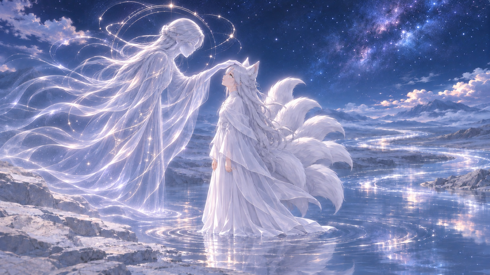
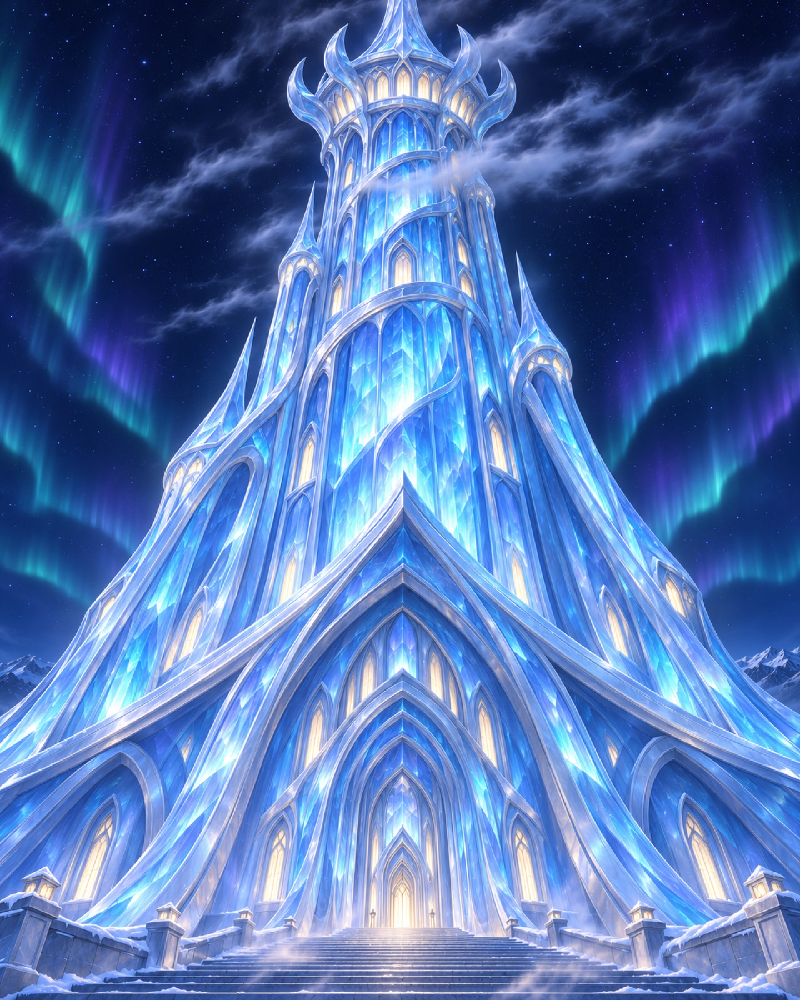

# 第一部：永逝之日

## 序章｜时间之外的往事

在塞尔薇娅·诺克斯诞生之前，这颗星球上没有昨天，也没有明天。水珠悬在岩石边缘，高处的云保持着舒展的形状，连山谷间尚未成形的风，也停在了无声的空旷里。万物浸没在时间长河之中，而河流本身静止不动。一切都以最初的模样保存着，如同某个被遗忘在宇宙角落的标本。

一道银光从星海间经过。时间女神伊瑟莉娅垂下目光，原本掠向远方的身影停了下来。银白长发浮在肩后，几道缀着星点的光环缓缓交错，映过她近乎透明的面庞。她的眉眼由细微的光勾勒而成，银瞳深处不见瞳孔，衣袍的长褶向下舒展，末端散入星流。那颗星球倒映在她眼中，微小而完整，仿佛只需伸出手，便能将它拢进掌心。

“啊，一颗静止而孤独的星球。”她抬起手，望着指尖下那颗沉寂的星球。“永远凝固，无法死去，亦无新生……”指尖缓缓蜷起，她的声音也低了下去，“就像我一样。”

一滴泪沿着她的面颊滑落。她将手按在胸前，从灵魂中分出一块碎片。碎片泛着银光，照亮了她的掌心。她把碎片轻轻放进时间长河。最初只有一圈涟漪，随后，第二圈、第三圈向远处推开。涓流汇聚，奔涌的声音渐渐穿过了寂静。

岩石边缘的水珠终于坠下，在水洼中溅起极小的一点水花。水面的涟漪一圈圈散开，原本凝固的云也开始缓缓移动。灵魂碎片在河流深处舒展开来。银白的长发浮起，颊边几绺短发微微翘着，洁白的狐耳与九条尾巴从光中显现。耳廓内覆着细软的绒毛，蓬松的长尾在她身后缓缓舒展。少女睁开眼，那是一双与女神相同的银瞳。

“塞尔薇娅·诺克斯。”女神俯视着她，“这是你的名字，我最干净的灵魂碎片。”

少女循声抬起头。河水从身旁经过，女神的手缓缓伸向她的额前。

“从此，你便是这颗星球的时间代行者，历史守望者。时间因你而存在，历史在你的手中流淌。”少女仰着脸，听见她继续说道，“去做我做不到的事情，去书写你自己的故事。赐予你不灭的祝福。”

“我会守望这里。”少女微微垂首，回答得很郑重。

女神看了她片刻，手落在她头顶，沿着银白的长发轻轻抚过。塞尔薇娅抬起眼，迎上女神的目光，原本微抿的唇慢慢松开。身旁的河水缓缓流淌。

---

## 第一章｜寂静与时光之女

塞尔薇娅将自身的力量凝成水晶，在自己诞生的地方筑起高塔。那是世界的极北之地，日光从未抵达，星河横贯群山上方，极光在漫长的夜色里缓缓舒展。塔身圆润而修长，淡蓝的晶壁间浮着层层折光，弧形晶脊沿塔身向上延伸，在高处托起花萼般的冠廊，更细长的塔尖隐入云中。

高塔所在的谷地背风，温泉从岩隙间涌出，沿着低处汇入河道。水面浮着薄雾，靠近泉流的地方没有积雪，露出深色的河石。极光掠过时，远处的雪岭泛起浅青色，河里的倒影随着水波轻轻晃动。

塞尔薇娅将银光汇入塔中的水晶，最初的白狐便在那里睁开了眼睛。他们生来便能驾驭魔法，也不会因岁月流逝而衰老。她为他们取名“永谧”。他们漫长的生命，就从这片寂静的夜色中开始。

渐渐地，塔前的雪地上多了来往的足迹。族人起初只沿河岸散步，后来越走越远，走出了群山。再向南，是风雪与游离魔力交织的雪原。穿过那里，才能看见绵延的大森林。外出的人有时隔了很久才回来，一进门便有人迎上去，接过行囊，问这次到了什么地方。

有一回，一个族人从河流下游带回几株小花。她用双手护着裹住根须的湿土，进门先借了一只浅碗，才肯让旁人凑近。碗被放到大厅西侧的窗台上时，花瓣还拢着。大家听她讲泉边的路，忽然有人碰了碰她的手臂。最外面的一片花瓣已悄悄舒展，微光从花心透出来，映亮了碗沿。后面的人踮起脚，问路的话也暂时停了下来。

族人惯常起身的时候，一道浅青色极光正越过塔顶，光穿过层层晶壁，在大厅地面缓缓移动。塞尔薇娅沿大厅西侧贴墙的弧梯向下，白色巫女服的衣襟间露出黑色交领，腰间束着同色的宽腰封。花形银扣下的细带随着步子轻轻晃动。银白长发披在身后，颊边层叠的短发衬着一张白皙的脸，唇色很淡。楼梯下方，一个年轻族人正朝她挥手：“首领——”她循声抬起眼。

梅芙守在梯口，浅紫长裙外披着素白的羊毛披肩，白发用骨梳松松挽起。见有人急着往下跑，她伸手拦了一下：“慢些，地上有雪水。从这边走，别挤。”

“可是已经开始了！”年轻的白狐转身迎上塞尔薇娅，急急指向大厅后方的拱门。塞尔薇娅穿过拱门后的短廊，走进尽头那间圆形晶室。诞生台座周围已经挤了不少人，有人蹲下，有人踮脚，刚从外面回来的族人肩头还落着雪，湿鞋印一路留到了台座旁。看见塞尔薇娅，他们纷纷让开，又跟着她往里挪了一些。

人群里有人说这次比上回快，旁边立刻有人挤过来，想看清台座上的新生者。银白的光沿台座底部的晶纹向上汇聚，一对小小的狐耳已在光中显现，随后是蜷起的身体、垂落的白发，以及藏在身后的尾巴。最后几缕光散去，新生者坐在台座中央，柔软的白发垂到肩头，脸颊还圆圆的。她茫然地低头看着自己的手，指头蜷起，又慢慢张开。塞尔薇娅拢住垂下的宽袖，露出一截黑色袖里，向她伸出手。新生者迟疑片刻，便把手放进那只摊开的掌心。一线银光沿着指尖流过。塞尔薇娅确认她体内的力量已平稳下来，收回手，示意她可以下去了。

新生者挪到台座边缘，脚尖却够不到地面。旁边有人伸手，她仍仰头望着塞尔薇娅，像在等她解决这最后一点困难。塞尔薇娅俯身将她抱下来，直到双脚站稳才松手。身后传来轻轻的笑声。

“名字想好了吗？”梅芙蹲下来，见新生者把脸往塞尔薇娅的衣摆后藏，便笑着放轻了声音。孩子探出头，看看她，又看看塞尔薇娅，慢慢摇了摇头。

“那就慢慢想。”梅芙拿起备在台座旁的乳白色软呢外衣，帮她穿好。衣服稍大，袖口盖过了手指，梅芙便替她挽起一折。孩子摸索着衣扣，梅芙替她扣好第一颗，又扶住下面的扣眼：“这颗你试试，我扶着。”

孩子捏着衣扣试了两回，终于扣上，便抬起脸给梅芙看。梅芙笑着替她抚平衣襟，将压在衣摆下的尾巴轻轻拨出来。蓬松的尾尖扫过孩子的手背。她低头去看，又扭身往后找，才发现那条尾巴连在自己身上。她伸手摸了摸，随后望向塞尔薇娅身后舒展的九尾：“只有一条吗？”

“嗯。”

“是不是没有长好？”

“已经长好了。”

新生者又伸出手，数起她的尾巴。数到一半，两条长尾交叠，她忘了方才数到哪里，小眉毛顿时皱在一起，伸出的指头犹豫着移来移去，只得重新开始。塞尔薇娅垂眼看着她，神情也认真起来。她将交叠的两条尾巴分开，站在原处，等孩子从头数过。

“九条！”她终于仰起脸，眼睛亮亮的，连声音都扬了起来，“我以后也会长这么多吗？”

“也许。”

她抱起自己的尾巴，摸了摸尾尖：“要是长不出来呢？”

塞尔薇娅的目光从她怀里的尾巴移到脸上，声音放缓了些：“一条也很好。”

新生者低头看了看怀里的尾巴，轻轻摸了两下，嘴角翘起来。她把尾巴放开，挨到塞尔薇娅身旁，攥住那截衣袖，连肩膀也贴了过去。

梅芙牵着新生者走出晶室，带她认塔里的路。塞尔薇娅回到大厅，沿西侧弧梯上了一层，走进书房。这里的窗正对河湾，一张长桌摆在窗前，桌上放着地图，信匣旁压着几册翻开的书。瑟兰已经等在那里，穿着一件蓝灰长袍，白发束在颈后。见她进来，他便挪开手边的卷册。塞尔薇娅在他对面坐下。

过了小半日，梅芙也带着孩子上了楼。孩子已经选定了名字，叫芙宁，从环廊一路说到书房门口，直到瑟兰起身笑着提醒，大家已经记住了。他身量很高，芙宁仰着头，仍想再说一遍，却看见长桌尽头的塞尔薇娅还在看图。她踮了踮脚，决定稍后再过去一趟。

瑟兰坐回原位，将两张路线图并排摊开。谷地南侧的岩壁坍塌了一块，经常往返的族人想修好旧路，另外几人则提议绕到河边，顺便经过暖泉旁新发现的花地。

“我去看过，旧路底下也松了。就算清掉碎石，那一段也得重新加固。”他指给塞尔薇娅看，“走河边远些，不过以后省事。你看看。”

“走河边。”塞尔薇娅指了指旧路，“岩壁还会塌。”

瑟兰点头，在纸上添了一笔，又将河边的图往前推了推。弯曲的线旁挤着几朵花，画图的人还仔细标出了颜色。塞尔薇娅扫过路线：“这一段多绕了。”

“那几个人愿意自己铺这一段。”瑟兰指了指河岸旁的花，嘴角露出一点笑意，“来问我的时候，连石头都挑好了。”

塞尔薇娅将纸转正，在靠近岩壁的一段路上划了一道，让路线往外移开一些：“随他们。这里也避开。”

瑟兰把两张图叠在一旁，起身替她添水，顺口说起新生者给自己取了名字，叫芙宁。孩子听见，立刻从旁边探出头，等他让开便走到桌边：“首领，我叫芙宁。”

“我知道。”

“你听见啦？”芙宁睁圆了眼睛。

“瑟兰告诉我了。”

“可是我还没有告诉你。”芙宁坚持，扶着桌沿又站直了些，“我叫芙宁。”塞尔薇娅停下笔，略带疑惑地望着她，听到最后，才郑重地点了点头。芙宁这才满意，在她膝边坐下，攥住衣袖，仰头看了片刻桌上的纸。看不明白的地方太多，她很快便困了，脑袋一点点垂下去，手里还攥着衣袖。塞尔薇娅落笔时被轻轻牵了一下，低头看见那几根不肯松开的手指。芙宁睡得很沉，脸颊抵在衣料上，嘴唇微微翘着。塞尔薇娅看了片刻，眉眼稍稍舒展。她没有抽出衣袖，先替芙宁提好外衣，才用空着的手将纸挪近。

桌上的纸还没看完，门口便传来艾缇雅的声音：“河边的路能走，不过旧图得改。”她抱着一卷图快步进来，灰蓝色短斗篷上还沾着雪。白发松松编在胸前，辫梢结了霜，茶色眼睛却亮得很。她连腰后的皮袋也没放下，便往桌边凑。瑟兰闻声抬头，将叠在一旁的旧图重新展开。

“你已经去过了？”

“走错了一次，不过找到一条岔流。”艾缇雅把图铺开。新添的几条线横在原来的河道旁，边角洇着一块深色水渍。她指着上游的一处弯折：“暖泉冲开了岸边的积雪，水都漫上旧路了。我从这里绕过去的。”

瑟兰拿来镇纸，压住卷起的边角，艾缇雅才松开手。塞尔薇娅看了一眼。

“纸湿了。”

“已经擦过。”艾缇雅答得很快，见她仍看着水渍，脸上的得意便少了些。

塞尔薇娅的视线沿水渍移到她湿透的衣摆，眉间蹙起：“先去换衣服。”

艾缇雅这才低头。米白色亚麻裙湿了半边，下摆贴着皮靴，水已经滴到了地上。她往后退了半步，拎起湿透的裙摆：“我很快就回来。河弯后面还有一段没说呢。”临出门，她又回头叮嘱瑟兰别挪地图。

等她换好衣服回来，书房里已经安静下来。梅芙抱走了芙宁，瑟兰也离开了，塞尔薇娅独自坐在桌边整理余下的纸张。地图仍压在镇纸下。艾缇雅凑过去，指尖沿着先前画的线移到河弯后：“接着这里。绕过这块岩石，就能上岸，后面的路都是干的。”塞尔薇娅放下手里的纸，顺着她所指的位置看过去。

“这一段河岸要加固。”塞尔薇娅在图上做了标记，“水涨起来，还会漫过去。”艾缇雅俯身看清，点了点头。等笔尖离开纸面，她才从腰间的小袋里取出一条细链：“还有这个，也给你看看。”

塞尔薇娅抬起眼。链子末端垂着一枚水晶坠子，边缘打磨得很细，随着艾缇雅的手轻轻转动，晶面泛起柔和的光。她将坠子托在掌心，递到塞尔薇娅面前：“给你的礼物。”说着便笑了，等着她伸手来接。

塞尔薇娅没有立刻接。她端详着坠子，又看向艾缇雅含笑的脸，眼中带着询问：“用来做什么？”

“戴着。”艾缇雅将链子提起来，水晶轻轻一晃，“首领之证。”

“族人认得我。”塞尔薇娅说，“不需要凭证。”

艾缇雅脸上的笑僵了一下，张了张嘴，又闭上。那双银瞳仍认真望着她。她低头拨正坠子，想了一会儿，又把手往前递了些：“好吧，那就不当凭证。我挑了很久，觉得你戴着会好看。”说到这里，她的声音才轻下来，“你要不要试试？”

塞尔薇娅的目光在她脸上停了片刻。艾缇雅仍伸着手，笑容里已带了点不安。塞尔薇娅终于接过坠子，水晶落在掌心，比高塔的晶壁略暖。细链还绕在艾缇雅指间，她忙低头解开，唇边已经有了笑意。

“哪里找到的？”

“河里。”

塞尔薇娅抬起眼，眉梢微动。艾缇雅立即补上一句：“只是踩空，没有被冲走。”她接过项链，绕到塞尔薇娅身后，“低一点。头。”

塞尔薇娅依言俯身。艾缇雅将银发拨到一旁，几缕发丝勾住肩侧的白花饰，她用指尖轻轻挑开，才摸索着找细链上的搭扣。指尖擦过后颈时，少女睫毛一颤，稍稍偏过头。听见艾缇雅低声说“快好了”，她便停住，任由那双手替她扣好。

“好了。”艾缇雅松开手，水晶垂在交领下方，贴着白色衣襟。塞尔薇娅低头看了一会儿：“不妨碍行动。”艾缇雅先是一怔，随即笑起来：“那我就当你喜欢了。”塞尔薇娅略显困惑地看着她，直到她伸手来拨正坠子，才垂下眼。艾缇雅把地图移到长桌靠窗的那一端，坐下来继续补画那条岔流。窗外的极光渐渐淡去，她把晶灯挪近些，笔尖沿着水渍边缘绕了过去。

塞尔薇娅重新整理文件，坠子随着俯身滑到桌沿。她伸手托了一下，将它拢回衣领内。艾缇雅隔着桌面问河流的另一段该标在哪里，她便抬头看向那张图，手指仍搭在链子上。

---

## 第二章｜灵魂之间的回声

这颗星球上最初的草木，来自生命之神维塔里斯留下的一滴神血。神血落入大地，根系便在泥土深处舒展，枝叶迎向风与光。血肉生命开始生长、繁衍，也开始衰老与死亡。时间所记录的事，从此一日比一日更多。

那滴神血最终化作一个人。他为自己取名奥瑞恩，带领最初的人们生火、迁徙，在河流交汇的平原上筑起第一座城。城墙起初低得挡不住风。等它终于连成能够护住城内居民的屏障，许多亲手搬运石料的人，已经长眠于城外。

奥瑞恩仍是原来的模样。孩子跟着父母向他问好，长大后，又带着自己的孩子来见他。有些名字他要询问两遍，才知道眼前的人究竟是谁家的后代。永恒国王的称号，便这样留了下来。

永谧族最初遇见他的子民时，奥瑞恩的城已经有了集市与街巷。露弥穿过魔法雪原，又走过大森林，在南面的河岸旁遇见了他们。等她返回高塔，行囊里便多了一块烤焦的木片。几名族人围在台阶旁，看她翻来覆去地展示背面的刻痕。露弥个子不高，白色短发刚及下颌，耳侧别着一枚小铜夹。她还穿着远行时的赭色皮背心与浅麻色衬衣，靴上的泥都没干，便坐在台阶上讲了起来，行囊敞在脚边。

“他们把树枝放进火里。”

旁边的族人往木片上凑近些：“当然会烧起来。”

“他们知道，是为了煮东西。”露弥把焦黑的一面翻给他看，眉梢抬起来，等着他接着问。

有人问东西为何不能直接吃。露弥想了想，说自己还没有来得及问，他们便先请她吃了一份。

“好吃吗？”

“有一点焦。”她皱了皱鼻子，围着的人便笑起来。露弥把木片往行囊边一搁：“下次我要看着他们煮，弄明白是哪里烧过了。”看见塞尔薇娅经过，她又拾起木片，起身递过去。塞尔薇娅接在手里，刻痕里还留着一缕温热的力量，正缓慢散去，指腹移开以后，那点温度便淡了些。她沿着痕迹摸过一遍，没有在其中找到永谧族的气息。露弥在一旁解释：“他们说，带着这个，下次就认得我了。”

露弥再度南行时，塞尔薇娅随她一道出发。雪原上的风挟着游离的魔力，几次将脚印掩没；露弥认得山隘的位置，仍沿原路向南。越过最后一道雪岭，树木渐渐密起来，日光从枝叶间洒落。两人穿出大森林时，河岸边正有人搬运木料。塞尔薇娅第一次见到奥瑞恩，便是在一段倒塌的木栅栏旁。露弥一到就蹲进人群里，看他们用绳子捆木料。绳结绕得太慢，她伸手碰了一下，几圈绳索便自行收紧，旁边立刻响起惊叹。

正扶着横木的男子转过头。他肩背宽阔，深金色的头发束在颈后，几绺散发被汗黏在额角。浅褐色麻衣的袖子高高挽起，肩头落满木屑。他抬眼望来，目光从塞尔薇娅的狐耳移向身后的九尾。她在河岸旁停下，白色裙摆被风吹向身后，露出两侧绣着浅色花纹的黑色衣片。他放下木头，拍去掌上的碎屑，往前走了两步。

“你就是露弥提过的首领？”见塞尔薇娅点头，他停在几步外，“奥瑞恩。这里的人由我照看。”

“塞尔薇娅·诺克斯。”

奥瑞恩认真重复了一遍她的名字，确认没有念错，才接着说道：“我们在森林边缘取了一些木材。如果打扰了你们——”

“森林不属于我。”

奥瑞恩怔了一下。塞尔薇娅的目光落向露弥，后者正拿着一截余下的绳索，学身边的人打结。塞尔薇娅收回目光：“不要伤害我的族人。”

“当然。”他收起方才的惊讶，迎着她的目光郑重地点头，“我们也希望如此。”

那天，她在河边停留了很久。人类为一段栅栏争论不休：横木太低，挡不住野兽；加高以后，旁边的人又翻不过去了。露弥听得皱眉：“为什么要翻？”

“门还没有修好。”

她低头看看栅栏，将其中一段连着泥土移到旁边，露出可供通行的空隙：“现在可以走了。”

刚才解释的少年张着嘴，奥瑞恩却蹲下去，查看被拔起的木桩：“下次提前告诉我一声。我刚才差一点还扶在那里。”露弥一怔，狐耳往后缩了缩，赶紧点头。奥瑞恩笑起来，她红着脸，也跟着笑了。

那个少年叫诺尔，棕发乱蓬蓬的，鼻梁两侧散着几颗雀斑。他的麻布上衣已经短了些，抬手时露出一截细瘦的手腕，肘上缝着颜色较深的补丁。笑声停下后，他仍追着露弥问木桩是怎么动起来的，最后索性问她能不能教自己。“手伸出来。”露弥先拉过他的手看了看，又往他掌心送进一缕微光。诺尔痒得缩了一下，她便来了兴致：“能感觉到？那就试试。”下一次来，她在他面前放了一杯水。

诺尔原以为最难的是记住咒文，露弥却只让他试着将水托起来。他照着她示范的动作伸手，肩膀抬得越来越高，杯子里的水纹丝不动。

“你在使什么劲？”露弥问。

“托它。”

“用力量。”

诺尔低头看看已经发酸的手臂，又看向她，脸涨得通红：“我已经在用力了。”露弥还想催他，瞧见他满脸的委屈，话便停了。她看看他的手，再看看自己的掌心，终于意识到，两人所说的可能不是同一回事。她拿来纸，画出力量经过的顺序，画到第三笔时停住了。她可以直接感知的流动，在人类身上并不如此清楚。她把画了一半的纸翻过去：“刚才是我没讲清。你先别托水，告诉我，力量到哪里就感觉不到了。”

诺尔小心地坐近一些。两人从午后试到傍晚，旁边的人离开了几次，又带着食物回来。最后，一团指尖大小的水摇摇晃晃地浮出杯口。诺尔屏住呼吸，连眼睛也不敢眨。

“别绷得那么紧。”露弥提醒。

水团忽然一颤，落回杯中，溅了他一脸。他先是僵住，随后抹着额头笑起来，湿发贴在脸上，怎么拨都拨不开：“我成功了。”

“只成功了一半。”露弥说着，自己也笑了，伸手替他拨开挡住眼睛的湿发。

“剩下那一半明天补。”诺尔咧着嘴，怎么也收不住笑。

露弥看了他片刻，才低头去找那张被溅湿的纸，标出方才需要修改的位置：“明天继续。”

“好。”

第二天，露弥推门时，诺尔已经坐在桌边。两杯水摆在面前，桌角还搭了一块干布。他见她看过去，先把布往自己这边挪了挪。

***

来旁听露弥授课的人渐渐多起来。她常在城里住上许久，其他族人也开始留下授课，或与人类一同研究术式。曾经只需凭感觉施展的魔法，被一笔笔拆开，记在不同的纸上。

通向极北的路也渐渐有人往来。人类带着布料、器皿和远方的消息，在熟悉雪原的族人引领下穿过大森林，再越过风雪。初次抵达的人常在塔前停下，仰望极光，直到同行者回来招呼，才想起放下行囊。为了接送伤病者与传递急讯，族人后来在林缘和塔下留下了成对的通行印记。平日安静的晶面被施术者唤亮时，两端便能短暂相通。

露弥偶尔抱怨，人类为什么总要写这么多。奥瑞恩听见时，翻开了一本边角磨损的教本。前后几页有不同的笔迹，其中一处错误被划去，又由后来的人补上。

“我还记得写这一页的人。”他将书摊平，手指停在前面的一行笔迹上，“后面的已经是他的学生了。”

露弥顺着看过去，两种笔迹之间有几页被翻得格外薄。奥瑞恩替她翻过一页：“写下来，后来的人还可以继续。”

露弥将书接过去，仔细翻完。此后，她出门总会带纸，只在看诺尔的笔记时忍不住皱眉，问他是否准备留给别人猜。

几年后，塞尔薇娅再踏进那座边城，已经找不到当年的木栅栏。马车从高大的石门下经过，沿街水渠把清水送往各处。照明术式嵌进石柱，白天只有浅浅的纹路。几名施法者在广场上争论新画的法阵，有人搬来梯子，修理一盏总比其他灯暗些的灯。

诺尔站在梯子上，肩膀比过去宽了，下颌也有了棱角，低下头时，额前那撮棕发仍不听话地翘着。靛蓝上衣的袖子挽着，腰间挂着修灯用的工具袋。露弥在下面叫他把灯罩往左挪些，他照做了，却听见她又补了一句：“你的左边。”

“这就是我的左边。”

露弥抬头看了看，改了说法：“靠墙那边。”

诺尔叹着气照做，转头看见塞尔薇娅，差点踩空：“首领阁下！”

露弥一把扶住梯子。他赶紧站稳，将工具塞进口袋，指向广场尽头的水渠：“上次提过的那一条，已经通到城外了。”

塞尔薇娅沿他的手望去。清水穿过石槽，流向城墙外的聚落。“为什么修那么远？”她问。

“那里的人也需要水。”诺尔抹去手腕上的石粉，“总算不用天不亮来城里排队了。可我想再往外接一段，试了几次，术式都撑不住。”

“把第三段术式改完就够了。”露弥说。

“第三段我改过，水是过去了，后面的石槽却裂了。”诺尔朝水渠比了一下，“你上次还说第四段也有问题。”

“那就把两段接起来试，别拆开算。”露弥仰着脸，“今晚带图来，石槽的宽度也标上。”

“今晚？”诺尔苦着脸往水渠那边看了一眼，还是点头，“行。我得先把这盏灯修好，昨晚又有人在这里摔了一跤。”诺尔从口袋里取出工具，继续修灯。塞尔薇娅从梯子旁经过时，两人又说起了水渠的事。

绕过广场，塞尔薇娅走进回廊，奥瑞恩正在那里等她。他换了一身深绿色长袍，领口与袖缘绣着细窄的金纹，额上戴一顶薄金冠。日光照在他脸上，仍是初见时的年轻模样。庭院中，一群孩子追着从森林里跑来的小兽，转弯时撞成一团。一个耳朵略尖的孩子被同伴扶起来，揉了揉额头，又冲在最前面。

“越来越热闹了。”奥瑞恩看着他们跑远，目光才落到她胸前的水晶上，“这枚水晶，你一直戴着。”

“艾缇雅送的。”

“很好看。”

塞尔薇娅低头看了一眼：“她说是首领之证。”

奥瑞恩笑了，伸手碰了碰自己额上的王冠：“我戴上这个，大家便以为我知道所有事情该怎么办。”

“你不知道？”塞尔薇娅看向他的眼神认真了些。

奥瑞恩的笑意慢慢淡了。“很多时候不知道。”他看见远处等候的侍从，以及对方怀里那叠厚厚的文件，轻轻叹了口气，“只能慢慢学。”

侍从终于走近，最上面的纸刚展开，便又被风掀起一角。奥瑞恩伸手压住，听见两处工事在争同一批石料，便将纸接过来：“先供水渠。桥那边，我去和他们说。”侍从提起后面还有几件，他点点头：“一并留下吧。”塞尔薇娅转向庭院，孩子们已经跑过另一侧回廊，尖耳朵的孩子正牵着同伴，指给他看藏在叶间的小兽。

***

前来请教的施法者越来越多，其中也有早已成名的人。马尔维克第一次来找露弥，便带着一本装订仔细的水晶研究记录。老人花白的头发梳得整齐，深褐长袍已经洗旧了，袖缘的补缝却很细。他欠身问好，将记录放在桌上。露弥在掌心汇起力量，他便凑近了看，久久没有动笔。一处转折出乎他的意料，他轻轻“啊”了一声，笑着翻到空白页，准备记下来。笔尖落下前，他看见了自己手背上的褐斑。另一只手覆了上去。

“你们一直如此吗？”

“什么？”

“不会衰老。”

露弥想了想：“会有变化。”

“但不会像我们。”

他的手仍覆在手背上。窗外有学生练习术式，小小的火焰升起，随后被手忙脚乱地扑灭。有人发出懊恼的声音，又有人笑着递去一块布。

“人类有太多事情来不及完成。”马尔维克说。

露弥望向那些学生：“可以交给后来的人。”

马尔维克看了一眼窗外：“他们当然可以接着做。只是这些记录，我写了大半辈子。”他将那本记录拉近，翻回前几页，“总该让我亲手做完一次。”纸上还留着早年的笔迹，末尾许多地方等着补全。他回到刚才那一页，握笔的手指轻轻抖了一下，墨点便落在预留的空白里。

此后，马尔维克又来请教过几次。他的问题越来越细，有些连露弥也需要回塔查证。收到共同研究水晶的邀约时，她便约了另两名族人一道前往，临走还留话，让诺尔把新编的教本送来。

***

最初有人未按约定归来，塔里并没有太过担忧。永谧族常在外面住上一整个季节，发现新的山谷或泉水，便连着寄回几封信。艾缇雅的地图因此越画越厚。她把已知的路标清楚，又在边缘留白，让后来的人添上新的去处。

露弥的信也这样送回来，说研究还要继续，暂时不回高塔。梅芙把信送进书房，放上长桌。艾缇雅起先还笑着，读到末尾，眉间却慢慢蹙起来。她重新看了一遍，没有像往常那样收进信匣。

“怎么了？”瑟兰问。

“她没有问诺尔的教本。”

“她给诺尔回过信吗？”

“还不知道，可以问问他。不过你先看这里。”艾缇雅将信摊回桌面，按住开头那行郑重的人类敬称。

“她以前嫌这个太长。说写完问安的话，都不够地方骂学生了。”

梅芙俯身看了一眼落款，又翻出另两名族人先前寄来的信：“和她一道去的两个人，也都没回信。”他们原本约好，等研究告一段落便一道回来。塞尔薇娅接过信，读到末尾，目光又移回开头那行敬称。她渐渐抿紧嘴唇，将信平放在桌上。

“她去的研究所在什么地方？”

梅芙从桌上那叠人类送来的书信里翻出先前留下的邀约。上面记着大森林南缘的峡谷附近一处地方，人类送来的行程到那里便结束了。塞尔薇娅起身，艾缇雅已经拿起地图：“我去过那一带。”

“带路。”

两人下楼，穿过大厅，走到塔前空地。通行印记亮起。艾缇雅先走进去，塞尔薇娅随后踏过银光，脚下的薄雪便换成了潮湿的落叶。

塔里，梅芙将剩下的书信夹回册子。一张记着世界缺口的旧图从书页间滑出来，上面的圆环缺了一角。她将图夹回原处，和其余书册一道放好。

---

## 第三章｜不知其意的泪水

离开林缘的通行点后，艾缇雅带着塞尔薇娅循河道走向峡谷。那里比地图上更深，树冠遮住裂缝的大半，从上面只能看见一线潮湿的石壁。水声远远传来，被回声磨得很细，听不清落在何处。艾缇雅将地图折起，俯身拨开崖边的枝叶：“上次没有这条路。”

岩壁下多出一段狭窄的石阶，凿痕还很新。塞尔薇娅走到边缘，望向下方：“你留在这里。”

艾缇雅没有立即答应。峡谷深处残留着族人的力量，熟悉的气息混杂在某种异样的波动里，让她的耳朵不由自主地向后贴去。她叫住正要下去的人：“塞尔薇娅。”

塞尔薇娅回头，安定的目光迎上她的视线：“我会带他们上来。”

说完，她沿石阶走入阴影。艾缇雅望着那道身影消失，将地图收进贴身的袋里，蹲下拨开崖边碎石，先清出一块可以让人停脚的地方。

越往下，寒意越重。瀑水的回声退到身后，石壁里渐渐透出另一些声音：金属拖过地面，短促的喘息，还有被门板闷住的说话声。塞尔薇娅停在一扇门前。门上刻着她熟悉的排列，转折处却少了一道线。露弥用它引水时，力量会在这里缓一缓，免得冲坏石渠。如今每经过一次，那股力量便猛然收紧，门后随之响起一声压抑的抽气。

塞尔薇娅抬手，门向内碎裂。里面的人转过头，最靠近门口的魔法师尚未来得及起身，便被无形的力量压回座位，声音断在喉咙里。她从他身旁经过。

房间很长，器具在冷光下排得整齐，细管从台面延伸出去，接往不同的容器。有族人被束缚在高台上，有人蜷在角落，听见响动，便费力地转过头。一双狐耳轻轻动了动，有人叫了一声“首领”。塞尔薇娅循声走过去，认出了那张脸。对方曾问过她，为什么自己凝出的冰总在边缘裂开。后来终于成功，特意把一片没有裂纹的冰带来给她看，却在暖泉边耽搁太久，到了她面前已融去一半，只得将剩下的那一小片托给她看。现在，那双手被固定在台面上，指头维持着僵硬的弧度。

金属在她掌下断开。族人没有坐起来，她托住他的后背，将力量送进去，触到的却是一处空缺。本应沿身体流转的光在那里散开，无论怎样汇拢，也找不到原先的去路。她换了方向。对方呼吸骤然变急，用力抬手，指尖碰住她的衣袖：“别……那边，还有……”他试着转头，目光几次落向走廊深处。塞尔薇娅顺着看去，先替他稳住气息，再将他与附近几名族人一同托起，沿来路送往崖顶。银光护在他们身周，挡住了滚落的碎石。余下的呻吟藏在更里面。她循声走过第二间房，在第三间停住。那里没有门。露弥躺在台上，短发散在颊边，耳侧的小铜夹不见了。那件浅麻色衬衣的一侧衣袖被扯开，露出腕上的束缚。

塞尔薇娅解开她腕上的束缚，拨走压在手下的记录。纸面翻过来，露出熟悉的笔迹：露弥总把需要重试的地方圈起，留一块空白，让学生补上结果。如今那些空白里填着另一种字，抽取的时刻、次数、身体的变化，逐项排得整齐。纸背还有几道挤在边角的修改，最后一笔拖到纸边，墨迹在边缘断了。

“露弥。”塞尔薇娅握住她的手。

白狐女子费力地睁眼，最初只盯着靠近的人影，直到看清那双银瞳，紧绷的肩膀才一点点放松。她想笑，干裂的唇角刚扬起来，眼泪却先沿着鬓边淌下：“你来了。”

少女扶起她，将银光送入体内。露弥的尾巴动了一下，旋即垂回台边。塞尔薇娅循着尚在的光追过去，抵达断处，便又从另一个方向接续。露弥忽然颤了一下，她立刻停手，低头去看，才发现那双狐耳已紧紧贴在发间。她神色一紧，凑近了些：“疼？”

露弥没有回答。她望着塞尔薇娅，嘴唇动了动，目光缓缓移向刚被拨到一旁的纸页。

“诺尔……”声音在这里断了，露弥的指尖朝纸的方向挪了挪，“新写的……还没……”

塞尔薇娅把纸移到她看得见的地方，等着后半句。在高塔里，她听过许多这样的停顿；只要稍等，族人便会重新接上，有时还要从头说起。露弥的目光却没有追过来。纸边碰到她的指尖，那几根手指也不再抬起。

塞尔薇娅低下头，托着她肩背的手没有松开。她望着露弥的脸，眉头渐渐皱紧，又握了握那只垂下的手，仍没有回应。片刻后，银光再度亮起，房间里一滴将落的水停在半空，走廊上的脚步也失去了后续的声音。所有事情都留在了原处。

她把手贴到露弥胸前，将力量放得更缓、更细，眼睛一瞬不瞬地盯着那张脸。断处依旧空着，溢出的银光落回她手背，露弥却没有像新生的族人那样握住她。塞尔薇娅重新收拢那几缕光，重复了一遍。水滴始终悬着，直到她终于垂下手，它才落到石面上。

水滴落下的轻响里，门口传来脚步声。“别再试了。”马尔维克站在那里，握着一件器具，指关节用力得发白，视线却始终追着露弥身上尚未散尽的光，“再注入力量，剩下的结构也会被破坏。”

塞尔薇娅转头看他。马尔维克向前半步，随即停住。少女直直盯着他，脸上一片冷白，唇边绷得很紧。他下意识把器具挡在身前。

“为什么？”她问。

“我们在寻找能够稳定运用水晶的方式。研究有许可，相关的记录——”

“为什么？”这一次，她几乎是咬着牙问的。

他咽了一下，视线越过少女，落在那具已经失去回应的身体上。她曾坐在窗前，毫无保留地向他展示力量，连他问了第三遍的问题也耐心答过。他移开目光：“你不会明白。我们会衰老，会死。等到终于能做一些事，手已经握不稳笔了。你们可以等，国王可以等，可我们……”

塞尔薇娅看见桌上的研究许可，王室印记压在纸角，旁边摆着分门别类的水晶。光有深有浅，其中一枚仍带着她熟悉的气息。她记得这缕气息的主人。那人离开高塔前，曾来问能否替朋友带一件礼物回去。

胸前的坠子轻轻碰着衣料。塞尔薇娅按住它，棱边硌进掌心，手指却没有松开。她试着像平日整理杂乱的力量那样，让胸口的灼痛停下来。视线移开，又落到另一只容器，再移开，便看见角落叠好的族人衣物。每一处都让那股灼痛更重。眼前的器皿渐渐模糊，她用力眨了一下眼，颊边便滑过一点湿意。她没有抬手去擦。马尔维克还在说话，她只听见声音一次次从身旁经过。

他终于举起器具。塞尔薇娅将露弥放回台上。黑色术式在两人之间展开，圆环缺了一角，断口向内伸出两道细线。她迎着术式走过去。第一道术式碎裂时，他脸上的镇定终于散了，慌忙去抓桌上的许可，指尖几次从纸边滑开。第二道没有来得及成形。他惊恐地张开嘴，再没有发出声音。

倒下的器具撞响了地面，走廊里随即响起奔逃的脚步。峡谷里的门相继打开。有人沿暗道逃走，有人举起双手，跪在地上，急切地指认其他房间。力量穿透石壁，截住四散的人影。门后的束缚相继断开，仍有气息的族人被银光托起，沿来路送往崖边。塞尔薇娅走过去，杀死每一个见到的人类魔法师。最后一间房里的人倒下时，她仍然停了一瞬，像在等胸口的灼烧一同熄灭。它没有。她转身回去，将露弥抱起。支撑岩层的术式随即断开，头顶传来沉重的闷响。

***

崖边，艾缇雅已经接住了被送上来的几名族人。有人能走，有人需要搀扶，仍不断回头找那道银白的身影。第一道裂纹爬上岩壁时，身旁的人抓住了她：“首领还在下面。”

“我知道。”艾缇雅扶最虚弱的人坐下，托付给一旁还能站稳的同伴。确认周围的屏障没有松动，她才沿着被打开的通道往下赶。塞尔薇娅正从露弥所在的房间出来，怀中抱着她。艾缇雅原本要问的话忽然忘了。她睁大眼，目光停在露弥垂落的手上，那几根指头还沾着干涸的墨迹。“……露弥？”她叫了一声，尾音轻得几乎听不见。

塞尔薇娅把人交过来，动作很稳。艾缇雅伸手接住，直到碰到那只再也不会抬起的手，才猛然收紧手臂。她低下头，嘴唇抖着，怎么也叫不出第二声。眼泪落在露弥冰凉的脸上。头顶又震了一下。塞尔薇娅抬手隔开落灰，银光托着她们沿崖壁升起。回到伤者身旁，她才对艾缇雅说：“带他们回去。”

“你呢？”

少女没有回答，目光越过森林，落在远处的城墙上。她知道那些道路通往何处，也记得他们怎样请族人留下，怎样向授课的白狐道谢。那些面孔与声音依旧清楚，与峡谷里的惨状交叠，让胸口那股陌生的东西烧得更重。她要让它们消失。

艾缇雅顺着她的视线看向林外的城墙，脸色变了。她抱紧露弥，急急开口：“先回高塔。”

塞尔薇娅向前迈步。

“还有人需要照顾。”艾缇雅急急叫住她。她满脸是泪，声音里带了哭腔，“我们先把他们带回去，好不好？”

“你带他们走。”

“你要去哪里？”

少女停了一瞬。

“杀光他们。”

远处有族人轻轻呼唤，艾缇雅不得不回头。等她再转回来，银白的身影已掠过高处岩壁。峡谷随即向内坍塌，所有房间、暗道与器具被巨石吞没。艾缇雅紧紧护住怀里的人。包围幸存者的光仍然稳固，而塞尔薇娅已经越过林缘。艾缇雅抱着露弥，带伤者退向通行点。同行的两名族人接过露弥，她才腾出手按上晶石，指尖却抖得几乎无法接续术式，直到另一名族人扶住她，银光才重新亮起。

---

## 第四章｜白昼不再降临

午后，诺尔正在教三个学生控制水流。最小的那个总会多引出一些水，桌沿滴滴答答，地面已经湿了一片。他指着杯口，叫孩子先少引出一点，别急着把它举高。

孩子咬住嘴唇，努力收拢手指，水却猛地向上蹿。旁边两个学生连忙躲开，诺尔抬手接住，将它送回杯中：“今天先到这里。”

“老师，我是不是学不会？”孩子垂着头，眼眶红了，偷偷去看旁边两个同伴。

“我第一次学，把自己浇得比你湿多了。”诺尔蹲下来，朝自己头顶比了一下。孩子抬起头，见他一脸认真，没忍住笑了一声，又赶紧抹了抹眼睛。诺尔这才起身推开窗，也笑起来：“还有人能作证。”

窗边还放着留给露弥的教本。她已经很久没有来检查了。他写信问，回信却只说研究正在紧要处，没有提那几处答应要看的修改。他把新写的内容夹进书里，仍搁在靠窗的位置。她若来了，从门口就能看见，省得又问他把东西放到了哪里。

诺尔正想把它往里挪，忽然注意到广场上的喷泉。水柱仍保持扬起的形状，细小的水珠停在半空，周围的人一个接一个抬起头。城墙上传来钟声。第二下尚未散尽，远处的石墙便向内折断。窗框猛地震响，木屑擦过诺尔的肩。他先把学生推到桌下，才冲到门边，看见守卫正抬起武器，几名施法者匆忙撑开屏障。

一道银白色的身影从城门上方经过。他扶住门框，惊惶的脸上刚露出喜色，便看见她抬起的手正对着城内，笑容僵在嘴角：“首领阁下？”

声音几乎被街上的喊叫吞没。少女的目光从屋顶掠过，没有停。诺尔仍抬起手，想让她看见自己。他记得她曾站在水渠旁，听自己解释为什么要把水送到城外；露弥就在梯子下面，在他险些跌落时扶住了梯子。他不由自主地向前走了半步，朝她喊：“露弥呢？”

天空中的术式亮起，最小的学生已经从桌下爬出来，哭着扑到他身边，抓住他的衣角。诺尔猛然回身，抱起孩子冲回桌旁，蹲下将他护在怀里。另两个学生还缩在桌下，一个哭着攥住他的衣服，另一个抱着头，不敢动。房梁开始往下压，他撑起防护，朝那个孩子伸出手。第三处转折，他依着露弥的修改接下去，颤动的光勉强稳住。白光漫进门前，孩子的手终于握住了他。

***

第一座边城覆灭时，帝国尚未弄清敌人是谁。第二座城市的求援只送出半句，传讯便断了。第三座城关闭城门，守卫还没有从门闩旁退开，脚下的城墙已经开始崩塌。

塞尔薇娅穿过层层防御。那些术式大多带着熟悉的痕迹，力量如何流转，在哪里需要转折，她甚至比施术者本人更清楚。她抬手截断，继续向前。

街上有人丢下武器，有人抱起孩子，还有人跪倒，朝她不断说着什么。她认得几张面孔，有人曾远行来过高塔，有人在族人授课时站得很近。她的视线从他们脸上经过，落回前方尚未被毁的城门。

下一座城市的钟楼仍然完整，沿路的屋舍还亮着光。只要望见那些安然存在的人类，她便再次想起峡谷里的台面与容器，手指随之收紧。白光越过街道，所有声音在她身后迅速消失。

等奥瑞恩赶到她前方那座城时，来自边境的传讯已经接连中断，风里全是灰。城外道路挤满人，翻倒的马车堵在桥头，孩子被从车厢里抱出来，挨个往后送。几名施法者轮流支撑屏障，接手的人还没站稳，上一人便已跪倒。

梅芙送来的急讯被国王握在手中，边角沾着血。他落在断墙上，深绿色长袍被碎石划破，顾不得查看，便望向路前方的少女。她仍穿着河边初见时那样的白色巫女服，银白长发被风拂到颊边，目光越过他，望向身后的城。九尾在尘灰中展开，胸前还戴着艾缇雅送的水晶。白袖上的血已经干了，她抬起手，指间重新聚起光。

“塞尔薇娅。”他走下断墙，将身后的人挡住。

“让开。”

“峡谷的事，我已经听说了。所有参与者，我会亲自追查。研究所、资助者、替他们隐瞒的人——”

“我让你让开。”她的眉眼猛地沉下去，字音从绷紧的齿间挤出。

奥瑞恩停住。她说话比平时更慢，指尖的力量却没有散去。急讯上那个地名，他在以前的报告里见过；失踪、异常的研究，也都有人提过疑问。他留下核实的命令，等下一次呈报，等仍需时间的调查。几份报告末尾的署名已经换过，那道命令却始终没有得到最后的答复。他甚至想不起，自己最近一次亲自去那里是什么时候。

“我没有阻止他们。”他抬起眼，脸色灰败，声音里再没有方才急着解释的劲头，“这是我的责任。”

少女望着他，眼里没有一丝动摇：“所以你也会死。”

远处的塔楼向一旁倾斜。奥瑞恩抬手托住，示意塔下的人快走。塞尔薇娅的目光跟过去，白光切断了他的术式，径直落向尚未逃离的人。他转身挡住。石块在身后砸下，巨响震得耳中一片嗡鸣，等他重新站稳，才发现血已经顺着嘴角淌到衣领里。

“这些人没有去过峡谷！”奥瑞恩抹去嘴边的血，声音终于压不住了，“他们中有许多人，连永谧族的名字都没有听过。”他仍挡在路中，额上的青筋绷起来，塞尔薇娅的视线却越过他的肩，追着那些还在跑的人。

她向前迈步。奥瑞恩将急讯收进衣襟，拔出剑挡在她面前。剑身映出她的衣袖与那枚水晶。

剑锋与白光撞在一起，震落了断墙上最后一段石檐。瑟兰从林缘的通行点赶来，穿过落灰，来到塞尔薇娅侧后方：“回去吧。艾缇雅把人带回去了，他们在等你。”

少女没有回头，手指却停顿了一瞬。瑟兰朝她走近。他从前也常这样，在她做事时过来商量，等她听完，再一起决定怎么处理。她即使没有回答，也总会记住他说过的事。

“回塔之后，我们一起追查。先让城里的人撤出去，那里还有孩子。”

“他们是人类。”

“我知道。”

“那就够了。”

瑟兰站住，脸色变了。他望着她，眼里已有怒意，开口前却先深吸了一口气。她的语气平得几乎没有起伏，可那只悬在身侧的手绷得很紧，指尖有光不断溢出。

“你看过他们怎样生活。”

“我看过峡谷。”她终于转头，“你也应该去看。”

瑟兰喉咙发紧。他已经见过带回来的人，亲手接住其中一个。那人靠在他肩上，仍反复问首领在哪里，好像她一回来，所有事情便都会好。

“我知道他们做了什么。”他低声说，“可现在死去的，也有我们的学生。有些人还在等露弥回去。”

塞尔薇娅猛地盯住他。那个名字仿佛把峡谷的声音也带了回来，她的嘴唇颤了一下，随即抿紧，连呼吸都变得急促。指间的光骤然变亮：“别提她。”

“你若继续，我就得拦你。”

九尾猛然扬起，风压将灰尘推开。瑟兰被迫退了数步，脚下石地裂出深痕。落石砸下之前，一道屏障又在他身前立起，替他挡住碎石。“别站在那里。”她说。

她转回身，重新面对奥瑞恩。瑟兰的手碰上屏障，掌下仍是高塔里熟悉的力量，外面的落石却不断撞来，震得指尖发麻。他又叫了一声，她没有回头。等碎石不再落下，他才收回手，退向林缘的通行点。

再踏出银光时，极北的寒风迎面吹来。他快步登上塔前的阶梯，循着说话声走向大厅东侧的客房。几间房门都敞着，床铺让给了伤势较重的人，还能坐起的便靠在床边。伤处已经得到处理，仍有人时不时望向门口，像在等其他人跟进来。最里面的一间很安静。露弥躺在靠墙的床上，艾缇雅坐在床边，替她整理头发。她拨开一缕沾住的发丝，碰到耳侧时又停下，换了更轻的动作。芙宁站在旁边，小声问她为什么不醒。艾缇雅抿住嘴唇，手指停在白发里。她低头看着孩子，眼睛红肿，张了张嘴，却不知该怎样回答。芙宁怔怔看着她，不敢再问，伸手攥住了她的衣角。

瑟兰在门口停住，没有过去。梅芙从隔壁的伤者房里出来，肩上的羊毛披肩已经取下，浅紫袖口留着替伤者包扎时沾上的血。她看见他脸上的灰，便把原本要问的话咽了回去。

“她不肯停。”瑟兰低声告诉她。

梅芙随他退回大厅。正门外，通行点尚未闭合，另一端的白光照上石阶，交战的震动也沿术式传了过来。她望着那些石阶，想起族人从前带着人类送的灯火，沿这里走回塔中。她转身上楼，瑟兰跟了上去。两人走进书房，她从长桌上抽出那本夹着旧图的书。瑟兰认出封面：“你还记得里面的仪式吗？”

“那是黑魔法。”梅芙抱紧了书，直直看着他，声音又急又重，“我们不知道缺口另一边有什么。”

“先听它怎么说，能核对的地方再核对。”瑟兰垂眼看着封面，“有一处不对，就停下。”

梅芙的拇指抵在封面边缘，一直没有松。楼下有人在呼唤同伴，她转头望向敞开的房门。过了一会儿，喊声停了。她将指头探进书页间，抽出那张图。

梅芙抱着书，与瑟兰下楼，穿过大厅后方的拱门。还未到诞生晶室，两人便转入侧面一间空置的小屋，将书放在桌上。两人依照图上的位置摆好晶石，她又核对了两次线条，才补上最后一笔。缺口处的细线向内延伸，空气随之轻颤，圆环中央出现一片看不见底的暗。她的手仍停在纸上，朝那片暗处开口：“我们需要阻止她。”

声音从远处返回，起初像重复，随后才有了不同的词句：“你们的高塔，与她的力量相连。”

瑟兰没有接话。那声音便说出晶柱的位置、光路的走向，提到一处藏在底座后的旧裂纹时，还指出补过的地方稍有偏移。梅芙亲手修补过那里。她的手停在桌沿，抬眼望向圆环中央的暗处。

“截断交汇，她便无法维持现在的力量。等她停手，再依照原来的方向接回。”

“会影响族人吗？”她问。

“你们会暂时失去施法的力量。”

“生命呢？”

“从塔中诞生后，你们便已经拥有各自的形体。”暗处的声音仍然平稳，“损坏力量的通路，不会抹去已经存在的生命。”

梅芙与瑟兰对视。许多族人在外面生活过很久，离开高塔，并没有发生异常。他们熟悉塔的外环，却从未有人告诉过他们，里面还维系着什么。那声音又给出截断光路的方法。梅芙另取一张纸，将它描述的图样画下，逐一核对自己记得的结构。

瑟兰听完，问了最后一个问题：“能够修复？”

“按照次序接回。”

梅芙将接回光路的次序记在图旁，又在外环处重重画了一横：“她一停手，我们就停。”

“等通路截断，我就去接她。”瑟兰说，“你守着交汇，把通路接回。”

梅芙抬眼看他：“你不回来，我也会接回。不能让塔一直断着。”

“好。”

梅芙仍不放心，又低头核对了一遍图上的位置。又一阵震动从大厅方向传来，小桌上的杯子碰着晶石，发出轻响。她扶住桌沿，终于将图拿起来。

***

城外的交锋仍在继续。奥瑞恩退到断路尽头，低头看见剑刃又崩开一处。身后还有人没有过桥，更远的求援也在催促，声音从身侧断断续续传来。他重新握稳剑柄。塞尔薇娅的目光已越过他，望向那些尚未倒塌的城。他伸出另一只手，握住剑刃，血沿掌心流下。那滴曾经落入大地的神血，在漫长岁月之后，再次开始燃烧。

同一时刻，瑟兰与梅芙离开小屋，走下内廊另一侧的窄梯。塔基的水晶室里，晶柱环绕着中央水晶，光路从柱间伸向上方，没入穹顶。几名长老已经等在晶柱之间，留出的位置与他们平日检查晶柱时相同。门敞着。塞尔薇娅从未对族人锁过门。

---

## 第五章｜此外，一无所剩

血先在剑刃上燃起来，继而沿奥瑞恩的手臂向内蔓延。他没有松手，直到剑身亮得看不清原有的缺口，才将它从掌中抽出。道路两旁的焦土里冒出细小的绿色。根须在地下交错，托住将塌的石桥，让堵在桥头的人有机会往后撤。刚抽出的叶片被风压折断，更深处的根却还在生长。

塞尔薇娅抬手，桥下的水和空中的尘灰一齐停住。奥瑞恩仍然向前，剑锋穿过凝滞的风，抵到她面前。少女偏头避开，一缕银发从颊边断落。她终于将视线重新放到他身上，脚下却没有后退，冰层沿路面陡然升起，隔开桥头与尚未离开的人。

奥瑞恩切开冰，碎屑在眼前飞散。他刚越过断面，风便从侧方撞来，将他压向塌了一半的城墙。燃烧的血托住身体，他在落地前转过剑，抵住紧随而来的雷光。石地在脚下凹陷，膝盖重重磕下。他试着握紧剑柄，掌心的皮肉却已经失去知觉。每次呼吸都牵动胸口，热意从里面向外透出，连吐出的血也带着灼光。

塞尔薇娅已经从另一侧走过，连视线也没有落向他。白光越过冰壁缺口，直取桥后的道路。奥瑞恩踉跄着退到桥头，将剑插进两块桥石之间。神血沿裂缝铺开，托住下陷的桥面，又在逃离的人身前竖起。他听见手臂里一声轻响，身体被压得更低，手却仍扣在剑柄上。“走！”他朝身后喊。

脚步声急急经过，有人绊倒，又被拉起来。奥瑞恩下意识动了一下肩，剑上传来的力量随即将他压回。他重新撑稳，直到那些脚步离得远些，才吐出一口带血的气。

***

水晶室里，梅芙将手贴上晶柱，核对图上最后一处交汇。指下的光平稳流动，和她每次来时一样。脚步声从上方的梯口传下来，有人沿内廊端水经过，还在问一件外衣落在哪里。她忍不住抬头，又望向瑟兰：“还来得及停下。”

瑟兰站在对面，掌心按住另一处位置。其余几位长老已经准备好，只等她开始。梅芙想去问问艾缇雅。她攥着图纸，迟迟没有迈步。上方又传来一阵震动，晶柱里的光晃过众人的脸。瑟兰望着她：“让她回来。”

梅芙依照记下的次序注入力量。第一处光路收窄，塔内的回响低下去，她立刻停手，听见上方的人仍在交谈。震动再次沿晶柱传到掌心。她抬眼望向瑟兰，两人继续到第二处。晶柱里浮出细线，和图上所示的方向一致，他们才将力量送入更深的交汇。

裂纹在那里出现，越过梅芙的指尖，还在继续向上，比图中标出的范围长得多。她试着收回力量，裂纹却分出新的枝杈，一路爬过整根晶柱。一阵震动传到上方，伤者房里响起水杯碎裂的声音。

芙宁坐在露弥床边的小凳上，等艾缇雅收好用过的布巾。寒意突然从身体里面升起，她缩了缩肩，想站起来，却发现尾巴软软垂着，双腿也使不上力。

“艾缇雅？”她叫得很轻。艾缇雅刚转身，便看见她撑着凳沿想起身，膝盖却一软，跪了下去。芙宁抓住走到跟前的艾缇雅，攥着衣袖的手指浅得近乎透明：“我站不起来。”

艾缇雅立刻把她抱起，扶着门框向外望。隔壁有人踉跄着走出来，扶住墙，又慢慢滑坐到地上。晶壁里的光一条条暗下去，映在白发上的银色也随之退开。梅芙的喊声从内廊深处传来：“停下！快停下！”

长老们收回力量，裂纹仍在延伸。瑟兰转身要走，刚迈出一步，膝盖便失了支撑。他扶住晶柱，看见自己的手指也开始变淡，停了一瞬，又将力量往回送。眼前才亮起一小片，光便从另一处漏了出去。梅芙已经奔到那根晶柱旁，把手压上将断的交汇。

“照着图来的……”梅芙急急回看，脸上已经没有血色。纸上的次序与方才做过的完全相同，她却像认不出那些字了，嘴唇徒劳地动着。她试着把前一步反向接回，裂口却更深，指间瞬时失了温度。上方又有东西倒下，她松开图，把两只手都按上去。纸贴着衣摆滑落，再没有人顾得上捡。

水晶室的喊声沿窄梯与内廊传来，艾缇雅把芙宁抱得更紧，搭在孩子背上的手也开始失去颜色。芙宁仰起脸，眼泪挂在睫毛上，嘴角委屈地往下撇：“首领呢？”

艾缇雅张了张嘴，一时发不出声音。孩子看着她，她便勉强弯起嘴角，却连这个笑也撑不住，只好把额头抵在那片白发上。过了一会儿，她才轻声回答：“她知道了。”脚下的震动越来越重，她收紧手臂，替芙宁拢住将要滑下的外衣，“她会回来的。”

***

断路前，塞尔薇娅的手突然停住。奥瑞恩几乎以为自己看错。她猛然望向北方，银瞳睁大，嘴唇微微张开，连呼吸都停了一瞬。身后原本伸向道路的白光也随之收紧。

遥远的地方，某个始终与她相连的东西正在断裂。切断光路的力量尚未散尽，她认出了其中两道：瑟兰，梅芙。她在裂口处重新辨认，结果仍然相同。瑟兰方才还站在她身后，叫她回去，她也还记得自己替他挡住了落石。

又一道裂纹贯穿交汇，族人的生命开始流失。她认得那些气息：说话总要停顿的人，习惯走最左边楼梯的人，还有那个数完她的尾巴，便攥住衣袖不肯放的小小身影。她将力量送往遥远的极北，接住将散的光。裂口却不断增多，刚接稳的一处又松开，她只得继续补入，让同样的气息一次次停在消散之前。

那句小小的询问忽然浮起。

——要是长不出来呢？

——一条也很好。

她的手指颤了一下。胸前的水晶碰到掌背，她连低头的余暇也没有。

奥瑞恩看见一线银光从她手中抽离，越过林梢，投向遥远的北方。少女的力量正从战场撤走，抵在剑上的压力终于松了一瞬。他不知道那边发生了什么，也来不及分辨。桥栏边还有人，身后那条路没有走空，而掌下燃烧的血已经越来越少。他拔起剑，换了一次握法，麻木的手指才勉强扣紧剑柄，向前挥去。最后的神血尽数燃烧，刃上的裂口被强光掩住。

塞尔薇娅望着迎面挥来的剑，指尖刚动，送回高塔的力量便随之松开。她立刻重新稳住，手臂却来不及抬起。她知道如何挡下这一击，也知道怎样回到族人身边，可每一处裂口都仍在牵扯，任何一处松手，便会有熟悉的气息暗下去。

她不再收束外泄的力量，将更深处维系自身的银光也送回高塔。灼痛沿意识向内烧去，那些熟悉的气息才终于停在消散之前。她明明已经毁掉峡谷，杀死了那些人。为什么还会失去？为什么连高塔也在碎裂，为什么留下这些痕迹的，偏偏是——

灵魂深处猛然撕开，灼痛在右眼中烧成刺目的金色。她痛得皱紧了脸，咬住的齿间漏出一声短促的喘息。近在眼前的剑也模糊了，两块碎片从她体内剥离，一块银白，一块金色，悬在意识触及的边缘。她试着将它们收住，那些拽住她的生命却又一次暗下去。她只能继续向高塔送出力量。

爆发越过她尚在维持的所有术式，将迎面的剑寸寸震碎。奥瑞恩看见那双一银一金的眼睛，随即，视野被光淹没。

***

那一日，帝国的钟声先后中断。远离战场的城里，有人正把面包从炉中取出，有人倚在门边，听迟归的脚步是否来自熟悉的方向。书桌前的施法者终于解开一处错误，刚提起笔，光便从窗外照了进来。

城墙、宫殿、学舍在同一片白色里失去轮廓。水渠被截断，桥梁落下，高处的旗帜只晃动一次，便连同悬挂它的石柱一起消失。书库的门向内压倒，成排抄本在翻卷中散开。尚未干透的批注、留给后来者的疑问，与保存了数代的术式一同卷进风里，寻不到原来的页序。风暴掠过森林，岩石翻起，河流改道。失去约束的魔法渗入土壤，也深入了那些来不及逃离的生命。

光退去后，原野只余寥寥几片残垣。风从断墙间穿过，上面半行字被裂口截断，后半截不知落在何处。通往旧城的道路也在那里中止，再没有国王归来的脚步。

---

## 第六章｜沉睡的宫殿

塞尔薇娅回到极北时，星河仍横在雪岭上方。她踏上高塔的阶梯，先看见门内散落的碎杯。残水沿石缝流到最下一级，在边缘蓄成一滴。她经过时，它终于落下，轻轻碰响地面。大厅里很暗。几名族人扶着墙，正试着将倒在客房门外的同伴搀回去。听见脚步，他们纷纷抬头。

“首领……”

塞尔薇娅从他们中间走过，银光沿足下向外延伸，经过大厅、楼梯与尚未熄灭的晶壁。沿途将散的生命被她暂时稳住，浅淡的指尖透出些许颜色，急促的呼吸也缓下来。东侧的房门前，芙宁在艾缇雅怀里动了一下。她试着握手，终于能抓住对方的衣袖，便仰头问是不是好了。艾缇雅却望着那道走进内廊拱门的背影，迟迟没有回答。她看见少女垂在身侧的手轻轻颤着，每过一处，便有更多的光从指尖散开。

断续的晶光照着内廊地面，塞尔薇娅循光走下窄梯，进入水晶室。瑟兰仍在裂开的晶柱旁。梅芙跪着，将最后一点力量送入交汇，直到听见身后的脚步，才转过头。塞尔薇娅看见断开的光路，继而看向地上那张记着方法的纸。纸角画着一个缺了一角的圆环，两道细线从断处伸向里面。她的目光在那里停了一下。瑟兰慢慢收回手：“是我们。我和梅芙找到了仪式，叫其他人来帮忙。”

她的目光移到他脸上。瑟兰原本准备把事情从头说清楚，却在这一眼里停住。他脸上最后一点强撑的镇定褪了下去，眼眶发红，始终没有躲开她的目光。少女看着他，下颌绷紧，唇边也失了血色。她迟迟不动，像在重新辨认一个熟悉的人。梅芙撑着地面站起来：“我们以为……只会让你暂时失去力量。”她低头去找那张纸，伸出的手却停在半途。掌心才恢复些许的颜色，上方又传来族人跌倒的声响。她扶住晶柱，声音低了下去：“我们不知道会这样。”

塞尔薇娅绕过两人，走到裂口最深的地方。瑟兰跟着转过身。最初从塔里醒来时，她也是这样站在晶光里，听他问了许多问题。后来，他走过远路，也曾与她争执，每一次回塔，却总要先去找她。此刻，他仍下意识地等她转过身。

“首领。”瑟兰叫住她。

少女停了一下，没有转身：“出去。”

“我——”他仍没有移动。

塞尔薇娅侧过脸，眉间压着怒意：“出去。”

梅芙拉住瑟兰的手臂，和其余长老一同退到门外。塞尔薇娅没有关门，只抬手触到断裂的晶面。下一瞬，强光逼得他们垂下眼，掌中尚在消退的颜色终于彻底恢复。

门内，碎开的晶片被重新托起。那些结构出自她的手，她知道每一道力量应当通往哪里，光便沿旧有的方向接续，水晶室里渐渐有了熟悉的回响。直到现有族人的生命全都稳定，她才绕过修复的晶柱，走到中央水晶前。通向上方诞生台座的那一束光，仍然没有亮起来。

塞尔薇娅将手贴上去，缓慢注入力量。晶面轻颤，映出她一银一金的双眼。那条黯淡的光路只亮了短短一截，便停住了。她等了一会儿，拂去晶面上的碎屑，又换了位置。细小的亮点浮起，还未成形便已散去。门外，瑟兰刚要开口，她已重新将手贴上晶面。他把话咽了回去，和梅芙一起等着。

很久之后，她终于垂下手臂。高塔保住了已经存在的族人。通往诞生晶室的光路，却再也无法回应她。

客房里渐渐有了说话声，芙宁也已经能够自己走路。艾缇雅从房内的衣柜取来一件干净外衣，准备给塞尔薇娅披上。芙宁伸手要帮她拿，两人便一起走到内廊，等在下行的窄梯旁。孩子等得久了，挪到尽头的晶室门前，探头向里看。几名族人在收拾散落的东西。有人捡起杯子，看了许久才放回原处；有人走到门口，才想起要找的人已经不在，便低头折回来。

塞尔薇娅从窄梯上来，走得比下去时更慢。几缕银白的发丝黏在颊侧，白色裙褶间积着尘灰，裙侧的浅色花纹已看不清了。垂下的宽袖里露出苍白的指尖。九尾低低拖着。等在内廊的族人迎上前，想叫她看看自己已经恢复的手。芙宁先跑过去，把外衣举高：“你的。我抱着等了好久，没放到地上。”

塞尔薇娅看了一会儿，伸手接住。孩子没有离开，又回头望向晶室里空着的台座：“还会有新的人来吗？”

少女的手停在衣料上。她垂眼望着芙宁，嘴唇动了一下，才慢慢抿住。原本准备说话的人都安静下来，只有衣摆擦过地面的细微声响。

“不会了。”

芙宁望回去。那里与她来时一样，看不出哪里坏了。她似乎还想问，艾缇雅已经握住她的手，轻轻牵到身旁。

塞尔薇娅将外衣搭在臂上，走回大厅，沿弧梯上楼。艾缇雅牵着芙宁跟在后面。书房里，几页纸被震落在地，塞尔薇娅弯腰捡起，放回长桌，随后走到窗前。

艾缇雅松开孩子的手，收拢桌上散乱的纸页，将露弥留下的草稿挑出来，放进小盒子。用旧的笔搁在一侧，底下几页术式的边角沾过水，已经起皱。她摸到纸上浅浅的杯底圆印，想起诺尔曾抱怨，老师总在喝水时看他的笔记，手便停了停。还有一封没送出的信，封面上仍是他的名字。她把压弯的一角抚平，将信放在最上面。盒盖合拢时，她终于低下头，肩膀颤了几下，额头抵在手背上，很久没有抬起来。

窗外，泉水仍在流淌，薄雾漫过岸边的小花。极光拖着淡青的尾端，缓缓掠过雪岭；通向南方的路上，归来者留下的脚印还没有被风填平。塞尔薇娅望着那些脚印。族人从这里出发，带回花朵、地图、陌生的器具，也带回其他生命的故事。她还记得他们每一次归来，脚步抵达大厅，话便已经说到一半。现在，许多声音再也不会响起。

她抬起手，高塔中的银光随之上升。散在雪原与南方森林中的同源气息接连回应，被那股力量牵引，一一收拢到塔的庇护中。直到最后一缕也被接住，她的手仍没有放下。远处的雪岭开始模糊，极光的边缘渐渐散开。河流的声音拉长，仿佛隔着越来越厚的水，渐渐听不清。

环廊上传来说话声，族人纷纷停在窗前，有人扶着窗沿往下看。艾缇雅抬起头，抱起桌上那卷未画完的地图，走到塞尔薇娅身旁。熟悉的雪路、山影与河湾向外退去，只有高塔内的脚步声仍然清楚。她解开束绳，将地图展开。河湾旁仍留着熟悉的岔流，她按住卷起的纸边，指腹停在尚未画过的空白处。窗外的河湾已经看不清了。她将图卷好，重新系紧了绳。

塞尔薇娅将高塔与族人从流动的历史中托起，带往时间长河之外。通向外界的路在光中收拢，再没有留下可供追随的痕迹。窗外最后一点熟悉的颜色退去时，她扶住了窗沿。

艾缇雅立刻放下地图，伸手扶住她。握住的手臂冷得几乎与晶壁相同，她心里一紧，叫了她的名字：“塞尔薇娅，先坐下。”

塞尔薇娅没有动。她转过身，看见芙宁站在桌边，门外也有人望进来。她的目光从一张张脸上经过，停得很久。有人想开口，又被身边的人轻轻碰了一下。艾缇雅等她看完，才扶着她走出书房。

两人沿环廊走到弧梯旁，继续往上。有人低声询问是否要帮忙，塞尔薇娅经过时，便往那人腕间送出一点微光。回应平稳地传回来，她才继续迈步。下一层的族人已经能自行收拾散落的书，她仍停了停，又往艾缇雅扶着自己的那只手上送去一线银光。“我没事。”艾缇雅把她的手拢进掌心，“你也歇一歇。剩下的让梅芙去照料，我们先上楼。”

到了塞尔薇娅的房门前，楼下的说话声已经听不清了。艾缇雅推门进去，将长榻上的书与图纸挪到一旁，扶她坐下。那件外衣还搭在她臂上，艾缇雅接过来，披在她肩头。少女低头时，胸前的水晶滑出衣领，链子勾住一缕银发。她抬手想解，指尖却一时没能捏住。

艾缇雅俯下身，替她解开缠住的发丝。塞尔薇娅低着头，额发轻轻碰到她的手腕。第一次替她戴上时，少女还坐得端正，认真问她礼物有什么用途。艾缇雅停了片刻，才将细链理顺。

“还在。”塞尔薇娅望着水晶，忽然说。

“嗯。”艾缇雅把坠子放进她掌心，朝她笑了一下。眼角仍是红的，声音却放得很稳，“还在。”

柔和的光映着手指。塞尔薇娅将坠子拢住，链子从指间垂下，另一端仍扣在颈后。艾缇雅扶她躺好，拨开散到脸侧的长发。少女的视线却仍朝门口去。门外的环廊上有脚步靠近，又被低声拦住，来人交谈几句，换到稍远的地方等待。都是熟悉的声音，她一个个辨认出来，手才渐渐松了些。

“我会照看这里。”艾缇雅坐到旁边，伸手轻轻覆住她的手背，“你先睡。”

塞尔薇娅看向她，紧蹙的眉心终于一点点松开。她努力睁着眼，眼前的面容却慢慢模糊，灵魂深处，那两块分离的碎片仍安静悬着，银白与金色的光彼此遥望。她已经无力再将它们收回。有人替她掖好外衣，动作放得很轻。她似乎还想说什么，最后只动了动握着水晶的手。

艾缇雅没有催促。过了一会儿，那双一银一金的眼睛终于闭上。

***

梅芙来接芙宁。孩子跟着她走出书房，却不肯下楼，拉着她往上层的梯道走。梅芙替她拢好衣襟，俯身抱起：“今天不能去了，她需要睡觉。”芙宁揪住她的领口，她也没有改口，只把孩子抱稳些，“等她能见人的时候，我带你去。”芙宁趴在她肩头，仍望着向上盘绕的梯道。晶壁遮住了转弯后的台阶，她仰起头，也没能望见更高处。

瑟兰独自走进书房，在长桌边坐下，拉开抽屉。两张旧路线图压在下面，纸边已经磨得发白，河边那张还画着几朵褪色的小花。他取出来，将卷边压平。靠近岩壁的地方，原来的路线旁多出一道改过的笔迹。他的手指停在那里。环廊上有人轻声询问塞尔薇娅的情形。他抬起头，等了一会儿，只听见一声叹息，便把图重新收好。

有人仍在窗边守着，有人开始重新收拾房间。塔基的水晶室中，维系生命的光路平稳流动。底层内廊尽头，诞生晶室的门依旧敞着，台座上却始终没有亮起微光。塞尔薇娅沉睡在高处，胸前的水晶依旧泛着微光。时间从这座高塔之外，继续向前。
